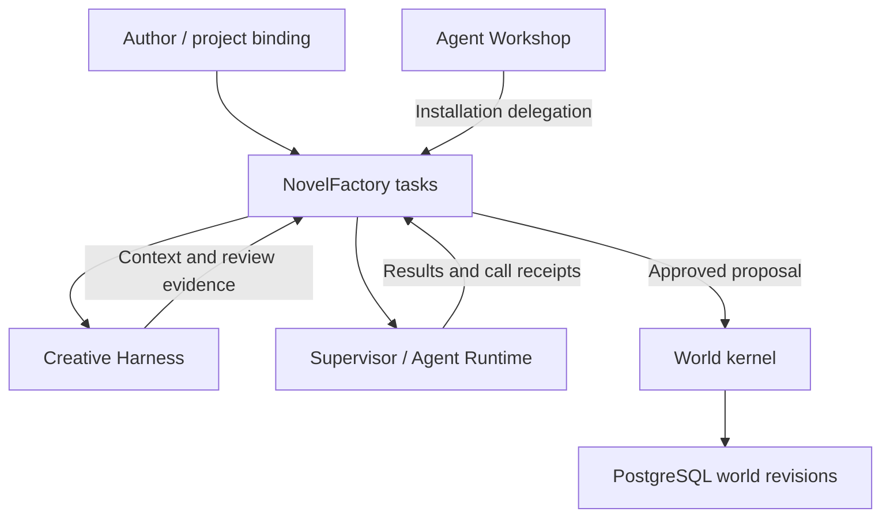

# NovelFactory

[中文](README.md) · English

NovelFactory coordinates agents that plan, write and review a novel against a versioned story world. An author can send characters into the same scene with different knowledge, have an editor review the resulting draft, and resume from the last recorded decision after an interruption.

Suppose a courier receives a letter in volume one and the protagonist reads it in volume two. The system can track the delivery, the moment the protagonist learns the contents, and a proposed future reveal separately. Writers, planners and reviewers each receive the material their task permits.

## Find your starting point

| Goal | Guide |
| --- | --- |
| Run a short volume locally and inspect the result | [Quick start](docs/en/02-quick-start.md) |
| Understand character knowledge, world history and continuity | [Project overview](docs/en/01-project-overview.md) · [Architecture](docs/en/03-system-architecture.md) |
| Configure employees, skills, model routes and budgets | [Agent platform](docs/en/04-agent-platform.md) · [Agent Runtime](docs/en/05-agent-runtime.md) |
| Follow a plan through drafting and editorial review | [Production pipeline](docs/en/06-production-pipeline.md) |
| Integrate a client or model host | [MCP, HTTP and operator interfaces](docs/en/07-api-reference.md) |
| Deploy the services or rehearse recovery | [Configuration and deployment](docs/en/08-configuration-and-deployment.md) · [Operations and recovery](docs/en/09-operations-and-recovery.md) |
| Size a workload and interpret benchmark results | [Performance and evaluation](docs/en/10-performance-and-evaluation.md) |

## How a book moves forward

Agent Workshop manages organizations, employees, grants and skills. NovelFactory binds each assignment to a work, branch, role and world revision. The supervisor selects an operator-configured model route. Creative Harness assembles context, plans, simulations and review evidence. The kernel checks dependencies and approvals before advancing the canonical head. Books can share model slots while keeping their task histories and ledgers separate.

Length estimates are advisory. Word-count differences do not cause rejection, rewriting or extra chapters. Story completion depends on coherent plot and character logic, the approved plan and ending, followed by independent editorial review.



## Run a six-scene volume

The manager is a program that sleeps when idle and wakes workers from durable task changes. Codex handles planning, complex decisions and independent reviews through actual scoped MCP reads; DeepSeek Flash handles prose and roleplay. Missing evidence, unevaluated story time and genuine author decisions have distinct recovery paths. Later coverage revisions preserve original manuscripts and model receipts, with explicit server revalidation before chapter and book acceptance.

The offline `python scripts/nf.py dry-run --books 2 --chapters 8 --seed 42` command uses the real Harness boundary with simulated responses and no database or provider connection. It checks the path through independent reviews and final book freezing. A simulated completion does not establish the literary quality or completion of a live novel. [Lifecycle and dry-run guide](docs/zh-CN/11-Dry-Run与程序生命周期.md)

Start in a Linux checkout with Python 3.12, uv and the PostgreSQL 17 server tools installed. Set `PG_BIN` to the directory containing `initdb`. This command creates a temporary database and writes a short volume using a deterministic model fixture.

```bash
uv sync --locked --group dev --python 3.12
export PG_BIN=/usr/lib/postgresql/17/bin
out=$(mktemp -d)
uv run --no-sync python scripts/with_postgres.py --migrate -- \
  .venv/bin/python scripts/run_short_volume.py --execution-kind TEST_FIXTURE \
  --object-root "$out/objects" --output "$out/volume"
```

The verified run produced six scenes and 2,204 Unicode code points in 15 fixture calls, with zero live inference requests. The accepted world event count was seven both before and after writing. To use a live model, the operator configures a provider, grants execution authority and sets a budget. [Setup and expected output](docs/en/02-quick-start.md)

## Engineering status

| Area | Observed result |
| --- | --- |
| Correctness and recovery | Current unit/contract checks passed 860 cases and 17 subtests, with two platform skips. PostgreSQL shards and focused recovery runs are recorded separately; historical two-service, Redis and WAL/PITR evidence is retained. [Story completion and advisory length](reports/story-completion-advisory-20261114.md) |
| Capacity | Two ten-minute read runs with 500 logical agents completed 12,000 requests each. The 200-agent overload and 1000-agent open-arrival gates remain unmet. |
| Editorial and billing evidence | The volume and provider fault scenarios used synthetic inputs. Human manuscript ratings and commercial invoices require separate evidence. |
| Live readiness | Actual scoped MCP reads and automatic rereads now work. Writer identity formatting and independent-review record collisions received separate fixes. A/B production acceptance remains in progress; neither novel is complete. [Latest production observation](reports/runtime-review-format-20261114.md) · [Live tool evidence](reports/runtime-native-tools-20261114.md) |

The services use Python, SQLAlchemy, PostgreSQL 17, optional Redis Streams, MCP over stdio, and a separate HTTP API. The contributing guide covers repository conventions. Historical designs and acceptance records remain available at their original paths. [Contributing](AGENTS.md) · [Engineering history](reports/p6_readiness/README.md) · [Capacity issue #13](https://github.com/SKYdayDUCK/NovelFactory/issues/13) · [GitHub Actions](https://github.com/SKYdayDUCK/NovelFactory/actions)

## License

GNU Affero General Public License v3.0. [LICENSE](LICENSE)
