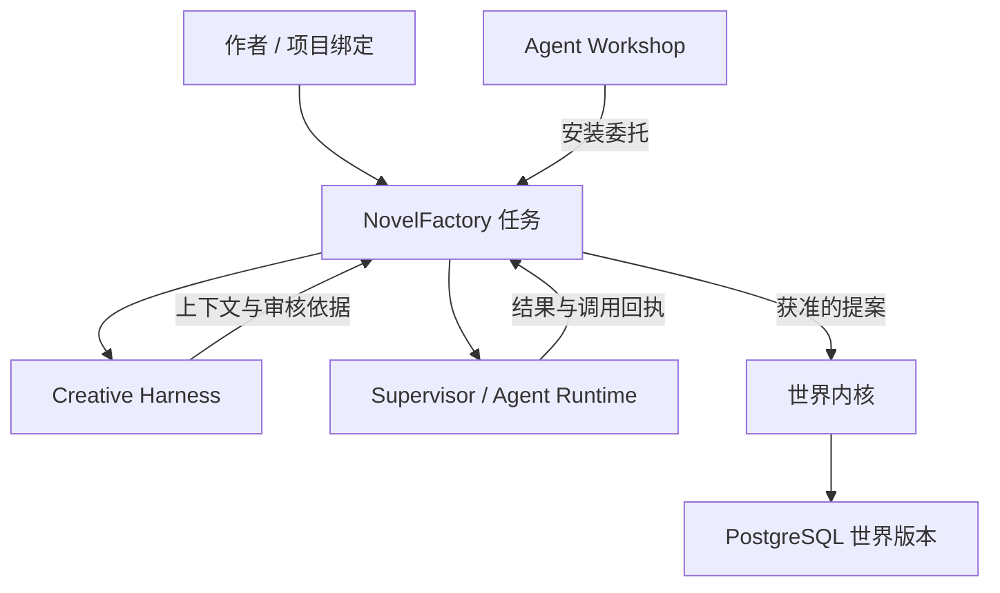

# NovelFactory

中文 · [English](README.en.md)

NovelFactory 是一个多智能体小说生产系统。作者可以让角色按当时知道的事情行动，让编辑在同一版草稿上审读，再把获准的事件写入小说世界。作品暂停后，作者可以从保存的任务和审核回执继续写作。

例如，信使在第一卷收到密信，主角到第二卷才读到它。系统分别记录信件发生了什么、主角什么时候获知内容，以及提纲预计何时揭晓真相。写作、推演和审核可以并行，各自使用获准的信息。

## 从哪里开始

| 我想做的事 | 入口 |
| --- | --- |
| 在本机跑通一卷，查看输出与世界事件 | [快速开始](docs/zh-CN/02-快速开始.md) |
| 了解人物认知、正式世界与跨卷继承 | [项目介绍](docs/zh-CN/01-项目介绍.md) · [系统架构](docs/zh-CN/03-系统架构.md) |
| 设置员工、Skills、模型和作品预算 | [Agent 系统](docs/zh-CN/04-Agent系统.md) · [Agent Runtime](docs/zh-CN/05-Agent-Runtime.md) |
| 从提纲走到分章写作和文学审核 | [小说生产流水线](docs/zh-CN/06-小说生产流水线.md) |
| 从软件或模型宿主调用项目 | [MCP、HTTP 与管理接口](docs/zh-CN/07-接口参考.md) |
| 部署两个服务，演练中断与恢复 | [配置与部署](docs/zh-CN/08-配置与部署.md) · [运维与恢复](docs/zh-CN/09-运维与恢复.md) |
| 判断负载是否适合自己的机器 | [性能与实验](docs/zh-CN/10-性能与实验.md) |
| 不连接数据库和模型，测试到整书最终冻结 | [Dry Run 与程序生命周期](docs/zh-CN/11-Dry-Run与程序生命周期.md) |

## 一部小说如何推进

Agent Workshop 维护组织、员工、授权和 Skills。NovelFactory 把一次写作任务绑定到作品、分支、角色和世界版本。Supervisor 按服务端路由选择模型，Creative Harness 组织上下文、候选计划、推演和审读。世界内核核对依赖和批准后推进正式 HEAD。多个作品可共享模型执行资源，各自保留任务和账本。



## 运行六场短卷

在 Linux 源码目录中准备 Python 3.12、uv 和 PostgreSQL 17 服务端工具。将 `PG_BIN` 指向包含 `initdb` 的目录。下面的运行创建临时数据库，使用确定性模型夹具。样例输出记录场次数、模型调用和写作前后的世界事件数。

```bash
uv sync --locked --group dev --python 3.12
export PG_BIN=/usr/lib/postgresql/17/bin
out=$(mktemp -d)
uv run --no-sync python scripts/with_postgres.py --migrate -- \
  .venv/bin/python scripts/run_short_volume.py --execution-kind TEST_FIXTURE \
  --object-root "$out/objects" --output "$out/volume"
```

本轮实跑得到 6 场、2,204 个 Unicode 码点、15 次夹具调用和 0 次真实推理。写作前后均有 7 个已接受世界事件。接入真实模型时，由操作人员单独配置 Provider、授予调用权限并设置预算。[安装步骤与输出说明](docs/zh-CN/02-快速开始.md)

## 工程状态

| 范围 | 已取得的结果 |
| --- | --- |
| 核心行为与恢复 | PostgreSQL 17 上的完整候选回归通过 1,008 项，另有 17 项子测试。验证覆盖双服务、历史升级、Redis Streams 和 WAL/PITR。 |
| 容量 | 两轮 500 Agent、每轮 10 分钟的读测试各完成 12,000 次请求。200 Agent 过载及 1000 Agent 开放到达仍未达到原门槛。 |
| 文学与费用 | 短卷和供应商故障测试使用合成输入。真人全文评分与商业模型账单需要单独取证。 |
| 离线整书流程 | 50 组三书各五章达到整书最终冻结；27 类、1,350 个模拟场景检查通过。[验收记录](reports/dry_run/README.md) |
| 本机真实生成 | A、B 使用 Codex 审核与 Flash 写作，已完成修复后的十分钟观察，Worker 继续运行。[运行报告](reports/runtime-monitor-20261114.md) |

项目使用 Python、SQLAlchemy、PostgreSQL 17、可选的 Redis Streams、MCP stdio 和 HTTP。可先运行 `python scripts/nf.py dry-run --books 3 --chapters 5 --seed 42`，经过真实 Harness 边界模拟规划、写作、随机审核、返工、双路全文审核及整书最终冻结，数据库和上游模型调用均为 0。默认命令必须达到全部小说最终冻结才返回成功。[Dry Run 与生命周期](docs/zh-CN/11-Dry-Run与程序生命周期.md)

管理器是程序，空闲时休眠并回收 Worker，按持久任务变化唤醒。真实模型分工为 Codex 承担复杂工作、规划和审核，DeepSeek Flash 承担写作、角色扮演和简单摘要。密钥使用本机凭据库；稳定上下文前缀提高缓存复用条件，按真实回执统计命中率。`temp/` 和 `.runtime/` 均不提交 Git。

参与开发前请阅读仓库约定。设计沿革与历史验收保留在原路径。[开发约定](AGENTS.md) · [历史验收](reports/p6_readiness/README.md) · [容量问题 #13](https://github.com/SKYdayDUCK/NovelFactory/issues/13) · [GitHub Actions](https://github.com/SKYdayDUCK/NovelFactory/actions)

## 许可证

GNU Affero General Public License v3.0。[LICENSE](LICENSE)
