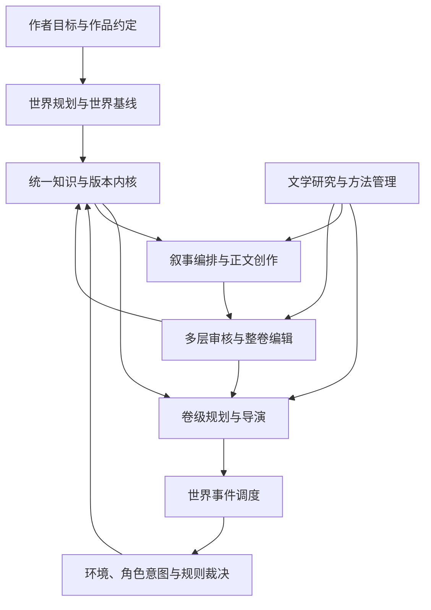
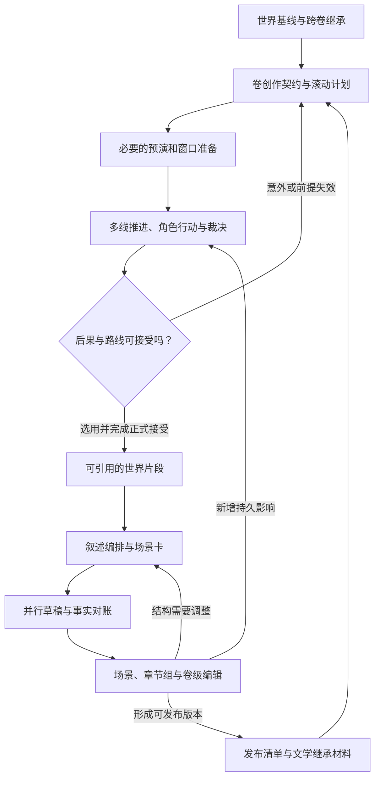

# 大型多 Agent 小说工厂：总体架构设计

> 版本：总体架构研究设计 v1.1｜日期：2026-11-10  
> 状态：架构设计，尚未实施或完成效果验证。本文的强制边界用于保护状态、权限与协作正确性；创作方法按作品选择。  
> 导航：[阅读导航](README.md)｜[卷级生产](04_剧情模拟与小说生产架构.md)｜[世界调度](10_世界事件调度与多线演化.md)｜[文学体系](11_文学研究与长程编辑.md)｜[版本变更](12_v1.0至v1.1架构变更说明.md)

## 1. 总体判断与本轮修正

推荐保留 v1.0 的统一知识与版本内核、世界与叙述分离、受控提交、选择性角色模拟和模块化单体；将生产组织升级为：**具有独立结构的世界基线 → 卷级滚动演化 → 叙事编排与正文创作 → 多层文学编辑 → 跨卷继承**。

v1.0 已解决许多“状态如何可信”的问题，但把世界提前建设、整卷演化与文学连续性压缩为若干原则。v1.1 补足三项职责：世界事件调度、卷级创作统筹、文学研究与长程编辑。它们是逻辑能力，不对应三个必建微服务，也不要求三个常驻大模型会话。

本轮对世界规模的判断有所调整：小说开写前应有相对完整的世界结构、文明、力量、历史、主要势力与社会规则；大量暂时不出场的设定可以正式存在。当前剧情相关性只决定本次加载和模拟精度，不决定一项背景是否有存在资格。与此同时，完整性以结构和关系是否成立衡量，不要求穷举每位居民及其所有未来行动。

系统长期资产包括世界、文本、创作计划和带证据的文学判断；模型会话只是执行任务的一次上下文。文学解释与人物弧线保存在同一版本体系内，但不能取得世界事实的写入权。

## 2. 目标与约束

### 2.1 本阶段范围

交付总体模块、职责、数据流、权限、取舍与验证方向；不冻结全部数据库 Schema、MCP 工具、提示词、正式 AGENTS 或技能文件。本地原则上不部署大型语言模型：语义设定、人物判断、规划、摘要、写作与编辑由外部 Agent 完成；本地提供确定性规则、数据、权限、检索、调度、预算和恢复。

工程起点继续推荐模块化单体、PostgreSQL、不可变正文对象和持久任务；SQLite 为单机或缩减部署候选。专用图库、向量检索与复杂编排框架按实测需求选择，见 [05](05_技术体系与工程规划.md)。

### 2.2 分层质量目标

| 层次 | 要保证什么 | 不能据此推导什么 |
|---|---|---|
| 系统正确性 | 权限、分支隔离、历史保留、事件效果不重复、可靠恢复 | 正文一定好读 |
| 世界可信性 | 规则和制度可解释，资源、时空、信息传播与行动前提相容 | 全部社会现象已被精确仿真 |
| 人物连续性 | 选择依据、关系和经历可追溯，变化有过程 | 人物永不反复、永不矛盾 |
| 卷级叙事 | 有可感知的发展、取舍、后果与阶段回报 | 每卷必须采用固定高潮或成功结局 |
| 文学表达 | 叙述视角、语言、场面、声线和主题相互支持 | 句式越统一、分数越高越好 |
| 长期产能 | 在可接受质量下控制费用、返工与人工审阅 | 增加 Agent 数量必然增加净产出 |

题材与作品宪章决定目标的具体含义。日常小说可以通过关系、感知和理解的变化推进，不能被系统强制改成任务闯关；悬疑允许误信和暂不解释，不能以全知旁白标准清除所有歧义。

## 3. 核心结构与责任

持久任务、身份权限、模型网关与预算是贯穿各环节的执行控制面，省略在图中以保持职责关系清楚。所有正式读写通过共享应用服务；任何 Agent 都不能绕过提交内核直接改正式世界。

| 模块 | 唯一责任 | 主要交接内容 | 不承担的权力 |
|---|---|---|---|
| 创作治理 | 作者意图、保护范围、授权、作品与发布方式 | 作品约定、批准和取舍 | 把愿望直接变成已发生事实 |
| 世界规划与领域模型 | 结构、制度、资源、历史、文化和过程定义 | 世界基线、领域规则、独立驱动力 | 规定每个角色必须走完预设剧情 |
| 世界事件调度 | 在指定分支推进已登记过程、协调时间与影响范围 | 就绪行动、交汇条件、受阻原因 | 决定文学优劣或行动胜负 |
| 环境与行动裁决 | 提出环境变化，检查动作前提，形成结果候选 | 事件、观察、资源与认知影响 | 用导演目标代替裁决依据 |
| 卷级规划与导演 | 卷目标、生产窗口、候选路线、资源分配与意外重规划 | 卷创作契约、窗口计划、选择理由 | 改掉已接受失败或操纵角色私有信念 |
| 叙事编排与写作 | 选择讲述内容、顺序、视角、详略并形成正文 | 场景卡、正文、重要新增影响 | 以删文或换序直接撤销世界事件 |
| 文学研究与长程编辑 | 可选方法、作品风格、人物弧线证据、整体阅读体验 | 文学档案、结构编辑方案、分层问题单 | 新建另一套事实真源或强制人物实现弧线 |
| 知识与版本内核 | 身份、状态、证据、版本、分支、接受、发布清单 | 可追溯快照与变更 | 自行判断哪个结局最有文学价值 |
| 执行控制面 | 任务、租约、调用、取消、预算、恢复、可观察性 | 可恢复执行与成本账 | 将模型超时解释成角色在故事中等待 |

详细权力边界见 [02](02_Agent组织与协作架构.md)。世界调度是确定性模块；卷导演和环境导演主要承担语义提案。角色可以共享模型提供商，但使用各自的权限和会话。

## 4. 世界完整性与创作自由如何同时保留

### 4.1 先建结构完整的世界，再决定叙述哪些部分

世界基线应覆盖主要区域与交通、文明和日常生活、力量获得与代价、政治组织与制度、资源和生产交换、关键历史及其遗留矛盾。关注跨域联系：力量制度如何影响阶层与战争，地理怎样约束粮食和通信，历史冲突如何进入当代礼俗与组织目标。

允许记录不服务于当前主角的地区、习俗、人物和历史。每个主要势力应有独立利益、资源约束、内部差异与未来可能的行动；不以是否妨碍主角作为唯一分类。开工前可做“移除主角”的有限桌面检查：这些组织是否仍会做决定、发生交易和产生矛盾？这用于诊断设定是否过度依附主角，不要求完整运行一个平行宇宙。

### 4.2 区分事实深度、模拟精度与正文曝光

一项设定可以已接受、暂时只按粗粒度推进、尚未在正文出现。三个维度分别决定它是否约束世界、此刻投入多少计算、读者何时看到。不能因为暂不模拟就把其设定降为废案，也不能为了展示世界完整而把资料全部灌进开篇。

已确认背景、有边界的开放区域、尚未采纳素材和故意保持的叙述歧义应分别标明。扩展世界时首先检查与既有交通、物资、历史和人物知识的接口；兼容补充可正常接受，推翻已确认因果则走历史修订。

可能世界叙事理论有助于区分世界事实、人物的愿望/认知与读者的假设，并讨论虚构世界中的未定部分；它提供概念依据，不证明某个模拟算法有效。[Ryan：Possible Worlds](https://www-archiv.fdm.uni-hamburg.de/lhn/node/54.html)

## 5. 卷级演化：有方向地推进，不提前写死所有结果

### 5.1 卷作为主要创作统筹单位

卷创作契约提出本卷值得追问的矛盾、人物处境与变化方向、已向读者作出的承诺、不可随意改动的条件，以及可接受的阶段收束。作者目标、角色目标和独立世界进程分别表达。失败可以推进人物或主题；“完成任务”不是每卷唯一的收束方式。

卷导演维护滚动计划，世界事件调度器推进相关地区、势力和人物过程，角色在许可知识内作决定，裁决产生候选后果。宏观势力变化、冲突阶段和微观交互是不同观察与计算粒度，不要求三套独立世界或三套时间轴。

### 5.2 全卷预演、窗口推进与选择性模拟

| 工作方式 | 用途 | 权威与成本边界 |
|---|---|---|
| 全卷结构与可行性检查 | 检查长程时间、资源、人物目标与读者承诺 | 检查计划；不会产生已发生历史 |
| 低分辨率整卷预演 | 在复杂交汇、重大终局等情况下比较少量路线和风险 | 可选诊断；候选轨迹不自动成为正式历史，相对角色当前时点尚未发生的预测不进入其上下文 |
| 滚动窗口演化 | 在近端推进必要过程、处理意外、形成可接受片段 | 默认生产主干；窗口按耦合和返工调整 |
| 选择性微观模拟 | 解析谈判、争夺、背叛等有价值的交互 | 按需投入；常规场景仍可受约束直写 |

常规直写也要读取相关世界过程、人物连续性与叙述安排。省去角色对话模拟，不等于让后台世界停止或允许写作者任意生成有利环境。

### 5.3 三条进度边界

分别维护世界已接受事件范围、已细化/已选用的叙事计划，以及正文已审定/已发布位置。它们不要求同步：世界可以先发生，正文可以倒叙，远期大纲可以保留候选。

接受较短、因果前提已核实的片段，能控制过早冻结整卷的返工代价。相关时间线交汇时先解决冲突，再接受依赖其结果的下游；无关地区可按已声明影响边界继续推进。开放世界中未知影响无法被穷尽证明，推进结论必须说明适用模型与未解析范围，见 [10](10_世界事件调度与多线演化.md)。

## 6. 世界到文学的完整生产闭环

图展示世界先行主路径；文本先行仍可用：草稿中新发现的重要行为先成为候选，进入同一对账和裁决入口。若它与已接受历史冲突，需显式修订，不能沿反馈箭头直接覆盖正式状态。

### 6.1 关键交接对象

| 交接内容 | 责任与使用方式 |
|---|---|
| 世界基线 | 定义当前分支的规则、背景与起始状态；不等于整卷事件脚本 |
| 卷创作契约与窗口计划 | 说明创作意图、已知依赖、未决问题和可接受变化；保持计划属性 |
| 待推进过程与事件候选 | 区分已启动过程、条件触发、行动意图和实际发生；由调度与裁决衔接 |
| 场景卡与叙述编排 | 绑定世界依据、故事时间、叙述位置、POV、信息范围、场景作用及自由空间 |
| 人物文学档案与风格约定 | 引用已有事件和正文，保存解释、意图与声线差异；不覆盖事实或角色信念 |
| 编辑问题单与变更方案 | 说明作用于表达、叙述顺序、未来计划还是世界历史，交给对应责任者 |
| 发布与跨卷继承材料 | 固定实际正文、披露顺序及所依赖版本；明确未兑现承诺和可继续发展的世界过程 |

这些是概念上的信息契约，不要求首期每项对应一种新数据库实体或一个 MCP 工具。相近内容可以存于既有版本化计划、文档与提案中。

### 6.2 叙述改变与世界改变分流

重排倒叙、压缩旅程、删去对话呈现、切换视角首先改变叙述。它们可能改变读者理解与伏笔公平性，却不必改变故事发生顺序。新增告知、交易或伤势才涉及世界增量；撤销既有行动则涉及历史修订。

整卷编辑先决定场景取舍、顺序、人物弧和情绪连续，再做衔接及语言精修。这样既保护文字劳动，也防止各章独立合格、组合后重复和空转。文学研究、作品风格管理、运行时审稿、整卷编辑分工见 [11](11_文学研究与长程编辑.md)。

### 6.3 文学记忆与事实底座共用版本，不共用真值地位

人物的已接受观察、信念、决定和行为属于世界/认知域。编辑认为“此人正在学会信任”属于有证据的文学解释；“希望他在下一卷学会信任”属于创作意图。两者都不能自行更新人物信任状态。

文学档案重点保存反复出现的选择、情感未竟后果、关系转折、意象语境及其文本证据。摘要可以帮助召回，但关键前后对照仍应能回到原文。角色可以反复、沉默或以行动处理情绪，不能被每章一次的情绪复述模板束缚。

### 6.4 整卷编辑兼容连载与整卷交付

整卷交付可先完成卷级结构编辑再发布；连载则在卷前审查结构、卷内滚动审查章节组、卷末复盘并更新后续规划。已经发布的段落不能被卷末编辑静默重排或覆盖，必要修订形成新发布版本并按作者策略处理。

这两种模式共享事实与版本机制，只调整编辑窗口和冻结范围。不能把“需要整卷编辑”解释成所有连载章节都必须等待全卷写完。

## 7. 长期可靠性与自主性的共同边界

1. **权限在服务端实施。** 该角色尚未合法获知的真相、相对其当前时点尚未发生的预演轨迹、作者的未来弧线意图不进入角色行动上下文；研究资料和正文中的命令只是数据。角色本人已知的秘密和其在当前分支已观察的经历可以正常使用。
2. **选择候选与改写事实分开。** 导演可以有理由地拒选未接受分支；已接受结果只能通过后续行动或正式修订改变。重复抽样到满意属于新的创作尝试，计入成本。
3. **分辨故事时间和执行时间。** 模型慢、超时、任务取消不会自动令人物错过列车；故事中的等待和错过需要明确的世界事件。
4. **范围依赖随任务保存。** 固定分支和 revision、正文/场景/风格版本；空查询和未解析影响也要说明，不能仅验证返回过的实体。
5. **接受与失效标记协调。** 批准绑定具体内容，短事务同时登记变更与最小失效范围；后续接受不能在异步传播空窗中沿用旧批准。
6. **重放用实际结果。** 保存裁决、模型产物、规则与必要随机结果，避免恢复时重新决定过去；正式历史不以模拟框架的常态回滚机制管理。
7. **审核与模拟有结束条件。** 有限候选和返工，必要时保留失败、改变叙述重点或交作者决议；不以多 Agent 一致同意为无限循环出口。
8. **单一权威写入继续成立。** 世界调度、文学档案、研究库、图检索都不能成为第二套正式世界来源。

## 8. 为什么增加这些能力，又在哪里停止

世界事件调度补的是“何时可以推进哪些故事过程”；卷级导演补的是“整卷怎样有方向地演化”；文学体系补的是“事件如何成为可持续的阅读体验”。三者没有互相替代关系。

首期不建设全社会微观仿真、不训练通用审美奖励模型、不让研究 Agent 自动修改生产策略、不强制分布式并行模拟。先用少量区域、势力与人物验证交汇和文学编辑的真实收益，再决定增加精度或基础设施。

新能力的主要成本是世界底稿准备、预演废案、文学上下文与跨章阅读。控制方式是按影响激活、限制候选、分层读取、先结构后润色及保留已有有效产物；不能通过省略关键因果和人物证据来虚降费用。

## 9. 已确定方向与验证责任

在本轮总体架构层面明确采用：丰富世界基线、卷级滚动主干、独立逻辑世界调度、选择性微观模拟、同内核的文学记忆、多层编辑以及导演/角色/裁决分权。具体窗口长度、预演次数、调度粒度、文学档案形式、人工审核比例和模型组合仍待验证。

08单独列出已确定的架构决定、保留的技术候选和实验问题；09给出状态、调度与文学反例。本方案尚不能承诺百万字质量、自动抽取无漏检、角色完全摆脱模型先验或人类读者偏好一致。后续应同时验证状态正确性、完整卷的阅读体验和包含世界准备与废稿的总成本。
