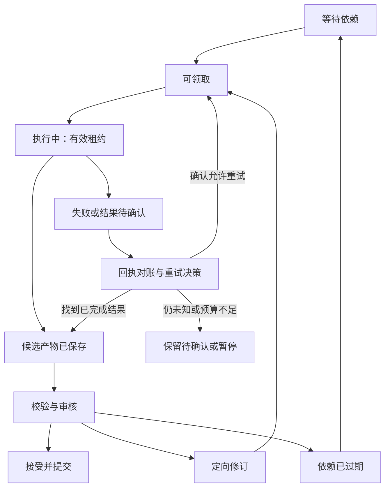

# 02｜Agent 组织与协作架构

> 版本：总体架构研究设计 v1.1｜2026-11-10  
> 状态：尚未通过端到端实验。角色族用于划分责任，可由同一模型或人员按任务承担；世界事件调度是程序模块。  
> 关联：[总体设计](01_总体架构设计.md)｜[卷级生产](04_剧情模拟与小说生产架构.md)｜[世界调度](10_世界事件调度与多线演化.md)｜[文学编辑](11_文学研究与长程编辑.md)

## 1. 组织原则：管理程序掌握流程，Agent 承担判断

小说工厂需要持续保存世界和生产状态，不能把一段总编聊天记录当作整个系统。推荐明确以下职责：

| 部分 | 核心责任 | 权限边界 |
|---|---|---|
| 确定性执行控制面 | 模型任务、租约、依赖、预算、取消、重试、审核门禁 | 按现实运行时间管理任务，不将超时解释为故事发展 |
| 世界事件调度模块 | 按故事时间与影响范围组织过程推进和交汇 | 请求裁决及提交，不能决定人物意图、胜负或文学质量 |
| 小说运行时Agent | 世界设定建议、规划、角色行动、语义裁决、写作、审核 | 读取被授权的上下文、提交候选产物；不能直接改权威表 |
| 开发Agent | 研发工具、规则、数据库迁移、工作流、评测 | 默认在开发分支和测试数据中工作；生产变更走工程发布程序 |

总编Agent负责文学取舍和跨环节协调，是一个可替换的语义角色。它不保管数据库管理员凭据，不兼任所有审稿器，也不因“总编”称号获得绕过世界不变量的权限。正式写入由提交服务执行；服务可以在既定授权范围内自动接受普通章节，无须每处措辞都请求人类确认。

这与长期工作流的恢复要求一致：保存流程状态和保存领域事实是不同职责。LangGraph官方将线程检查点与跨线程数据存储区分；本系统进一步独立保留世界版本和发布记录，避免依赖某个框架内部状态作为小说事实源。[E07]

## 2. 四个容易混淆的“Agent”概念

**角色类型**描述职责，例如写手、角色扮演者或审稿员；**角色实例**绑定一本小说中的具体人物或任务；**模型会话**是一次隔离的推理上下文；**工作者进程**执行外部调用和工具请求。它们并非一一对应。

一名角色可以持续存在于知识库而长期没有活跃会话；一个工作者可以依次执行许多角色实例；同一模型可以承担不同职责，但每种职责必须重新构建上下文和权限。用同一模型分别写作和审稿，只能称作角色分离，不能宣称获得了统计独立的评价。

### 2.1 推荐角色族

| 角色族 | 产物与责任 | 不负责 |
|---|---|---|
| 总编 | 全书创作约定、跨卷取舍、重要冲突决议、授权内批准建议 | 数据库事务、随意恢复预设结果 |
| 世界主设与领域顾问 | 世界基线、文明制度、资源历史、独立过程及扩展提案 | 将所有背景写成主角专用道具 |
| 卷导演与规划者 | 卷创作契约、滚动窗口、预演比较、意外重规划、叙事注意分配 | 直接改变人物信念、裁决或正式历史 |
| 环境导演 | 地区条件、非人格化过程、合法环境变化与观察建议 | 充当隐形全能反派，反复施压直到角色服从 |
| 角色/势力行动者 | 根据私有认知、价值、资源和组织决策条件提出意图 | 全知检索、自行宣布成功；抹掉组织内部差异 |
| 语义裁决者 | 对本地规则未完全定义的后果提出有依据的裁决 | 为符合大纲而改变确定规则；代替角色选目标 |
| 写作与修订者 | 场景叙述、对白、语言和正文中新发现的创作提案 | 悄悄改变重大事件和信息边界 |
| 证据整理者 | 断言、事件对齐、原文证据与文学档案的候选更新 | 自动将抽取、心理标签或编辑解释升级为事实 |
| 文学研究者 | 阅读理论、创作经验及样章，提出有边界的方法和实验 | 给每章自动追加规则；直接修改风格或人物 |
| 专项审核者 | 事实、人物、披露、局部表达等有证据的问题单 | 以单一分数裁定整卷质量 |
| 卷编辑 | 整体诊断、场景取舍/重排、人物与情感连续、接缝及修订整合 | 以删文代替撤销世界事件，或统一抹平多声部 |

总编、卷导演、卷编辑可以由同一主体按阶段承担，但要明确本次是在制定未来、判断已写文本，还是批准变更。世界顾问和文学研究按准备、具体问题及版本回顾触发，无需常驻轮询。普通写作与修订可以复用工作池，高影响变更仍须独立证据复核。

### 2.2 人类作者的介入位置

作者预先确定创作方向、受保护设定、发布渠道、预算和允许自动处理的变更类别。普通描述、对话、已经授权的冲突结果和常规章节接受可以自动完成。

受保护设定变更、重大历史修订、超出当前授权的外部发布、预算例外或价值取舍无法解决时，系统提交具体方案供作者决策。角色死亡是否需人工介入取决于作品政策和既有授权，不能一概规定“所有死亡必须审批”。

人类也应能直接编辑正文。编辑后的文本作为新版本重新走受影响的对账和审核，不覆盖旧稿，也不要求作者模拟Agent的内部对话。

## 3. 能力与信息权限矩阵

世界真相、作者计划、人物信念和读者已获知分别构建视图。权限控制在服务端执行；客户端传来的`epistemic_view`只是请求，不是授予自己全知权限的凭据。

| 主体 | 默认可读范围 | 可提交产物 | 可直接改变权威状态 |
|---|---|---|---|
| 角色行动者 | 该人物在指定故事时间的感知、记忆与信念 | 行动意图、话语、认知候选 | 否 |
| 卷导演 | 授权世界、卷目标、候选预演、文学连续性与预算 | 推进窗口、候选选择、重规划与叙述安排 | 否 |
| 环境导演 | 指定地区/过程的真实状态和适用规则 | 环境变化、观察与传播候选 | 否 |
| 世界事件调度器 | 推进所需状态、已登记过程、因果和影响边界 | 就绪任务、交汇/受阻说明、提交请求 | 仅由受控提交服务正式生效 |
| 写作者 | 场景合同、允许披露内容、必要文风与衔接上下文 | 正文、新细节或变化提案 | 否 |
| 证据整理者 | 待审文本及授权核对范围 | 带文本位置的断言和对齐候选 | 否 |
| 事实审核者 | 指定版本的相关世界状态、事件和证据 | 有证据的问题及处置建议 | 否 |
| 文学审核者/卷编辑 | 正文、创作约定、人物文学档案及必要的事实证据 | 分层问题单、结构编辑与有范围的修订 | 否 |
| 文学研究者 | 获准研究资料与指定样本，默认不需要全书秘密 | 方法提案、适用边界、样章对照 | 否 |
| 总编 | 作者授权的全局视图 | 选稿、变更和争议决议 | 只能请求提交服务执行 |
| 提交服务 | 完成校验所需的权威数据 | 新版本、审批记录、发布清单 | 是，受身份与策略约束 |
| 开发Agent | 代码、文档、脱敏测试数据 | 工程变更 | 默认无小说生产写权限 |

写作者是否需要知道被隐藏的真相，按任务决定：普通场景只给可表达信息；必须准确布置双关或伏笔时，可由获授权的作者视图提供必要解释，同时规定读者披露界限。不给所有写手灌入完整未来卷纲，是减少剧透和过度迎合结局的直接办法。

角色会话和缓存必须隔离。不能让一个已经阅读作者全知视图的会话仅靠“现在扮演主角”就承担信息受限角色；不同角色、不同分支及不同权限的检索缓存也不能混用。服务端过滤能控制系统送入的信息，不能保证模型完全没有预训练知识、类型套路或正确猜测，因此还需要行为层的信息来源审核。

### 3.1 五种决定分开负责

| 决定 | 主要责任者 | 对其他环节的约束 |
|---|---|---|
| 世界里存在什么规则与背景 | 作者授权下的世界主设与提交服务 | 新增设定检查历史接口，不能临场覆盖既有规则 |
| 哪些过程何时可以推进 | 世界事件调度器 | 依据时间和影响范围；队列先后不决定争夺胜者 |
| 人物想做什么 | 角色行动者 | 依据当时所知和自身理由；角色可以拒绝导演建议 |
| 行动实际造成什么 | 本地规则与独立语义裁决 | 允许失败、部分成功和未知；不能为终局改判 |
| 哪些事件怎样被讲述 | 卷导演、写作者与卷编辑 | 改变取舍、顺序和表达；不自动改变发生事实 |

卷导演可以要求“下一窗口观察商队与守军如何交汇”，也可以提出成功目标或作者保护的承诺，但不能把它作为裁决成功的依据或强制角色选择。环境导演可以依据既定季节和条件提出暴雨，不能反复补造灾祸排除角色的其他选择。提出新机会或新设定并非一律禁止，但要按普通世界提案说明依据、代价和影响，并记录其导演来源。

### 3.2 候选选择与事后操控的边界

允许比较少量未接受分支，记录为什么选用或放弃；保留角色合理失败作为有效候选。不能从多个互斥分支各取有利片段拼成一个未经重验的历史，也不能把重新生成直到满意称作技术重试。

预演得到的远期事件、读者反应预测和人物弧线愿望只提供给授权规划/编辑任务。角色执行选择分支时重新从对应快照组装上下文，不能沿用已经读过其他分支未来的会话。真实已获知的信息则不能为了制造误会被任意清空。

已接受结果与保护终局冲突时，先调整尚未发生的路线；必要时向有权限的主体提出承诺或历史修订。一次重大角色行为不必都请求作者确认，是否升级由作品保护范围和既有授权决定。

## 4. 通信以任务和产物为中心

不采用所有Agent无限互相聊天的默认模式。控制面维护任务板与依赖关系；Agent读取上下文、产出候选，结构化事件通知真正受影响的消费者。少量讨论只用于具体争议，并有问题范围、参与者和结束条件。

### 4.1 共享消息所需的语义

本阶段只要求消息能回答以下问题：属于哪本小说和分支；基于哪个不可变版本；谁在何种权限下发出；对应哪个任务、尝试和因果链；产物在哪里；使用哪些故事时间与叙述位置；依赖哪些来源；是否允许重试和何时截止。

交接还要区分世界推进范围、卷/场景计划版本、叙述顺序、风格与文学档案版本，以及产物是事实、预测还是编辑解释。基础上下文由服务生成，Agent不能任意修改。无需把同一长篇正文重复塞进每条消息，传递不可变产物引用和哈希即可。

| 消息族 | 典型内容 | 消费者 |
|---|---|---|
| 提案 | 设定、行动、认知、剧情、正文新增事实、文学方法 | 对应领域审核与决策环节 |
| 结果 | 窗口裁决、候选正文、证据对齐、卷级编辑诊断 | 下游生产环节 |
| 状态通知 | 版本接受、依赖失效、索引就绪、预算不足 | 控制面及有依赖的任务 |
| 决策记录 | 接受、拒绝、延期、变更授权 | 提交服务与审计视图 |

一条“剑已交给主人”的自然语言消息不能直接驱动资产状态变更。它可能是角色发言、抽取结果或已裁决事件；消费者必须先根据产物类型与来源确定其含义。

### 4.2 任务生命周期

图中“接受并提交”只表示任务产物按其类型接受，并不一律等于公开发表。取消、预算停止和策略暂停可从未完成状态进入终止或阻塞状态；它们撤销后续提交资格，保留已生成产物用于恢复与人工查看。

同一任务只允许一个当前有效执行代际。有意对同一场景生成两份候选时，应建立不同候选任务，避免将正常竞争和重复领取混为一谈。工作者超时后租约移交，新代际推进；旧工作者迟到的结果可保存为废弃候选，但不能覆盖当前结果。

## 5. 并行规则：根据依赖，不根据章号

工作流调度器检查事实、认知、资源、伏笔、文风衔接等依赖；世界事件调度器另行处理故事中的时间与行动交汇。不同地点的独立支线通常更容易并行；相邻章节也可在批准的候选事件序列和入/出状态固定后并行转写，但随后仍需衔接审核。

每个写作任务绑定“世界版本、场景版本、叙述编排、人物文学档案、文风版本、权限范围及读取依赖”。读取依赖包括查询范围：“没有守卫”依赖整个相关场景，而不只是查询返回的空列表。最初可用场景或实体组版本戳保守判定过期，以正确性换取少量重复审核；后续再细化。

数据库事务的Serializable隔离只覆盖该事务读写，不能自动保护几分钟前已送入模型的上下文。因此，正式提交必须重新检查任务依赖；不能把长时间LLM调用放在数据库事务里等待。[E01]

并行窗口按返工和审核积压调整。若审核队列增长、上游计划不稳定或大量候选过期，先停止派发依赖未来的写作，继续处理无关支线、修订和审核。扩大Agent数的前提是交付吞吐提升，而非界面上同时亮起更多工作者。

并行写作前由卷编辑提供有限的衔接材料：叙述者/POV约定、近期真实正文、重要人物说话方式与本场情感承接。工作者可以保留各场景应有的语域差异；共享文风不等于用同一句式改写所有人。相邻章节不能只凭各自审核通过就直接拼接，须检查状态、披露、重复解释、情绪和语言接缝。

场景卡标为确定的结果必须说明是候选分支内已选定结果，还是正式已接受事件。推测写作可以提前进行，但依赖未定时不进入可发布清单。上游调整后先确认影响范围，再决定保留、局部修订或重写。

## 6. 审核独立性与冲突裁决

### 6.1 意见必须带证据和类别

| 问题类别 | 例子 | 处理方式 |
|---|---|---|
| 可重现的硬冲突 | 同一真品在同一时间被两个互斥主体实际持有 | 阻止相关候选接受，给出版本、规则和事件证据 |
| 语义疑点 | 人物似乎突然知道秘密，但可能由暗示推断 | 补充来源与上下文，交独立复核，不自动判死 |
| 文学分歧 | 节奏慢、内心描写多、结尾不够强 | 总编根据作品目标裁决，可保留异议 |
| 创作变更 | 新细节有价值，但改变了未来剧情 | 走变化影响分析与重规划 |

裁决顺序为：当前明确授权与受保护约束；可验证世界规则；角色认知与因果连续性；创作目标；局部风格偏好。前提是先确认所谓硬冲突没有混淆倒叙、谎言、传闻、所有权与持有权。

审稿者先独立读证据，再看写作者解释，减少先入为主。重要问题可采用不同模型或人工抽检降低共同偏差，但不能把模型多数票当真值。ConStory-Bench提供证据定位与分类思路，同时承认二元判错会误判有意的延迟揭示；因此它适合生成待核查意见。[P-C]

### 6.2 局部合格与整体可用分别判断

场景审核关心本场选择、视角与后果；章节审核关心阅读单元的组织；相邻章节审核关心承接与重复；整卷编辑关心取舍、结构、人物变化、情绪节奏和阶段回报；跨卷回顾关心承诺、积累与风格演化。一次地方检查不替代较高层判断。

卷编辑先诊断影响最大的问题，提出有限的修改方案；获准后由指定修订者整合。涉及表达或叙述顺序可在编辑权限内处理，改变未来路线转卷导演，改变世界历史转知识修订。章节已批准但无法适配新的卷结构时，只撤销相应“用于本次编排”的资格，不抹去旧稿和旧批准记录。

详细多层编辑与连载模式见[11](11_文学研究与长程编辑.md)。不存在每个层级都必须由一名新 Agent 重读全书一遍的要求；关键问题做深评，常规检查共享证据并合并执行。

### 6.3 返工有出口

先判断问题层级和影响范围；能局部修则局部修，已确认的结构性问题直接进入场景或卷级重编，再决定是否修改细纲、重规划或提出世界修订。修改伏笔句之前，应检查其承诺与揭示功能；不能为了去掉某类句式破坏跨卷铺垫。

同一问题反复出现时不无限增加审稿轮数。配置轮次与成本上限；触及上限时汇总剩余问题、各方证据、可选方案和影响范围，由总编或作者完成一次明确决策。硬约束未解决的候选不能靠多数票强行通过，作品可以保留在未发布状态。

## 7. 成本、自主性与停止机制

采用三级预算：全书或周期预算、卷/任务预算、单次调用上限。任务开始前预留预算，结束后按实际用量结算；价格变化按调用时的计价版本记录。重试、废弃候选和审核成本都计入，而不是只统计最后一稿。

重要角色按场景和目标变化唤醒；背景人物通过已声明的世界过程或粗粒度事件维护，只有进入叙事或影响关键资源时才升级为细粒度模拟。每个人物长期状态留在数据库，不能靠常驻会话保持存在感。

停止新任务、取消执行、撤销提交资格、暂停外部发布是四个不同动作。停止预算消耗时仍允许查阅、下载、备份、处理已完成结果；外部调用已发出后可能无法撤销，其回执必须对账。LangGraph官方也明确，丢失回执是未知结果，幂等键须事前持久化，不能把本地没有记录当成远端没有执行。[E08]

## 8. 起步配置与演进

建议第一阶段复用世界准备、卷统筹、角色/环境行动、写作修订、证据与编辑等任务池；文学研究在开书和具体问题出现时调用，世界事件调度由本地模块负责。任务入口可合并实现，不以角色族数量决定进程或模型数量。初始并发数按提供商限流和预算保守配置，再通过实际返工率调整。

扩展时增加角色模板、领域规则和审核策略，而不是复制世界数据库。开发Agent和小说Agent均通过版本化文档获得工作指导，但运行权限来自控制面；`AGENTS.md`、`SKILLS.md`与`SKILL.md`的组织由规范文档单独说明。

下一阶段同时验证四类结果：角色使用授权知识且保留合理选择；重复/迟到任务不破坏世界；跨线交汇和并行写作可停止、失效与恢复；人物变化与整卷阅读体验能获得独立证据。部署与恢复细节见[技术体系与工程规划](05_技术体系与工程规划.md)。

## 参考来源

- [E01] [PostgreSQL，§13.2 Transaction Isolation](https://www.postgresql.org/docs/current/transaction-iso.html)。用于数据库隔离能力与边界；长任务依赖机制为本项目设计。
- [E07] [LangGraph，Persistence](https://docs.langchain.com/oss/python/langgraph/persistence)。用于检查点/存储区别。
- [E08] [LangGraph，Fault tolerance](https://docs.langchain.com/oss/python/langgraph/fault-tolerance)。重点阅读Retry boundaries and idempotency。
- [P-C] Li et al., [*Lost in Stories: Consistency Bugs in Long Story Generation by LLMs*](https://aclanthology.org/2026.findings-acl.410/), Findings of ACL 2026。方法§2、局限§6、诊断评测附录A.2。

访问日期：2026-11-10。职责划分、权限矩阵、预算策略与生命周期是本项目架构建议，不是上述来源已验证的小说工厂实现。
