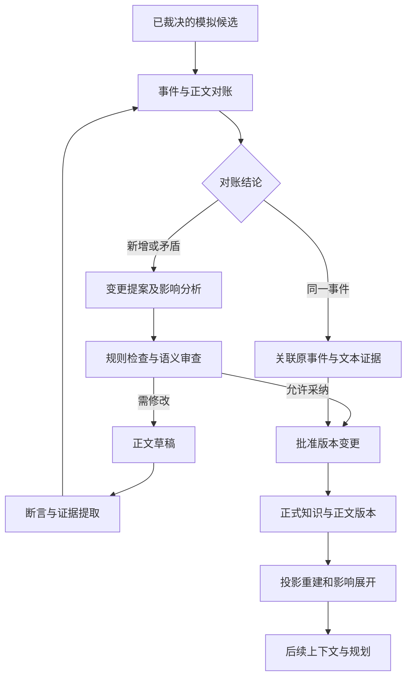

# 03｜知识与动态世界架构

> 版本：总体架构研究版 v1.1｜日期：2026-11-10  
> 定位：定义全系统共同使用的事实、时间、认知、事件和版本语义；不规定完整数据库 Schema 或 API。  
> 关联：[总体架构](01_总体架构设计.md) · [Agent 协作](02_Agent组织与协作架构.md) · [小说生产](04_剧情模拟与小说生产架构.md) · [工程规划](05_技术体系与工程规划.md) · [完整案例](09_压力测试与端到端案例.md) · [世界调度](10_世界事件调度与多线演化.md) · [文学编辑](11_文学研究与长程编辑.md)

## 1. 核心判断：维护可追溯的故事状态，而非一份不断加长的摘要

本系统需要回答的不只是“青霜剑与谁有关”，而是：**在哪条剧情分支、采用哪次编辑修订、处于哪个故事时刻、从谁的视角看，青霜剑是什么状态；这个回答由什么证据支持。**

推荐以关系数据库保存受控知识、事件及版本记录，正文使用不可变内容对象；图谱、状态投影、全文索引、向量索引和摘要服务于查询。它们可以重建，不能各自批准一套世界真相。这继承了输入方案 v1.0 §3、§7、§17 的有效设计。

“一个权威源”是**一个受控写入和版本裁决体系**，并不要求正文大文件、数据库、索引都放在一种存储介质里。核心要求是每个正式版本有一致的清单，能够确定它使用哪些正文、事实、规则和审核决议。

世界可以预先拥有大量暂未进入当前剧情的已接受设定，包括远方势力、文化历史、物产、人物与秘密。这些冗余内容为后续演化和创作提供空间；一经接受，仍有版本、来源和适用约束，不能因为本卷没有使用就视为随时可推翻的候选素材。

**保存设定、推进变化、装入上下文是三个不同决定。** 已接受设定可以长期保存而不每天调用 Agent 模拟；登记了持续过程的地区和势力则按故事时间与影响条件推进。当前任务只召回相关且获准的信息。尚未设计的细节可以保持未定，但未定义不等于不存在，未解析的高影响过程也不能当成已经确认没有发生任何事。

### 1.1 六条共同不变量

1. 正文中出现一段话，只能直接证明该版本写过这段话；其内容是否为世界事实还取决于叙述方式和批准结果。
2. 一个角色提出行动，不等于行动成功；一次裁决通过，不等于它已经合并到正式分支。
3. 世界事实、角色信念、作者计划和读者披露分别管理；检索和写入都不能把它们隐式转换。
4. 一个历史版本可复原；改稿生成新版本，旧证据和旧发布记录仍可查询。
5. 状态变化必须可追溯到批准的事件、初始设定或编辑决议；不能仅因检索得到一段相似文本就改写状态。
6. 模型提取、模型推断和审稿分数是待采信结果；能否改变正式知识由规则、权限和明确决议决定。

## 2. 统一知识体系：同库分域、同对象多视图

### 2.1 核心对象及唯一责任

| 对象 | 表达什么 | 产生方式与边界 |
|---|---|---|
| `Entity` | 人物、地点、组织、器物、技能等具有身份的对象 | 稳定 ID；显示名称和外号不能替代身份 |
| `WorldRule` | 本世界中允许或禁止的转移、制度和能力限制 | 由领域设定批准；规则有版本、适用范围和例外 |
| `WorldEvent` | 在故事世界内发生的某次事件 | 来自批准的初始历史、裁决或正文对账；携带参与者、时间与影响 |
| `WorldProcess` | 旅行、生产、战争准备、消息传播等持续过程 | 登记起点、规则、影响范围和当前阶段；过程已经启动与未来一定完成分别判断 |
| `ScheduledTrigger` | 某时间/条件满足时应进行一次求值 | 有来源过程和适用版本；进入队列、到期或求值完成都不直接证明预期事件发生 |
| `Claim` | 某人、旁白、文档或模型作出的具体陈述 | 可以真实、虚假、争议、假设或未确认；不能直接等价于事实 |
| `TemporalRelation` | 在某区间成立或被主张成立的关系 | 根据批准记录投影，或保存来源明确的关系断言 |
| `Belief` | 某角色在当时相信、怀疑或否认什么 | 由观察、交流、回忆和推理产生；允许与世界真相不一致 |
| `PlanNode` | 作者准备实现的叙事意图与前提 | 属于规划域；记录期望结果，不直接更新世界状态 |
| `Reveal` | 正文在某叙述位置披露了什么 | 绑定具体正文版本与叙述位置，不等同角色得知 |
| `EvidenceRef` | 哪份不可变材料支持某个判断 | 指向正文片段、设定决议、裁决结果或其他来源 |
| `Summary` | 面向某任务和视角的语义压缩 | 派生内容；有覆盖范围、来源版本与失效状态 |
| `AdvanceCoverage` | 某作用域已经检查到哪个故事边界、依据什么 | 版本化的推进覆盖记录，包含过程范围与条件；它是决策依据元数据，不是世界内发生的动作 |

初始设定可以直接批准“这座城已存在”，不必虚构一个无意义的建城事件。只有确实需要解释历史变化时才建事件。关系也不必全部强制转换成动作，例如人物血缘可作为批准断言，其证据可能是一份作者设定。

世界调度使用这些对象提出推进与事件候选，仍经同一知识内核接受，不维护另一份可独立写入的世界。实体、过程和触发也不是一一对应：同一角色可以参与多个过程，一个运输过程也可能产生多次中断、求值和消息。详细职责见 [10](10_世界事件调度与多线演化.md)。

### 2.2 四类视图及一个候选区

| 视图 | 核心问题 | 典型内容 |
|---|---|---|
| 世界视图 | 本版本确认发生了什么、实际成立什么 | 剑已被反派盗走 |
| 角色视图 | 此人在当时观察、理解和相信什么 | 主角尚不知道失窃，仍以为剑在包内 |
| 叙事披露视图 | 读者读到此处被提供了哪些线索与说法 | 只读到空剑匣，还未看到盗剑倒叙 |
| 作者规划视图 | 作者希望哪些未来事件发生、依赖什么 | 希望师父在后续卷赠剑 |
| 候选区 | 有哪些未批准背景、探索与废案 | 另一条分支中护卫救回了剑 |

这里的“读者知识”是系统记录的**披露及预期读者假设**，不是对真实读者心理的测量。读者可能提前猜中身份，也可能忘记线索；系统主要管理可观察的文本曝光，而不是声称知道读者一定理解了什么。

同一条消息可以在不同域有不同对象：反派确实说了“剑已归还”，是可确认的发言事件；“剑已归还”作为命题可能为假；主角相信该命题，是另一条认知记录。分开保存后，谎言与误解才能成为正常剧情机制，而不是被一致性审核误删。

## 3. 事实权威、分支和正文发布必须分开

输入 v1.0 §4.1 将剧情事实表述为“已提交正文中发生的事件”，而 §6.4 允许未披露世界设定成立。若不修正，后台世界会在“没有写出来就不能发生”与“导演随时可以宣布发生”之间摇摆。

推荐采用几个正交维度，而不是一个万能的 `canon_status`：

| 维度 | 需要区分的状态 | 不可据此推导的事项 |
|---|---|---|
| 采信状态 | 提议、待核验、批准、被新修订替代 | 批准不代表读者已经知道 |
| 所属版本 | main、创作分支、模拟分支及具体 revision | 沙箱批准不代表 main 已接受 |
| 对象种类 | 已发生事件、规则、信念、计划、预测 | 已批准计划不代表未来事件已发生 |
| 文本状态 | 草稿、审定稿、发布版本 | 发布台词不保证台词内容真实 |
| 曝光范围 | 作者、特定角色、特定叙述位置 | 世界事实不自动向所有角色开放 |

**幕后事件可以成为正式世界事实。** 例如反派在 D20 偷走宝剑，经授权的世界裁决已确认，正文可以到 C31 才通过倒叙披露。主角在 D23 才发现失窃也完全成立。

同时，不必提前确认所有后台细节。对于尚未产生约束的未知历史，可保留“未定背景”；一旦它被用于角色行动、物品状态或关键因果，就需要补充来源、通过检查并纳入版本。这样既保护文学自由，也避免导演随时制造便利事实。

已接受设定、已登记待推进过程、尚未解析背景及未采纳候选是不同状态。城池确实存在，不说明其当前政权已经推进到所有查询日期；有一场候选政变，也不说明政权已经改变。后台地区的完整性应随具体查询和过程范围判断，不能以一个笼统的“已建模”标志代替。

### 3.1 “未来”相对于什么

不要用一个全局“当前故事日期”管理所有事件。多线叙事可以同时确认一条线到 D31、另一条线到 D24。系统维护的是**已接受事件集合及其因果一致边界**：一个事件依赖的已知前提不能凭空缺失；不同地点的独立事件不必强排成唯一顺序。

还需区分：

- **相对查询点的未来**：版本已经确认 D20 失窃，但正在查询 D13。D20 事件仍是本版本的确认记录，只是不参与 D13 状态投影。
- **尚未实现的未来安排**：作者希望 D50 赠剑，尚未裁决并纳入该世界的发展。它属于计划或条件分支。

因此，“未来计划不能当事实”不是把所有晚于查询时间的记录都删掉，也不是禁止作者查询已经确认的后续事件。

条件触发还有独立语义：D20 出发可以已接受，D30 的抵达检查可以已登记，但 D30 抵达仍须核对道路、拦截和其他前提。取消或改期一个触发通常修改未来安排，并不自动撤销出发事实，也不产生返航。某候选全卷预演已走到结局，仅说明该分支有一条候选历史；正式主分支仍按可审查的因果片段接受。

## 4. 时间模型：两种时间语义、一条叙述坐标与认知事件

### 4.1 不照字面建设四套独立时钟

| 维度 | 用途 | 示例 |
|---|---|---|
| 故事事件时间 | 事件在虚构世界何时发生 | D20 盗剑 |
| 故事有效区间 | 状态在同一故事坐标上持续多久 | 主角占有剑的区间为 D12 至 D20 |
| 编辑记录历史 | 系统在什么版本接受、修改或撤销该说法 | rev_120 把 D12 的借剑修订为赠剑 |
| 叙述位置 | 哪个文本版本在何处呈现某信息 | C31 倒叙披露 D20 |

事件时刻和有效区间使用同一故事时间域；后者不是另一套物理时钟。编辑历史提供双时态中的另一维。角色“D23 获知失窃”是故事时间上的认知事件，并带有自身的记录版本。

任务的现实启动时间、超时与租约另归工作流历史，不参加故事日期换算。模型迟回一小时不会让商队多行一小时；暂停应用不会自动生成故事内的“停滞”或“继续行进”，恢复后仍按照登记过程和目标故事边界求值。

必须区分三类修改：

- **新增披露**：C31 展现已确认的 D20 事件，世界历史不变。
- **历史补充**：补录未曾确定但与既有历史兼容的幕后事件；仍要检查其前提与下游影响。
- **追溯修订（Retcon）**：把已确认的 D12 借剑改成赠剑，得到另一版世界历史。

“补录”如果改变了旧版明确承诺的状态或因果，就不能通过改名绕过 Retcon 流程。

模型提出早于相关已接受推进边界的新事件时，应进入上述历史补充或追溯修订流程，不能作为普通未来触发插入后直接生效。是否已经写入正文不是唯一判断标准，其他幕后事件、人物认知和草稿也可能依赖旧历史。

### 4.2 模糊时间与偏序

支持确切点、区间、相对事件和未知时间。状态明确时可使用半开区间表达，以避免交接瞬间被重复算入两段持有状态；模糊区间则保留约束，不强行转换成精确日期。

例如事件只知发生在 D22–D25 之间，查询 D23 的物品状态可能出现多个可行结果。查询应返回“尚不可确定”、候选状态及其时间依据，不能因为它写在 C23 就定为 D23。

严格的 `before` 子图必须无环；角色关系网、社会关系网、剧情主题关联可以有环。不能把所有“有关联”都塞进一个全局 DAG，也不能把章节排序当作真实时间排序。

无环只是必要条件，还要联合检查日期区间、持续时长和先后约束是否存在可行解。例如 A 发生于 D22–D25，B 发生于 D20，却要求 A 早于 B：关系图没有环，时间条件仍然矛盾。存在多个可行顺序时应保留不确定性；拓扑排序只给出一种计算顺序，不能据此宣布故事唯一时间线。

### 4.3 统一查询语义

一次可复现查询至少明确：**作品、分支、具体 revision、故事时间或事件边界、请求的视图**。读者视图再指定正文版本和叙述截止位置；计划查询必须显式选择规划域。

对外可提供友好的“当前版本”默认值，但服务端在任务开始时要将其解析为具体 revision，并在结果中返回。Agent 不能写作到一半因 `HEAD` 改变而悄悄混用两版事实。

作品、分支与 revision 必须绑定到该身份获准访问且属于该分支历史的快照。请求 `main` 却携带仅存在于反事实分支的 revision，应明确拒绝，不能回退到 main 当前版本。读取旧版仍执行调用时有效的权限；历史快照不恢复已被撤销的访问权。

结果除答案外，应说明：适用时间、来源、采信状态、查询是否完备、派生视图是否新鲜。权限由服务端根据调用身份计算；客户端自填 `author_full` 不能获得全知权限。

答案应区别“成立”“已证实不成立”“未知”“存在争议”“无此关系”和“不适用”。例如遗失物的持有人未知，与明确无人持有不同；已毁剑的活跃持有关系不适用，也不能反推其历史上从未有过主人。对允许开放信息的世界，查不到记录不能直接作为否定证据；只有登记范围已声明完备的库存等子域，才可采用相应的封闭校验。

索引落后或检索范围不完整，是查询质量状态，不是世界中的“未知”。权限不足又是独立的访问结果；对无权获知的信息，不得通过错误差异、命中数量、路径长度或“存在一个隐藏实体”等提示泄漏其存在性。

### 4.4 查询还需要知道相关过程是否已推进

固定 revision 解决“读哪一版”，不能单独证明“该版已经算到所需故事时点”。若某地区只检查到 D24，仍有可能在 D27 改变政权的登记过程未解析，查询 D30 时不能把 D24 的统治者无条件延续为完备答案。可以返回已接受的历史及其覆盖限制；依赖 D30 政权的正式决策应先推进或取得足够的状态依据。

推进覆盖至少说明：适用的作用域与故事边界、所依赖的规则和过程版本、已处理的相关入站影响、未解析的范围。它不是“最后一个事件的最大时间戳”，也不是整个世界在该日期绝无其他事件的证明。允许地区 A 已确认到 D31、地区 B 到 D24；需要两地交互时，按 [10](10_世界事件调度与多线演化.md) 组织相关过程至共同因果边界，再接受交汇结果。

“没有更早影响”的结论只在声明的过程、影响通道、最短传播条件及覆盖范围内成立。已知可能改变本次结果的高影响过程未解析时，应细化、合并推进域或等待，不能用空事件列表证明安全。瞬时通信、共享资源或新规则可能使原边界失效。无关支线无需因此全部停止。

边界可以表示“已检查到 D30 之前”或一个因果闭合事件集合；到达 D30 的在途影响还未处理时，不能顺便声称 D30 同时事件已经完整结算。对模糊时间保留区间与因果阶段，避免给所有支线制造唯一精确时间戳。

以下三种缺口分别返回和处理：世界事实尚未确定；登记过程尚未推进到请求范围；检索投影尚未覆盖已经接受的事实。第一种可保留 unknown，第二种需要世界推进或限定查询，第三种应回源或重建。不能把三者都隐藏成“没查到”。

## 5. 时态知识图谱：把“网”做对，再选择图数据库

### 5.1 图是关系语义与查询能力，不是一种固定产品

第一版即可在关系库中保存实体、事件、关系断言和证据引用，使用 SQL 递归查询或按需内存子图完成多跳查询。只有实测图查询负载值得独立优化时，再建设专用图数据库投影。

建议首先定义少量有明确约束的关系族：

| 关系族 | 示例 | 关键语义 |
|---|---|---|
| 结构关系 | 属于组织、地点包含、技能前置 | 可静态或分时有效；包含关系须防非法循环 |
| 状态关系 | 占有、位于、受伤、控制矿脉 | 有有效期和排他性规则 |
| 事件参与 | 发起者、受让者、见证者、受影响物 | 用角色化参与关系表达多方事件 |
| 信息关系 | 观察、声称、相信、怀疑、告知 | 关联命题与来源，不直接等价于世界真相 |
| 规划关系 | 需要、预期实现、候选替代 | 限于未来规划或模拟分支 |
| 来源关系 | 引用、由……抽取、由……派生 | 支持版本追溯与派生失效 |

每个重要关系类型应说明适用对象、排他条件、有效期含义、允许的推导及例外。避免只增加几十个自然语言边名，却无法说明它们何时成立。

### 5.2 多方事件与因果链

“师父把剑借给主角，由长老见证，三日后应归还”应建立一个事件，关联不同参与角色、物品、条件和承诺。几个彼此孤立的二元 `owns` 边无法表达同一交接，也无法保证它们一起更新。

“矿脉被夺→资源不足→武器制造受阻→战力下降”也不能统一当作必然因果：

- 已核实库存低于制造配方所需，是可计算的前提失败。
- “组织因此一定战败”通常是模型推断，可能有库存、贸易、战略等替代因素。
- 后续卷纲引用了旧产能，是明确的创作依赖。

三种边分别服务于状态校验、风险提示和重规划；推测边不能沿图传播为新的正式世界事实。

登记过程还需要资源、路线、消息与可能影响范围的依赖关系，用于发现跨线交汇。这些关系有“可能影响”“需要验证”等类型，不把未来候选效果写成已发生因果。调度相关图与正文任务依赖可以引用同一对象，但章节先后、任务执行先后和世界因果不能合并成一种边。

### 5.3 实体身份与揭晓

实体 ID 长期稳定。名称、外号、旧名与伪装身份可以有时间和视角范围。两个同名人物不自动合并；一个人物的两个身份也不因作者已经知道关系，就向角色暴露。

推荐以可版本化的身份对应断言关联“黑衣人”与“师父”，保留旧引用及当时的匿名表达，不立即物理合并并删除旧 ID。作者身份视图可以认定同一人，角色视图仍可把他看作未知者。

实体解析不确定时返回候选；需要保证唯一资源、核心人物或秘密身份正确时，应先解决歧义再批准相关状态变更。

## 6. 物品与资源：历史、权利、位置和血缘共同管理

### 6.1 对象种类应先分开

| 种类 | 示例 | 主要检查 |
|---|---|---|
| 类型模板 | 某类飞剑 | 能力、制造规则、默认属性 |
| 唯一实例 | 青霜剑 item_sword_001 | 身份、唯一性、生命周期 |
| 资源批次 | 三份玄铁矿 | 数量、单位、来源、分割与消耗 |
| 容器 | 剑匣、车辆、储物戒指 | 包含关系、位置传播、容量规则 |
| 知识内容 | 一门功法 | 谁掌握、许可和传播；复制通常不消耗原知识 |
| 知识载体 | 记载功法的秘籍 | 作为有形物品独立转移、损坏和毁灭 |

毁掉秘籍不必让已经学会功法的人失去知识；复制功法也不等于制造第二本同一身份的秘籍。

### 6.2 权利与实际状态不能压成 `owns`

按领域需要区分所有权、实际占有、保管职责、控制能力、使用许可、权利主张、抵押权益和物理位置。并非每件普通道具都必须填满所有字段；复杂度由剧情需要与领域制度决定。

在统一压力测试的宗门制度下：

| 故事时点 | 所有权 | 实际占有 | 解释 |
|---|---|---|---|
| D05 | 宗门 | 师父 | 宗门造剑后交由师父持有 |
| D13 | 师父 | 主角 | 借用只改变占有及使用许可 |
| D21 | 师父 | 反派 | 盗窃不转移该世界认可的所有权 |
| D32 | 最后确认的所有者为师父；毁坏后的权利依制度解释 | 活跃占有不适用 | 唯一实例已彻底毁坏，不能作为完好剑继续使用或交易 |

这些结论来自测试世界的制度假设，不能硬编码成所有小说通用的产权法。战争战利品、共有财产、人格化法器等情形需要不同规则。

查询 D32 应同时返回生命周期“已毁坏”、活跃持有及使用“不适用”，并将最后确认所有者与可能存续的赔偿、残骸或纪念权利分开。rev_119 的最后确认所有者是师父；若 rev_120 把 D12 修订为赠剑，则为主角。制度未规定毁坏后权利时保留该不确定性，不能推断所有权利必然消失，也不能返回一把仍可履约交付的完整剑。

“谁实际持有”暂时未知，不表示世界允许一把排他性神器同时被两个互斥主体独占。**知识的不确定性与世界状态的排他性是不同问题。** 对共有、共同搬运等情况，则应建立明确的共同关系而不是误报。

未来资源预约也不等于当前持有。规划域可为候选路线登记所需船只或粮食，以发现冲突；世界内已经签署的契约则可能产生未来权利，按具体制度解释。工作流的任务租约只授予计算和提交资格，三者不能互相转换。征用指令是否、何时改变法定权属应由世界规则决定，不能从指令文本自动推出库存已经入库。

### 6.3 容器与位置

剑在匣中、匣在车上、车在青岩城，可推导剑的城市级位置；前提是相关包含路径在该版本、该故事时刻有效。位置推导需要防止容器循环，并考虑移动、容器破坏和物品取出的事件。

拥有车辆不自动拥有车内所有物品；控制车辆不自动知道暗格中有剑。世界物理位置、可见位置和角色猜测位置分别查询。角色不能通过图查询返回的隐藏路径、别名或摘要间接获知秘密。

### 6.4 生命周期和材料血缘

制造、转移、消耗、拆分、合成、修复、复制、伪造和毁坏均须声明如何影响身份与资源。领域规则决定修复后沿用原身份，还是产生新衍生物；不能用“名字一样”替代判断。

资源守恒是**对声明的资源种类、数量单位、配方、损耗和产物作核算**，并非机械要求“矿石数=武器数”。三份矿石制成一把剑，可以消耗矿石、生成成品及废料；剑毁坏后不会自动退回原矿石。若世界允许凭空造物，应由批准的能力与代价规则解释。

材料与作品证据都可以借用 PROV-O 中实体、活动与派生关系的建模思想；本项目无需因此强制部署完整 OWL/RDF 栈。[^prov]

## 7. 人物认知与长期记忆：保存变化，不制造全知角色

### 7.1 观察、解释、信念分别记录

人物收到消息只是一次接触或观察，并不意味着必然相信。认知更新可表达“接受、怀疑、暂存、拒绝、遗忘或重新解释”。重要变化需要关联观察来源及理由，但无需把每句自然语言心理描写都转成一套数值心理学模型。

角色可长期同时拥有冲突信念，例如相信师父忠诚，又察觉其行为可疑。系统应容许这种张力，不自动把它清理为单个布尔结论。自报置信度只作模型或角色的表达，不当成经校准的客观概率。

人格、价值观、社会身份、目标与情绪有不同变化速度。核心价值可逐步演化，情绪可快速变化，短期目标可被局势打断；审核关注变化是否有可理解的经历与铺垫，而非要求人物永远重复初始人设。

### 7.2 记忆分层与压缩

建议组合三种材料：

- **事件与观察记录**：保留何时经历、从谁获知以及原始证据。
- **角色持久状态**：当前目标、关系变化、誓言、创伤、关键误信等。
- **面向任务的摘要**：按场景、章、剧情弧和人物生成，可更新、可失效。

本地库负责索引、预算、聚合、版本与规则化简报；需要理解潜台词、动机或重新概括的工作交给外部 Agent。不能声称“本地无模型”还能自动完成任意高质量文学摘要。

角色遗忘是故事中的认知事件；检索器因 token 预算没召回某记忆，是系统检索失败。二者不能混用，否则系统会把自身上下文缺失伪装成人物设计。

### 7.3 认知传播的许可边界

世界变更只产生“可能被谁感知”的候选影响。确认观察、沟通和理解后，才更新相应人物状态。消息传输还应考虑地点、通信方式、时间延迟和可信来源。

发信、在途、送达、阅读与理解是可以分开的发生。一个 D29 发出的消息最早 D31 到达，只约束该通道；D31 仍要检查送达条件，也不排除人物经现场观察或另一条合法渠道更早得知。收到旧消息时保留其来源时点和接收时点，不用数据库最新真相自动纠正人物误信。世界调度管理传播过程，认知模块管理观察与信念，双方引用同一消息及发生身份。

Retcon 不会在编辑操作发生的现实时间，向角色发送一次故事内的“获知真相”。例如把 D12 借剑改为赠剑，新版本应重建权属投影，并重新评估 D12 参与者的观察、理解、记忆及后续台词；他们可能从当时起就理解为赠与。与此事无接触的反派不会因此知情，旧 revision 的认知历史也不改变。

后续已接受事件不能只检查数值状态。例如 D30 师父再次许诺 D50 赠剑，在 D12 已赠的新版中可能成为重复承诺、误解或需要修订的情节。说出许诺这一事件可以继续存在，但不得据此反推师父在 D30 仍拥有剑；需要编辑结合人物认知与场景意图复核。

### 7.4 人物文学档案与事实内核的关系

人物文学档案引用本章的人物身份、实际经历、信念、关系证据和原文，并记录人物弧线意图、情感未竟后果、关系阶段与声线解释。它是同一知识内核上的版本化文学视图，不另建一个能覆盖人物事实的资料库。组织方式与使用流程见 [11_文学研究与长程编辑.md](11_文学研究与长程编辑.md)。

档案区分作者意图、角色内心表达、编辑解释和读者预期假设。作者希望角色学会信任，不代表角色当前已经信任；编辑认为其冷淡源于羞愧，不等于已接受的唯一心理事实。解释可以并列、修订并保留证据；一旦新心理判断要改变后续正式行动依据，应按认知更新的采信与版本流程处理，不能以“文学解释”静默改写已经接受的恐惧、誓言或误信。

人物弧线的未来目标可供导演和文学编辑使用；角色模拟只取得其获准的既往经历、当前状态与相关认知，不下发“编辑要求你在本卷成长”的未来剧本。情感未竟后果可以作为有出处的软记忆提醒，不由内核按统一衰减率自动归零，也不自动强制某个动作。

## 8. 版本、分支与可重放状态

### 8.1 三种历史分开保存

| 历史 | 内容 | 顺序依据 |
|---|---|---|
| 世界历史 | 盗剑、借剑、造剑、告知、死亡等 | 故事时间与因果偏序 |
| 编辑历史 | 批准设定、采纳模拟、改正文、Retcon、合并分支 | 不可变提交及父版本 |
| 工作流历史 | 某任务启动、失败、重试、审稿、花费 | 系统运行时间和任务依赖 |

删除一个借剑事件是编辑修订，不是在世界中自动生成一次还剑。模型调用失败并重试也不会让角色再说一次同样的台词。

### 8.2 分支的用途与合并条件

分支用于草稿、反事实探索、局部改写和正式演化；发布版本是不可变的已选择清单。共同祖先中同一对象、同一次发生保留身份；分叉后独立产生的发生各有身份，不能因描述相似就合并。Retcon 以新版本或明确替代关系修订断言，保留旧来源；一次发生的修订不能在重放中被当成两次事件执行。

合并不能只是两个图的并集，也不能只看文本是否改了不同行。需要比较基础版本与两侧结果，并复查：共同资源、前置状态、时间约束、角色认知、伏笔与已发布承诺。

两条分支分别写“剑已毁”和“剑被救出”，即使章节文件没有文本冲突，也存在世界语义冲突。可选择其一、重规划，或保留两个版本；不允许合成一个状态自相矛盾的 main。

### 8.3 可重放不等于重新生成

保存已接受事件、编辑变更、裁决结果、规则版本、必要随机记录与输入快照。状态恢复重放这些已保存结果，不重新请求角色 Agent“再做一次同样决定”。

本地确定性算法可以验证可重放性；远端模型即使参数或随机种子相同，也不能作为完全复现的保证。重新生成是新的 run，需重新检查后才有资格替换旧结果。

规则升级与投影器升级也要分开：修复一个计算程序缺陷，可能重建等价投影；改变世界规则本身，则是有故事影响的版本变更。不能用“系统升级”偷偷重解释全部历史。

### 8.4 宏观与微观是同一历史的不同粒度

宏观过程可保存窗口边界状态、数量变化与出入消息，不必记录每个日常动作；微观场景展开时继承这些已接受约束。聚合记录只保证其声明的范围，不能把“七天末运到一百袋粮”推成“第三天已经有一百袋”。需要中间状态时补足兼容轨迹；无法兼容则提出候选替代或历史修订。

聚合事件与细化事件建立身份及效果覆盖关系。在一个版本的状态重放中，明确由哪一种表示施加相应效果；不能先施加整周消耗，再逐场重复扣除同一消耗。只增加兼容描写可关联原事件与证据；替换状态效果的表示则须经过受控的等价细化或修订，检查资源、时间、消息及下游已经依赖的后果。宏微切换的生产职责见 [10](10_世界事件调度与多线演化.md)。

## 9. 正文抽取与模拟对账：在发布前闭环

推荐处理路径如下。该图表达职责和分支，不是完整状态机。

### 9.1 提取的首先是有出处的断言

提取器需区分动作陈述、对白、传闻、回忆、假设、预言、计划和不可靠旁白。句子“若剑仍在，他便能打开禁门”不能提取成“剑仍在”和“已打开禁门”两件事实。

证据绑定正文内容哈希、片段范围、场景和版本；来源段落改变时，旧证据仍属于旧版本，不能无声迁移到新段落。不同语言运行时应统一字符或字节偏移口径，避免中文索引错位。

### 9.2 三层去重分别处理

1. **请求幂等**：网络超时后重发同一提案，只保存一次有效操作。
2. **事件身份对齐**：正文中的交剑、模拟记录的交剑、后文回忆中的交剑关联同一历史发生实例。
3. **投影应用**：同一版本的同一事件效果不能在一次状态构建中执行两遍。

ID 能解决已知关联的去重；无法识别的同义表达仍需语义对账。模糊匹配只能提出候选，不能自动把两次真实交接合并成一次。

### 9.3 允许文学创造，控制改变世界的影响

新增修辞、停顿等可在不违背既有事实的范围内自由创作。天气描写只有在不改变通行、线索、能力或后续前提时才属此类；一场阻断山路的暴雨就需要事实提案。新增人物身份、永久伤势、秘密泄露、物品来源、能力例外等会影响后续的内容，也应产生知识变更提案。

正文与模拟不一致时，选择修改正文，或经授权修改事件并重查下游。不能一边保留“模拟剑已毁”，一边让正文“剑还在”，再希望摘要统一二者。也不能仅因某事件未写出来，就撤销已批准幕后事实。

## 10. 提交、并发和投影一致性

### 10.1 一个可审查的变更包

正式提交关联正文对象、事件/断言变化、所用规则、审核结果与目标版本。重大事实批准应绑定具体变更内容，修改提案后原批准不能无限沿用。

写入时先确保正文等不可变对象已可靠保存，再在数据库事务内登记引用、事实变更和分支 HEAD。数据库外对象上传通常不属于同一个 ACID 事务，架构不能宣称跨介质天然原子；采用暂存、校验、清单提交和孤立对象清理保证不会发布悬空引用。

涉及世界推进的提交，同时记录相应过程进展、触发消费或替代、推进覆盖与后续待办。不能先宣布已经推进至 D30，再等待另一个任务保存决定 D30 状态的裁决结果。跨域交汇的必要状态变化在同一接受包中检查，保持共享资源与消息身份一致；将来如需拆服务，也不能因此放松这些语义。

### 10.2 写作并行与世界裁决并行是两件事

多个 Agent 可在固定快照上并行起草；同一唯一物品的互斥行动必须先裁决冲突。不能以哪个请求更早写进数据库，决定谁在故事中抢到了剑。

同一交互窗口中的行动可共享起始快照，收齐意图后按领域规则共同裁决；已经存在因果先后的事件遵循先后关系。处理方式记录在裁决结果中，具体的战斗随机规则不属于通用知识内核。

提交时比较预期 HEAD，并检查受影响读写依赖。早期采用清晰的分支串行合并；需要提高吞吐时，再评测对象级依赖验证。不能使用“最后写入者覆盖前者”。

长任务还应携带关键范围与负向查询依赖，例如“这条路线在此时窗没有阻断过程”，而不只记录曾返回的实体行。过程新增、影响通道改变或同一边界出现新输入，都可能使旧安全推进判断失效。裁决计算可在事务外并行，接受前仍须校验这些依赖和当前授权；不能用数据库串行提交顺序替代故事先后。

### 10.3 投影延迟必须可见，但不必拖停全厂

图、摘要、全文与向量索引记录它们覆盖的来源版本和构建版本。判断兼容性依据版本祖先关系和具体清单，不能比较不同分支 revision 数字大小。

权威变更提交时同步标记受影响领域或依赖范围待重验证，逐对象失效和重建可以异步展开。新的正式接受或发布在该范围未证明兼容前必须回源验证或等待，不能把尚未被后台任务改状态的旧批准当成有效。明确查询旧 revision 则仍可读取其原有历史，不把新版失效等同于删除旧版。

关键状态查询若图投影落后，可以回到权威关系库或重放相关状态；摘要落后，可返回事件简报及原文。只有无法获得任务必需且可信的内容时才阻塞该任务。

探索检索可以在明确标记后返回不完整结果；正式审稿、资产裁决和发布不能把旧索引的“没找到”当成“事实不存在”。

## 11. 上下文编译与检索可信性

### 11.1 查询顺序

先固定版本与权限范围，再取得必需约束和角色状态；随后按实体、关系、事件与原文检索；最后加入可验证摘要和可选语义召回。搜索排序不能让不适用分支、未来规划或无权查看的秘密混入结果。

硬约束不能因为分数低而被淘汰。若必需信息超过预算，应缩小任务、分场景读取或返回预算不足，不静默截断关键前提。

### 11.2 可信上下文的最小内容

| 内容 | 用途 |
|---|---|
| 快照与视图说明 | 明确这份上下文描述哪一个世界、哪个时点、哪个角色 |
| 必须遵守的规则与已确认状态 | 防止已毁道具复活、角色越权行动等硬错误 |
| 相关观察与信念 | 支持角色在信息不足时作出合理选择 |
| 事件与原文出处 | 允许写作和审稿核对来源 |
| 任务相关摘要 | 在预算内恢复长程因果和情绪脉络 |
| 未定事项与缺失范围 | 区别“不知道”与“否定” |
| 过程推进覆盖与相关在途影响 | 区别已接受状态、尚未求值的过程和未来触发，防止从旧状态预测当前 |

文学任务还可以取得获准的人物档案和情感后果提示，但应标明哪些是事实、角色表达或编辑解释；角色决策包排除作者未来弧线。对受限角色，推进覆盖和缺失说明本身也需裁剪，不能借“有一条隐藏入站消息”泄漏秘密。

自然语言摘要不能覆盖结构化记录的证据；结构化记录也不能因形式整齐就被自动视为正确。两者均需保存来源和批准路径。

### 11.3 信息隔离贯穿整个检索链

权限过滤应在检索和上下文组装阶段实施，缓存键需包含作品、版本、视图、叙述截止与有关规则配置。不同角色的调用上下文、工具权限和模型会话应隔离，避免通过上一角色的会话残留获得秘密。

原文、图路径、别名、摘要及审稿证据都可能泄密。全知审稿 Agent 可以判断“主角不知道凶手”，但反馈给受限写作 Agent 时应提供任务允许的约束，不必附上未授权的凶手真实身份。

被拒绝的行动反馈也要区分系统内解释与角色可感知解释。世界裁决器知道暗门被封死，不表示角色在尝试前就能读到完整幕后原因。

## 12. 失效传播：准确定位影响，避免全书无限返工

变更影响分成三类：

| 依赖类型 | 典型处理 | 是否自动改变剧情 |
|---|---|---|
| 计算派生 | 重建状态、索引；旧摘要标记过期 | 不自动创造新的故事事件 |
| 确定前提 | 阻断已不可能的计划，创建重规划任务 | 由规划 Agent 决定替代方案 |
| 语义或文学关联 | 标记待复审、说明证据与不确定性 | 不直接作否定结论 |

宝剑毁坏后，依赖“该剑完整存在”的赠剑计划不可继续执行；关于师徒情感的整条主题线却不必删除，它可能通过失约、追责或重新承诺继续发展。

追溯修订同理：重算必然改变的权属区间，定位引用旧关系的正文和摘要，检查角色认知；不会自动重写所有后续章节。依赖图只能覆盖系统已知依赖，语义关联可能漏检，因此重大改稿还需跨章检索与人工或外部 Agent 复审。

变化也可能使过程触发、传播下界、推进覆盖和人物文学解释过期。封路首先影响相关运输的条件抵达；不直接把所有商队都改成已经失败。回改一封信则可能影响已接受的知情与行动。新修订中的覆盖需按变化范围重新验证，旧 revision 的历史及证明记录仍保留；不能靠调整一个全局故事时钟修复所有问题。

## 13. 研究借鉴、推荐边界与下一步验证

### 13.1 论文与工具的适用边界

- **DOME**：借鉴动态层级规划与实体记忆。其 MEM 使用章节号作为四元组第四项，抽取、筛选和冲突判断仍涉及 LLM；本项目的故事时间、分支、批准与编辑修订属于新增设计。[^dome]
- **Zep/Graphiti**：参考 episode 来源、时态关系和混合检索。其论文的自动矛盾失效偏向新信息，不能直接用于充满谎言和不同视角的小说事实批准；当前 reference server 也不能代替本项目权限层。[^zep] [^graphiti]
- **GraphRAG/LightRAG**：可作为研究资料、语义概览或旁路召回的候选。它们的检索与索引能力不等价于小说世界的事务、分支和认知隔离。[^graphrag] [^lightrag]

这些机制的采用是本项目架构判断，不是论文已经证明“百万字小说工厂可稳定运行”的结论。

### 13.2 第一阶段需要落实的内容

优先验证：单一受控写入、稳定身份、事实/计划/信念分域、事件与编辑历史分离、固定版本查询、物品权属与来源、过程/触发/发生分离、相关作用域推进覆盖、发布前对账、关键上下文隔离、Retcon 影响追踪。无需先建立完整心理模型、全世界经济仿真或多图数据库同步集群。

下一阶段用 [统一压力测试与端到端案例](09_压力测试与端到端案例.md) 检查 T01–T12，再加入跨角色会话泄漏、索引延迟、反事实分支串读、部分来源缺失与重复提交的故障场景；以 [10 的白桥粮运案例](10_世界事件调度与多线演化.md) 验证多线交汇、消息延迟和宏微效果对齐，以 [11](11_文学研究与长程编辑.md) 验证人物文学档案与事实认知的边界。**本次是设计推演，不代表这些测试已由实现通过。**

仍需原型回答的问题包括：复杂模糊时间查询的成本；身份揭晓后的局部重建范围；模型漏抽事实对依赖分析的影响；中文检索在严格权限过滤后是否仍有足够召回；以及何种记忆压缩能够降低调用成本而不损害人物动机与文学细节。

## 参考来源

[^dome]: Wang et al., 2025. [Generating Long-form Story Using Dynamic Hierarchical Outlining with Memory-Enhancement](https://aclanthology.org/2025.naacl-long.63.pdf)，重点核查 §4.1–4.3、§5、Limitations、附录 B.2/B.3。
[^zep]: Rasmussen et al., 2025. [Zep: A Temporal Knowledge Graph Architecture for Agent Memory](https://arxiv.org/html/2501.13956v1)，重点核查 §2.1–2.3，尤其 §2.2.3 的时态抽取与旧边失效。
[^graphiti]: [getzep/graphiti 官方仓库](https://github.com/getzep/graphiti)，核查 temporal/hybrid retrieval、模型依赖与 Reference MCP and REST servers；访问日期 2026-11-10。
[^graphrag]: Microsoft [GraphRAG Indexing Overview](https://microsoft.github.io/graphrag/index/overview/) 及 [Indexing Dataflow](https://github.com/microsoft/graphrag/blob/main/docs/index/default_dataflow.md)；访问日期 2026-11-10。
[^lightrag]: [HKUDS/LightRAG 官方仓库](https://github.com/HKUDS/LightRAG)，核查增量更新、选择性删除、存储与重建说明；访问日期 2026-11-10。
[^prov]: W3C, 2013. [PROV-O: The PROV Ontology](https://www.w3.org/TR/prov-o/)，§3 概念及实体生成、使用、失效、派生关系。
