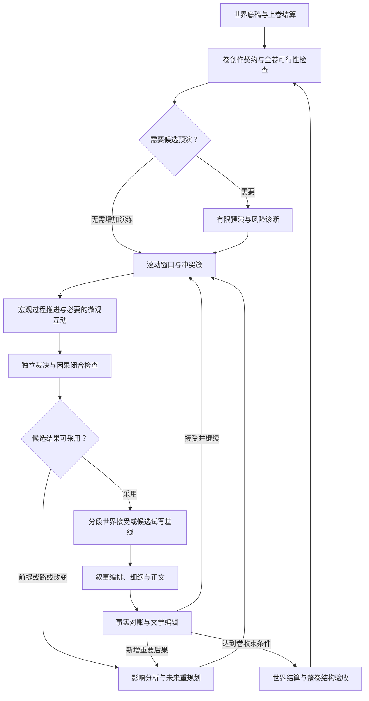

# 04｜剧情模拟与小说生产架构

> 版本：总体架构研究版 v1.1  
> 定位：以卷级动态模拟组织世界演化、人物行动与文学生产；以下为本方案的设计建议，尚未实现或经过效果验证。  
> 关联：[总体架构](01_总体架构设计.md) · [Agent 协作](02_Agent组织与协作架构.md) · [知识与动态世界](03_知识与动态世界架构.md) · [世界事件调度](10_世界事件调度与多线演化.md) · [文学研究与长程编辑](11_文学研究与长程编辑.md) · [研发路线](08_架构决策与研发路线.md)

## 1. 核心设计：以整卷为创作单位，以有限窗口推进世界

推荐采用 **“较完整的世界基础＋卷级动态模拟＋选择性的微观角色扮演＋持续的文学组织与编辑”**。卷不是若干独立场景的集合：势力计划、人物长期目标、资源变化、消息传播与制度性事件会跨场景作用；文学创作又必须把这些变化组织成有焦点、有情感发展、有阶段回应的整体。

因此，每卷都要考虑相关世界进程及其后果，但不必让所有人物逐日对话。普通旅程可以聚合推进；已确定后果的低互动段落可以直接写作；关键谈判、争夺、背叛和重大选择才需要展开角色交互。**省略微观扮演，不等于省略该段时间内的世界演化。**

本章中的“模拟”有明确边界：外部 Agent 提出人物选择与语义后果，本地服务执行已定义的资源、时空、权限和规则检查；结果经裁决与接受流程成为指定分支的历史。系统不声称能够完整预测社会或人类心理，也不以模拟日志替代小说。

### 1.1 一卷的完整生产闭环

图中的“采用”是编辑选择；进入 main 的正式接受仍要完成版本、权限和依赖验证。最后一条边表示下一卷或下一弧的启动，不是要求无休止生成。作者可以在完成一卷、预算达到边界或需要重大创作决议时暂停。

### 1.2 五类职责共同工作

| 职责 | 主要判断 | 产物与边界 |
|---|---|---|
| 世界构建与领域设计 | 这个世界怎样成立、哪些结构已经确定 | 版本化设定、历史、制度、能力和初始状态；不替人物决定每个未来动作 |
| 世界事件调度 | 哪些过程现在应推进，哪些交汇需要协调 | 局部故事时间、后台进程、消息与入站影响；具体机制见10 |
| 卷导演与规划 | 本卷值得讲什么，怎样组织冲突与回报 | 卷目标、候选路径、模拟焦点、叙事安排；无权为目标篡改裁决 |
| 角色与行动裁决 | 人物为何选择，行动实际造成什么 | 意图、裁决、事件与认知反馈；人物不凭宣称取得成功 |
| 写作与长程编辑 | 如何成为有文学价值的整卷 | 细纲、正文、人物文学档案、结构编辑；具体机制见11 |

这些是责任划分，不要求五个独立服务或五名永久在线的主管。不同角色可由同一外部模型按任务实例化，关键权限和状态写入由统一内核控制。

## 2. 卷开工之前：先有世界，再选择本卷切口

### 2.1 世界准备要完成结构层的创作

首卷启动前应有一份足够完整、可以持续扩展的世界底稿。它既包含限制行动的规则，也包含产生人物、矛盾和生活质感的内容。

| 世界面向 | 创作前应形成的结构 | 可以继续开放的细节 |
|---|---|---|
| 世界与力量 | 世界层级、能力来源与上限、学习条件、代价、主要例外、不同体系的作用边界 | 尚未使用的具体招式、器物外观与局部技艺 |
| 地理与文明 | 大区域、文明分布、生态与资源带、主要交通、距离和通信方式 | 每座小城的街巷、所有普通居民与商铺 |
| 社会与制度 | 权力来源、组织治理、生产和交换、教育与身份、法律或礼法、宗教与习俗 | 某次普通交易的谈判细节、未涉及的地方支系 |
| 势力与人群 | 主要组织的资源、利益、内部派系、盟约、债务和冲突来源 | 每名成员的完整传记与每日行程 |
| 历史与当前局势 | 关键时代、制度起源、战争迁徙、历史创伤、近年变局及可追溯秘密 | 对当前状态无约束的历史细节与开放谜题 |
| 物品与资源 | 类别、制造和使用条件、稀缺性、重要实例、权利制度与生命周期 | 所有普通物品的逐件身份与全世界库存 |

“较完整”由结构覆盖与相互支撑判断，不以设定字数或实体数量验收。例如，强大宗门如何得到供给，交通如何支持其控制区域，力量代价如何约束战争，历史创伤如何沉淀为制度，应该能得到彼此兼容的解释。这不要求建设完整经济学仿真。

**允许大量暂不进入剧情的已接受冗余世界。** 远方文明、暂不出场的家族、没有被主角使用的修炼传统，可以先成为正式设定。它们不是因为“不服务首卷”就只能留在候选区。未激活只表示当前无需细粒度推进或进入上下文，不表示不存在、不受约束或可以随手重写。

相应地，“结构已经完整”也不表示所有微小细节和未来事件都已经决定。开放部分可以继续创作；扩展要与既有结构兼容。对于已接受的隐藏事实，后续改变仍属于版本修订，不能以读者尚未看到为理由无痕替换。设定采信和分支语义沿用[03](03_知识与动态世界架构.md)，世界范围与运行分辨率的关系见[10](10_世界事件调度与多线演化.md)。

### 2.2 每卷形成一份工作说明

卷创作契约（也称卷工作说明）是已有信息的有版本引用与创作决议，不是复制一份独立世界数据库，也不是保证每项计划成功的剧本。开工时至少回答以下问题：

1. **从什么状态接续？** 固定作品分支和 revision，读取相关人物、势力、资源与各线的已接受边界；检查上卷遗留伤势、债务、误信、承诺及尚在进行的后台过程。
2. **这一卷要形成什么阅读体验？** 说明核心叙事问题、主题张力、焦点人物、阶段回报和大致篇幅。可以是“信任能否承受利益冲突”，不必预先写成“第十二章某人必定背叛”。
3. **世界与人物各自要做什么？** 登记本卷可能相关的势力计划、人物目标、长期进程、时间窗口和消息传播。列明哪些即使主角不介入也会继续。
4. **哪些受保护，哪些可以改变？** 区分已接受事实、明确的作者保护性承诺、较强叙事偏好与开放路线。保护性承诺应少而清楚，不能把所有节点都升级成硬终局。
5. **怎么结束本卷？** 定义可接受的阶段回应、可以带入下一卷的未决项，以及停止、改线和升级决议的条件。完成不等于所有人物达成目标。
6. **投入到什么程度？** 确定预演、互动、并行写作和修订的预算范围，及哪些关键选择值得独立复核。预算是工作约束，不是强迫故事在某个字数点突然收尾。

上卷结束不必让所有支线停在同一个故事日期。本卷起点是一组可解释的状态与局部前沿；关键交汇的同步由世界调度处理，不能按“已经进入第二卷”自动把全世界推进到同一天。

### 2.3 用“无主角对照”检查世界是否真正自驱

作为开卷结构诊断，可问：**从当前状态开始，若主角不介入这场局势，各势力和有关人物会尝试做什么，哪些过程仍会推进？** 先检查目标、资源和过程登记；只有关键不确定性值得研究时，才增加少量隔离候选演练。

对照需要说明移除的只是主角未来的哪种干预，不能顺带抹去其既有历史，也不能把其他角色的目标全部改写。预演中应停止向角色提供卷导演的期望结果。如果主角不出现，所有组织就原地等待、债务不到期、边境战争也不再发生，这通常暴露了世界设计或调度的空缺。

它不是要求主角对世界没有影响，也不是经统计验证的因果实验。它服务于一个具体的创作检查：配角与社会是否拥有独立动因，而非只在主角到场时临时产生需求。

## 3. 动态卷纲：目标不同，计划也应不同

### 3.1 不把卷目标写进人物脑中

| 内容 | 示例 | 谁能修改、如何生效 |
|---|---|---|
| 卷级叙事目标 | 使读者理解某制度的代价，形成师徒信任的重大考验 | 卷导演在作者授权范围内调整；不直接改变世界 |
| 人物弧线意图 | 希望主角从依赖师门走向承担独立判断的后果 | 属于创作计划；是否实现要看经历和文学表达，不能给人物当未来记忆 |
| 角色自身目标 | 主角希望取得许可，长老希望保住家族 | 角色可因观察、关系和经历调整；导演不能秘密覆盖 |
| 势力计划 | 商会准备抬价、结盟或转移货源 | 由制度、派系和决策者共同约束；宗主偏好不自动等于全宗意志 |
| 世界进程 | 寒潮、航道变化、伤势恶化、已启动的运输 | 依世界规则和局势推进；不是为了制造高潮而任意开关 |
| 作者保护性承诺 | 某核心人物在全书某阶段之前不被正式接受为死亡 | 约束候选采用与创作决议；不能把必死裁决偷改为幸存 |

人物行动要同时有两种解释：在世界中是否可能，以及在其所知和所欲之下为什么会尝试。IPOCL 将作者目标与人物意图分开；但其原始模型对意图成功的要求限制了失败与对抗情节。Sabre进一步结合有限、可能错误的信念；它仍是中央符号规划，不能直接视为本系统的开放行为引擎。[IPOCL，§4.3、§4.6](https://arxiv.org/pdf/1401.3841) [Sabre，Problem Definition、Search、Limitations](https://cdn.aaai.org/ojs/18896/18896-52-22662-1-2-20211004.pdf)

本方案借鉴这种区分，在关键选择上要求动机和认知证据，而不要求所有人物理性最大化同一个效用函数。犹豫、情感、误解、冲动、失败和放弃都可以成立；问题是读者能否从经历和表达中理解它们。

### 3.2 卷纲同时维护发生层与呈现层

**发生层**描述已接受事件、当前候选事件、尚未实现的目标、必要前提和可能路径。它关心因果、资源、行动者及世界时间。**呈现层**描述哪些材料进入本卷、由谁感知、何时披露、如何交错、形成怎样的情感与主题进展。它关心读者的阅读顺序。

两层以事件、人物、承诺和证据引用衔接，不共享一份按章节编号排列的事实表。一次政变可以在后台先发生，卷中只呈现通信中断，后半卷再揭露经过；读者已见线索不代表主角已经知道真相。系统记录的是披露和预期理解，不宣称能够直接测量真实读者心智。

未来路线宜保留“目标—条件—可能做法—风险—替代或失败结果”的关系。例如：目标是取得组织犯罪的可信证据；进入秘境只是某条路线，其必要条件是完整古钥和有效通行许可。钥匙彻底毁坏可以使这条路线失效，却不能自动推出“任何证据都不存在”。同样，有候选替代路线也不能自动推定它一定成功。

### 3.3 远处保持粗，近处才详细

全书层保存主题、主要矛盾、重要弧线意图与保护性承诺；卷层保存阶段问题、冲突结构与可能回应；临近窗口展开可检验的前提、互动和后果；场景层组织具体阅读体验。层数按作品需要增减，不设强制六级大纲。

DOME支持粗纲与局部细纲、正文交替推进的借鉴；其原文的细纲生成依赖已生成内容，但并未提供本方案的多线世界调度与分支重规划。其记忆索引采用章节号，也不能直接替代故事时间。[DOME，§4.1–4.2、Algorithm 1](https://aclanthology.org/2025.naacl-long.63.pdf)

本方案进一步允许卷级路线本身在授权范围内改变。只滚动修改细纲、永远禁止卷目标与路线重审，会把动态规划变成修补原定剧本的工具。

## 4. 全卷检查与预演：先看得到整体，再决定模拟多深

### 4.1 三档工作，不默认把每卷模拟两遍

| 档位 | 内容与用途 | 采用条件 | 成本与边界 |
|---|---|---|---|
| 全卷可行性检查 | 检查关键时间窗口、资源供需、因果前提、人物目标交汇和叙事回报是否具有可能路径 | 每卷规划都应覆盖这些问题 | 能形式化的本地检查；语义分析由外部Agent完成，不等于逐事件执行 |
| 候选宏观预演 | 沿少数重要假设推演到卷末附近，识别脆弱路线、长期无进展、重大冲突与不同收束可能 | 多线耦合、陌生世界规则、关键不确定性或昂贵返工风险较高 | 只是有假设的候选轨迹；不追求穷举或精确概率 |
| 局部精细预演 | 对决定卷结构的谈判、争夺、误导或危险选择展开角色互动与裁决 | 高风险节点需要验证动机、信息和后果 | 只展开必要范围；可复用有效候选，不强制生产时再跑一遍 |

“整卷预演”应指在卷尺度上观察一种或少数可能演化，而不是把所有日常、所有人物和所有分支先详写完。短封闭故事可以进行较完整的细模拟；长卷、连载和开放世界通常采用粗远细近的组合。

早期 drama management 研究已把故事目标、许可干预与未来投影分离；其原文也显示，浅层搜索的效果不能从小例直接泛化到更复杂故事，而且实验中的剧情评分并非真人文学体验。本方案借鉴问题分解，不承诺找到全卷最优路线，也不引入统一美学标量统治编辑。[DODM，Approaches、Search results、Future work](https://www.cs.uky.edu/~sgware/reading/papers/nelson2006declarative.pdf)

### 4.2 预演应该交付诊断，而非盖章的未来

有用的预演输出包括：关键转折的候选因果链、哪些结果依赖单一资源、哪些人物缺少可信动机、哪些消息来不及到达、哪些长期进程会在主线之外改变局势、哪些失败会产生值得写的后果，以及哪些部分尚无法判断。

预演必须保留基础版本、假设、干预和分歧。模型称某路线“很可能发生”，只是判断，不是经校准概率；多个措辞不同的候选，也不自动代表结构多样性。比较应关注是否改变冲突组织、选择代价、信息关系或主题回应。

可采用的结果是初步方向、风险清单和少数备用路径。不能把整条预测轨迹直接导入 main 为未来历史，不能把预演中尚未发生的背叛送进人物记忆，也不能让裁决器为了兑现预演而偏袒某一方。

### 4.3 预演与生产可以复用，但必须说明采用范围

如果某候选片段的基础快照、关键依赖、权限与相关入站影响仍有效，可以复用其实际裁决和记录；不必仅因进入生产阶段就重新调用模型。采用时要明确哪些片段接受、哪些继续保留为计划，及其影响属于哪个分支。

短而封闭的作品也可以在动笔前采用已经充分裁决、通过接受检查的整卷轨迹。叙述位置尚未追上，不会把已接受事件重新变成计划；代价是后续涉及世界后果的文学改线需要正式修订。系统限制的是预测自动升格，不是禁止作者先确认较长的发生层。

如果预演期间世界基础改变、正文增加了重要交易，或另一条线提前送达消息，则重验证受影响部分。尚未接受且无法证明兼容的结果，不得继续作为本轮写作或接受的依据；已接受历史的改变另走修订。一次预演成功不能长期替代依赖检查。

候选支线可以被明确放弃，保留其原因和成本用于评估。反复重跑直到得到指定胜负属于创作筛选，不能伪装成无偏裁决或技术重试；预算耗尽时应收束、改线或形成具体创作决议。

## 5. 滚动窗口：宏观进程与微观选择在这里汇合

### 5.1 窗口不是固定几章

窗口按相关故事时间范围、事件预算、决策风险和下一次关键交汇共同选择。短兵相接可能按分钟展开，旅行可按数日聚合，政治谈判可能围绕一个期限。章节数是呈现规划，不是世界时间推进单位。

同时区分三个边界：

- **演化窗口**：本轮准备推进哪些世界过程与人物行动。
- **叙事窗口**：本轮组织和写作哪些材料，可能含更早的倒叙。
- **发布边界**：哪些正文已形成不可变发布版本，哪些仍处于可编辑缓冲区。

扩大演化窗口有利于发现远期冲突，但可能提前固定不值得采用的结果；缩小窗口降低返工，却可能忽视长线耦合。默认在重要决策、资源交接、消息到达和局势改变处设置复看点，根据实际返工率调整。

### 5.2 宏观、中观和微观如何接合

| 层次 | 推进什么 | 何时展开或回传 |
|---|---|---|
| 宏观 | 势力计划、地区局势、生产运输、战争阶段、长期环境过程 | 资源、时限或信息将影响当前行动时进入相关窗口；不用召唤每名普通成员 |
| 中观冲突簇 | 围绕同一问题的目标竞争、行动阶段、资源争夺和消息链 | 用来发现谁真正互相影响，并界定需要协调的推进范围 |
| 微观 | 有文学或因果价值的同场互动、选择、交锋与局部观察 | 决定了资源、关系、认知或关键后果后，回传宏观计划与后续场景 |

“中观冲突簇”是规划和调度共享的工作对象，不增加第三套正式时钟或一个必须部署的新服务。其成员也可变：一场商队争夺可能把原本独立的债务、边境政策和师徒冲突连接起来。

卷导演圈定的是本卷重点观察与细化的范围，不是全世界允许运动的范围。已登记的独立过程仍按各自条件由世界调度负责；尚未展开的部分保留明确的覆盖范围与未知边界。不能因本卷不写某条线，就撤销其期限、忽略已经承诺的变化，或在人物重返时假装期间没有经历。

宏观聚合不应预先宣布一个等待微观裁决的胜负。反过来，若宏观结果已经被接受，后来对该历史作微观呈现，不能重新裁决出另一套资源或伤亡。分辨率切换要保留边界状态和已生效后果；详见[10的推进与展开机制](10_世界事件调度与多线演化.md)。

### 5.3 一次窗口的具体工作

1. **取基线。** 固定分支、revision、相关故事时间与授权视图，读取人物状态、文学档案中适用的已发生经历、势力计划和后台过程。导演可看作者意图；角色只取得自己可观察、可回忆和可合理推测的内容。
2. **查入站影响。** 世界调度器检查相关消息、运输、政策、环境变化及其他支线行动，确认哪些必须在当前交汇前处理，哪些可以独立继续。
3. **选择推进粒度。** 明确聚合段、冲突簇和需要微观互动的节点。普通任务可以直接形成有依据的阶段结果，不为每次买水、走路安排多轮会话。
4. **提出行动与过程变化。** 角色和势力根据目标产生意图；环境过程依据规则或语义提案推进。计划到期只是需要检查是否发生，不自动等于发生。
5. **解决相互影响。** 对同时争夺、相互阻断或共用资源的行动，从同一基线成组裁决。先后由故事条件、能力和裁决决定，不能由数据库提交先后决定。
6. **检查后果与文学价值。** 核对资源、状态、消息和人物认知变化，并判断这段发展是否提供有用选择、关系变化、情绪后果或叙事推进。文学价值用于决定呈现与开放候选的取舍，不能免除既有世界前提要求的后果。平静段也可以有价值，不以冲突次数当唯一标准。
7. **选择、接受并更新。** 对可用片段完成相应分支的接受或建立候选试写基线；更新未来卷纲、场景依赖和需要重看的文学意图。未被讲述的已接受后果同样进入后续状态。

### 5.4 什么是“可接受的因果闭合片段”

正式接受单位不必等于一句动作，也不必等于整章。推荐围绕一组已解决的相互作用形成片段，例如“关桥—商队改道—消息未及时送达”或“一次争夺及其直接损伤、占有和可见后果”。

在所声明的影响范围内，片段应满足：关键前提有来源；相关互斥动作已经处理；必要资源和时间后果一致；应被纳入的入站影响没有遗漏；观察或消息使哪些人获知什么有明确边界；重要未决项没有被当作确定结果。

这是**有范围的闭合**，不是证明整个开放世界绝无未知因素。无关远方支线无需全部等待；相关前提尚不清楚时，也不必冻结所有创作，可以暂停这部分接受并继续独立工作。局部前沿、跨线屏障及迟到影响的处理由[03](03_知识与动态世界架构.md)与[10](10_世界事件调度与多线演化.md)共同定义。

### 5.5 保留两种接受时机

**世界先行**适合已经明确且需要持续约束后续的关键后果：先接受政变、毁物、交易或消息到达，再组织其正文呈现。

**候选试写**适合尚需文学判断的互动：在隔离分支中固定本轮写作基线，先形成场景或草稿，核对重要增量后再选择接受。选中、沙箱裁决通过、工作分支接受和 main 接受必须明确区分。

这使系统既能拥有真实的后台历史，也保留写作发现的空间。不能为了便于改稿把已经接受的幕后事实重新称作“草稿”；也不能为了流程整齐，要求所有未来对白和关系走向在动笔前完全冻结。

## 6. 角色自治与卷导演：组织条件，保留选择和后果

### 6.1 角色运行采用观察—意图—裁决—反馈

角色输入包括其经历、当前信念、身体和资源状态、目标、关系及新收到的观察。输出可以是行动、对白、拒绝、沉默、求证、等待或离场。系统不能把不服从卷纲自动判为“角色失败”。

角色提出“我夺到了剑”时，提案可包含夺剑尝试与其自我理解，真正占有仍由裁决确认。对白通常可以连续生成；其中的告知、承诺、欺骗和重大关系转折，在可能影响后文时识别为持久增量，不要求每个语气词都结构化。

角色收到反馈后可以改变目标或误解结果。观察不等于相信，推测不等于确知；角色不因幕后事件进入新revision就同步知情。长期文学档案中的未来弧线意图不能送入自主决策上下文，详见[11](11_文学研究与长程编辑.md)。

BOOKWORLD提供了世界背景、地理与角色互动结合的参考，但其简化环境和以场景计移动时间的方式不直接适用于多线长篇。本项目的后台过程、局部时间和独立接受机制是进一步设计。[BOOKWORLD，§3、Limitations](https://aclanthology.org/2025.acl-long.773.pdf)

### 6.2 卷导演有哪些正当的创作权力

卷导演可以选择焦点人物与交汇、调整候选场景顺序、决定哪些交互值得展开、提出与世界兼容的机会、安排尚未确定的普通环境细节、压缩无关过程，以及在失败后寻找新的叙事问题。它可以利用现有商贸制度安排一封合理的邀约，也可以提议一个新配角；是否带来持续后果决定所需的登记和审查强度。

这些创作可以在预授权范围内自动进行，不需要为每个日常细节询问作者。约束应集中于人物选择所依赖的事实、重要资源与能力、已有承诺和已接受历史。

| 导演操作 | 推荐边界 |
|---|---|
| 选择叙事视角、压缩旅程、交错支线 | 可自由组织呈现，但保留真实后果和已披露信息约束 |
| 选择尚未展开的碰面或消息场景 | 必须有可达时间、传播路径和人物动因；不能凭需要瞬移 |
| 在开放空间增加普通事件或配角 | 与已接受世界兼容；重要新增效果走轻量或完整增量流程 |
| 调整未来计划和候选分支 | 在作者授权范围内进行，记录为何放弃或改线 |
| 强迫角色信任、爱上、背叛或赴死 | 不能用导演命令代替其经历和动机；重大作者选择应显式表明 |
| 让已接受的死亡、毁物或通信从未发生 | 无权直接进行；需要合法后续事件或正式历史修订 |

### 6.3 防止“环境引导”变成隐蔽强制

只通过环境改变人物，也可能形成强制：如果角色每次拒绝，导演都加大压力直到其选择预定动作，就没有保留真正的可变路径。DiriGent的原文确实包含要求动作注入和重复增强张力的 Story Enforcement 循环，不能将其概述为只有温和环境调度。[DiriGent，Story Enforcement](https://cgl.ethz.ch/Downloads/Publications/Papers/2025/Che25b/Che25b.pdf)

本方案建议在高影响干预中说明目的、已有依据、可能后果和采用理由；保留“不干预”与“接受失败后改线”的候选。干预次数和候选探索受预算限制，重复无进展时回看目标与结构，不通过无限强化刺激保证服从。

作者可以选择更强的创作导向，或更开放的涌现导向；这是作品层的创作偏好，不是两套事实内核。在较强创作导向下，可以更积极选择初始条件和候选路线，但裁决仍说明其实际采用的条件和结果。已接受结果不得被反复重跑抹去。

### 6.4 自主性不等于放任无意义运行

模拟可在目标已决、状态没有实质变化、对话重复、缺少必要前提、角色已无互动理由或达到预算边界时结束。结束可以产生“拒绝合作”“谈判破裂”“暂未查明”等结果，而不是强迫达成卷目标。

对缺乏文学价值、尚未接受且具有真实选择空间的候选路线，编辑可以不采用。由既有事件和规则已经约束的后果，则不能因不够精彩而删除；继续推进相应时间范围时仍须处理，文学上可以不呈现。已接受但不值得逐场描写的日常也可以略写。角色的自主性体现在重要选择可由其目标与所知解释，并能造成真实代价，不体现在为每个普通人生成最长日志。

## 7. 合理意外后的重规划

### 7.1 先分清是什么问题

| 情形 | 处理方式 | 不能采取的捷径 |
|---|---|---|
| 合法但出乎卷导演意料 | 评估新后果，重规划受影响的未来；可以保留失败 | 因“不像大纲”要求裁决器改判 |
| 必要规则或时间前提未知 | 补充核验，暂停相关接受，继续独立线 | 默认为成功或编造确定日期 |
| 角色获取了无来源信息 | 修正上下文或认知提案，重做受污染候选 | 把泄漏解释为角色突然聪明 |
| 裁决使用了错误事实或规则 | 纠正裁决；已接受时按版本流程修订并分析影响 | 覆盖原记录，让后续无法追溯 |
| 未接受候选触及保护性承诺 | 明确拒绝候选、调整合法未定条件，或提出承诺变更 | 当作网络重试无限抽到预期结果 |
| 已接受结果使重要承诺不可达 | 调整实现路径、接受实质失败，或正式修订承诺/历史 | 恢复已销毁唯一物品，虚构从未提过的万能能力 |
| 世界合理但卷整体失焦 | 重新选取、压缩、组织材料，必要时调整未来焦点 | 为增加“精彩度”无痕改写发生层 |

Mimesis 的 narrative mediation 明确区分承认意外再重规划，与替换动作效果来保住原计划。本方案借鉴前一种路径；后者若用于覆盖独立裁决，会破坏本系统的世界承诺。[Riedl等，2003，§3.3–4](https://faculty.cc.gatech.edu/~riedl/pubs/riedl-young-aamas03.pdf)

### 7.2 重规划的范围由真实依赖决定

第一步固定已接受结果和证据。第二步定位硬前提、计划引用、消息与认知、伏笔和文学承诺分别受到什么影响。第三步生成少量真正不同的后续方向，比较可行性、人物动机、阅读价值、损失和成本。第四步更新选中路线及相关任务，保留未受影响的有效工作。

依赖要有类型。例如，唯一古钥是某扇门的必要条件，毁坏后该开门路线确定失效；矿脉损失对法宝制造可能只是供给风险，因为还有库存和替代来源；人物失去朋友后的情感影响需要文学复核，不能沿图机械推导“悲伤数值增加，所以必定复仇”。

“最小范围重规划”指不无故重写独立内容，不是强行把重大意外关进一章。政变、长期通信中断或核心人物死亡可能改变多条线，此时应扩大卷级甚至全书级复看。尚未发生的计划可变；既有事件、人物当时所知和已发布正文分别按其版本机制处理。

### 7.3 必须允许有代价的失败

替代路线不应总是把同一奖励无损送回主角。古钥毁坏后，可以只查明部分秘密、失去救援时间、引发联盟分裂，甚至把本卷从“夺取宝物”改成“承担错误判断”。如果所有意外最终都由新道具补齐，形式上的重规划仍然取消了角色选择的后果。

没有可信路线时可以缩短、转向或结束当前弧。作者真正保护的终局若无法保持，应形成包含已发生事实、候选选择与代价的决议，而不是让系统自动编造一个方便例外。

## 8. 从演化材料到细纲与正文

### 8.1 文学组织不是逐条美化日志

卷导演与长程编辑从世界材料中选取值得呈现的选择和后果，决定省略、概述、场景化、并置或延迟揭示。一个事件可以跨多章形成后果；一个章节可以呈现多个时期；大量世界演化可以始终留在幕后。

发生与呈现分离可借鉴角色模拟后再重写的研究，但该研究本身不承担完整历史查询、长期伏笔和权限治理。本方案在统一版本底座上补充这些约束。[Multi-Agent Based Character Simulation，§3](https://aclanthology.org/2025.in2writing-1.9.pdf)

删去一段正文中的告知描写，不等于撤销世界中已经接受的告知，也不自动让人物重新无知。同一事件可以被现场描写、倒叙、回忆和他人转述多次，实际影响仍然只执行一次。

### 8.2 场景卡只固定关键条件

场景卡应能让写作者理解这一场为什么存在，同时留出文学空间。推荐包含以下内容组，不在本阶段固定全部字段：

| 内容组 | 需要说明什么 |
|---|---|
| 来源与时空 | 使用哪个版本、哪些事件或候选；事件时间与叙述位置；人物能否到场 |
| 叙事作用 | 本场的核心问题、阅读焦点、情感进展、对整卷的贡献 |
| 人物条件 | 目标、认知、关系阶段、适用的情感未竟后果；不是未来结局指令 |
| 状态约束 | 已确认的起始状态、必须保留的事件后果、尚待裁决的候选目标 |
| 信息与声音 | POV、叙述距离、允许披露范围、作品风格宪章与场景变化范围 |
| 自由范围 | 可以即兴的对白、动作细节、意象、留白及需要反馈的重要增量 |

对已经接受的事件，场景卡引用其结果；对尚未发生的行动，只能写目标、条件与允许的结果空间。不能把“希望他答应”当作已确认终态，再要求模拟证明这件事。

细纲先审事实与因果，再审人物、结构和表达潜力。两类审核可以由不同能力完成，但不必所有场景都开多方会议。普通修辞和节奏判断由负责编辑直接处理；持续伤势、新交易、重要披露和新能力触发相应增量核对。

### 8.3 正文可以反向影响未来演化

写作会产生未在模拟中充分表达的动机、对白、关系细节和新选择。其中不改变后续条件的表达由写作者自主完成；涉及持续事实的部分进入提案，核对其与已接受事件的关系。

对账至少区分：同一事件的再次呈现、新发生的增量、说谎或误信、表达歧义、与既有事实冲突。抽取器提供候选，不能自行决定世界真相。重要结局、资源和披露还需要与场景约束直接核对，不能把“没有抽出矛盾”当作一致性证明。

新交易获准后可能改变下一窗口的资源或人物目标，应触发相关重规划；若正文只是更好地表达原有动作，则无须再次裁决所有世界事件。最终批准绑定具体正文、变更和依赖，后续实质改写重新进入相应检查。保存、发布和恢复机制见[05](05_技术体系与工程规划.md)。

### 8.4 并行写作围绕依赖和缓冲区展开

时间上相邻的章节不一定能同时写，不同支线也不一定独立。并行前固定起始状态、关键事件、披露范围和风格依据。若后一场依赖尚未裁决的生死或交易，可以等待，或明确作为推测草稿运行，接受可能废弃的成本。

连载应保留适度未发布缓冲区，供结构调整和接缝编辑使用。并发规模受审核吞吐、上游稳定程度与废稿率约束；更多同时生成的字数不等于更多可接受正文。

## 9. 卷内复看、卷结算与下一卷

### 9.1 在还能修改结构时检查整卷

整卷编辑从卷前就参与，在关键转折或中段回看实际发展，卷末再进行整体验收。重点包括：开篇提出的问题是否仍在作用，人物选择是否产生积累，支线怎样相互改变，情绪是否得到承接，信息是否有层次，哪些场景重复了相同功能。

世界因果成立与整卷文学成立是不同维度。前者不能证明后者；逐章评分的平均也不能代替通读整卷。完整方法见[11_文学研究与长程编辑.md](11_文学研究与长程编辑.md)，包括人物文学档案、风格研究、结构编辑和原文回读。

已发布前缀不能在结构编辑中静默删除或重排。可以修订未发布缓冲区和未来窗口，或形成明确的新版本。整卷回看越晚，能够合法改变的空间越小，因此不应把卷级编辑推迟到全文发布后。

### 9.2 两份互相引用的卷结算

| 结算面向 | 必须交接的内容 | 不应推导的结论 |
|---|---|---|
| 世界结算 | 已接受事件与局部前沿；人物位置、伤势、能力和资源；势力与制度变化；消息到达；未完成过程与待验证依赖 | 卷结束意味着全世界暂停，或所有人同时获知局势 |
| 文学结算 | 本卷叙事问题的阶段回应；人物弧线实际形成的变化；关系与情感余效；伏笔、承诺和开放问题；风格与结构审议 | 有人升级或任务完成就意味着情感回报成立 |

两份结算都引用统一版本及证据；人物文学档案保留解释的不确定性。某人因失败而更回避亲密关系，可以成为有文本依据的编辑解释；不应仅因总结写下这句话，就强制角色下一卷按固定情绪公式行动。

人物与势力未完成的目标可以延续、修改、搁置、失败或终止。伏笔可以回收、转义或保留开放；已形成明显读者承诺而又放弃的内容，应有明确的编辑判断与必要表达，不能只在账本中改成“已完成”。未出场的背景设定则没有义务全部变成伏笔。

### 9.3 下一卷从后果启动

下一卷重新选择叙事问题和焦点，但继承真实后果：失去的盟友、未还的债、错误信念、未寄达的信、政治失衡与未消化的情感，都可能成为新动力。不得为方便开局把角色关系、资源和社会状态重置为初始模板。

只需更新受影响的世界底稿和规划，不必重写整部世界百科。若一卷结束暴露了原世界结构的缺陷，例如运输制度无法支持既定规模，应将修订作为独立创作决定并分析影响，而不是每卷新增一个临时例外。

## 10. 端到端纸面推演：秘境路线受阻的一卷

> 本例是架构纸面推演，未实际运行模型或执行测试；与09的青霜剑固定夹具相互独立。

### 10.1 开工底稿

世界已确认三类与主角无关的结构：宗门依赖北线矿材与商会信贷；边境议会会按既定程序调整通行许可；山路存在有季节规律的封闭风险。商会有自己的债务与货源利益，宗门内部有不同派系，仓储账册作为制度记录已经存在。远方文明与数个家族也已设计，但本卷无需启动其细节。

人物初始目标各异：主角想进入秘境调查师门旧案，师父想保住弟子并控制丑闻，商会代表想确保回款，反派想切断可追踪自己的证据。卷导演希望形成“服从师门是否等于忠诚”的阶段回应；“主角必定入秘境”只是候选路线。

### 10.2 全卷检查与首个窗口

可行性检查发现：借贷期限与预计入境时间接近，许可证变化会影响运输，古钥是秘境入口的唯一必要物。无主角对照显示，即使主角不调查，商会仍会催债、议会仍会处理通行、派系仍会争夺资源；这些动因在正式推进中继续存在。

导演只对“先取得许可”与“先追踪古钥”两种高影响方向进行有限宏观预演，识别各自的信息缺口，不提前裁定全卷输赢。首个窗口推进相关债务、运输与角色调查，在交汇处展开一次谈判。主角是否承诺为商会办事，由其当时所知和动机决定；承诺是否换来帮助另行裁决。

### 10.3 意外发生

反派依据已知风险决定销毁古钥，裁决确认其能力、时间和资源允许，且该世界没有复原路径。若结果被选中并正式接受，入秘境路线失效。未收到消息的主角仍可继续寻找钥匙；其行为是符合误信的尝试，不应被全知审稿器误判为不合理。

与此同时，封路使商队改道；它是否造成材料短缺，要检查库存与替代货源。不能直接由“失去矿路”推断宗门必败，也不能为保存原卷纲让商队无视封路按时抵达。

### 10.4 重规划与文学组织

导演保留钥匙毁坏和真实损失，提出三种方向：调查既有账册但承担政治交易；继续追索导致错过救援；接受本卷只能揭露部分真相，把失约与师徒分裂作为阶段结果。账册确实存在不表示主角自动获知、更不表示一定拿得到；取得方式仍需要人物动机、消息路径与行动裁决。

编辑可选择让读者先看到熔炉残留，再跟随尚不知情的主角寻找钥匙，形成信息差。正文可以省略大部分运输日志，却保留迟到消息、借贷压力和承诺代价。若写作者加入一项改变双方利益的交易，先作为增量对账，通过后再调整下一窗口。

### 10.5 卷末与后续

本卷可能以主角获得部分证据、失去原计划的秘境机会，并首次承担违背师命的后果结束。世界结算交接债务、路线、派系与消息；文学结算检查信任冲突是否有足够经历和表达，而非仅列出“师徒关系下降”。下一卷从这些后果继续，不自动补发同样的奖励，也不让古钥复活。

## 11. 取舍、成本与后续验证

### 11.1 为什么推荐这种组合

| 设计选择 | 必要性 | 代价与复审条件 |
|---|---|---|
| 较完整世界底稿与已接受冗余 | 提供独立于主角的文明、制度、冲突与创作资源 | 前期设定与一致性审议增加；以结构可信和后续复用判断，不以全部出场为目标 |
| 卷级动态推进为主干 | 让长期过程与人物选择持续影响整卷 | 需要维护目标、进程与影响边界；不能退化成每场只查最近摘要 |
| 常规全卷检查、按需候选预演 | 获得整体视野，避免把全细模拟变成固定双倍成本 | 预演价值依作品而异；测量发现关键问题与减少返工的实际收益 |
| 选择性微观互动 | 把调用花在信息差、相互选择和高影响后果上 | 触发策略可能漏掉有价值场景，需要编辑判断与消融比较 |
| 有界导演与失败可保留 | 防止自主性被无限干预掏空 | 可能需要放弃已有稿件或原定回报；记录损失和具体创作选择 |
| 分段接受与未发布缓冲 | 在真实后果和写作发现之间维持可管理边界 | 状态与草稿需要协调；过早接受会增加修订，过晚接受会拖累下游 |
| 卷中与卷末结构编辑 | 防止局部通顺、整体空转 | 增加通读与重排成本；不能仅以模型评委或摘要代替 |

世界自驱、角色自治和文学组织不能互相替代。自由运行所有角色未必产生好卷；只优化大纲遵从度又会消除意外。推荐组合依靠明确的责任和交接，在有限范围内探索，而不是增加一个无所不管的超级导演。

### 11.2 原型应证明什么

第一批创作原型应包含一个结构完整但规模受控的世界底稿、少量有独立目标的势力、至少两条会相互影响的事件线、一卷的阶段问题、一次合法意外和一次卷中结构回看。无需先实现数千角色或完整经济模型。

验证分开进行：

- **世界与流程正确性**：幕后进程不因主角离场冻结；关键消息与资源进入正确窗口；候选预演不污染正式事实；同一事件多次呈现仅一次效应；接受与正文回写能恢复和追溯。
- **人物与导演关系**：重要行为在人物所知下可解释；允许有意义的拒绝和失败；检查被拒候选和干预记录，识别形式上开放、实际上唯一服从路线的情况。
- **整卷文学价值**：由独立读者和编辑评估人物积累、情感后果、结构回报、语言与继续阅读意愿，不由单一数值替代。
- **净成本**：报告所有预演、失败候选、返工、审核与人工整合，衡量每万已接受中文字的总成本与完成时间。

在相近模型、世界信息、篇幅和预算下，比较静态规划直写、宏观滚动、宏观加选择性微观、以及全细模拟。若要归因，再分别去掉全卷预演或卷中编辑，避免把所有改进打包后声称某个单一机制有效。详细评测原则沿用[08](08_架构决策与研发路线.md)。

当前仍需研究窗口长短、预演触发、背景聚合精度、人物动机复核的可靠性，以及不同题材对作者控制的需求。上述论文支持若干局部机制，不能证明组合后的系统已经具备百万字中文小说生产能力；本阶段交付的是可以进入详细设计与验证的完整创作架构。
