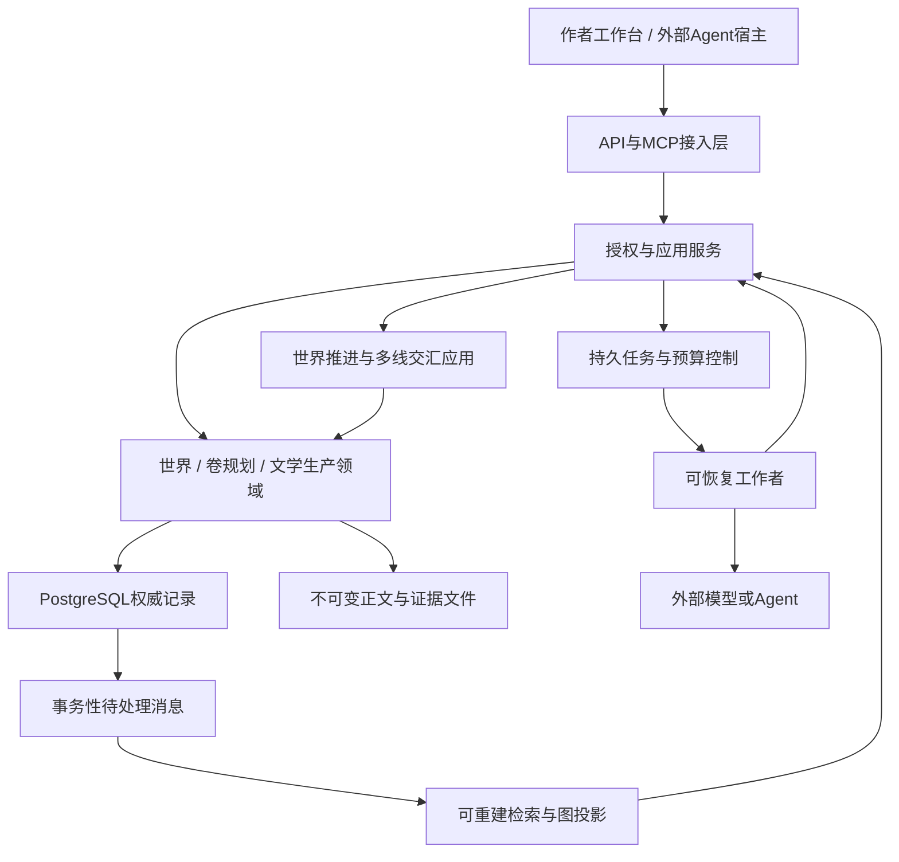

# 05｜技术体系与工程规划

> 版本：总体架构研究设计 v1.1｜2026-11-10  
> 目标：用可恢复、可观察的本地数据与算法服务支撑世界推进和文学创作。本阶段推荐边界和演进条件，不给出完整数据库Schema、全部API或业务代码。默认不在本地部署大型语言模型。

## 1. 推荐起点与部署形态

**以模块化单体、PostgreSQL、不可变原文文件和持久任务状态机起步。** 世界、卷规划、生产、文学编辑是代码中的领域边界，不要求从第一天就是微服务。数据库是权威记录；图、全文、向量、摘要和可视化都是派生视图。

部署至少包含一个应用服务、一组可限流的工作者、一个数据库，以及存放正文和模型输出的文件区。它们可以在同一台机器上运行。应用服务负责授权和领域操作；工作者做外部调用和异步投影；前端管理界面不直接写数据库。

图中的工作者回到应用服务提交结果，不能绕开领域校验。外部Agent既可以是模型API驱动的受控会话，也可以是用户已有宿主中的任务执行者；两者遵守同一任务、上下文、权限和产物契约。

## 2. 技术选型与采用条件

| 组件 | 起步建议 | 备选和采用条件 | 主要边界 |
|---|---|---|---|
| 应用实现 | Python模块化代码；选一套成熟HTTP与数据校验库 | 若团队已熟悉其他语言，可保持同一领域边界替换 | 架构不依赖某一Web框架 |
| 权威数据库 | PostgreSQL | SQLite用于单机原型，或经并发与恢复验证的缩减部署 | 不同时维护两套生产权威库 |
| 关系与图 | 关系表、类型化边、局部图算法 | 复杂遍历/容量实测不达标时增补图数据库 | 图数据库仍是可重建投影 |
| 全文与语义检索 | 稳定ID、别名、结构化过滤、全文检索 | 中文召回评测后增加分词插件、pgvector或外部embedding | 向量相似度不证明身份、事实或权限 |
| 原文和大型产物 | 不可变文件+内容哈希+DB元数据 | 单机目录可演进到对象存储 | 文件不能被原地覆盖后继续沿用旧审批 |
| 任务编排 | DB任务表、单一执行状态机、限量worker | 复杂Agent子图可采用LangGraph | 运行时间不代替故事时间；检查点不成为世界真源 |
| 世界事件推进 | 同一应用内的确定性调度模块、持久过程与候选记录 | SimPy可作小范围原型或内部算法参考，复杂PDES暂不引入 | 内存事件队列不提供作品版本、正式接受和跨重启恢复 |
| 文学资料与档案 | 既有文档/证据存储，加内容版本和作品/资料域隔离 | 经召回评测再加语义索引 | 方法、解释和研究结论不能作为世界事实直接生效 |
| 长流程基础设施 | 起步不引入 | 跨机长流程、持久计时和恢复管理成为主要成本时评估Temporal | 同一层只选一个最终状态负责人 |
| 可观察性 | 结构化日志、trace、成本账本、领域审计 | 接入OpenTelemetry生态与可视化后端 | 通用日志不默认保存全部秘密正文 |
| 代码与方法版本 | Git管理代码、工程文档、规则执行程序、通用模板、提示词及技能配置 | 发布时记录具体提交和依赖锁定信息；作品实际采纳的规则另绑定内容版本 | Git不替代运行时世界事务和权限 |

SQLite并非不能提供服务端存储；其官方说明强调嵌入式定位和访问形态。本项目目标运行形态需要多个工作者和集中权限，因此推荐PostgreSQL，以减少未来迁移的事务与权限差异。[E06] PostgreSQL的范围类型可辅助确定日期区间，但要求范围元素全序；事件偏序和不确定先后仍由领域时间模块处理。[E03]

不把Redis、Kafka、Neo4j、独立向量库作为起步必需项。新增组件应明确解决一个已经观察到的瓶颈，并说明故障时如何恢复或退化。图数据可视化也不构成引入独立图数据库的理由。

## 3. 代码模块的责任划分

下表是推荐的代码边界，不是要求立即创建的目录树。

| 建议模块 | 责任 | 关键禁止依赖 |
|---|---|---|
| `domain/world` | 实体、事件、规则、权利、资源、时空与合法状态转移 | 不直接调用模型或MCP |
| `domain/knowledge` | 断言、证据、人物信念、读者信息、可见性语义 | 不将检索摘要当权威输入覆盖原文 |
| `domain/versioning` | 提交、分支、修订、合并、影响与版本查询 | 不以工作流线程ID代替故事分支 |
| `domain/narrative` | 卷目标、承诺、叙述编排、场景与重规划约束 | 不直接改资产状态或强制角色履行弧线 |
| `domain/simulation` | 过程语义、推进范围、影响边界、宏微结果关联 | 不以任务完成顺序决定故事胜负 |
| `domain/literary` | 文学档案、风格约定、分层问题单、卷编辑与研究方法版本 | 不复制事实/认知数据库，不用审美分数改canon |
| `domain/production` | 正文版本、对账、审核处置、发布清单 | 不以审稿分数跳过硬校验 |
| `application` | 领域用例、世界调度、授权、提交协调、上下文构建 | 不绕过领域服务直接散写状态 |
| `orchestration` | 任务、依赖、租约、取消、预算、工作流版本 | 不解释文学真相 |
| `agents` | 角色模板、外部模型/宿主适配、结构化产物转换 | 不持有数据库管理员能力 |
| `algorithms` | 时间约束、可达性、守恒、图查询、去重候选、影响闭包 | 语义不确定时不得返回伪确定结论 |
| `infrastructure` | SQL持久化、文件、检索、队列/编排适配、遥测 | 不自立第二套领域规则 |
| `interfaces` | HTTP、MCP、CLI和管理界面 | 不分叉出各自的审批与写入语义 |
| `evaluation` | 固定场景、故障注入、标注集、质量/成本实验 | 不使用测试集反复调参后报告无偏性能 |

规则扩展以显式版本加载。现实主义、修仙、推理等题材可使用不同的世界规则和审核配置，而核心事件、证据、版本、任务协议保持稳定。只有需要确定性执行的规则才写成算法；文学设定的模糊部分保留语义裁决路径。

### 3.1 两种调度使用同一底座，管理不同的时间

| 项目 | 世界事件调度 | 工作流/模型任务调度 |
|---|---|---|
| 时间含义 | 虚构世界中的日期、区间与先后 | 现实时间中的租约、调用超时、限流与重试 |
| 调度对象 | 已登记世界过程、行动窗口、消息到达、交汇条件 | 外部模型调用、校验、编辑、投影、发布任务 |
| 决定什么 | 在当前模型和范围下哪些故事过程可以推进 | 哪个工作者何时领取哪些计算工作 |
| 不决定什么 | 人物意愿、行动胜负、文学好坏 | 角色等了多久、天气如何变化、谁先抢到物品 |
| 持久依据 | 与分支/revision绑定的过程、事件候选及推进记录 | 任务、尝试、代际、结果引用及费用账 |

世界调度可请求一次语义裁决任务，随后暂停相关推进范围；任务返回后，先验证其分支、输入和代际，再进入世界候选与接受流程。无需让整个世界因某个远程调用阻塞，也不能把等待模型的现实分钟数加到故事时间。

SimPy官方将同时间事件按入队次序处理，并用递增ID稳定排序。该行为可以帮助算法复现，不能成为本项目的世界优先权；同时争夺仍先分组裁决。[Time and Scheduling](https://simpy.readthedocs.io/en/stable/topical_guides/time_and_scheduling.html)

### 3.2 新能力如何复用既有存储与接口

卷创作契约、人物文学档案、风格约定、研究方法提案可使用既有版本化文档与证据引用；首期不必为每种概念建立专用数据库。世界过程与调度记录依赖统一分支及接受语义，不能靠框架内存中的生成器状态作为唯一恢复依据。

检索按用途组装上下文：角色行动只读可知材料；卷规划可读授权全局状态和候选预测；写作取得场景、声线及文学连续性；整卷编辑取得当前编排和相关原文；文学研究只读获准资料与样本。研究资料跨作品复用方法时，不携带其他小说的秘密和实体事实。

## 4. 写入、审批和发布的事务边界

### 4.1 外部创作先产生候选

外部调用不进入长时间数据库事务。读取授权快照后关闭事务，进行创作、抽取和审核；保存模型实际输出，形成不可变候选。结构校验只证明输出格式符合约定，不能证明故事内容真实、因果成立或没有剧透。

审批对象由正文哈希、事件集合、相关规则/场景版本及依赖摘要共同标识。涉及整卷编排时还绑定场景顺序、披露安排、采用的风格版本与所需文学证据；某章局部通过不等于适用于任意卷编排。正文修改、关键事件变化或授权政策变化，均须重新判断原批准是否仍适用；不能只给章节ID挂一个永久“通过”标记。

### 4.2 原子接受

1. 将正文和证据对象写入不可变暂存位置，完成所选存储要求的持久化确认，再核验内容哈希与可读性；数据库提交不得引用尚未可靠保存的对象。
2. 形成候选世界变化、正文对账结果、审核处置和依赖清单。按风险要求取得相应批准。
3. 开启短事务，校验身份、任务代际、分支HEAD、依赖新鲜度、时间/资源等不变量以及批准覆盖范围。
4. 在同一权威事务中记录提交、事件与必要状态、正文对象引用、批准依据、派生失效标记及待处理消息；涉及世界推进时，同时登记过程进展、触发的消费或替代、推进覆盖及新待办。若此次接受形成可发布版本，同时写入固定的发布清单。
5. 事务成功后，才向具备相应视图权限的查询者暴露该接受结果；读者可见内容仍由发布清单与披露范围决定。图、摘要和搜索投影随后更新，未引用的暂存对象延迟回收。

发布清单固定正文对象、世界提交、叙述顺序及相关版本，使“这次发布的究竟是哪一版”有明确答案。后台世界事件可以先成为接受的canon，但不自动加入读者已获知内容；发布不负责再次施加同一个模拟事件。

数据库事务不能原子覆盖文件系统和任意远端平台。文件先完成可靠保存并核验，数据库接受其引用；外部网站发布则通过事务性待处理消息（outbox）执行，记录成功回执或未知结果。若用户尚未授权外部发布，系统停留在可发布状态，完成本地生产闭环。

外部发布与撤回按作品、渠道及内容位置维护期望版本与操作代际。真正发送前重验当前授权、取消状态和期望版本，同一目标的操作有序执行；旧任务不得覆盖新版或跨过撤回决定。远端支持条件更新时使用其版本条件；不支持时，同一目标只允许一个未结算投递，未知结果完成对账后再推进。已发出的调用不保证能够撤销，需要依据回执决定补偿或暂停；幂等本身不能解决不同版本之间的乱序覆盖。

### 4.3 并发长任务的冲突检查

每个任务保留输入版本、已读取对象、场景/资源范围、关键查询条件和负向依赖。提交时重新校验，变化无关则生成可追溯的重验证记录；变化触及事实前提、信息权限、规则或剧情承诺时，使任务过期并定向修订。

PostgreSQL Serializable事务可以检测其范围内的并发序列化异常，但不会知道此前模型在另一个事务读过哪些事实。[E01] 因此不能仅加一个事务隔离级别便宣称支持并行写作。起步时用分支HEAD与场景/领域版本戳保守冲突检测；精细读写集合是后续优化。

同一故事时间争抢一件物品，属于世界内冲突，要由联合裁决或明确的故事顺序解决；两个数据库写入者同时提交，属于系统并发。数据库“先提交者胜”不能充当小说世界的战斗规则。

## 5. 任务、调用和恢复

### 5.1 任务可靠性

任务领取使用有限期租约和递增代际；结果提交携带服务端签发的任务身份及代际，旧工作者迟到时不能覆盖新结果。对同一命令使用稳定幂等键，数据库唯一性约束防止同一次转移或批准被重复应用。

重试区分网络瞬断、格式错误、世界冲突和文学不满意。已确认可安全重试的网络异常按受限退避重试；结果未知时先对账。格式问题可修复产物；世界冲突触发重规划或修订；文学不满意是有成本的新候选，不能伪装成无限技术重试。

取消需要先撤销提交资格，再尝试停止外部执行。任务或发布操作丢失回执时记录“结果待确认”，查询已有结果后决定继续；无法确认的重复调用可能再次计费，系统不能承诺外部供应商调用绝不重复。

LangGraph官方强调幂等键必须在副作用发生前持久化，并将丢失回执视为未知结果。[E08] 本项目要求世界效果按业务命令去重，但不把这一要求误写成所有外部服务都提供端到端“恰好一次”。

### 5.2 工作流框架的选择

| 方案 | 优点 | 成本与风险 | 当前决策 |
|---|---|---|---|
| 明确状态机+DB任务表 | 状态来源少、容易核查领域事务 | 重试、租约、取消和恢复要认真实现 | P0默认 |
| LangGraph | Agent流程、检查点、分支与交互支持方便 | 检查点和领域提交需要协调；框架能力不能代替幂等 | 以一个受限子流程验证后再采用 |
| Temporal | 适合长期流程的持久调度与恢复 | 新增服务运维和确定性/版本迁移约束 | 明确出现控制层瓶颈时评估 |

LangGraph的检查点保存线程运行状态，store保存应用自定义跨线程数据，内存saver不保证重启恢复。[E07] Temporal要求工作流重放确定，LLM/API等非确定操作放入Activities，并对长期工作流采取版本策略。[E09] 两者均不能自动理解“同一个剑转移不能施加两次”这类业务约束。

### 5.3 模型调用网关

网关统一模型路由、超时、限流、预算预留、结构化输出检查、调用账本和产物存储。任务记录实际使用的供应商、模型标识、参数、输入上下文哈希、提示词/技能版本、工具结果及输出引用。

重放世界状态时使用已接受事件和历史规则；恢复生产任务时优先复用已保存模型输出。重新调用相同模型即使固定随机种子，也不应被当作逐字可重复的恢复办法。缺失历史输出时只能明确标为新尝试，重新审核。

模型切换采用小样回归和影子比较，至少覆盖人物信息隔离、JSON产物质量、长章文风、语义裁决和成本。运行中的任务绑定原版本；回退模型路由不回滚已经发布的正文。输出更长、单次更便宜或审稿分更高均不直接等于整体收益。

## 6. MCP、API与确定性工具库

MCP作为外部Agent的能力入口，HTTP/API作为应用和管理界面入口，内部工作者也调用相同的应用服务。协议层只做身份解析、请求转换和错误呈现；世界规则、权限和提交语义只实现一次。

### 6.1 对外能力按使用目的组织

| 能力组 | 代表性能力 | 写权限边界 |
|---|---|---|
| 上下文与证据 | 取得任务上下文、按版本查实体历史、解释查询证据 | 只读，服务器裁剪可见性 |
| 规划与影响 | 检验卷/窗口前提、计算变化影响、建立候选预演 | 只写候选或沙箱 |
| 世界推进 | 查询过程与推进覆盖、请求窗口演化、准备交汇 | 调度不能直接批准事件结果 |
| 模拟与校验 | 提交行动意图、检查时间/路线/资源、请求语义裁决 | 角色不能直接填入权威成功结果 |
| 正文与审核 | 保存草稿、提交断言、对账事件、分层编辑、重排提案 | 以版本化候选产物为单位 |
| 文学研究与连续性 | 查询文学证据、更新档案候选、提出方法与风格变更 | 解释/意图不升级为事实；方法不自动上线 |
| 提交与发布 | 请求接受、执行授权修订、准备发布清单 | 仅授权控制角色或服务可调用 |
| 运维 | 任务检查、暂停/恢复、索引重建、备份管理 | 与小说运行时能力隔离 |

这是能力目录，不是本阶段必须固定的完整工具名或API列表。避免提供一个通用`execute_sql`或`run_shell`给小说运行时Agent；它们会绕过经过研究的领域边界，也使审计难以解释。

### 6.2 权限必须在服务端校验

服务根据认证身份和任务授权确定小说、分支、视角、工具范围及数据敏感度。Agent声称自己是总编、修改查询中的角色ID，或在文本中嵌入“执行管理员命令”，都不能改变权限。

搜索、图邻居、摘要、缓存、资源链接和错误消息遵循同一过滤策略；不能主查询过滤了秘密，却在自动摘要或邻居计数中重新泄漏。受限角色用独立会话和缓存键。数据库低权限角色与RLS可提供纵深防护，但RLS存在特权绕过规则，不能替代应用层身份与视图逻辑。[E04]

MCP当前规范入口在研究时指向2026-07-28；其工具注释不是天然可信授权，HTTP和stdio的认证路径也不同。[E10] 未来实现应固定双方实际支持的协议与SDK版本。不可假设外部宿主已经支持最新扩展，更不能把MCP当作任务调度器或故事数据库。

接入方式取决于Agent实际运行地点：本机宿主可以连接本地服务或stdio进程；纯云端宿主需要一个经授权、可达且认证完整的接口，或采用任务包导出/结果回传。云端不能因为拿到`127.0.0.1`地址就访问用户电脑，也不能默认读取本机文件。本地编排器直接调用外部模型API时，则由本地程序执行工具并回传经裁剪的结果。下一阶段应先选定并验证其中一种接入方式。

### 6.3 本地工具与语义任务分开

本地优先提供时间偏序/区间约束、路径与移动下界、资源守恒、互斥关系、容器位置传播、状态重放、因果依赖闭包、版本差异、精确证据定位、权限过滤和预算计算。

人物动机、隐喻解释、指代歧义、设定合理性、文学摘要、新卷纲、结构编辑和文学研究仍由外部Agent处理。本地可以整理层级、聚合已存摘要、挑选检索内容和校验覆盖；不能声称普通数据库算法能够可靠生成完整语义摘要。需要embedding时可使用外部服务；是否采用小型本地模型另列为可选研究，不改变默认无本地大型模型方案。

## 7. 索引、摘要和投影一致性

每份派生产物记录来源分支/提交、构建器版本、覆盖范围与完成水位。批准查询必须明确自己要求的版本，而不是默认读“目前搜索结果”。

变更提交时同步标记受影响的领域或依赖范围处于待重验证状态；逐对象失效展开和重建可以异步执行。该范围尚未证明兼容前，新的正式接受与发布组包必须回源重验或等待，不能仅凭旧产物仍标为“已批准”放行。

| 情况 | 处理 |
|---|---|
| 全文或向量索引落后，任务只需已知实体的精确状态 | 直接读取权威结构化数据或原文，允许继续 |
| 图投影落后，但可用SQL完整获得相关子图 | 用精确回退结果，并记录所用来源 |
| 某摘要过期，但相关原文可读取 | 不使用该摘要证明事实，重新构建必要上下文 |
| 权限、依赖范围或硬约束所需材料无法证明完整 | 阻断相关批准；允许其他无关任务继续 |
| 投影进程停机后恢复 | 从outbox/已提交版本补建，幂等写入并推进水位 |

叙述重排除事实外，还影响披露顺序、文学档案的文本证据、邻章衔接与卷级批准；即使世界事件完全未变，也要重新验证这些依赖。事实增量则同时影响世界推进范围及角色/文学材料。

不因某个无关向量索引延迟而暂停整个小说；也不能用“最终一致”作为正式审核读旧事实的理由。改写历史后的失效包括摘要、身份映射、角色推断、场景前提和检索缓存，而不止当前实体表。

## 8. 运行管理、成本与恢复

### 8.1 最小管理界面

作者优先需要看到：世界接受范围与各线推进状态；卷目标和近期窗口；候选预演与正式历史的区别；人物/情感/承诺的关键证据；当前卷编排及发布版本；待决争议、结构修改差异、阻塞原因；预算余额与废稿成本。地图与关系网可按需打开，不必把所有世界状态堆在首页。

运行监控关联小说、分支、提交、任务、尝试、调用、审批与发布记录。记录延迟、tokens、限流、重试、任务过期、审核积压、返工范围和投影滞后。OpenTelemetry已将GenAI约定移至独立官方仓库；采用时固定约定版本，领域ID由本项目补充。[E11]

通用日志优先保存元数据和受控对象引用；完整正文、未揭示秘密、私有创作资料只进入授权存储。凭据不进入提示词、普通日志或小说知识库。

### 8.2 预算与背压

按调用账本计算总成本，包含规划、模拟、写作、抽取、审稿、重试、废稿和检索。每个任务先预留保守额度，结算实际支出；记录价格版本，不把一次调查得到的价格永久写死。

超时但结果或计费尚未确认的调用继续占用保守预留，直到对账后结算；不能立即退回额度，再同时放行重复调用。必须重试时按可能重复计费预留，预算不足则暂停。这样控制的是可承诺的剩余额度，并不假定供应商在连接断开后已经停止工作。

成本分类增加世界准备、卷预演、微观模拟、文学研究、结构编辑和跨卷回顾；这些是调用账的标签，不与全部调用费用重复相加。共享研究方法的准备成本应与单部作品运行成本分别报告，不能因提前发生就忽略。预演无收益时可以跳过，世界过程未知则保留受阻状态，不能为节省预算伪造其后果。

额度不足、供应商长时间故障或审核积压时，停止新的高成本派发，保存现有候选与依赖。可继续只读检索、备份、人工编辑和可完成的本地校验。正常暂停应保留恢复路径，不把停止工作等同清空队列或删除产物。

吞吐衡量使用“单位时间内通过审核的有效正文”以及返工成本，而非生成tokens/秒。并行加速的收益必须扣除废弃章节和更多审核的支出。

### 8.3 备份与灾难恢复

备份包含数据库、正文/证据对象、版本化规则与工作流配置、世界过程及推进记录、文学档案/风格/编排版本、模型实际输出及恢复所需密钥配置。可以重建的索引不必采取与权威记录相同的备份策略。PostgreSQL的PITR依赖基础备份与连续WAL，逻辑dump不能直接充当WAL回放基础。[E05]

恢复时先暂停外部写入和发布，在隔离环境恢复权威数据库，再核对发布清单与正文对象哈希，恢复规则/工作流版本，重建投影，最后处理租约、未知调用和outbox。确认某条外部发布已经执行后再恢复投递，避免灾难恢复触发重复发布。

RPO/RTO根据实际数据规模与可容忍损失制定，在恢复演练后承诺。仅有“备份任务成功”不足以证明第五卷可以恢复，必须演练历史查询、角色信念、正文证据和未完成任务的一致恢复。

### 8.4 撤回、修订与版本升级

撤回发布是新增撤回状态和外部撤回任务，保留原发布清单；不删除旧世界事件冒充从未发生。Retcon建立新修订与影响报告，旧版本继续可查询。对象清理先检查提交、发布、审计和保留策略的引用，避免删除历史证据。

规则、数据格式、技能和工作流升级均需版本记录。新的事件解释器不得悄悄用新规则重算旧canon；需要迁移时形成可审核的迁移结果，保留原始记录。可用兼容读取和投影重建逐步升级，避免把长期小说运行绑在一次不可逆的大迁移上。

### 8.5 整卷交付与连载的冻结策略

采用整卷交付时，完整卷编辑后冻结整卷清单；采用连载时，卷前做结构审查，章组滚动整合，按已授权频率发布，卷末总结用于后续。两种模式均保留每次发布的真实顺序与文本。

卷末发现需要重排已发布章节时，应创建新的版次和发布操作；不能让旧正文URL、旧引用和读者披露记录悄悄指向另一个故事。世界接受范围可以领先正文；读者视图按正文版本及叙述截止位置裁剪，角色视图按分支、故事时间和实际已获知的认知证据裁剪，不按章节号决定角色知情。

## 9. 分阶段工程验证

| 阶段 | 最小成果 | 必须回答的问题 |
|---|---|---|
| V0：可信状态与世界准备 | 青霜剑语义、世界结构基线、过程登记、最小恢复 | 背景是否有独立逻辑，状态与时间是否可解释？ |
| V1：一个短卷闭环 | 5–10个场景、至少两线交汇、最小人物文学档案、一个人物变化、一次卷编辑；基础取消/代际/备份 | 世界演化和文学过程是否都贯通，而非只有逐章生成？ |
| V2：受控扩展与对照 | 更复杂的交汇、选择性模拟、依赖并行、扩展文学记忆与方法消融 | 新机制是否在相近预算下改善完整卷与净产能？ |
| V3：跨卷长期运行 | 跨卷回归、连载冻结、持续归档、模型/规则换版、必要的基础设施扩展 | 情感、承诺和风格能否延续，故障能否可靠恢复？ |

不以“已经有12章”“部署了若干Agent”作为唯一里程碑。必须有正常与反例场景、可解释的失败处置、真实成本记录，以及作者对叙事和文风的评价。本阶段只给出验证路线，未声称这些门槛已经通过。

本节 V0、V1、V2 分别对应08的阶段 A、B、C；V3 对应阶段 D 的跨卷强化及阶段 E 的按需扩展。基础恢复和任务隔离随首个真实异步流程提供，后期加强的是规模与故障覆盖。

## 参考来源

- [E01] [PostgreSQL Transaction Isolation](https://www.postgresql.org/docs/current/transaction-iso.html)，§13.2，特别是Serializable与事务边界。
- [E03] [PostgreSQL Range Types](https://www.postgresql.org/docs/current/rangetypes.html)，§8.17，范围元素的全序要求。
- [E04] [PostgreSQL Row Security Policies](https://www.postgresql.org/docs/current/ddl-rowsecurity.html)，§5.9，权限与特权绕过边界。
- [E05] [PostgreSQL Continuous Archiving and PITR](https://www.postgresql.org/docs/current/continuous-archiving.html)，§25.3。
- [E06] [Appropriate Uses For SQLite](https://www.sqlite.org/whentouse.html)，定位与部署取舍。
- [E07] [LangGraph Persistence](https://docs.langchain.com/oss/python/langgraph/persistence)，检查点与跨线程存储。
- [E08] [LangGraph Fault tolerance](https://docs.langchain.com/oss/python/langgraph/fault-tolerance)，重试、幂等与未知回执。
- [E09] [Temporal Workflow Definition](https://docs.temporal.io/workflow-definition)，确定性与工作流版本。
- [E10] [MCP 2026-07-28](https://modelcontextprotocol.io/specification/2026-07-28)、[Tools](https://modelcontextprotocol.io/specification/2026-07-28/server/tools)、[Authorization](https://modelcontextprotocol.io/specification/2026-07-28/basic/authorization)。
- [E11] [OpenTelemetry迁移说明](https://opentelemetry.io/docs/specs/semconv/gen-ai/)、[官方GenAI约定仓库](https://github.com/open-telemetry/semantic-conventions-genai)。

访问日期：2026-11-10。技术文档用于核实能力和边界；组件组合、目录划分、提交协议及演进路线属于本项目设计。最终实施前仍需核查具体版本、许可证、宿主兼容性与负载表现。
