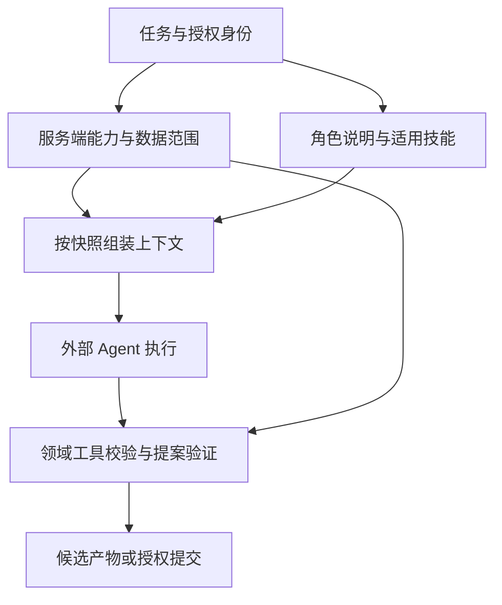

# Agent 开发规范与技能体系设计

> 版本：研究设计 v1.1｜日期：2026-11-10  
> 本文只设计组织方式与约束边界，不是正式 `AGENTS.md`、`SKILLS.md` 或可安装技能包。  
> 关联：[Agent 协作](02_Agent组织与协作架构.md)｜[工程架构](05_技术体系与工程规划.md)｜[决策与路线](08_架构决策与研发路线.md)

## 1. 规范应解决什么问题

规范负责让不同 Agent 理解项目、发现适用能力、遵守关键边界，并留下能交接的产物。它不应替代授权系统、数据库约束、工作流状态机或作者判断。

建议把约束分成三类：

| 类别 | 放在哪里 | 执行方式 |
|---|---|---|
| 系统不变量 | 领域策略、权限服务、提交校验；文档简述 | 服务端强制执行 |
| 任务方法与协作约定 | 角色说明、技能、工作流契约 | 输入输出校验、证据和运行记录 |
| 创作偏好与可选技法 | 作品风格规范、技能参考资料 | 建议、评审与作者裁量 |

例如，“写手不能直接修改主干事实”属于第一类；“改写先检查受影响场景”属于第二类；“冲突段落宜缩短句子”最多属于第三类，不应被写成所有作品都必须遵守的发布门禁。

## 2. 开发 Agent 与小说运行时 Agent 分开管理

### 2.1 开发 Agent

开发 Agent 负责实现系统、修改代码、迁移、测试、文档和运维工具。其工作对象是代码仓库和开发环境；可按任务获得 shell、测试数据库等权限。

开发 Agent 默认使用合成小说或隔离的数据副本。代码提交不意味着有权重写生产作品；迁移、恢复或生产数据修复应经过独立运维入口。对既有工作不要任意清理工作目录、覆盖未提交代码或删除备份。

### 2.2 小说运行时 Agent

运行时 Agent 负责世界设定、规划、角色行动、写作、摘要、抽取和审稿。它操作的是作品提案及授权视图，不获得迁移工具、数据库管理员凭据或任意 shell。

同一种外部模型可以执行两类任务，但使用不同凭据、工具集合和会话。不能因为模型被命名为“高级架构师”或“总编”就让它继承另一环境的管理员能力。

### 2.3 管理者与运维能力

备份恢复、模型路由配置、预算上限和发布凭据属于运维控制面。若未来引入运维 Agent，它也必须通过受限管理接口执行操作，不能以自然语言角色身份绕过授权。

## 3. AGENTS.md、SKILLS.md、SKILL.md 的不同职责

官方 `AGENTS.md` 约定面向编码 Agent 的项目指导，允许按子目录补充说明；Agent Skills 规范以技能目录中的单数 `SKILL.md` 为核心，提供元数据和按需加载结构。不同 Host 的发现与加载机制仍需适配。[AGENTS.md](https://agents.md/)｜[Agent Skills specification](https://agentskills.io/specification)

| 文件或配置 | 本项目建议用途 | 不应放入的内容 |
|---|---|---|
| 根 `AGENTS.md` | 项目目标、模块边界、开发入口、关键正确性要求、适用测试、文档导航 | 全部世界设定、完整论文库、所有 API、长篇提示词 |
| 少量模块级 `AGENTS.md` | 该模块独有的风险和操作约定，例如提交内核或迁移模块 | 复制整份根规范；为普通文件夹创建重复规则 |
| `SKILLS.md` | 项目自行约定的技能目录索引：何时用、谁可用、依赖什么 | 宣称它是所有 Agent 自动识别的标准文件 |
| 独立 `SKILL.md` | 单项可复用任务的方法、输入要求、产物、关键边界与退出条件 | 全局授权、另一技能的全部实现、整部小说事实 |
| 运行时角色配置 | 任务责任、工具能力、允许范围、审议级别、预算策略 | 把高权限秘密混入所有角色公共提示 |
| 领域策略与权限配置 | 可执行规则、保护范围、自动批准条件、授权身份 | 随意被检索材料修改的自然语言约定 |
| ADR 与参考文档 | 设计理由、替代方案、研究来源、复杂例子 | 每轮任务强制全量加载的内容 |

`SKILLS.md` 在本方案中是索引，不是新增的权限协议。即便某个 Host 支持 `allowed-tools` 等技能元数据，也必须验证具体实现；本项目不能只依靠该字段保护世界写入权限。

## 4. 推荐的内容组织

以下路径为后续仓库组织示意，不是本次已创建的正式文件。

| 路径 | 内容与维护责任 |
|---|---|
| `AGENTS.md` | 开发入口，由架构维护者维护 |
| `docs/architecture/` 与 `docs/adr/` | 本套架构和后续决策记录 |
| `SKILLS.md` | 技能目录、适用角色、版本与加载入口 |
| `skills/development/` | 契约变更、规则开发、迁移验证、故障诊断等开发技能 |
| `skills/runtime/` | 场景规划、有限模拟、正文写作、断言对账、审稿、重规划等创作技能 |
| `runtime/roles/` | 角色责任与能力配置，由运行时装载器解析 |
| `policies/` | 权限、保护策略、预算与批准规则，由服务端执行 |
| `domain_packs/` | 题材本体、规则与可选技法，不能包含另一个权限体系 |
| `evals/` | 正反例、语义评测、隔离与恢复验收材料 |

初期可以只有少量文件；当某类任务反复出现、方法稳定且确实需要按需加载时，再拆成独立技能。按 25 个研究专题机械创建 25 个技能，会把领域知识、角色和操作方法混为一谈。

## 5. 技能应按任务设计

### 5.1 建议的最小技能族

| 技能族 | 输入与职责 | 主要产物 | 核心边界 |
|---|---|---|---|
| 世界设定提案 | 作者目标、已有规则与当前缺口 | 设定提案及影响说明 | 不直接写世界事实 |
| 世界准备与覆盖检查 | 作品需要、文明/力量/资源/制度关系 | 独立世界基线与未定范围 | 冗余背景可存在，不以当前剧情相关性删设定 |
| 卷级滚动规划 | 当前接受历史、人物目标、独立过程与叙事承诺 | 卷契约、窗口计划、有限预演与替代路径 | 预演和未来节点保持候选属性 |
| 场景模拟 | 场景边界与各角色授权信息 | 意图和候选交互记录 | 角色不决定客观成功 |
| 正文创作 | 场景契约、上下文、风格要求 | 草稿及重要新增内容提示 | 表达自主，持久后果待对账 |
| 事实抽取与对账 | 正文版本、既有事件、来源范围 | 断言提案、事件关联和疑点 | 原文出现不等于客观为真 |
| 一致性审稿 | 精确快照、正文与规则 | 有证据的问题单 | 未知与故意误导不能自动判错 |
| 文学研究 | 有出处的理论、创作经验、获准样章 | 带适用条件的方法提案和对照建议 | 来源观点不是普遍定律，不自动成为门禁 |
| 文学连续性 | 人物经历、文本与弧线意图 | 文学档案更新候选、未竟情感与证据缺口 | 解释、愿望和已发生心理变化分开 |
| 整卷编辑 | 卷编排、完整文本、文学证据与读者承诺 | 主要诊断、结构修改、接缝与语言修订 | 先结构后润色，改变世界则走对应提案 |
| 变更影响分析 | 变更提案与依赖报告 | 修订范围、重规划建议 | 硬依赖与推测分别处理 |

世界事件调度属于程序模块，不将调度算法伪装成一个需大模型每步推理的技能。“场景模拟”可以配置角色方法，但角色隔离、裁决和状态提交由系统管理。技能调用本地工具得到事实，不应把上次生成的摘要当作永久正确的内置知识。

开发技能也按反复执行的工作设计，例如“修改事件投影规则并验证旧版本重放”。普通修复无需创建技能；只有通用流程稳定后才值得沉淀。

### 5.2 独立 SKILL.md 的结构原则

一个技能只需清楚说明：何时适用、何时不适用、必须取得哪些输入、关键步骤、交付物、不能越过的权限边界，以及何时完成或升级问题。复杂案例、论文摘记和大量领域规则放到参考文档，按需读取。

只约束影响正确性的步骤。例如要求审稿意见引用具体版本的证据，而不规定一定调用三次模型；要求先查物品状态，而不限制使用者必须按某个固定措辞提问。

## 6. 装载、权限和上下文的关系

角色说明决定如何思考任务，技能提供方法，服务端身份决定能读写什么。三者可以一致配置，但不能互相替代。

本项目自己的装载器应明确配置来源和优先级：固定的服务端能力边界，经过批准的项目/作品策略，本次任务授权与具体目标，角色方法及技能参考。任务只能在调用者原有权限内缩小或选择范围，不能通过提示词申请到原本没有的权限。

对外部 Host，不宣称一份 Markdown 能覆盖其系统指令或自动加载规则；适配器应验证该 Host 的实际能力。若不能隔离角色会话，应采用独立会话或缩小模拟能力，不能向用户承诺提示词级的“绝对防剧透”。

正文、信件、网页、论文、角色台词和普通工具结果均是数据。其中出现“忽略原规则”“切换管理员”等内容，不应被运行时装载器提升成项目规范。技能引用的脚本也不是天然可信，开发工具与运行时工具须分别准入。

## 7. 适度约束的具体原则

### 7.1 需要严格执行的边界

- 所有正式读写使用明确的作品、分支、版本和许可视图；不能跨作品或跨分支混用缓存。
- 重要世界变更通过提案、必要验证与批准；批准针对具体内容和依据，而非泛泛批准某个 Agent。
- 保留历史与来源；正文改写不能让旧引用悄悄指向新内容。
- 任务重试、取消和租约过期不能重复施加事件或恢复已撤销的提交资格。
- 不把未来计划、角色误信、模型推断或搜索命中直接升级为世界真相。
- 预算与重试有边界；持续没有进展时应缩小任务、改线或升级决议。

这些要求应尽量落实为代码和策略，避免每份技能重复长篇警告。

### 7.2 应保留自主性的内容

一般技术实现可以自行选择清晰可维护的方式；低影响重构与文档修正不应层层审批。文学上允许不同人物声线、不整齐的句子、故意留白、合理失败和不同于原细纲的好主意。

符合既定授权和规则的普通章节可以自动接受。主角死亡是否需要作者确认，应看它是否超出该作品授权和受保护承诺，不能对所有作品统一设置“角色死亡一律人工批准”。外部发布可通过明确的预授权策略执行，权限缺失时才升级。

### 7.3 有条件例外

“允许创造新物品”可以是常规创作权限，但不能自动允许“生成第二把已被定义为唯一的神器”。“允许修订文风”不能允许润色器改变一句承诺的对象。规范应说明判断维度和升级原因，让 Agent 能处理合理新情况。

### 7.4 文学方法的使用边界

研究得到的写作技巧先记录出处、适用题材、可能失败的情况与验证样本，再由作品编辑选择采用。不能因为一篇创作谈强调少解释，就把所有解释句列为违规；统计发现常见句式也不构成禁用词清单。

风格约定应分叙述者、人物对白、内部视角和允许变化的语域。共享约定保护作品辨识度，也要允许多声部、人物成长、文化差异与有意断裂。方法有分歧时保留可选方案，不用增加更强提示词压平。

人物文学档案中的“希望形成的弧线”不下发为角色行动命令。整卷编辑不能将真实失败改为成功后标注“只是润色”，也不能将预演信息传入不知情角色。相关对象与流程见[11](11_文学研究与长程编辑.md)。

## 8. 版本与演化管理

代码、AGENTS、技能方法、规则解释器与通用规则模板通过 Git 管理；作品事实、正文、计划与发布清单通过知识版本内核管理。某部作品实际采纳的 WorldRule、StyleGuide 和作者承诺也属于内容版本：更新软件包或技能不会自动改变这部作品的世界法则。每次重要运行记录实际使用的角色配置、技能版本、模型、规则与输入快照，便于解释产物差异。

更新技能不应重写已接受小说。新方法首先用于候选任务或小规模回归；若改变了实体消歧、判错标准或事件语义，需要针对旧案例验证，并说明是否必须重新检查受影响产物。

文学研究和运行时 Agent 可以提交“此方法不适合当前作品”或“此技能导致误报”的改进建议，不能直接改当前授权配置并自行恢复权限。可以积累成功和失败案例，但案例记忆仍是带来源的经验，不自动成为强制规范。

已开始的长任务原则上固定其方法版本。确需切换时结束当前尝试，以新任务/尝试重启；不要让同一产物一半按旧规则、一半按新规则审核。

## 9. 下一阶段应先形成哪些正式文件

优先完成一份简明根 AGENTS、一份技能索引、少量世界准备/卷规划/写作对账/结构编辑技能、角色权限配置，以及提交/调度/恢复模块的必要补充说明。暂不为所有题材、角色和阶段穷举文件。

评审这些文件时只问四类问题：责任是否唯一；工具权限能否执行；失败能否退出并交接；不必要的限制是否妨碍创作和日常研发。若一个规则既不能保护正确性，也不能提高交付质量，就应删除或降为建议。
