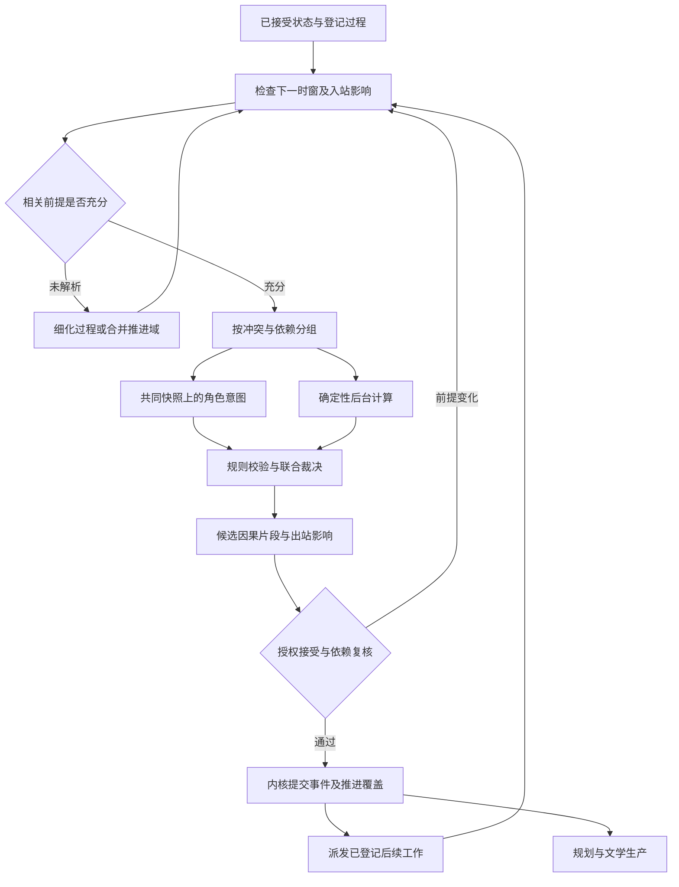

# 10｜世界事件调度与多线演化

> 版本：总体架构研究版 v1.1｜日期：2026-11-10  
> 定位：解释多地区、多势力与多角色怎样沿故事时间独立演化，并在共享资源、消息和关键事件处可靠交汇。以下是架构设计，尚无实现或性能验证。  
> 关联：[总体架构](01_总体架构设计.md) · [知识与时间语义](03_知识与动态世界架构.md) · [卷级生产](04_剧情模拟与小说生产架构.md) · [工程规划](05_技术体系与工程规划.md) · [压力测试](09_压力测试与端到端案例.md)

## 1. 总体判断：需要世界调度能力，不需要另一套事实系统

**增加独立的逻辑世界调度模块，采用事件驱动、相关作用域保守推进、关键交汇联合裁决的组合。** 首期与世界领域、知识内核和工作流运行在同一应用中；它不是新的数据库，也不要求分布式仿真集群。

仅有角色 Agent、普通任务队列和章节大纲，无法回答：商队尚在路上时，另一地区能否完成征兵；征用令、夺桥行动与商队何时相互影响；模型任务晚返回是否改变故事里的先后；后台过程未解析时，能否宣布某地 D30 的状态已经可信。因此，调度必须成为明确职责。

| 责任 | 世界调度模块 | 其他模块的责任 |
|---|---|---|
| 什么需要推进 | 登记旅行、生产、政治行动、消息传播、角色阶段决策等过程 | 世界设定定义规则；规划和角色提出意图 |
| 推进到哪里 | 根据因果、传播与资源边界选择下一安全范围 | 知识内核保存版本及推进覆盖记录 |
| 哪些行动一起处理 | 识别同场冲突及跨线交汇，组织共同输入 | 裁决模块决定实际后果，角色不自行宣布成功 |
| 何时确认结果 | 形成可审查的事件片段及条件证明 | 授权接受流程决定是否并入正式分支 |
| 哪个模型现在工作 | 提交所需的语义工作任务 | 工作流管理现实时间、租约、重试与预算 |
| 哪些事情值得写 | 提供事件、影响和未决事项 | 文学规划决定镜头、篇幅、视角及叙述顺序 |

导演可提出未来机会、细化请求和候选路径，不能修改时钟来跳过失败，也不能把已经接受的结果改成“只是还没有模拟”。普通推进在既有授权内自动完成；只有触及受保护设定、重大历史修订或其他授权例外时才升级决议，不让每个后台事件都等待人工确认。

## 2. 先分清已经发生、正在进行和等待检查

### 2.1 三种时间用途各归其位

故事时间表达虚构世界的发生、持续和传播；叙述位置表达读者何时读到；现实运行时间表达模型超时、任务租约和费用结算。各地区的推进边界是同一故事坐标上的覆盖信息，不是另外发明一组互不相容的时钟。世界可以使用相对事件或日期区间，无需给所有动作编造精确秒数。

**模型调用耗时十分钟，不表示角色等待了十分钟。** 若剧情确实发生等待，应由角色选择、世界规则或经批准的过程产生相应事件和持续时间。任务重试只影响工作流。

### 2.2 调度对象的语义

| 对象 | 例子 | 能否直接用于当前世界状态 |
|---|---|---|
| 已接受发生 | D20 商队离开青岩城 | 可以；出发、当时位置及已实际消耗有事实依据 |
| 已登记过程 | 商队沿既定路线运输，途中可能受阻 | 可以确认过程已经启动；不能预先确认抵达和全部未来消耗 |
| 条件触发 | 预计 D30 检查是否抵达北岸关口 | 只表示到时应求值，不是抵达事件 |
| 作者计划 | 希望商队及时缓解救济危机 | 规划意图，不能改变持有或地点 |
| 角色意图 | 守军准备征用这批粮食 | 需要后续行动与裁决；下令本身可以是已发生事件 |
| 资源预约 | 为某条候选运输路线预留船只 | 规划协调信息，不等于角色已取得船只 |
| 推进覆盖记录 | 在指定版本和条件下，相关过程已检查到 D29 结束 | 说明哪些查询可据此决策，不证明世界中没有未设定的事情 |

已生效的契约也可能约定未来用船权；那是世界制度下的权利事实，与工作流为候选方案设置的技术预约不同。两者都不能直接推出实际占有。未来触发的取消或改期通常只是过程安排变更；取消“抵达检查”不会在世界里制造一次返航。

大量已接受的地理、历史、制度与人物设定，即使暂未进入正文，仍然约束演化。只有变化需要推进；静态设定不必每天调用 Agent 复述一次。未定义背景也不自动变为否定事实。

## 3. 时间推进方案的比较

| 方案 | 优点 | 主要代价与适用限制 | 建议 |
|---|---|---|---|
| 全世界固定回合 | 容易理解，同回合交互便于组织 | 远途旅行与一句对白共用步长，空转多；容易被最慢角色拖住 | 用于短时同场交互，不作为全世界默认时钟 |
| 单一离散事件队列 | 跳过无变化区间，易调试和恢复 | 若不说明影响边界，晚产生的早期事件仍会破坏历史；简单队列无法解决语义冲突 | 首期执行基础，配合过程登记和冲突分组 |
| 按作用域保守推进 | 无关支线可继续，相关结果接受前查清前提 | 需要维护传播、共享资源与未解析影响；边界过宽会降低并行度 | 推荐逻辑模型；起步允许同域串行 |
| 乐观推进并回滚正式历史 | 在部分负载下可利用更多并行 | 需撤销下游消息、人物认知、正文与审核；外部模型重新执行还会改变语义结果 | 不作为正式历史默认机制；探索限于候选分支 |

SimPy 可作为小规模确定性仿真或算法试验的候选。其官方文档明确同时间事件按排入顺序依次处理；这保证计算执行顺序，却不提供小说里谁先夺得桥梁的裁决依据。采用它仍需本项目自己的持久化、权限、联合裁决和版本语义。[S01]

经典并行离散事件仿真区分保守处理与检测错误后回滚，并讨论 lookahead、死锁和共享状态的困难。[S03] 本方案借用因果约束和保守推进思想，**不把每个角色实现成一个分布式逻辑进程，不把完整 PDES 协议当成 MVP 前提**。本地确定性计算通常不是首要成本，外部语义调用和返工才需要首先测量。

## 4. 推进域：按相互影响划分，允许动态合并

### 4.1 地区只是起始划分

一个推进域是在当前窗口内需要共同确认状态的一组过程、资源和参与者。它可以起初对应地区，也可以对应船队、宗门行动或一场围城。距离远不一定独立：即时传讯、共同矿脉、跨区商路和远程法术都可能建立耦合；同一城市里互不影响的两段日常也未必需要同批裁决。

独立势力有自己的阶段目标、登记过程和下一决策条件，不必等主角走到当地才开始行动。卷级规划选择本卷重点观察与细化的宏观过程，不界定全世界允许运动的范围；全部已登记的独立过程仍由调度按各自阶段决策、资源阈值、消息到达或期限负责。本卷不写某条线，不能撤销其期限或已经承诺的变化。

对长期有效的生产、旅行和制度变化，可使用低成本聚合推进；暂未展开的部分保留明确的覆盖限制，不能默认为期间没有变化或已经完成。对未激活且未承诺变化的背景细节，保存已接受设定和未解析范围，不必模拟每个居民的日常。

当商队、守军征用与对手夺桥将在同一时间窗口影响同一桥梁和货物时，调度将相关过程组织为一个**中观冲突簇**，必要时临时合并其推进域。冲突簇是规划与调度共同处理的工作对象，不是第三套时钟或新常驻服务。交汇结算、出站影响已登记后，可以重新拆开；不能在未决共享资源仍跨域时只为提高并发强行拆分。

### 4.2 推进边界不是“已见最大日期”

一个域有 D30 的未来触发，不能据此说它已推进到 D30；有一条 D30 的已接受事件，也不能据此说所有可能影响 D30 结果的登记过程都已处理。推进覆盖需绑定具体分支、修订、作用域、过程集合、适用规则、已检查的入站影响与仍未解析事项。

推进到某边界前，应检查三类输入：已经在途的消息和移动；已登记但尚未求值、可能产生入站影响的过程；共享资源、远程能力及其他已声明的跨域依赖。只读取当前事件队列而忽略后两类，会把“还没产生任务”误认成“不会发生影响”。

若一个入站影响的最早到达时间是 D30，可以在其余条件成立时推进到 D30 之前；**接受 D30 同边界结果前，仍须纳入或明确排除这个影响**。时间端点以及同一时刻的因果阶段不能靠数据库排序隐式决定。

### 4.3 开放世界中的“安全”只能是有条件的

经典保守推进需要知道不会再收到更早、且能改变待处理结果的事件。[S03] 在本项目中，这一结论只对**已声明的世界规则、过程登记范围、影响通道和最短传播约束**成立。模型可能提出新的势力行动或隐藏能力，系统不能数学证明所有尚未设定的影响都不存在。

因此，每次正式接受保留条件边界：为什么这些过程足以覆盖本次判断，哪些背景被授权保持未解析，哪些假设一旦改变会使结论失效。边界不是任意免责声明：已知会影响该资源、时窗或人物认知的高影响过程，必须细化、合并推进、取得有依据的排除结论，或等待；不能写一句“未知影响忽略”就放行。

无法给出可靠的最短传播时间时，不必强行计算漂亮的并行窗口。可以在相关域中逐个处理最早的候选决策和必要反应，遇到零时延相互作用则共同结算。真正无关的支线继续运行。新通道、新能力或地图变化如果缩短传播下界，应使有关推进条件和未提交任务失效；若要求影响已经接受的过去，转入历史修订。

## 5. 一轮推进如何闭合

图中的循环按有效进展和预算停止，不表示无限连续运行。

1. **选定任务范围。** 固定作品、分支、世界修订和规则版本，确定本轮故事时窗、过程及资源范围。工作分支推进和正式分支推进分别记录，不互相冒充。
2. **确定下一有意义边界。** 综合下一触发、持续过程的中断点、消息最早到达、共享资源冲突与卷级阶段目标。既不能跨过已知影响，也不必为无变化的每一天创建一个事件。
3. **收集相关输入。** 决定哪些意图需要来自同一起始快照，哪些后台变化可由规则计算。对等待语义判断的过程登记其可能影响范围，避免其他工作误以为它已经不存在。
4. **执行分组与裁决。** 独立组可以并行求候选；同组动作联合判断成功、失败、中断和实际消耗。角色仅看到合法观察；迟到的模型结果不因此获得其他人的私有意图。
5. **形成候选片段。** 保存实际采用的裁决、事件身份、依据、影响与后续触发。必要的观察和消息发送有出处；消息接收和人物相信仍按各自条件发生。
6. **接受因果闭合片段。** 在声明的影响边界内，其必要前因已接受或包含在同一提交中，互斥效果已统一，所需入站影响已处理或有条件排除，出站影响已有登记。相应作用域的事件、过程变化和推进覆盖经内核一次接受；不存在单方先占共享物、另两方稍后补交的正式中间世界。
7. **更新后续工作。** 将被破坏的路线、资源前提、人物观察和正文任务定向列入影响范围，生成新的调度/规划任务。传播与索引可异步执行，但相关接受与发布不能沿用未重验证的旧批准。

这里的“因果闭合”不是全卷终局已确定，也不是证明整个开放世界完整；它使一段局部结果有可审查的接受边界。某人已经出发但仍在途中，是可以接受的片段，只要已接受内容没有偷带“必然到达”。全卷候选预演可用于发现死路和碰撞，但不自动获得这种正式地位。

### 5.1 同时、先后未知与反应阶段

同一日期可能只是精度较粗；区间重叠也不证明动作实际同时。先检查已有因果与持续时间：先破桥再过桥就按该顺序处理。若现有信息无法决定次序，而次序会改变结果，应细化时间、联合裁决或保留多个候选分支；不得随便选一个拓扑排序就宣布这是唯一历史。

确需同时结算时，共同输入之后再裁决排他结果；允许反应动作时，先发布该阶段可观察后果，再收集合法反应，并保留阶段因果关系。同一物理时刻也可以有先因后果，不能仅因时间戳相同就把发射与命中交换。[S02][S04]

事件堆的稳定序号、DB 提交顺序和工作者速度，只能为实现选一个执行次序。只有在相互独立、可交换的效果上，这种顺序才可以不影响故事；对互斥效果，必须先有领域裁决。

## 6. 宏观聚合与微观展开如何使用同一段历史

[04](04_剧情模拟与小说生产架构.md) 以卷级动态模拟为主干，区分宏观世界过程、中观冲突簇和必要的微观互动。三种粒度共享实体、版本、时间与事件身份，不各自维护一份世界。

| 切换 | 应保留的约束 | 不能做什么 |
|---|---|---|
| 宏观过程交给微观场景 | 入场状态、可用资源、时间范围、已发送/接收消息、已承诺的边界后果 | 为了精彩对白临时增加已消耗资源或提前得知情报 |
| 微观结果回到宏观推进 | 实际消耗、人员和控制权变化、未完成行动、新消息、残留承诺 | 只带回成功摘要，漏掉伤势、债务或未完成的运输 |
| 已接受聚合历史后来细写 | 与既有边界一致的轨迹、事件引用及解释 | 宏观已扣粮一次，微观战斗再扣同一消耗一次 |
| 微观展开推翻聚合结果 | 明确冲突、提出新候选或正式历史修订 | 把不兼容结果包装成“补充细节”直接覆盖 |

聚合记录需要说明它保证什么。例如“这七天共运到一百袋粮”可以保证窗口终点的交付，不必精确说明每天搬几袋；它却不能证明第三天已有一百袋可用。需要中间状态时先细化兼容轨迹，不把终点状态平铺到整段时间。

对同一段过程，知识内核记录聚合表示与细化表示的关系，并明确本版本使用哪一层施加状态效果；父汇总与子事件不能叠加执行。细写只是添加兼容证据时可以保留既有结果；若需要替换效果表示，执行受控的等价细化或修订，并验证总量、跨边界消息与已被下游依赖的后果。事件描述更详细，并不意味着世界又发生了一遍。

背景可在之后丰富，但重要因果不能倒填。例如已经确认主角因无人告知而误入关口，后文不能新增一封此前已送达、且明确警告主角的信而不复核其认知与行动。隐藏不等于未发生；未描写也不等于允许任意改写。

人物的情感未竟后果和关系阶段可影响下一次角色调用的检索与解释，但不由调度器按统一时间公式自动“归零”。其文学表达与档案组织见 [11_文学研究与长程编辑.md](11_文学研究与长程编辑.md)，正式经历和认知依据仍归 [03](03_知识与动态世界架构.md)。

## 7. 多线交汇案例：白桥粮运

以下是独立作品“白桥粮运”的架构推演，与青霜剑案例使用不同作品身份和事件集合。结果为示例设定，并非声称算法能自动决定军事或文学合理性。

商会希望履行对居民的救济交付，商队负责实际运输；守军希望取得军粮以维持防御；对手希望控制白桥通行，形成谈判优势。关内已有救济压力，后续恶化程度仍需按库存与分配过程求值。这里没有要求三个目标都服从主角线。

本测试世界明确约定：商会拥有这一百袋粮，商队实际保管；征用命令本身登记指令和权利主张，不在下令时转移本批粮食的法定权属或实际占有。其他世界的制度可以不同，不能把本例当成通用法律。

| 时点与线索 | 当前可接受的内容 | 后续需调度的内容 |
|---|---|---|
| D20，商队线 | 商队从青岩城出发，携带一百袋粮；货物身份、位置和实际支出已登记 | 预计 D30 越白桥抵达北岸白桥关民仓；道路、拦截和后续消耗仍待检查 |
| D27，守军线 | 守军下达征用令，命令与收令范围已有证据 | 执行队准备在 D30 接管粮食；下令并未把粮食转入军仓 |
| D28，对手线 | 对手队伍已经出发，掌握自己的合法情报 | 计划 D30 夺取白桥；是否夺得必须裁决 |
| D29，消息线 | 信使获悉征用令并出发，已声明的这条路线最短两日 | 最早 D31 才可能交付这条消息；到时仍检查道路与拦截，尚未发生接收 |
| D30，交汇窗口 | 各线的已接受前缀提供共同输入 | 商队过桥、守军征用、对手夺桥进入同一冲突簇 |

世界调度不能只弹出商队最先入队的抵达触发，先宣布货物到库，再让对手“赶不上”。也不能让三个 Agent 在各自快照里分别成功。应先纳入桥梁控制、三方位置、运输能力与信息差，再在共同边界裁决。

假设选定并获准接受的结果是：对手占据北桥头，商队停在南岸，守军未取得货物。内核一次记录相关控制权、位置、实际消耗及行动结果；原“D30 越桥抵达”触发已经求值，但其成功条件不成立。本次交汇示例没有粮食损耗，一百袋仍由商队保管，所有者仍为商会；民仓和军仓库存都不能因计划、预约或命令而增加。救济目标与守军需求据此重新规划，不能在文学转写时跳过现实后果。

各方只更新实际观察支持的认知。商队可以目睹桥头战斗，却不因数据库已有 D27 命令就自动知道征用动机。该信使路线的 D31 下界不排除商队在 D30 通过守军现场宣告等另一个已记录的合法渠道得知征用。若信使到时满足条件并实际送达，旧信可以带来新认知，也可能已不符合最新局势；来源时间与接收时间同时保留。远方领袖何时获知夺桥结果，要再经过相应消息链。

另一条南海支线若已证明在 D35 前不会经声明通道影响关口，且关口也无该时窗内必需输入，可以继续推进；它不必等桥头全部对白写完。但“地理上很远”本身不是充分证明，传送与即时通信规则可能否定这一边界。

若迟到模型随后声称“其实 D26 桥已炸毁”，调度入口不将它插入已接受前缀冒充正常未来事件。它进入历史补充/Retcon 评估：与已接受状态兼容的补充需要版本化验证；改变既有过桥、情报或战斗前提的内容必须修订有关历史和下游。正文尚未发布也不能跳过这一判断。

## 8. 调度可靠性：把系统故障留在系统里

### 8.1 持久化与提交

登记过程、触发版本、作用域、依赖及已选结果进入同一权威存储。内存堆只是待办索引，重启可重建。一次未来触发可以产生多个技术尝试，但同一次故事发生的身份与效果去重独立于尝试次数。

世界接受事务同时登记事件/状态变化、相应过程进展、消费或替代的触发、推进覆盖、最小失效范围及后续待办。不能先写“域已推进至 D30”，再异步保存决定 D30 状态的事件。模型调用在事务外进行；提交时重新核验分支、作用域/谓词依赖、规则、授权和任务代际。

过程条件变化时，旧候选可保留作诊断，不能凭旧触发直接生效。例如封路使运输候选过期；更早生成的抵达草稿不得覆盖封路事实。恢复重放存档事件、裁决和随机结果，不重新询问模型决定已经接受的过去。完整工程协议见 [05](05_技术体系与工程规划.md)。

### 8.2 等待、死锁与停机的不同含义

| 情况 | 处理方式 |
|---|---|
| 角色模型尚未返回 | 按工作流查账、重试或替换执行者；相关裁决等待，不自动把角色记为沉默、错失时机 |
| 两个域互等对方边界 | 检查已登记在途影响和依赖；必要时合并域或缩小窗口，共同处理最早冲突 |
| 零时延反应无限循环 | 限定有意义的反应阶段；若仍无进展，停止并检查规则或动作粒度，不能偷偷增加故事时间 |
| 已知高影响过程未解析 | 补足该过程、合理扩大裁决范围或保留待定；不能将未知当成无事发生 |
| 预算不足或供应商故障 | 保存候选及未决范围，停止相关高成本派发；其他确无依赖的任务可继续 |
| 正式前缀出现漏掉的早期影响 | 保留证据，进入历史修订与影响审查；不以自动回滚隐藏问题 |

无进展监控关注“同一依赖反复阻塞”“反复生成等价候选”“推进条件未变化”等具体情况，而非单纯长时间没有新章节。恢复路径包括细化、合并、降低预演深度、合法改线或提交作者决议。调度器不能保证任何矛盾世界规则都能继续运行。

后台公平性属于计算资源分配：为已激活的地区和势力设置有限的候选预算与防饥饿规则，避免主角线永久抢占全部调用。计算优先级不成为故事行动优先权；某势力的 worker 晚运行，不表示其军队在世界里晚出发。

## 9. 分阶段落地、代价与待验证问题

起步只需在同一应用内验证少量地区、三至五个长期过程和一组共享资源冲突：事件/过程持久化、局部推进覆盖、共同快照、消息延迟、失效及恢复全部形成闭环。之后才扩大独立作用域和宏观聚合精度；如果串行世界接受已经够快，就优先并行语义提案和正文工作，而不增加分布式同步设施。

主要代价是影响边界维护、持续过程建模与语义漏报。过窄边界可能漏掉早期影响，过宽边界导致大量等待。宏观聚合降低调用量，却增加后来细化的兼容性约束。全卷预演能提前暴露死路，也会产生废弃候选；是否采用取决于实际减少的返工，而非追求模拟覆盖率。

下一阶段至少验证以下反例，并与 [09](09_压力测试与端到端案例.md) 的时间、并发与重试测试衔接：

1. **到达触发已经到期但桥已断**：触发可完成求值，抵达事实不成立。
2. **同时间三方争夺且模型返回顺序交换**：速度不改变裁决输入或合法观察；不能出现多方独占。
3. **远端地区存在更早入站影响**：相关接受被阻止；真正无关支线仍能推进。
4. **未解析高影响过程和零时延通信**：不能伪造正的安全窗口；可合并后串行处理。
5. **宏观结算后细写同一战斗**：总量、消息和身份保持一致，资源不重复扣除。
6. **进程在结果保存与回执之间崩溃**：恢复不重复施加事件，不凭旧租约推进边界。
7. **后台角色调用超时**：不自动写成等待或缺席；暂停原因在系统域可解释。
8. **后写正文新增影响过去的密信**：进入历史补充/修订，检查已接受的认知与行动。

开放问题包括：自动识别跨域语义依赖的召回与误报；何种过程登记粒度既能支持长篇又不过度建模；区间重叠如何控制候选数；动态合并/拆分边界的保守程度；宏观细化返工是否抵消节省的调用；以及增加后台自主演化是否实际改善人物和整卷结构。性能与文学收益须分开测量，不能用事件吞吐证明小说更好。

## 10. 研究来源与采用边界

| 来源 | 本轮核查范围 | 可借鉴与不能直接推出的结论 |
|---|---|---|
| [S01] SimPy, Time and Scheduling | 全篇时间粒度、顺序处理、事件堆说明；页面标识 4.1.2 | 参考离散事件执行；FIFO 不证明虚构世界的公平或胜负 |
| [S02] Lamport, Time, Clocks, and the Ordering of Events in a Distributed System（1978） | The Partial Ordering、Logical Clocks、Ordering the Events Totally，论文 pp. 558–561 | 参考因果偏序与实现全序的区别；逻辑时间大小不能反推因果，更不能替代持续时间与领域裁决 |
| [S03] Fujimoto, Parallel Discrete Event Simulation（1990） | 局部因果约束、保守推进、死锁、时间窗、lookahead、条件事件及乐观回滚机制；未穷读全部性能实验 | 参考安全推进的必要前提与代价；原文面向明确定义的仿真过程，不能证明开放语义世界的影响已经完整登记 |
| [S04] Fujimoto, Exploiting Temporal Uncertainty in Parallel and Distributed Simulations | 作者稿 §1、§3、§4.1–4.3、§5.1–5.2；实验未作复现实测 | 区间与因果约束并存有启发；不直接采用 AT/ATC 分布式协议，不把区间重叠当作资源无冲突，也不迁移其速度收益 |

本章的推进域、知识接口、候选与正式接受边界、宏微效果对齐及小说案例，均为针对本项目的架构推导。上述论文不提供现成的中文长篇小说调度器，也未验证本方案的文学质量。

- [S01] [SimPy 官方文档](https://simpy.readthedocs.io/en/stable/topical_guides/time_and_scheduling.html)。
- [S02] [Lamport 作者托管原文](https://lamport.azurewebsites.net/pubs/time-clocks.pdf)。
- [S03] [Fujimoto 1990 原文，大学课程托管](https://eecs.ceas.uc.edu/~wilseypa/classes/ece975/sp2010/papers/fujimoto-90.pdf)。
- [S04] [Fujimoto 作者所在院系托管原文](https://sites.cc.gatech.edu/computing/pads/PAPERS/Exploiting_Temporal_Uncertainty.pdf)。

访问日期：2026-11-10。实施时仍需核查选定库的具体版本和许可；本章没有引入新的必需仿真运行库。
