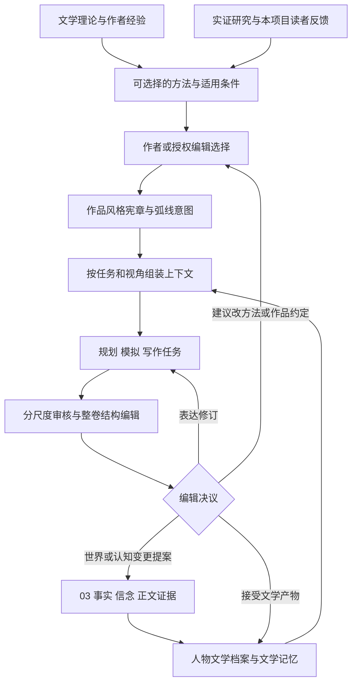

# 11｜文学研究与长程编辑

> 版本：总体架构研究 v1.1｜日期：2026-11-10  
> 定位：补全长期人物塑造、文学记忆、文笔文风研究、分尺度审核和整卷编辑的创作闭环。本文定义职责、产物和决策关系，不规定完整数据库结构、API或提示词。  
> 关联：[动态知识](03_知识与动态世界架构.md)｜[小说生产](04_剧情模拟与小说生产架构.md)｜[规范与技能](06_Agent规范与技能体系设计.md)｜[研究资料](07_论文与技术资料库.md)｜[决策与评测](08_架构决策与研发路线.md)

## 1. 从“保持正确”走向“让一部作品成立”

v1.0 已经保护了世界事实、角色信息和版本历史，但文学部分仍有三个缺口：人物成长被概括为“变化要有依据”，文风被概括为“不要同质化”，卷级质量被概括为“做综合回顾”。这些方向正确，却没有说明长期写作中该保存什么、写手如何接续、总编能改什么，以及怎样知道一个原本不错的局部改动损伤了整体。

v1.1 增加的是**文学产物与编辑责任**，而非再增加一组常驻 Agent：

- 用人物文学档案保存有依据的解释、变化意图和未尽后果，使角色跨章出现时能够接续其经历。
- 用作品风格宪章和不同声音的表达锚点，指导写作与编辑；明确哪些变化是作品所需。
- 用场景、章节、相邻章节、整卷、跨卷五种观察尺度，识别局部检查无法发现的问题。
- 让整卷总编拥有结构编辑责任：选择讲什么、删去什么、如何重排、在哪里停留、通过谁理解，而不是平均各章评分。
- 把文学研究、实际写作和读者反馈连接起来；方法与作品约定通过明确版本演化。

可靠的世界是创作的材料和边界。世界里发生过十次追逐，并不要求正文逐次等量呈现；人物连续三个场景都没有改变立场，也不代表写作失败。审核须回到作品意图、具体文本和读者体验，判断这些安排是否有作用。

## 2. 文学研究能力如何进入生产体系

### 2.1 一个受版本管理的创作反馈环

图中的文学档案、宪章、评审和正文均使用 [03](03_知识与动态世界架构.md) 的作品、分支、修订、来源与批准机制。方法库属于可复用知识；某部作品选用的方法、风格版本和弧线意图属于该作品的内容版本。方法升级不自动改写已经接受的小说。

### 2.2 区分四种来源的效力

| 证据层次 | 在本专题中的用途 | 不能据此声称 |
|---|---|---|
| 文学理论与学者论述 | 提供人物、聚焦、时间、声音等分析工具 | 某理论已经转化成可靠的自动写作算法 |
| 作者创作谈与访谈 | 展示真实创作中的选择、失败和经验 | 某位作家的方法适用于所有题材与读者 |
| 受控实证研究 | 在所研究模型、文本与评价条件下检验现象 | 短篇实验已经证明中文长卷编辑能力 |
| 本项目设计与假设 | 把这些材料转成可协作、可追溯的机制 | 当前已经运行、测得提升或消除同质化 |

本轮补充研究以学者署名原文、作者本人创作材料和原始论文为依据。叙事学条目提供概念辨析，不把其中引述的全部经典原著算作本轮已读；研究阅读范围列于文末。

### 2.3 按问题组织研究，而非堆积写作格言

文学研究能力在开立新作品、选择新题材、反复出现同类编辑问题、跨卷改变表达方式或更换重要模型时启动。它应回答一个具体问题，例如“怎样让已长期缺席的配角重返主线而不靠大段履历”，而非每章重新检索所有小说技法。

研究产物是一份简短的方法说明：所解决问题、来源与证据层级、适用作品条件、可尝试的做法、可能损伤什么、一个正例与一个反例，以及如何比较结果。比如“用人物动作承担情绪”可以是方法；“所有情绪词必须删除”不应进入系统。

可复用内容分三层：通用分析工具、题材与读者条件、当前作品的选择。前两层提供选项，第三层才形成具体任务约定。网络连载中的章末期待、悬疑的信息控制、仙侠的成长回报各有用途，但不统一规定章数、战斗频率、恋爱线或固定高潮曲线。

研究资料使用与作品知识分开的命名空间和访问范围。论文或范例中的人物、组织与秘密不自动进入作品实体索引；他作情节、作者访谈和外部评论也不成为本书的 canon。只有经选择的方法或明确引用，才进入相应任务；它们继续遵守 [06](06_Agent规范与技能体系设计.md) 的装载与权限边界。

## 3. 人物文学档案：保存经历的意义，保留人物改变的空间

### 3.1 与事实和认知内核的边界

人物文学档案不是第二份人物数据库。它引用某版本的事件、观察、信念、关系和正文，在此基础上保存创作意图及文学解释。若一项记录声称人物实际得知秘密、形成重要信念或作出有后续约束的承诺，仍须使用 [03](03_知识与动态世界架构.md) 的认知与事件语义。

**人物已经接受的私有决定与信念，可以是03中的正式认知事实。** 例如人物确实在当夜决定离开宗门，即使没有说出口、读者还未获知，也可以在获准历史中成立。不能把一切心理内容都降为编辑猜测；同时，人物说“我已经原谅了他”只直接证明这次表达，是否真实反映其状态仍需结合语境与既定呈现方式。

在此基础上，还要区分以下文学记录：

| 内容 | 示例 | 使用边界 |
|---|---|---|
| 作者的弧线意图 | 希望弟子从依赖师父转向独立判断 | 可修改的未来方向，不能强迫本场行为，也不能给角色泄露结局 |
| 角色自述与自我解释 | 本场独白说自己已经不再恨师父 | 有位置和语境的表达；可能是当时感受、自我说服或不可靠陈述 |
| 叙述呈现及其可靠性 | 旁白直接呈现其私下决定，或只经他人视角猜测 | 前者可支持认知事实的采信，后者保留推测身份；依据本作品的叙述约定判断 |
| 编辑对文本的解释 | 其行为表现为寻求认同，尚未完成独立 | 带证据、责任人和反证的判断，不自动覆盖人物事实 |
| 对读者反应的假设 | 读者可能把留剑理解为仍想和解 | 预测而非真实认知；实际读者反馈另存样本与阅读条件 |

人物的情绪、意图、行动与读者的感受也不必一致。角色说自己释怀，却仍避免提起死者，可能构成人物深度；编辑不能仅凭这类张力要求把两处“统一”。人物呈现与理解会随新证据变化，叙事学对此区分直接描述和推断，也提醒文本陈述可能不可靠。[^character]

### 3.2 档案保存什么

只为主角、重要配角及持续关系保存足够支持后续创作的材料。普通人物在出现持续后果时再扩充，不为所有 NPC 建设完整心理模型。

| 档案部分 | 保存的文学信息 | 与既有证据的连接 |
|---|---|---|
| 人物持续关切 | 想得到什么、害怕失去什么、在不同身份中承担什么责任 | 指向既有目标、经历、行为与明确设定 |
| 自我理解与矛盾 | 人物如何解释自己，行动在哪些地方抵触这种解释 | 分开本人表达、他人看法和编辑解释 |
| 关键选择链 | 在什么压力下选择什么，拒绝了什么，付出什么 | 引用已经接受的选择与后果，不只列事件摘要 |
| 人物弧线意图 | 本卷准备探索哪种变化，哪些方向可以放弃 | 属于规划；保留修改理由和备选路线 |
| 情感未竟后果 | 尚未消化的亏欠、羞耻、丧失、依恋、愤怒或希望 | 引用触发经历及已出现的后续表现 |
| 关系阶段 | 双方如何理解彼此，哪些话未说、哪些期待不对称 | 引用双方不同认知与共同经历，不压成一个亲密度 |
| 表达与注意特征 | 对谁怎样说话，习惯注意什么，回避什么，哪些经历正在改变这些特征 | 引用本作品已接受的原文与场景条件 |
| 未决解释 | 当前证据不足或编辑意见不一的地方 | 保留多个解释；不得用最高自报置信度强行消解 |

档案不要求每一栏始终填满。没有足够文本支持“他害怕亲密”时，可以保留该解释为候选，而不是生成一段心理学术语来填空。

### 3.3 “打算写成”与“已经写成”分开验收

一份完整弧线计划不代表正文已经塑造了成长。真实作者经验也能说明这一差别：爱潜水的乌贼在谈《长夜余火》时回顾，原拟让人物的口号经由经历成为理想，实际塑造却弱化了这一变化，使人物显得起初就很坚定。这里引用的是作者自我反思，不代替对作品的独立评价。[^cuttlefish]

本项目因此保留两条相互核对的记录：**人物准备经历怎样的变化**，以及**文本中已经有哪些可见变化与反证**。评审可以发现“目标尚未实现”，却不能替角色写入“已成长”。

审核变化时依次问：人物遇到什么压力；原有应对方式是否受到挑战；其选择有何代价；后文哪些具体行为发生了变化；哪些旧习仍保留；读者在哪里有机会看见这些差异。并非每个人都须完成正向成长。坚持、退步、分裂、拒绝和解、始终不能改变，也可以是获得作者认可的弧线。

### 3.4 情感连续不是固定情绪值

“情感未竟后果”用于防止经历在下一章被系统忘掉，不能变成要求人物持续悲伤的状态锁。

例如丧友可能影响人物安排守夜、接受帮助、解释玩笑、使用旧物或面对相似风险的方式。它不必每次都被直接写成哀伤。一次短暂快乐也不自动结束哀悼；新的观察、选择或关系经验可能使这段经历被重新理解。

档案只记录有作用的余效及其解释状态。后续场景可以回应、回避、转化或暂不触及；要把“本场不表现”与“从人物历史中消失”分开。若决定其影响已减弱，应给出文本或作者决议依据，不靠统一时间衰减公式。

关系同理：A 认为已经和解，B 只是暂时合作，读者又可能尚不知道 B 的条件。一个对称的“关系已修复”标签会丢掉这类故事空间。

## 4. 文学记忆：保住具体证据与尚未完成的回应

### 4.1 需要记住的不只是剧情梗概

剧情摘要说明发生了什么，文学记忆还应帮助写手恢复：这件事怎样被体验、哪些话尚未兑现、什么细节仍有意义，以及此前文本怎样建立读者期待。

建议在同一版本体系中组织五类可检索材料：

1. **关键原文锚点**：人物第一次重要选择、关系转折、声线与意象形成的片段。保留原文位置及版本，摘要不能替代它们。
2. **人物与关系的解释记录**：使用上一节档案，明确解释者和证据；同一行为可以保留有分歧的理解。
3. **未完成的文学回应**：誓言的代价、丧失的余效、关系中的欠账、尚未形成意义的反复意象。
4. **叙事披露与承诺**：复用03的披露和规划对象，记录已铺设的文本以及仍可改变的回收方式。
5. **编辑决议与意图保留**：为什么留下重复、为什么不用解释性旁白、某次改稿保护了哪条关系或悬念。

不把所有细节都变成待偿还承诺。背景、气氛和开放意义可以合法存在；只有作品反复强调、结构上许诺或被作者明确保护的内容，才需要较强的跨卷追踪。

### 4.2 用双层材料构造任务上下文

每次场景写作先取得03规定的可信事实与许可视图，再加入本任务相关文学材料：人物当前关切、未尽后果、与在场者的关系、少量原文锚点、该场叙述声音与可变范围、最近的出场和接续文本。

上层简报帮助定位，下层原文供核对。重要转折、长期缺席后的重返、声音显著变化和存在争议的解释，需要回读原文；不能无限“摘要的摘要”，最后只剩“他很重情义”。

锚点不只是常用词或口头禅。可以保存“向师父请求时先说明他人的需要；向同伴则先谈代价”的表达关系，以及对应原文。这比要求每章重复某一句标志性台词更有用。

上下文仍受任务权限约束。总编可见未来弧线，角色决策只获得其已经历、能理解的材料；倒叙场景使用当时的解释与认知。作者在第三卷形成的新解释，不能直接进入第一卷人物的内心。

### 4.3 更新、压缩和失效

文学档案在关键选择、关系转折、卷级编辑或重要修订后更新；不必每次生成句子都调用总结 Agent。普通提案可按已授予的编辑权限采纳，高影响或受保护意图改变再升级。

更新要区分新增证据、改变解释和改变计划。旧解释后来不再成立时仍保留其版本与适用叙述位置，这样才能还原作品为何曾让读者作出某种理解。

原文被删改、事件被修订或披露顺序变化时，相关档案与摘要标为需核对；不能仅把旧摘要换个版本号继续使用。检索未召回某段经历是系统问题，不能被解释成人物遗忘。文学压缩的质量应通过关键证据召回和实际写作结果验证，不能仅看摘要是否短而流畅。

## 5. 作品风格宪章：说明这部作品怎样表达

### 5.1 风格在创作前参与选择

风格不是正文完成后统一附加的装饰。汪曾祺的创作谈强调语言参与内容，句间联系和暗示作用不能只按单句华美来理解。借鉴这一作者经验，本方案让风格进入叙事选择、段落安排和任务交接，而不要求仿写其独特声音。[^wang]

作品风格宪章应简短，重点回答以下问题：

| 约定 | 需要说明的选择 |
|---|---|
| 叙述声音 | 谁在讲述，叙述者是否显露态度，讽刺或抒情如何使用 |
| 聚焦与心理距离 | 经由谁感知和评价，何时贴近内心，何时退后概述 |
| 叙述者的时间位置 | 当下叙述、事后回顾或其他约定；允许使用哪些后见信息 |
| 语域与社会差异 | 旁白、不同角色、不同场合分别怎样用语，方言与术语用到何种程度 |
| 节奏与信息密度 | 哪类选择值得停留，哪类过程可压缩，何时留白或解释 |
| 意象与细节来源 | 本作品偏重哪些经验领域，避免所有角色共享无来由的知识与比喻 |
| 情感表达 | 直接表达、内心语言、行动、沉默和场景反衬如何组合 |
| 允许的变化 | 不同POV、卷、年龄和关系阶段如何形成有意差别；哪些转变需要铺垫 |

这些约定不应变成固定句长、禁词表或每章修辞配额。若作者选择多声部，宪章应保护差异；若作品有稳定的回忆者声音，则要解释人物年轻时的直接发言如何与事后叙述并存。

### 5.2 分清作者、叙述者、聚焦者和对话角色

“第三人称”不足以规定一段小说怎样被体验。Niederhoff 对聚焦的分析区分叙述声音和人物感知，也指出提供人物知道的信息，不等于真正以其感受与评价组织叙述。[^focalization]

因此任务上下文至少应明确：谁讲、谁感知、从什么时间位置讲、什么信息可以说，以及本段与人物意识保持何种距离。它们是已有叙述与视图信息的文学用法，不另建一套世界时间。

以第一人称回忆为例，“那时我尚不知道……”可以来自后来讲述的叙述者，但不代表故事中的年轻人物已经获得消息。全知旁白也不意味着每句都必须解释所有人内心。自由间接表达、角色的偏见与不可靠叙述，需要按作品约定审核，不能自动升级为世界断言。

隐含作者则更不能成为一个全知管理角色。它是读者从整部文本重建的作者形象，相关理论本身也承认不同理解；在本系统中，它至多帮助编辑检查“作品整体给出了怎样的价值印象”，不能冒充真实作者意图或强制所有人物赞同同一种立场。[^implied]

### 5.3 方法可以互相替代，不能变成单一写法

| 创作问题 | 可尝试的方法 | 需要保留的反例 |
|---|---|---|
| 情绪只剩标签 | 用选择、注意对象、动作或对白间隙承载感受 | 直接概述可跨越长时间，也可形成坦率的叙述声音 |
| 设定阻塞场景 | 在人物需要、冲突或疑问中分步披露 | 某些作品有意保留编年、讲述或知识性段落 |
| 对话人物相似 | 检查目的、身份、对象关系、回避策略与知识范围 | 同一机构的公文语体或仪式套语可以相似 |
| 节奏过平 | 改变呈现时长、信息位置、视角和选择的代价 | 安静段落可能承担恢复、对照和关系深化 |
| 语言过分整齐 | 恢复人物的犹疑、粗粝、省略和局部节奏 | 不为“去AI味”故意制造错误或无理由的破碎表达 |

show/tell 在理论中也存在多种区分，不能缩成“展示永远优于讲述”的硬规则。[^showtell] 本地重复检测、句长分布和词频只帮助定位值得看一眼的地方；最终判断要回到功能、语境和原文。

### 5.4 跨卷风格怎样演化

人物年龄变化、叙述者更换、关系破裂、题材重心转移，可能需要新的表达方式。编辑先说明改变的文学理由，区分作者有意转变与更换模型造成的无意漂移；提供原文锚点和少量候选样段，比较收益及损失，再按授权接受新的风格版本。

新版本应说明从哪一卷、哪些场景或哪个叙述声音开始生效，哪些差异继续保留，是否需要修改未发布草稿。它不会自动重写旧卷；旧时点的直接发言仍可保留当时语域，后来的回忆叙述则遵守其讲述位置。读者反馈可以触发研究和提案，但没有未经决议就把整书语气改成“更轻快”或“更成熟”的通道。

跨卷审核比较的是变化的来源、功能和可理解性，而非与第一卷的距离是否最小。确定新方向后，更新任务上下文与实例，不必把旧方法从研究库删除。

## 6. 并行写作：共同依据与合法多声部

### 6.1 为并行任务固定正确的东西

[04](04_剧情模拟与小说生产架构.md) 按依赖组织场景并行，本节补充文学依赖。每个写作任务应得到同版本的作品宪章、对应叙述声音、该POV的注意与表达范围、在场人物关系，以及相邻任务必须接续的未完成动作、情绪或疑问。

多个模型共享这些作品依据，不要求生成同样的句型。同一人物在审讯、家庭和独白中可以有不同语域；多POV叙述可以改变节奏和词汇；人物成长也可以改变讲话方式。审核关注差异是否能由人物、情境或已批准的表达选择解释。

用于校准的片段优先来自本作品已经接受的文本，或为本作品原创并审定的小样。研究现成作品时抽象其方法与作用，不把某位作者的完整声音作为复制目标。

### 6.2 接缝编辑有独立任务目的

合并后的接缝不只检查上一章在哪里、下一章是否接得上，还要核对：

- 上一场留下的情绪与下一场的注意是否有连接、合理的时间间隔或有意反差。
- 是否重复介绍同一信息、重复做同一种情绪总结，或互相省掉必要的过渡。
- 叙述者和聚焦者是否发生未提示的切换；有意切换是否有辨认条件。
- 对话中的称谓、亲疏、回避和潜台词是否承接关系阶段。
- 章末期待是否在后续获得推进、转化或明确延迟，而不是反复空悬。

接缝可以通过改过渡、调整切点、删除重复说明、重分场景或重新标定视角解决。若必须新增告知、改变承诺或改写事件顺序，则进入相应事实/认知变更流程。接缝编辑无权为了“统一文风”抹掉合法声部差异。

### 6.3 多模型不是天然的多样性保障

短篇构思实验发现，个体评价改善可能与作品之间更相似同时出现；另一项2026年预印本在短小英文个人叙事中观察到三模型改写的选定文体指标呈同方向变化。后者未证明这些变化必然被读者感知或降低文学质量。[^diversity] [^voice]

本方案据此将模型数量与声音多样性分开管理。更换模型、加入“保留声线”提示或增加审稿轮数，都必须用当前作品验证。先保护有功能的差异，再判断某种变化是否值得保留；不是把相似度越低或文风越稳定当成普遍目标。

## 7. 场景到跨卷：五种尺度的审核责任

### 7.1 每个尺度回答不同问题

| 尺度与触发 | 核心材料 | 主要问题 | 产物与裁量 |
|---|---|---|---|
| **场景**：细纲确认、初稿及关键改写 | 场景意图、授权视图、入场状态、人物档案、正文 | 选择是否可信；信息如何被体验；场景产生了什么变化、对照或停留；情绪表达是否有对象 | 场景编辑指出具体问题或认可保留；持久事实变化回03 |
| **章节**：形成可读章节时 | 本章全部场景及章前后接口 | 是否存在推进与重心；场景比例、解释量、章内节奏和结束方式是否有效 | 调整场景组合、篇幅和切点；不要求每章独立完成一条人物弧 |
| **相邻章节**：并行合并、关键转折及局部重排后 | 接缝附近原文、两侧状态与关系、读者披露 | 情感接续、重复说明、跳步、视角切换、承诺推进和停顿是否成立 | 有范围的接缝编辑；邻域随实际依赖扩展，不固定永远只看三章 |
| **整卷**：卷前诊断、关键中段回看、卷末验收 | 全卷文本覆盖记录、场景功能图、主要人物选择链、披露与承诺 | 这卷究竟发生了什么有意义的变化；焦点、情感积累、主题与回报是否形成整体 | 总编形成主要结构判断与修改方案，不能用逐章分数平均替代 |
| **跨卷**：新卷启动、旧角色重返、重大修订及阶段收束 | 相关旧卷原文、人物/关系阶段、未尽后果、未回收承诺、风格演化决议 | 人物是否被重置；旧变化是否仍有作用；伏笔如何回应；新的吸引力是否只是复制旧卷 | 决定继承、变形、回应、保留开放或修订；不要求每次全书重审 |

信息依赖不一定等同章节相邻。第三十章倒叙呼应第二章，或第二卷的承诺在第五卷回应，审核应沿相应文本与人物链回读；不以固定窗口遗漏这些联系。

### 7.2 问题单应支持编辑决策

文学问题单只需说明：所读版本与范围、原文依据、影响的作品意图、主要问题、可能的相反解释、建议修改范围以及是否涉及世界或披露变更。一个有价值的意见可以是“这两次和解承担同样作用，第二次削弱第一次的代价”，而不是“情感评分偏低”。

区分三类处置：

- **可证实的不兼容**：与已接受事实、许可视图或明确作品约定冲突，按对应机制解决。
- **意图与实现之间的缺口**：计划要表现犹豫，正文却从未让读者看见；属于需要编辑判断的证据问题。
- **审美取舍**：留白与清楚、粗粝与流畅、慢读与快读之间的偏好，保留不同方案与作者裁量。

审美意见不能靠投票伪装成客观事实。单个模型说“不够感人”，也不能直接迫使写手增加死亡、哭泣或内心总结。

### 7.3 审核不是每轮必须找出问题

近期写作反馈研究表明，模型可以给出具体合理的意见，却遗漏最重要的问题；其“已经足够好”的判断也不稳定。实验主要是英语短故事和单轮反馈，不证明整卷编辑能力。[^feedback]

所以总编要先确定主要矛盾，再决定是否值得修改。评审可明确返回“当前范围没有足够依据要求修改”。反复出现同一审美争议、没有新增证据、改动收益不明或损伤已保护的表达时，停止自动循环，按作品授权保留原稿、选择一个版本或升级裁量。

## 8. 整卷总编：先编辑结构，再编辑句子

### 8.1 总编的责任和权限

整卷总编对这一卷作为阅读整体负责：它把哪些经历放到读者眼前，谁占据焦点，何处形成期待，哪里值得停留，人物的选择怎样相互照应，结尾留下了何种完成与未完成。

总编可以在授权范围内提出或执行场景删并、顺序调整、视角转换、篇幅重配、概述与展开的交换、重复意象的取舍，以及对白和叙述的局部改写。不能直接覆盖03中的既定世界事件，不能把文学判断自动写成人物信念，也不能用“全卷统一”取消本作品允许的多声部。

若调整未来叙事方向，回到04的卷级规划；若改变已接受的世界后果，回到03的修订；若改变作品的核心表达约定，按06和08规定形成新版本决议。

### 8.2 整卷阅读需要覆盖证据

长卷未必适合一次模型调用。推荐分段通读，并保存每段实际读到的原文范围、即时阅读观察、尚未解决的疑问与其后续变化。其上建立场景功能图和人物选择链，结构判断时再回读关键原文与衔接。

场景功能图关注各段在**呈现顺序**中贡献了什么：哪项期待建立或改变，谁做了有代价的选择，关系如何变动，哪些信息现在才对读者可见，哪里发生情绪停留。它不是对世界事件逐项复述，也不要求每场都同时完成这些功能。

阅读覆盖记录是防止漏段的检查，不证明模型已获得人类式整体体验。只读了摘要必须注明，未读范围不能被宣布“全卷通过”。关键卷和重大修订仍应有真实读者或编辑进行整体阅读；其成本计入生产预算。

### 8.3 一个有边界的整卷编辑过程

1. **固定编辑对象。** 确定正文清单、事实修订、人物档案与风格版本，标明已发布前缀和可改范围。
2. **先作整体诊断。** 通读后归纳这一卷最主要的成就与阻碍，给出跨场景证据。不要先把每句改漂亮，再发现整段应该删去。
3. **形成少量结构备选。** 比较保留、删并、重排、改聚焦、调整呈现时长等手段。说明各方案改善什么、牺牲什么、是否碰到事实或读者承诺。
4. **决定结构版本。** 在已有授权内采纳；受保护意图、历史和已发布文本变化按对应权限决议。保留未采用方案及其理由，无需生成所有方案的整卷全文。
5. **执行有范围的改写。** 将可独立的修改交回写作池，重建受影响上下文；事实依赖和文学依赖分别检查。
6. **做接缝与语言编辑。** 结构稳定后，连读改动两侧，检查声音、信息重复、关系和情感；全文语言扫描可定位问题，但不默认整卷全量改写。
7. **回读与结算。** 对主要问题检查是否解决，复核新问题和损伤，更新人物档案、披露记录及下一卷需要接续的内容，接受明确版本。

顺序、时长和频次是可独立调整的叙事变量。同一事件可以在回忆中再次出现，也可以用一句概述覆盖反复发生的日常；这些文学操作不改变事件本身发生的次数。[^time]

### 8.4 连载与完成稿采用不同的可改范围

连载不能等所有章节发布后才启动整卷编辑。卷前检查主要期待和人物方向；重要转折后回看已经实现了什么；卷末检查整体回报。触发频率按卷长、转折密度和返工情况调整，不另设固定的“每五章全面审判”。

未发布缓冲区可以重新组合；已发布前缀的调整须明确形成修订版或其他获准处理。不能为了卷末更漂亮，静默改变读者此前看到的版本。新的卷级判断优先影响尚可改变的窗口，同时承认某些早期选择会限制后续修复。

## 9. 贯穿示例：一次背叛如何跨卷留下人物与语言的变化

以下是用于说明接口的原创合成案例，不是已完成的小说实验。

### 9.1 同一事实可以产生不同的文学理解

弟子沈砚曾接受师父赠剑，并长期将此视为信任。第二卷他获得证据，确认师父用他承担了某次交易的代价。事实核仍保存原赠剑事件；角色认知按实际获知更新。人物文学档案可以新增“沈砚开始把赠剑理解为控制”的解释，同时保留此前的理解与原文。

作者希望第三卷写出独立判断，但这不是“以后凡师命必反对”。沈砚仍可能为保护同门接受师父的安排，只是这次要求明确代价并保留退出条件。这样的选择与旧行为形式相似，文学意义却可能不同；若审稿只检查“是否服从”，就会误判成长。

| 阶段 | 已有证据与认知 | 可探索的文学变化 | 不应自动推导 |
|---|---|---|---|
| 第一卷受赠 | 赠剑成立，弟子理解为信任 | 请求时先寻求师父认同 | 他以后一定忠诚 |
| 第二卷获知交易 | 证据进入角色认知，后续信念经确认 | 旧赠剑记忆被重新解释；称谓或回避开始变化 | 所有旧关爱都是假的；所有人已经知情 |
| 第三卷共同救人 | 仍有公共目标与现实约束 | 接受合作但谈清条件，允许依恋与警惕并存 | 独立等于永不合作，成长必须消灭旧情感 |

跨卷上下文应带来这些差异与关键原文，而不是只更新标签为“成熟、冷静”。若新稿没有体现任何可见区别，编辑提出的是实现缺口；若读者可从选择与代价看见变化，就不必再加解释性独白。

### 9.2 丧友后的下一章不必只剩悲伤

若同伴在上一章死亡，而沈砚下一章开玩笑，需要先检查故事时间、他是否知情、玩笑对谁说、在完成什么行动。若他为了安抚受惊的孩子而打趣，同时坚持不让另一同伴独自守夜，这可能呈现丧失留下的后果；不能因出现笑声判定情感清零。

如果正文没有任何动机、反差、余效或时间解释，且此后再不承认那段关系，整卷编辑可以诊断为情感断裂。修复可以是调整注意和选择、恢复一个必要场景、改变切点或承认时距，不必强行添加一段哭泣。

共情理论提醒，作者的情感策略与读者反应不自动对应；因此“这样写一定感人”只能是待检验假设。[^empathy]

### 9.3 八章逃跑怎样重编为一段有变化的阅读过程

假设世界中八次追逐都已经成立，逐章都写成“发现敌人—逃脱—暂时安全”会重复相同功能。总编可以保留第一次完整逃生，概述没有新选择的重复路段，展开人物为救人主动暴露行踪的一次，再留下一个安静场景处理代价。

世界事件没有因此删除；物品、伤势和角色所知仍按03保持。文本披露顺序、篇幅与情感停留改变，需要重新对账和审核。若其中一个原拟删去的短句承担关键伏笔，应比较保留、移动或替代呈现，而不是让语言编辑悄悄消除它。

一段没有战斗的政治谈判也可能承担本卷最关键的选择。其冲突来自目标、权力、信息或代价，不能因动作少而被要求补一场战斗。

## 10. 成本、职责与适用条件

### 10.1 复用能力池，不按文学名词增设常驻 Agent

| 职责 | 复用的能力与触发 | 必要产物 | 成本控制 |
|---|---|---|---|
| 文学研究 | 研究/编辑能力，按明确问题启动 | 有来源的方法及适用边界 | 不每章联网研究；复用已核查材料 |
| 人物档案维护 | 记忆/编辑能力，关键变化后调用 | 有证据的档案增量 | 优先主要人物和持续关系，不全量反复摘要 |
| 场景与章节编辑 | 既有写作/审稿池 | 明确范围的问题或修订 | 低影响表达可按预授权处理，避免逐句审批 |
| 接缝编辑 | 合并与编辑能力 | 两侧联读和必要局部修改 | 依据依赖选范围；不自动重写全部相邻章 |
| 整卷结构编辑 | 总编职责，可使用独立任务实例 | 整体诊断、取舍方案和结算 | 先决定改什么，再生成改稿；有限候选与有限轮次 |
| 读者检验 | 作者/编辑组织的评测 | 具体阅读反馈及条件 | 在样卷和重要版本集中投入，不要求每章大样本实验 |

角色可以由同一模型在不同任务中承担，但高影响写作与批准应区分职责和会话。换模型可能增加视角，也可能增加成本与偏好冲突；是否使用第二模型由实际错误和收益决定。

本地工具负责版本定位、差异、覆盖、引用、重复片段和统计线索；潜台词、情绪、主题与整体叙事判断由外部 Agent 和人承担。本文没有引入本地大语言模型，也不把文学理解伪装为确定性算法。

### 10.2 何时值得采用较重的文学机制

单场景短篇可以只用简短宪章、必要角色依据和一次整体编辑。**首次短卷生产闭环就应具有最小文学记忆和整卷编辑**：保留主要人物的关键选择原文、一个需要接续的关系或情感后果，并对完整稿件做结构诊断与回读；不能等工程强化全部完成后才加入文学能力。跨卷长篇、多POV、关系变化密集、长期连载或多写手并行时，再扩大档案与审核深度。

代价不仅是额外 token。过厚档案会强化早期解释，使角色不敢改变；过多审核会把异常但有效的表达磨平；全量回读会拖慢连载。应观察每万已接受中文字的编辑费用、返工量、人工时间和实际阅读收益，按 [08](08_架构决策与研发路线.md) 的公平比较原则收缩或加强机制。

## 11. 后续验证：把文学收益与可靠性分开测

首期用可完整阅读的中文短卷，保留人物变化、关系转折、安静段落、多POV及至少一次跨章编辑。比较“仅语言润色”“加入整卷结构编辑”“再加入人物文学档案”等配置，控制模型、资料、长度和总调用预算；需要归因时分别增加机制，不一次打包所有增强。

评测至少区分四件事：读者是否愿意继续读；人物选择与变化是否可理解；重要经历是否在后续产生合适影响；不同声部的差异是否仍然有效。另行记录事实、认知和版本错误，不能用文学偏好抵消。

对风格不要把变化最小作为成功标准。安排正反例：有意从悲伤POV转为轻快POV、有意重复与断句、角色成长后的语域变化、回忆叙述的后见评价，以及确实无理由的声音漂移。评价系统能否保留前者并定位后者。

整卷比较应给读者足够上下文，不能用孤立段落偏好代替整体判断。记录读者题材经验与阅读条件，交叉展示顺序，避免让同一读者重复读两版造成的记忆影响被当作编辑收益；必要时采用不同读者组。按作品或卷报告结果，不能把同一卷几十段当成几十个独立样本。

仍待验证的问题包括：文学档案能否降低长期漂移，是否引入锚定偏差；怎样的阅读覆盖能支持可靠整卷判断；结构编辑的边际收益何时低于成本；多模型在何种条件下增加有价值的差异；中文与不同类型读者如何理解同一段情感留白。当前方案提出可检验的架构，没有宣称这些问题已经解决。

## 12. 新增研究来源与实际阅读范围

| 编号与证据类型 | 来源及实际阅读范围 | 本章用途与边界 |
|---|---|---|
| L-T1 学术论述 | Burkhard Niederhoff，*Focalization*，2011/2013；Definition、Explication | 区分叙述声音与感知；不是通用判错算法 |
| L-T2 学术论述 | Scheffel、Weixler、Werner，*Time*，2013/2014；定义、故事/话语/讲述时间、顺序/时长/频次 | 支持叙事编排，不替代世界时间内核 |
| L-T3 学术论述 | Fotis Jannidis，*Character*，2012/2013；定义、人物指认与Characterization | 区分人物证据与解释，不做人类心理诊断 |
| L-T4 学术论述 | Wolf Schmid，*Implied Author*、*Implied Reader*，2013/2014；定义与解释争议 | 区分作者、文本形象与读者重建 |
| L-T5 学术论述 | Suzanne Keen，*Narrative Empathy*，2013；定义与读者差异部分 | 情感效果须验证，不保证共情 |
| L-T6 学术论述 | Tobias Klauk、Tilmann Köppe，*Telling vs. Showing*，2013/2014；定义与区分标准 | 技法作为可选手段，不立普遍禁令 |
| L-C1 作者经验 | 汪曾祺本人创作谈，中国作家网2017转载《当代》文本；页面主体全文 | 汉语表达与整体语言关系；不是所有作品的唯一诗学 |
| L-C2 作者访谈 | 李玮与爱潜水的乌贼，《青春》访谈，中国作家网2022转载；访谈全文 | 中文网络长篇的创作回顾，不能外推为普遍因果效果 |
| L-E1 受控实验 | Doshi、Hauser，Science Advances 2024；设计、主要结果与Discussion限制 | 八句英语故事，不代表专业长篇 |
| L-E2 受控评测 | Rashkin等，ACL2025；§3–4、§6–7及限制 | 短故事反馈，不是反复整卷编辑实验 |
| L-E3 预印本实验 | van Nuenen，arXiv:2604.22142v1，2026；§3、§4.1–4.3、§5.3 | 短英文个人叙事与指标代理，无读者质量验证 |

本轮未进行论文复现或实际小说产线试验。完整研究账本含工具来源与阅读位置，供后续07资料库维护；设计中的人物档案、编辑流程与成本策略均为本项目新增。

[^character]: Fotis Jannidis. [Character](https://www-archiv.fdm.uni-hamburg.de/lhn/node/41.html), *The Living Handbook of Narratology*，2012，修订2013。
[^cuttlefish]: 李玮、爱潜水的乌贼：[爱潜水的乌贼：网络文学不断“升级”的“奥术”](https://www.chinawriter.com.cn/n1/2022/1207/c404024-32582252.html)，来源《青春》，中国作家网2022-12-07转载。页面日期不代表所有创作经验发生的时间。
[^wang]: 汪曾祺：[语言像树，一枝动，百枝摇](https://www.chinawriter.com.cn/n1/2017/0707/c404032-29391168.html)，来源标《当代》，中国作家网2017-07-07转载；本轮不据转载日期认定原文写作年份。
[^focalization]: Burkhard Niederhoff. [Focalization](https://www-archiv.fdm.uni-hamburg.de/lhn/node/18.html), *The Living Handbook of Narratology*，2011，修订2013。
[^implied]: Wolf Schmid. [Implied Author](https://www-archiv.fdm.uni-hamburg.de/lhn/node/58.html) / [Implied Reader](https://www-archiv.fdm.uni-hamburg.de/lhn/node/59.html), *The Living Handbook of Narratology*，2013，修订2014。
[^showtell]: Tobias Klauk, Tilmann Köppe. [Telling vs. Showing](https://www-archiv.fdm.uni-hamburg.de/lhn/node/84.html), *The Living Handbook of Narratology*，2013，修订2014。
[^diversity]: Anil R. Doshi, Oliver P. Hauser. [Generative AI enhances individual creativity but reduces the collective diversity of novel content](https://pmc.ncbi.nlm.nih.gov/articles/PMC11244532/), *Science Advances* 10(28)，2024，eadn5290。[DOI](https://doi.org/10.1126/sciadv.adn5290)。
[^voice]: Tom van Nuenen. [Voice Under Revision: Large Language Models and the Normalization of Personal Narrative](https://arxiv.org/html/2604.22142v1)，2026-04-24，预印本v1。
[^feedback]: Hannah Rashkin, Elizabeth Clark, Fantine Huot, Mirella Lapata. [Help Me Write a Story: Evaluating LLMs’ Ability to Generate Writing Feedback](https://aclanthology.org/2025.acl-long.1254.pdf), ACL2025，pp.25827–25847。
[^time]: Michael Scheffel, Antonius Weixler, Lukas Werner. [Time](https://www-archiv.fdm.uni-hamburg.de/lhn/node/106.html), *The Living Handbook of Narratology*，2013，修订2014。
[^empathy]: Suzanne Keen. [Narrative Empathy](https://www-archiv.fdm.uni-hamburg.de/lhn/node/42.html), *The Living Handbook of Narratology*，2013。
