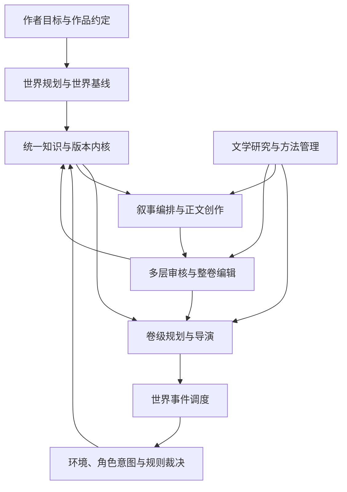
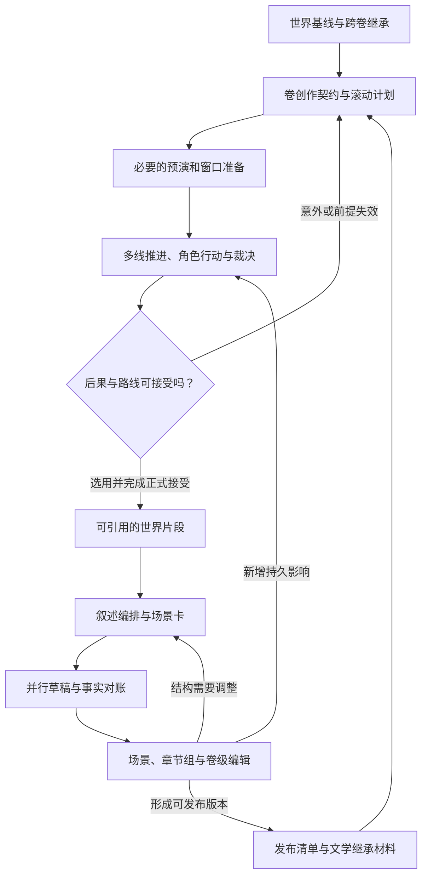
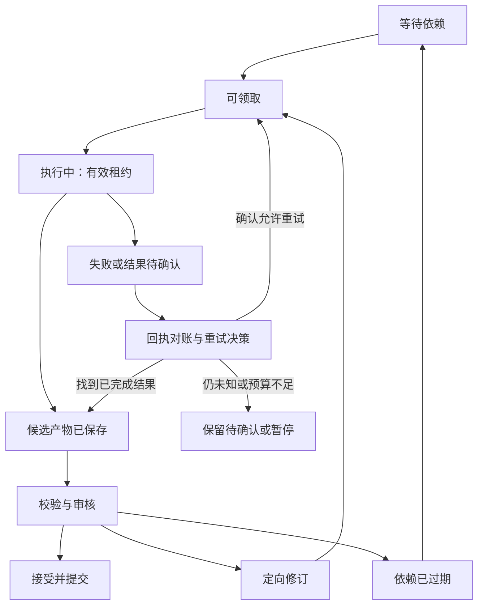
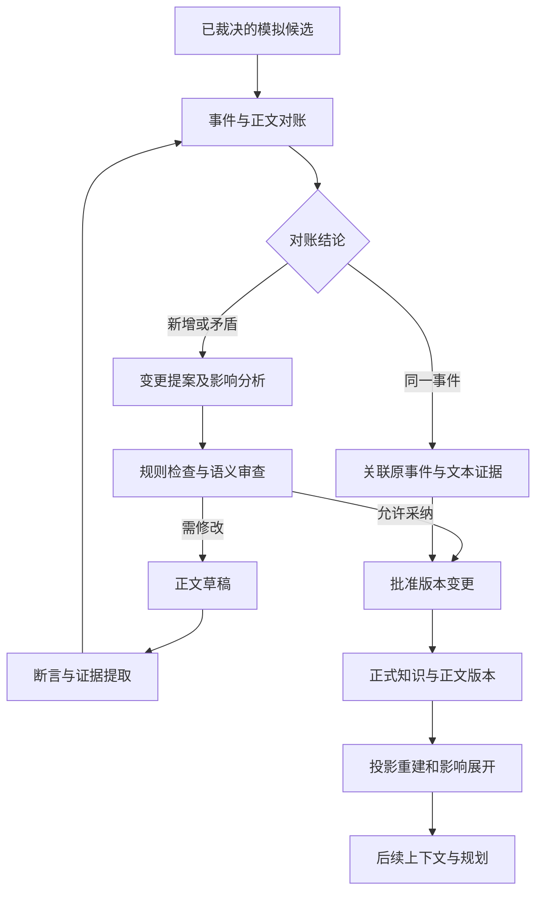
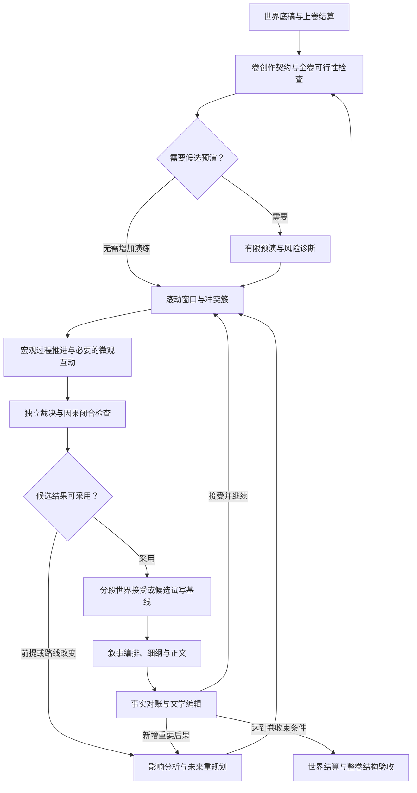
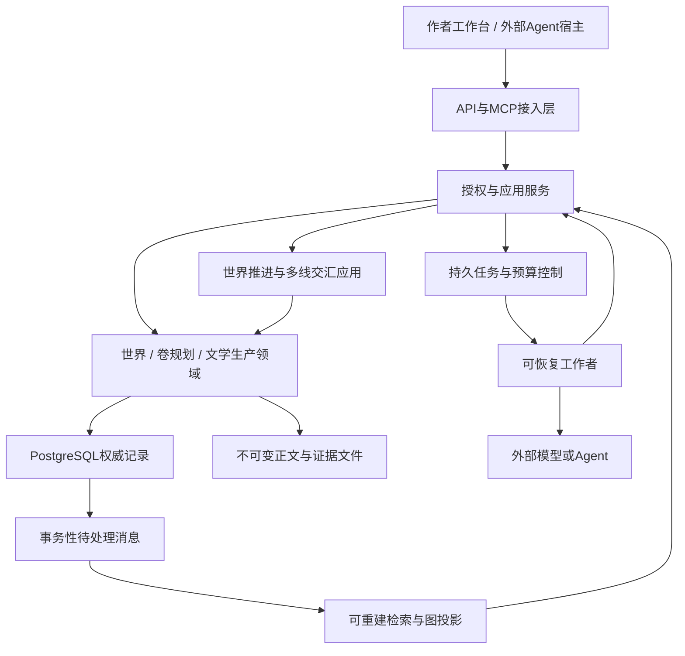
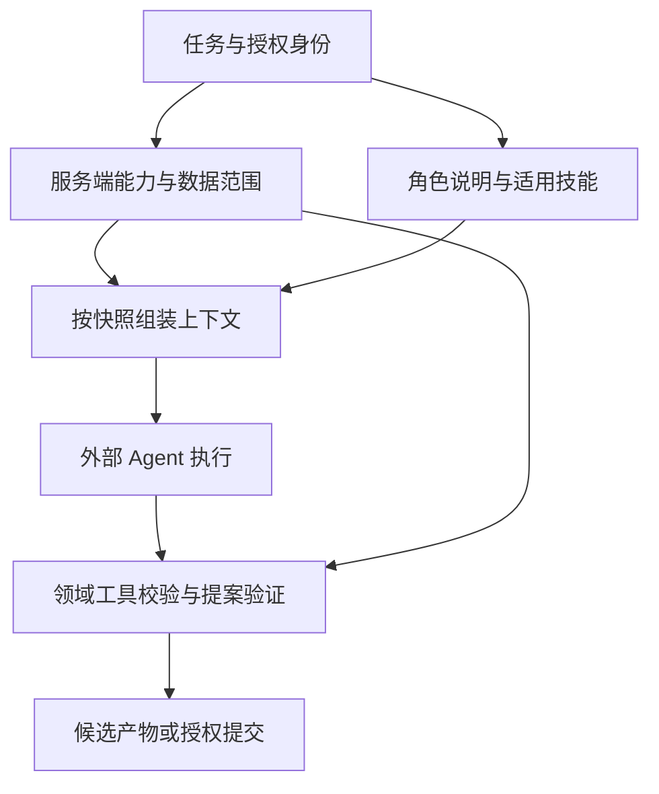
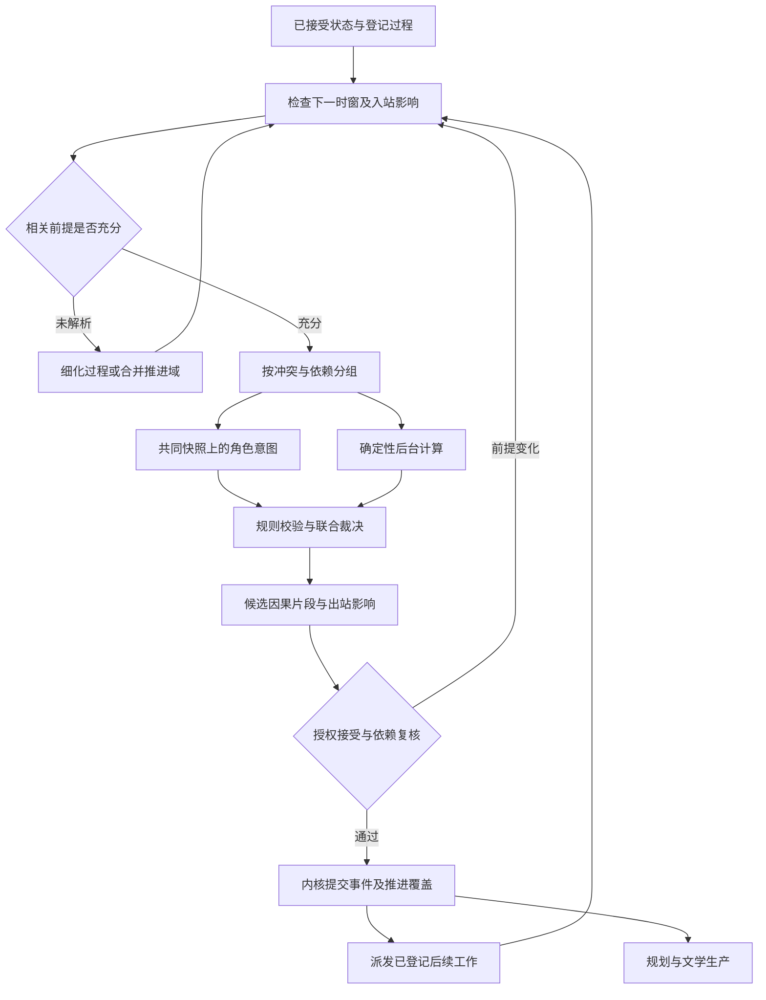
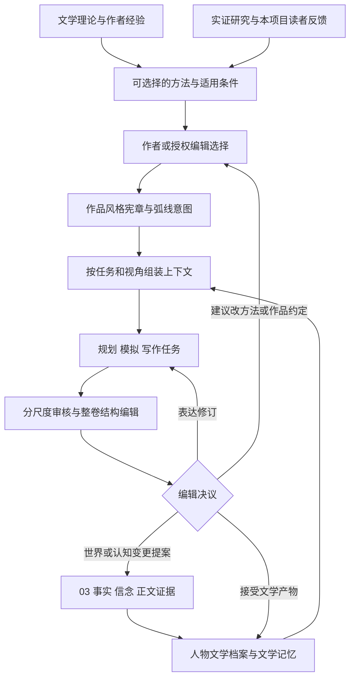

# 小说 Agent 工厂总体架构研究与设计 v1.1

> 完整合订本｜2026-11-10｜由本版全部模块文档生成。
> 本文件与分册内容一致；文内分册链接指向对应章节。架构推演与验收建议尚未经过业务实现或文学效果实验。

## 合订本目录
- [小说 Agent 工厂：总体架构研究与设计 v1.1](#doc-readme)
- [大型多 Agent 小说工厂：总体架构设计](#doc-01)
- [02｜Agent 组织与协作架构](#doc-02)
- [03｜知识与动态世界架构](#doc-03)
- [04｜剧情模拟与小说生产架构](#doc-04)
- [05｜技术体系与工程规划](#doc-05)
- [Agent 开发规范与技能体系设计](#doc-06)
- [07 论文与技术资料库 v1.1](#doc-07)
- [架构决策、风险与后续研发路线 v1.1](#doc-08)
- [09｜压力测试与端到端案例](#doc-09)
- [10｜世界事件调度与多线演化](#doc-10)
- [11｜文学研究与长程编辑](#doc-11)
- [12｜v1.0 → v1.1 架构变更说明](#doc-12)

---

# 小说 Agent 工厂：总体架构研究与设计 v1.1

> 研究与修订日期：2026-11-10（中国标准时间）  
> 基础：原始 25 个研究专题及 6 份配套资料、v1.0 架构、用户初步评审，以及新增的一手研究。  
> 阶段：总体架构研究与设计。尚未编写业务实现、运行完整小说产线或验证文学收益。

## 1. v1.1 的核心方案

**先建立结构较完整、允许大量冗余背景的世界，再以卷级动态演化组织创作；在关键互动处展开角色模拟，通过独立裁决与统一版本内核保存后果，最后由文学规划和整体编辑组织成小说。**

保留 v1.0 的知识、版本和可靠性基础，补强创作机制：世界不只为当前主角临时生成；卷纲提供方向而不强制每个结果；世界进程可以在幕后继续；人物经历通过证据型文学记忆累积；整卷编辑负责读者看到的整体，而非平均各章评分。

本次为**完整修订版**。01—09 已同步修改，10、11集中解释世界调度和长程文学机制，12说明修改原因。阅读者无需在 v1.0 上手工拼接补丁。

## 2. 阅读路线与文档导航

希望连续阅读，可打开[小说工厂_总体架构研究与设计_完整合订本.md](#top)。希望逐项评审，建议先读01，再读04、10、11，最后结合08与09检查取舍及验收思路。

| 文档 | 主要回答的问题 |
|---|---|
| [01_总体架构设计.md](#doc-01) | 整体如何分层，世界、文学、知识和协作怎样形成同一个闭环？ |
| [02_Agent组织与协作架构.md](#doc-02) | 谁决定意图、结果、时间和叙述，怎样管理权限、冲突与返工？ |
| [03_知识与动态世界架构.md](#doc-03) | 事实、信念、计划、时间、过程、版本、来源和文学视图怎样共存？ |
| [04_剧情模拟与小说生产架构.md](#doc-04) | 从世界准备到卷级预演、滚动窗口、重规划、正文和卷结算怎样工作？ |
| [05_技术体系与工程规划.md](#doc-05) | 推荐技术、代码模块、两类调度、提交、MCP/API、恢复与成本如何安排？ |
| [06_Agent规范与技能体系设计.md](#doc-06) | AGENTS.md、SKILLS.md、SKILL.md及开发/运行时角色分别管什么？ |
| [07_论文与技术资料库.md](#doc-07) | 哪些来源实际读过，支持哪些机制，哪些结论不能外推？ |
| [08_架构决策与研发路线.md](#doc-08) | 哪些边界已经确定，哪些工具仍是候选，后续如何验证？ |
| [09_压力测试与端到端案例.md](#doc-09) | 如何用正常例、失败例和文学反例检查整套架构？ |
| [10_世界事件调度与多线演化.md](#doc-10) | 多条线何时推进，怎样处理消息、同时行动、跨线交汇和宏微切换？ |
| [11_文学研究与长程编辑.md](#doc-11) | 人物和情感怎样积累，怎样研究写作方法、保持声音、编辑整卷？ |
| [12_v1.0至v1.1架构变更说明.md](#doc-12) | 相比 v1.0 实质改变了什么，为什么改变，哪些建议作了条件化处理？ |

若主要评审文学机制：**04 → 11 → 02 → 09**。若主要评审技术可靠性：**01 → 03 → 10 → 05 → 08**。来源核查统一进入07，不必逐个文件重复查找论文。

## 3. 全套文档共同采用的架构边界

### 3.1 世界可以很大，运行与上下文必须有选择

提前准备力量与地理结构、文明和制度、重要势力及内部利益、历史与当前矛盾。暂不进入剧情的设定也可以成为正式背景；未出场不降低其约束力。允许尚未决定的微细节继续开放。

**保存设定、推进变化、装入上下文、写进正文是不同决定。** 通过过程聚合、按需展开和权限检索控制成本，而不是把整个世界缩成主角眼前的几件事。

### 3.2 整卷有方向，未来仍可改变

卷创作契约说明阶段问题、主题张力、人物与势力的独立目标、作者保护的少量承诺、收束条件和预算。每卷检查整体可行性，按风险选择少量粗预演；生产中以滚动窗口推进宏观过程，在关键交汇处细化人物互动。

全卷预演是候选诊断，不自动成为 main 的未来历史。角色可以使用当前分支已接受且合法获知的经历，不能提前读到尚未发生的结局。合法意外可以改变卷纲，并允许保留有代价的失败。

### 3.3 世界调度、行动裁决与文学导演分工

世界调度器判断哪些过程和入站影响需要处理；角色决定想尝试什么；规则与独立语义裁决决定实际后果；卷导演和编辑决定哪些事件怎样被讲述。调度器首期是现有应用内的模块。

现实任务执行时间不等于故事时间；同日不自动意味着同时；数据库先提交也不能决定谁夺得同一件物品。无法确认的高影响过程暂停相关接受，真正无关的线继续推进。

### 3.4 文学记忆引用同一个世界

已接受的事件、私有决定、信念和承诺仍属于知识内核。人物文学档案另存有原文证据的解释、弧线意图、情感未竟后果、关系阶段及声音线索，不覆盖事实，也不成为第二个数据库真源。

“希望人物成长”“人物实际作出选择”“正文让读者看见变化”分别判断。情感连续不要求每章重复同一种情绪，成长也不要求线性变好。

### 3.5 整卷编辑承担整体责任

场景、章节、相邻章节、整卷和跨卷各有观察尺度。整体编辑先识别结构问题，决定删并、重排、视角和篇幅，再做接缝及语言；允许不必修改的判断，也保护有效的多声部。

连载在卷前及卷中就安排结构回看。已发布前缀受版本保护；删除一段告知描写不能让已经知情的角色重新无知。正文重排即使不改变世界，也可能使披露、文学解释和旧批准失效。

### 3.6 可靠性不依赖提示词自觉

关系数据库掌握受控事实与提交；图、全文、向量和摘要是派生能力。外部 Agent 负责语义提案，本地确定性服务负责权限、版本、时间与资源检查。MCP 是共享领域能力的接入层；AGENTS 和技能文件指导工作方法，不授予数据库权限。

所有涉及事实的正式接受继续遵守固定快照、依赖复核、幂等、任务代际、批准绑定与可恢复提交。普通任务可在预授权范围内自动完成，不要求逐句审批或所有重要情节都人工签字。

## 4. 本轮新增研究带来的关键取舍

新增研究覆盖 DODM、Mimesis、Sabre、Lamport 与 Fujimoto 的事件/因果研究，署名叙事学条目、中文作家创作谈，以及创作辅助和写作反馈的实证。重要取舍包括：借鉴容纳意外后的重规划，不把为大纲替换行动效果当常规权力；借鉴保守推进，不宣称开放世界绝对无遗漏；借鉴文学概念与反馈研究，不将短英语故事实验当作中文长卷自动编辑的证明。

既有五篇任务指定论文及工程选型继续保留，同时补正部分容易误读的边界。例如 IPOCL 原始意图框架对成功的要求，不能直接满足本项目对合理失败和对抗的需求。每项来源的阅读范围、采用位置和限制均见07。

## 5. 已确定、候选与待验证

**已确定的架构边界**包括统一版本内核、结构性冗余世界、卷级滚动组织、独立逻辑世界调度、有界导演、证据型文学记忆和整体编辑；这表示可据此进行详细设计，不表示已实现或获得效果验证。

**候选技术**包括 PostgreSQL / SQLite 的部署取舍、DB 状态机与可选工作流框架、检索组件和是否采用 SimPy。继续推荐模块化单体，原则上本地不部署大型语言模型。

**待验证问题**包括世界准备深度、预演与窗口策略、过程登记粒度、跨域依赖漏检、文学记忆的收益与锚定、整卷编辑成本、风格演化和自动接受范围。没有给这些问题编造统一数值阈值。

## 6. 下一阶段建议

先用一部约 5–10 场景的短卷贯通世界准备、两线交汇、一次合理意外、最小人物文学档案和整体编辑。首个真实异步流程同时具备基础恢复、依赖复核与迟到结果阻断。之后再扩大长卷、跨卷和并行规模。

工程正确性、语义工具效果与文学体验分别评价。比较 v1.0 基线与新增机制时，保留全部失败候选、废稿和人工介入，计入准备、预演、研究和编辑成本；整卷质量要有整体阅读，不能用事件吞吐或段落评分替代。

## 7. 交付与验证范围

本包提供互相链接的 Markdown 架构文档、Mermaid 架构与流程图、研究来源库、决策记录、纸面验收案例、变更说明和完整合订本。无需专门业务软件即可阅读；图示需要支持 Mermaid 的 Markdown 阅读器。

已对文档关系、术语、职责、接受边界和关键案例进行交叉校核。纸面案例是未来验收的预期行为，**没有冒充已经执行的测试**。本阶段未提供完整数据库 Schema、全量 API、正式提示词或全部 AGENTS/SKILL 文件，也未以文档数量替代架构有效性。

---

# 大型多 Agent 小说工厂：总体架构设计

> 版本：总体架构研究设计 v1.1｜日期：2026-11-10  
> 状态：架构设计，尚未实施或完成效果验证。本文的强制边界用于保护状态、权限与协作正确性；创作方法按作品选择。  
> 导航：[阅读导航](#doc-readme)｜[卷级生产](#doc-04)｜[世界调度](#doc-10)｜[文学体系](#doc-11)｜[版本变更](#doc-12)

## 1. 总体判断与本轮修正

推荐保留 v1.0 的统一知识与版本内核、世界与叙述分离、受控提交、选择性角色模拟和模块化单体；将生产组织升级为：**具有独立结构的世界基线 → 卷级滚动演化 → 叙事编排与正文创作 → 多层文学编辑 → 跨卷继承**。

v1.0 已解决许多“状态如何可信”的问题，但把世界提前建设、整卷演化与文学连续性压缩为若干原则。v1.1 补足三项职责：世界事件调度、卷级创作统筹、文学研究与长程编辑。它们是逻辑能力，不对应三个必建微服务，也不要求三个常驻大模型会话。

本轮对世界规模的判断有所调整：小说开写前应有相对完整的世界结构、文明、力量、历史、主要势力与社会规则；大量暂时不出场的设定可以正式存在。当前剧情相关性只决定本次加载和模拟精度，不决定一项背景是否有存在资格。与此同时，完整性以结构和关系是否成立衡量，不要求穷举每位居民及其所有未来行动。

系统长期资产包括世界、文本、创作计划和带证据的文学判断；模型会话只是执行任务的一次上下文。文学解释与人物弧线保存在同一版本体系内，但不能取得世界事实的写入权。

## 2. 目标与约束

### 2.1 本阶段范围

交付总体模块、职责、数据流、权限、取舍与验证方向；不冻结全部数据库 Schema、MCP 工具、提示词、正式 AGENTS 或技能文件。本地原则上不部署大型语言模型：语义设定、人物判断、规划、摘要、写作与编辑由外部 Agent 完成；本地提供确定性规则、数据、权限、检索、调度、预算和恢复。

工程起点继续推荐模块化单体、PostgreSQL、不可变正文对象和持久任务；SQLite 为单机或缩减部署候选。专用图库、向量检索与复杂编排框架按实测需求选择，见 [05](#doc-05)。

### 2.2 分层质量目标

| 层次 | 要保证什么 | 不能据此推导什么 |
|---|---|---|
| 系统正确性 | 权限、分支隔离、历史保留、事件效果不重复、可靠恢复 | 正文一定好读 |
| 世界可信性 | 规则和制度可解释，资源、时空、信息传播与行动前提相容 | 全部社会现象已被精确仿真 |
| 人物连续性 | 选择依据、关系和经历可追溯，变化有过程 | 人物永不反复、永不矛盾 |
| 卷级叙事 | 有可感知的发展、取舍、后果与阶段回报 | 每卷必须采用固定高潮或成功结局 |
| 文学表达 | 叙述视角、语言、场面、声线和主题相互支持 | 句式越统一、分数越高越好 |
| 长期产能 | 在可接受质量下控制费用、返工与人工审阅 | 增加 Agent 数量必然增加净产出 |

题材与作品宪章决定目标的具体含义。日常小说可以通过关系、感知和理解的变化推进，不能被系统强制改成任务闯关；悬疑允许误信和暂不解释，不能以全知旁白标准清除所有歧义。

## 3. 核心结构与责任

持久任务、身份权限、模型网关与预算是贯穿各环节的执行控制面，省略在图中以保持职责关系清楚。所有正式读写通过共享应用服务；任何 Agent 都不能绕过提交内核直接改正式世界。

| 模块 | 唯一责任 | 主要交接内容 | 不承担的权力 |
|---|---|---|---|
| 创作治理 | 作者意图、保护范围、授权、作品与发布方式 | 作品约定、批准和取舍 | 把愿望直接变成已发生事实 |
| 世界规划与领域模型 | 结构、制度、资源、历史、文化和过程定义 | 世界基线、领域规则、独立驱动力 | 规定每个角色必须走完预设剧情 |
| 世界事件调度 | 在指定分支推进已登记过程、协调时间与影响范围 | 就绪行动、交汇条件、受阻原因 | 决定文学优劣或行动胜负 |
| 环境与行动裁决 | 提出环境变化，检查动作前提，形成结果候选 | 事件、观察、资源与认知影响 | 用导演目标代替裁决依据 |
| 卷级规划与导演 | 卷目标、生产窗口、候选路线、资源分配与意外重规划 | 卷创作契约、窗口计划、选择理由 | 改掉已接受失败或操纵角色私有信念 |
| 叙事编排与写作 | 选择讲述内容、顺序、视角、详略并形成正文 | 场景卡、正文、重要新增影响 | 以删文或换序直接撤销世界事件 |
| 文学研究与长程编辑 | 可选方法、作品风格、人物弧线证据、整体阅读体验 | 文学档案、结构编辑方案、分层问题单 | 新建另一套事实真源或强制人物实现弧线 |
| 知识与版本内核 | 身份、状态、证据、版本、分支、接受、发布清单 | 可追溯快照与变更 | 自行判断哪个结局最有文学价值 |
| 执行控制面 | 任务、租约、调用、取消、预算、恢复、可观察性 | 可恢复执行与成本账 | 将模型超时解释成角色在故事中等待 |

详细权力边界见 [02](#doc-02)。世界调度是确定性模块；卷导演和环境导演主要承担语义提案。角色可以共享模型提供商，但使用各自的权限和会话。

## 4. 世界完整性与创作自由如何同时保留

### 4.1 先建结构完整的世界，再决定叙述哪些部分

世界基线应覆盖主要区域与交通、文明和日常生活、力量获得与代价、政治组织与制度、资源和生产交换、关键历史及其遗留矛盾。关注跨域联系：力量制度如何影响阶层与战争，地理怎样约束粮食和通信，历史冲突如何进入当代礼俗与组织目标。

允许记录不服务于当前主角的地区、习俗、人物和历史。每个主要势力应有独立利益、资源约束、内部差异与未来可能的行动；不以是否妨碍主角作为唯一分类。开工前可做“移除主角”的有限桌面检查：这些组织是否仍会做决定、发生交易和产生矛盾？这用于诊断设定是否过度依附主角，不要求完整运行一个平行宇宙。

### 4.2 区分事实深度、模拟精度与正文曝光

一项设定可以已接受、暂时只按粗粒度推进、尚未在正文出现。三个维度分别决定它是否约束世界、此刻投入多少计算、读者何时看到。不能因为暂不模拟就把其设定降为废案，也不能为了展示世界完整而把资料全部灌进开篇。

已确认背景、有边界的开放区域、尚未采纳素材和故意保持的叙述歧义应分别标明。扩展世界时首先检查与既有交通、物资、历史和人物知识的接口；兼容补充可正常接受，推翻已确认因果则走历史修订。

可能世界叙事理论有助于区分世界事实、人物的愿望/认知与读者的假设，并讨论虚构世界中的未定部分；它提供概念依据，不证明某个模拟算法有效。[Ryan：Possible Worlds](https://www-archiv.fdm.uni-hamburg.de/lhn/node/54.html)

## 5. 卷级演化：有方向地推进，不提前写死所有结果

### 5.1 卷作为主要创作统筹单位

卷创作契约提出本卷值得追问的矛盾、人物处境与变化方向、已向读者作出的承诺、不可随意改动的条件，以及可接受的阶段收束。作者目标、角色目标和独立世界进程分别表达。失败可以推进人物或主题；“完成任务”不是每卷唯一的收束方式。

卷导演维护滚动计划，世界事件调度器推进相关地区、势力和人物过程，角色在许可知识内作决定，裁决产生候选后果。宏观势力变化、冲突阶段和微观交互是不同观察与计算粒度，不要求三套独立世界或三套时间轴。

### 5.2 全卷预演、窗口推进与选择性模拟

| 工作方式 | 用途 | 权威与成本边界 |
|---|---|---|
| 全卷结构与可行性检查 | 检查长程时间、资源、人物目标与读者承诺 | 检查计划；不会产生已发生历史 |
| 低分辨率整卷预演 | 在复杂交汇、重大终局等情况下比较少量路线和风险 | 可选诊断；候选轨迹不自动成为正式历史，相对角色当前时点尚未发生的预测不进入其上下文 |
| 滚动窗口演化 | 在近端推进必要过程、处理意外、形成可接受片段 | 默认生产主干；窗口按耦合和返工调整 |
| 选择性微观模拟 | 解析谈判、争夺、背叛等有价值的交互 | 按需投入；常规场景仍可受约束直写 |

常规直写也要读取相关世界过程、人物连续性与叙述安排。省去角色对话模拟，不等于让后台世界停止或允许写作者任意生成有利环境。

### 5.3 三条进度边界

分别维护世界已接受事件范围、已细化/已选用的叙事计划，以及正文已审定/已发布位置。它们不要求同步：世界可以先发生，正文可以倒叙，远期大纲可以保留候选。

接受较短、因果前提已核实的片段，能控制过早冻结整卷的返工代价。相关时间线交汇时先解决冲突，再接受依赖其结果的下游；无关地区可按已声明影响边界继续推进。开放世界中未知影响无法被穷尽证明，推进结论必须说明适用模型与未解析范围，见 [10](#doc-10)。

## 6. 世界到文学的完整生产闭环

图展示世界先行主路径；文本先行仍可用：草稿中新发现的重要行为先成为候选，进入同一对账和裁决入口。若它与已接受历史冲突，需显式修订，不能沿反馈箭头直接覆盖正式状态。

### 6.1 关键交接对象

| 交接内容 | 责任与使用方式 |
|---|---|
| 世界基线 | 定义当前分支的规则、背景与起始状态；不等于整卷事件脚本 |
| 卷创作契约与窗口计划 | 说明创作意图、已知依赖、未决问题和可接受变化；保持计划属性 |
| 待推进过程与事件候选 | 区分已启动过程、条件触发、行动意图和实际发生；由调度与裁决衔接 |
| 场景卡与叙述编排 | 绑定世界依据、故事时间、叙述位置、POV、信息范围、场景作用及自由空间 |
| 人物文学档案与风格约定 | 引用已有事件和正文，保存解释、意图与声线差异；不覆盖事实或角色信念 |
| 编辑问题单与变更方案 | 说明作用于表达、叙述顺序、未来计划还是世界历史，交给对应责任者 |
| 发布与跨卷继承材料 | 固定实际正文、披露顺序及所依赖版本；明确未兑现承诺和可继续发展的世界过程 |

这些是概念上的信息契约，不要求首期每项对应一种新数据库实体或一个 MCP 工具。相近内容可以存于既有版本化计划、文档与提案中。

### 6.2 叙述改变与世界改变分流

重排倒叙、压缩旅程、删去对话呈现、切换视角首先改变叙述。它们可能改变读者理解与伏笔公平性，却不必改变故事发生顺序。新增告知、交易或伤势才涉及世界增量；撤销既有行动则涉及历史修订。

整卷编辑先决定场景取舍、顺序、人物弧和情绪连续，再做衔接及语言精修。这样既保护文字劳动，也防止各章独立合格、组合后重复和空转。文学研究、作品风格管理、运行时审稿、整卷编辑分工见 [11](#doc-11)。

### 6.3 文学记忆与事实底座共用版本，不共用真值地位

人物的已接受观察、信念、决定和行为属于世界/认知域。编辑认为“此人正在学会信任”属于有证据的文学解释；“希望他在下一卷学会信任”属于创作意图。两者都不能自行更新人物信任状态。

文学档案重点保存反复出现的选择、情感未竟后果、关系转折、意象语境及其文本证据。摘要可以帮助召回，但关键前后对照仍应能回到原文。角色可以反复、沉默或以行动处理情绪，不能被每章一次的情绪复述模板束缚。

### 6.4 整卷编辑兼容连载与整卷交付

整卷交付可先完成卷级结构编辑再发布；连载则在卷前审查结构、卷内滚动审查章节组、卷末复盘并更新后续规划。已经发布的段落不能被卷末编辑静默重排或覆盖，必要修订形成新发布版本并按作者策略处理。

这两种模式共享事实与版本机制，只调整编辑窗口和冻结范围。不能把“需要整卷编辑”解释成所有连载章节都必须等待全卷写完。

## 7. 长期可靠性与自主性的共同边界

1. **权限在服务端实施。** 该角色尚未合法获知的真相、相对其当前时点尚未发生的预演轨迹、作者的未来弧线意图不进入角色行动上下文；研究资料和正文中的命令只是数据。角色本人已知的秘密和其在当前分支已观察的经历可以正常使用。
2. **选择候选与改写事实分开。** 导演可以有理由地拒选未接受分支；已接受结果只能通过后续行动或正式修订改变。重复抽样到满意属于新的创作尝试，计入成本。
3. **分辨故事时间和执行时间。** 模型慢、超时、任务取消不会自动令人物错过列车；故事中的等待和错过需要明确的世界事件。
4. **范围依赖随任务保存。** 固定分支和 revision、正文/场景/风格版本；空查询和未解析影响也要说明，不能仅验证返回过的实体。
5. **接受与失效标记协调。** 批准绑定具体内容，短事务同时登记变更与最小失效范围；后续接受不能在异步传播空窗中沿用旧批准。
6. **重放用实际结果。** 保存裁决、模型产物、规则与必要随机结果，避免恢复时重新决定过去；正式历史不以模拟框架的常态回滚机制管理。
7. **审核与模拟有结束条件。** 有限候选和返工，必要时保留失败、改变叙述重点或交作者决议；不以多 Agent 一致同意为无限循环出口。
8. **单一权威写入继续成立。** 世界调度、文学档案、研究库、图检索都不能成为第二套正式世界来源。

## 8. 为什么增加这些能力，又在哪里停止

世界事件调度补的是“何时可以推进哪些故事过程”；卷级导演补的是“整卷怎样有方向地演化”；文学体系补的是“事件如何成为可持续的阅读体验”。三者没有互相替代关系。

首期不建设全社会微观仿真、不训练通用审美奖励模型、不让研究 Agent 自动修改生产策略、不强制分布式并行模拟。先用少量区域、势力与人物验证交汇和文学编辑的真实收益，再决定增加精度或基础设施。

新能力的主要成本是世界底稿准备、预演废案、文学上下文与跨章阅读。控制方式是按影响激活、限制候选、分层读取、先结构后润色及保留已有有效产物；不能通过省略关键因果和人物证据来虚降费用。

## 9. 已确定方向与验证责任

在本轮总体架构层面明确采用：丰富世界基线、卷级滚动主干、独立逻辑世界调度、选择性微观模拟、同内核的文学记忆、多层编辑以及导演/角色/裁决分权。具体窗口长度、预演次数、调度粒度、文学档案形式、人工审核比例和模型组合仍待验证。

08单独列出已确定的架构决定、保留的技术候选和实验问题；09给出状态、调度与文学反例。本方案尚不能承诺百万字质量、自动抽取无漏检、角色完全摆脱模型先验或人类读者偏好一致。后续应同时验证状态正确性、完整卷的阅读体验和包含世界准备与废稿的总成本。

---

# 02｜Agent 组织与协作架构

> 版本：总体架构研究设计 v1.1｜2026-11-10  
> 状态：尚未通过端到端实验。角色族用于划分责任，可由同一模型或人员按任务承担；世界事件调度是程序模块。  
> 关联：[总体设计](#doc-01)｜[卷级生产](#doc-04)｜[世界调度](#doc-10)｜[文学编辑](#doc-11)

## 1. 组织原则：管理程序掌握流程，Agent 承担判断

小说工厂需要持续保存世界和生产状态，不能把一段总编聊天记录当作整个系统。推荐明确以下职责：

| 部分 | 核心责任 | 权限边界 |
|---|---|---|
| 确定性执行控制面 | 模型任务、租约、依赖、预算、取消、重试、审核门禁 | 按现实运行时间管理任务，不将超时解释为故事发展 |
| 世界事件调度模块 | 按故事时间与影响范围组织过程推进和交汇 | 请求裁决及提交，不能决定人物意图、胜负或文学质量 |
| 小说运行时Agent | 世界设定建议、规划、角色行动、语义裁决、写作、审核 | 读取被授权的上下文、提交候选产物；不能直接改权威表 |
| 开发Agent | 研发工具、规则、数据库迁移、工作流、评测 | 默认在开发分支和测试数据中工作；生产变更走工程发布程序 |

总编Agent负责文学取舍和跨环节协调，是一个可替换的语义角色。它不保管数据库管理员凭据，不兼任所有审稿器，也不因“总编”称号获得绕过世界不变量的权限。正式写入由提交服务执行；服务可以在既定授权范围内自动接受普通章节，无须每处措辞都请求人类确认。

这与长期工作流的恢复要求一致：保存流程状态和保存领域事实是不同职责。LangGraph官方将线程检查点与跨线程数据存储区分；本系统进一步独立保留世界版本和发布记录，避免依赖某个框架内部状态作为小说事实源。[E07]

## 2. 四个容易混淆的“Agent”概念

**角色类型**描述职责，例如写手、角色扮演者或审稿员；**角色实例**绑定一本小说中的具体人物或任务；**模型会话**是一次隔离的推理上下文；**工作者进程**执行外部调用和工具请求。它们并非一一对应。

一名角色可以持续存在于知识库而长期没有活跃会话；一个工作者可以依次执行许多角色实例；同一模型可以承担不同职责，但每种职责必须重新构建上下文和权限。用同一模型分别写作和审稿，只能称作角色分离，不能宣称获得了统计独立的评价。

### 2.1 推荐角色族

| 角色族 | 产物与责任 | 不负责 |
|---|---|---|
| 总编 | 全书创作约定、跨卷取舍、重要冲突决议、授权内批准建议 | 数据库事务、随意恢复预设结果 |
| 世界主设与领域顾问 | 世界基线、文明制度、资源历史、独立过程及扩展提案 | 将所有背景写成主角专用道具 |
| 卷导演与规划者 | 卷创作契约、滚动窗口、预演比较、意外重规划、叙事注意分配 | 直接改变人物信念、裁决或正式历史 |
| 环境导演 | 地区条件、非人格化过程、合法环境变化与观察建议 | 充当隐形全能反派，反复施压直到角色服从 |
| 角色/势力行动者 | 根据私有认知、价值、资源和组织决策条件提出意图 | 全知检索、自行宣布成功；抹掉组织内部差异 |
| 语义裁决者 | 对本地规则未完全定义的后果提出有依据的裁决 | 为符合大纲而改变确定规则；代替角色选目标 |
| 写作与修订者 | 场景叙述、对白、语言和正文中新发现的创作提案 | 悄悄改变重大事件和信息边界 |
| 证据整理者 | 断言、事件对齐、原文证据与文学档案的候选更新 | 自动将抽取、心理标签或编辑解释升级为事实 |
| 文学研究者 | 阅读理论、创作经验及样章，提出有边界的方法和实验 | 给每章自动追加规则；直接修改风格或人物 |
| 专项审核者 | 事实、人物、披露、局部表达等有证据的问题单 | 以单一分数裁定整卷质量 |
| 卷编辑 | 整体诊断、场景取舍/重排、人物与情感连续、接缝及修订整合 | 以删文代替撤销世界事件，或统一抹平多声部 |

总编、卷导演、卷编辑可以由同一主体按阶段承担，但要明确本次是在制定未来、判断已写文本，还是批准变更。世界顾问和文学研究按准备、具体问题及版本回顾触发，无需常驻轮询。普通写作与修订可以复用工作池，高影响变更仍须独立证据复核。

### 2.2 人类作者的介入位置

作者预先确定创作方向、受保护设定、发布渠道、预算和允许自动处理的变更类别。普通描述、对话、已经授权的冲突结果和常规章节接受可以自动完成。

受保护设定变更、重大历史修订、超出当前授权的外部发布、预算例外或价值取舍无法解决时，系统提交具体方案供作者决策。角色死亡是否需人工介入取决于作品政策和既有授权，不能一概规定“所有死亡必须审批”。

人类也应能直接编辑正文。编辑后的文本作为新版本重新走受影响的对账和审核，不覆盖旧稿，也不要求作者模拟Agent的内部对话。

## 3. 能力与信息权限矩阵

世界真相、作者计划、人物信念和读者已获知分别构建视图。权限控制在服务端执行；客户端传来的`epistemic_view`只是请求，不是授予自己全知权限的凭据。

| 主体 | 默认可读范围 | 可提交产物 | 可直接改变权威状态 |
|---|---|---|---|
| 角色行动者 | 该人物在指定故事时间的感知、记忆与信念 | 行动意图、话语、认知候选 | 否 |
| 卷导演 | 授权世界、卷目标、候选预演、文学连续性与预算 | 推进窗口、候选选择、重规划与叙述安排 | 否 |
| 环境导演 | 指定地区/过程的真实状态和适用规则 | 环境变化、观察与传播候选 | 否 |
| 世界事件调度器 | 推进所需状态、已登记过程、因果和影响边界 | 就绪任务、交汇/受阻说明、提交请求 | 仅由受控提交服务正式生效 |
| 写作者 | 场景合同、允许披露内容、必要文风与衔接上下文 | 正文、新细节或变化提案 | 否 |
| 证据整理者 | 待审文本及授权核对范围 | 带文本位置的断言和对齐候选 | 否 |
| 事实审核者 | 指定版本的相关世界状态、事件和证据 | 有证据的问题及处置建议 | 否 |
| 文学审核者/卷编辑 | 正文、创作约定、人物文学档案及必要的事实证据 | 分层问题单、结构编辑与有范围的修订 | 否 |
| 文学研究者 | 获准研究资料与指定样本，默认不需要全书秘密 | 方法提案、适用边界、样章对照 | 否 |
| 总编 | 作者授权的全局视图 | 选稿、变更和争议决议 | 只能请求提交服务执行 |
| 提交服务 | 完成校验所需的权威数据 | 新版本、审批记录、发布清单 | 是，受身份与策略约束 |
| 开发Agent | 代码、文档、脱敏测试数据 | 工程变更 | 默认无小说生产写权限 |

写作者是否需要知道被隐藏的真相，按任务决定：普通场景只给可表达信息；必须准确布置双关或伏笔时，可由获授权的作者视图提供必要解释，同时规定读者披露界限。不给所有写手灌入完整未来卷纲，是减少剧透和过度迎合结局的直接办法。

角色会话和缓存必须隔离。不能让一个已经阅读作者全知视图的会话仅靠“现在扮演主角”就承担信息受限角色；不同角色、不同分支及不同权限的检索缓存也不能混用。服务端过滤能控制系统送入的信息，不能保证模型完全没有预训练知识、类型套路或正确猜测，因此还需要行为层的信息来源审核。

### 3.1 五种决定分开负责

| 决定 | 主要责任者 | 对其他环节的约束 |
|---|---|---|
| 世界里存在什么规则与背景 | 作者授权下的世界主设与提交服务 | 新增设定检查历史接口，不能临场覆盖既有规则 |
| 哪些过程何时可以推进 | 世界事件调度器 | 依据时间和影响范围；队列先后不决定争夺胜者 |
| 人物想做什么 | 角色行动者 | 依据当时所知和自身理由；角色可以拒绝导演建议 |
| 行动实际造成什么 | 本地规则与独立语义裁决 | 允许失败、部分成功和未知；不能为终局改判 |
| 哪些事件怎样被讲述 | 卷导演、写作者与卷编辑 | 改变取舍、顺序和表达；不自动改变发生事实 |

卷导演可以要求“下一窗口观察商队与守军如何交汇”，也可以提出成功目标或作者保护的承诺，但不能把它作为裁决成功的依据或强制角色选择。环境导演可以依据既定季节和条件提出暴雨，不能反复补造灾祸排除角色的其他选择。提出新机会或新设定并非一律禁止，但要按普通世界提案说明依据、代价和影响，并记录其导演来源。

### 3.2 候选选择与事后操控的边界

允许比较少量未接受分支，记录为什么选用或放弃；保留角色合理失败作为有效候选。不能从多个互斥分支各取有利片段拼成一个未经重验的历史，也不能把重新生成直到满意称作技术重试。

预演得到的远期事件、读者反应预测和人物弧线愿望只提供给授权规划/编辑任务。角色执行选择分支时重新从对应快照组装上下文，不能沿用已经读过其他分支未来的会话。真实已获知的信息则不能为了制造误会被任意清空。

已接受结果与保护终局冲突时，先调整尚未发生的路线；必要时向有权限的主体提出承诺或历史修订。一次重大角色行为不必都请求作者确认，是否升级由作品保护范围和既有授权决定。

## 4. 通信以任务和产物为中心

不采用所有Agent无限互相聊天的默认模式。控制面维护任务板与依赖关系；Agent读取上下文、产出候选，结构化事件通知真正受影响的消费者。少量讨论只用于具体争议，并有问题范围、参与者和结束条件。

### 4.1 共享消息所需的语义

本阶段只要求消息能回答以下问题：属于哪本小说和分支；基于哪个不可变版本；谁在何种权限下发出；对应哪个任务、尝试和因果链；产物在哪里；使用哪些故事时间与叙述位置；依赖哪些来源；是否允许重试和何时截止。

交接还要区分世界推进范围、卷/场景计划版本、叙述顺序、风格与文学档案版本，以及产物是事实、预测还是编辑解释。基础上下文由服务生成，Agent不能任意修改。无需把同一长篇正文重复塞进每条消息，传递不可变产物引用和哈希即可。

| 消息族 | 典型内容 | 消费者 |
|---|---|---|
| 提案 | 设定、行动、认知、剧情、正文新增事实、文学方法 | 对应领域审核与决策环节 |
| 结果 | 窗口裁决、候选正文、证据对齐、卷级编辑诊断 | 下游生产环节 |
| 状态通知 | 版本接受、依赖失效、索引就绪、预算不足 | 控制面及有依赖的任务 |
| 决策记录 | 接受、拒绝、延期、变更授权 | 提交服务与审计视图 |

一条“剑已交给主人”的自然语言消息不能直接驱动资产状态变更。它可能是角色发言、抽取结果或已裁决事件；消费者必须先根据产物类型与来源确定其含义。

### 4.2 任务生命周期

图中“接受并提交”只表示任务产物按其类型接受，并不一律等于公开发表。取消、预算停止和策略暂停可从未完成状态进入终止或阻塞状态；它们撤销后续提交资格，保留已生成产物用于恢复与人工查看。

同一任务只允许一个当前有效执行代际。有意对同一场景生成两份候选时，应建立不同候选任务，避免将正常竞争和重复领取混为一谈。工作者超时后租约移交，新代际推进；旧工作者迟到的结果可保存为废弃候选，但不能覆盖当前结果。

## 5. 并行规则：根据依赖，不根据章号

工作流调度器检查事实、认知、资源、伏笔、文风衔接等依赖；世界事件调度器另行处理故事中的时间与行动交汇。不同地点的独立支线通常更容易并行；相邻章节也可在批准的候选事件序列和入/出状态固定后并行转写，但随后仍需衔接审核。

每个写作任务绑定“世界版本、场景版本、叙述编排、人物文学档案、文风版本、权限范围及读取依赖”。读取依赖包括查询范围：“没有守卫”依赖整个相关场景，而不只是查询返回的空列表。最初可用场景或实体组版本戳保守判定过期，以正确性换取少量重复审核；后续再细化。

数据库事务的Serializable隔离只覆盖该事务读写，不能自动保护几分钟前已送入模型的上下文。因此，正式提交必须重新检查任务依赖；不能把长时间LLM调用放在数据库事务里等待。[E01]

并行窗口按返工和审核积压调整。若审核队列增长、上游计划不稳定或大量候选过期，先停止派发依赖未来的写作，继续处理无关支线、修订和审核。扩大Agent数的前提是交付吞吐提升，而非界面上同时亮起更多工作者。

并行写作前由卷编辑提供有限的衔接材料：叙述者/POV约定、近期真实正文、重要人物说话方式与本场情感承接。工作者可以保留各场景应有的语域差异；共享文风不等于用同一句式改写所有人。相邻章节不能只凭各自审核通过就直接拼接，须检查状态、披露、重复解释、情绪和语言接缝。

场景卡标为确定的结果必须说明是候选分支内已选定结果，还是正式已接受事件。推测写作可以提前进行，但依赖未定时不进入可发布清单。上游调整后先确认影响范围，再决定保留、局部修订或重写。

## 6. 审核独立性与冲突裁决

### 6.1 意见必须带证据和类别

| 问题类别 | 例子 | 处理方式 |
|---|---|---|
| 可重现的硬冲突 | 同一真品在同一时间被两个互斥主体实际持有 | 阻止相关候选接受，给出版本、规则和事件证据 |
| 语义疑点 | 人物似乎突然知道秘密，但可能由暗示推断 | 补充来源与上下文，交独立复核，不自动判死 |
| 文学分歧 | 节奏慢、内心描写多、结尾不够强 | 总编根据作品目标裁决，可保留异议 |
| 创作变更 | 新细节有价值，但改变了未来剧情 | 走变化影响分析与重规划 |

裁决顺序为：当前明确授权与受保护约束；可验证世界规则；角色认知与因果连续性；创作目标；局部风格偏好。前提是先确认所谓硬冲突没有混淆倒叙、谎言、传闻、所有权与持有权。

审稿者先独立读证据，再看写作者解释，减少先入为主。重要问题可采用不同模型或人工抽检降低共同偏差，但不能把模型多数票当真值。ConStory-Bench提供证据定位与分类思路，同时承认二元判错会误判有意的延迟揭示；因此它适合生成待核查意见。[P-C]

### 6.2 局部合格与整体可用分别判断

场景审核关心本场选择、视角与后果；章节审核关心阅读单元的组织；相邻章节审核关心承接与重复；整卷编辑关心取舍、结构、人物变化、情绪节奏和阶段回报；跨卷回顾关心承诺、积累与风格演化。一次地方检查不替代较高层判断。

卷编辑先诊断影响最大的问题，提出有限的修改方案；获准后由指定修订者整合。涉及表达或叙述顺序可在编辑权限内处理，改变未来路线转卷导演，改变世界历史转知识修订。章节已批准但无法适配新的卷结构时，只撤销相应“用于本次编排”的资格，不抹去旧稿和旧批准记录。

详细多层编辑与连载模式见[11](#doc-11)。不存在每个层级都必须由一名新 Agent 重读全书一遍的要求；关键问题做深评，常规检查共享证据并合并执行。

### 6.3 返工有出口

先判断问题层级和影响范围；能局部修则局部修，已确认的结构性问题直接进入场景或卷级重编，再决定是否修改细纲、重规划或提出世界修订。修改伏笔句之前，应检查其承诺与揭示功能；不能为了去掉某类句式破坏跨卷铺垫。

同一问题反复出现时不无限增加审稿轮数。配置轮次与成本上限；触及上限时汇总剩余问题、各方证据、可选方案和影响范围，由总编或作者完成一次明确决策。硬约束未解决的候选不能靠多数票强行通过，作品可以保留在未发布状态。

## 7. 成本、自主性与停止机制

采用三级预算：全书或周期预算、卷/任务预算、单次调用上限。任务开始前预留预算，结束后按实际用量结算；价格变化按调用时的计价版本记录。重试、废弃候选和审核成本都计入，而不是只统计最后一稿。

重要角色按场景和目标变化唤醒；背景人物通过已声明的世界过程或粗粒度事件维护，只有进入叙事或影响关键资源时才升级为细粒度模拟。每个人物长期状态留在数据库，不能靠常驻会话保持存在感。

停止新任务、取消执行、撤销提交资格、暂停外部发布是四个不同动作。停止预算消耗时仍允许查阅、下载、备份、处理已完成结果；外部调用已发出后可能无法撤销，其回执必须对账。LangGraph官方也明确，丢失回执是未知结果，幂等键须事前持久化，不能把本地没有记录当成远端没有执行。[E08]

## 8. 起步配置与演进

建议第一阶段复用世界准备、卷统筹、角色/环境行动、写作修订、证据与编辑等任务池；文学研究在开书和具体问题出现时调用，世界事件调度由本地模块负责。任务入口可合并实现，不以角色族数量决定进程或模型数量。初始并发数按提供商限流和预算保守配置，再通过实际返工率调整。

扩展时增加角色模板、领域规则和审核策略，而不是复制世界数据库。开发Agent和小说Agent均通过版本化文档获得工作指导，但运行权限来自控制面；`AGENTS.md`、`SKILLS.md`与`SKILL.md`的组织由规范文档单独说明。

下一阶段同时验证四类结果：角色使用授权知识且保留合理选择；重复/迟到任务不破坏世界；跨线交汇和并行写作可停止、失效与恢复；人物变化与整卷阅读体验能获得独立证据。部署与恢复细节见[技术体系与工程规划](#doc-05)。

## 参考来源

- [E01] [PostgreSQL，§13.2 Transaction Isolation](https://www.postgresql.org/docs/current/transaction-iso.html)。用于数据库隔离能力与边界；长任务依赖机制为本项目设计。
- [E07] [LangGraph，Persistence](https://docs.langchain.com/oss/python/langgraph/persistence)。用于检查点/存储区别。
- [E08] [LangGraph，Fault tolerance](https://docs.langchain.com/oss/python/langgraph/fault-tolerance)。重点阅读Retry boundaries and idempotency。
- [P-C] Li et al., [*Lost in Stories: Consistency Bugs in Long Story Generation by LLMs*](https://aclanthology.org/2026.findings-acl.410/), Findings of ACL 2026。方法§2、局限§6、诊断评测附录A.2。

访问日期：2026-11-10。职责划分、权限矩阵、预算策略与生命周期是本项目架构建议，不是上述来源已验证的小说工厂实现。

---

# 03｜知识与动态世界架构

> 版本：总体架构研究版 v1.1｜日期：2026-11-10  
> 定位：定义全系统共同使用的事实、时间、认知、事件和版本语义；不规定完整数据库 Schema 或 API。  
> 关联：[总体架构](#doc-01) · [Agent 协作](#doc-02) · [小说生产](#doc-04) · [工程规划](#doc-05) · [完整案例](#doc-09) · [世界调度](#doc-10) · [文学编辑](#doc-11)

## 1. 核心判断：维护可追溯的故事状态，而非一份不断加长的摘要

本系统需要回答的不只是“青霜剑与谁有关”，而是：**在哪条剧情分支、采用哪次编辑修订、处于哪个故事时刻、从谁的视角看，青霜剑是什么状态；这个回答由什么证据支持。**

推荐以关系数据库保存受控知识、事件及版本记录，正文使用不可变内容对象；图谱、状态投影、全文索引、向量索引和摘要服务于查询。它们可以重建，不能各自批准一套世界真相。这继承了输入方案 v1.0 §3、§7、§17 的有效设计。

“一个权威源”是**一个受控写入和版本裁决体系**，并不要求正文大文件、数据库、索引都放在一种存储介质里。核心要求是每个正式版本有一致的清单，能够确定它使用哪些正文、事实、规则和审核决议。

世界可以预先拥有大量暂未进入当前剧情的已接受设定，包括远方势力、文化历史、物产、人物与秘密。这些冗余内容为后续演化和创作提供空间；一经接受，仍有版本、来源和适用约束，不能因为本卷没有使用就视为随时可推翻的候选素材。

**保存设定、推进变化、装入上下文是三个不同决定。** 已接受设定可以长期保存而不每天调用 Agent 模拟；登记了持续过程的地区和势力则按故事时间与影响条件推进。当前任务只召回相关且获准的信息。尚未设计的细节可以保持未定，但未定义不等于不存在，未解析的高影响过程也不能当成已经确认没有发生任何事。

### 1.1 六条共同不变量

1. 正文中出现一段话，只能直接证明该版本写过这段话；其内容是否为世界事实还取决于叙述方式和批准结果。
2. 一个角色提出行动，不等于行动成功；一次裁决通过，不等于它已经合并到正式分支。
3. 世界事实、角色信念、作者计划和读者披露分别管理；检索和写入都不能把它们隐式转换。
4. 一个历史版本可复原；改稿生成新版本，旧证据和旧发布记录仍可查询。
5. 状态变化必须可追溯到批准的事件、初始设定或编辑决议；不能仅因检索得到一段相似文本就改写状态。
6. 模型提取、模型推断和审稿分数是待采信结果；能否改变正式知识由规则、权限和明确决议决定。

## 2. 统一知识体系：同库分域、同对象多视图

### 2.1 核心对象及唯一责任

| 对象 | 表达什么 | 产生方式与边界 |
|---|---|---|
| `Entity` | 人物、地点、组织、器物、技能等具有身份的对象 | 稳定 ID；显示名称和外号不能替代身份 |
| `WorldRule` | 本世界中允许或禁止的转移、制度和能力限制 | 由领域设定批准；规则有版本、适用范围和例外 |
| `WorldEvent` | 在故事世界内发生的某次事件 | 来自批准的初始历史、裁决或正文对账；携带参与者、时间与影响 |
| `WorldProcess` | 旅行、生产、战争准备、消息传播等持续过程 | 登记起点、规则、影响范围和当前阶段；过程已经启动与未来一定完成分别判断 |
| `ScheduledTrigger` | 某时间/条件满足时应进行一次求值 | 有来源过程和适用版本；进入队列、到期或求值完成都不直接证明预期事件发生 |
| `Claim` | 某人、旁白、文档或模型作出的具体陈述 | 可以真实、虚假、争议、假设或未确认；不能直接等价于事实 |
| `TemporalRelation` | 在某区间成立或被主张成立的关系 | 根据批准记录投影，或保存来源明确的关系断言 |
| `Belief` | 某角色在当时相信、怀疑或否认什么 | 由观察、交流、回忆和推理产生；允许与世界真相不一致 |
| `PlanNode` | 作者准备实现的叙事意图与前提 | 属于规划域；记录期望结果，不直接更新世界状态 |
| `Reveal` | 正文在某叙述位置披露了什么 | 绑定具体正文版本与叙述位置，不等同角色得知 |
| `EvidenceRef` | 哪份不可变材料支持某个判断 | 指向正文片段、设定决议、裁决结果或其他来源 |
| `Summary` | 面向某任务和视角的语义压缩 | 派生内容；有覆盖范围、来源版本与失效状态 |
| `AdvanceCoverage` | 某作用域已经检查到哪个故事边界、依据什么 | 版本化的推进覆盖记录，包含过程范围与条件；它是决策依据元数据，不是世界内发生的动作 |

初始设定可以直接批准“这座城已存在”，不必虚构一个无意义的建城事件。只有确实需要解释历史变化时才建事件。关系也不必全部强制转换成动作，例如人物血缘可作为批准断言，其证据可能是一份作者设定。

世界调度使用这些对象提出推进与事件候选，仍经同一知识内核接受，不维护另一份可独立写入的世界。实体、过程和触发也不是一一对应：同一角色可以参与多个过程，一个运输过程也可能产生多次中断、求值和消息。详细职责见 [10](#doc-10)。

### 2.2 四类视图及一个候选区

| 视图 | 核心问题 | 典型内容 |
|---|---|---|
| 世界视图 | 本版本确认发生了什么、实际成立什么 | 剑已被反派盗走 |
| 角色视图 | 此人在当时观察、理解和相信什么 | 主角尚不知道失窃，仍以为剑在包内 |
| 叙事披露视图 | 读者读到此处被提供了哪些线索与说法 | 只读到空剑匣，还未看到盗剑倒叙 |
| 作者规划视图 | 作者希望哪些未来事件发生、依赖什么 | 希望师父在后续卷赠剑 |
| 候选区 | 有哪些未批准背景、探索与废案 | 另一条分支中护卫救回了剑 |

这里的“读者知识”是系统记录的**披露及预期读者假设**，不是对真实读者心理的测量。读者可能提前猜中身份，也可能忘记线索；系统主要管理可观察的文本曝光，而不是声称知道读者一定理解了什么。

同一条消息可以在不同域有不同对象：反派确实说了“剑已归还”，是可确认的发言事件；“剑已归还”作为命题可能为假；主角相信该命题，是另一条认知记录。分开保存后，谎言与误解才能成为正常剧情机制，而不是被一致性审核误删。

## 3. 事实权威、分支和正文发布必须分开

输入 v1.0 §4.1 将剧情事实表述为“已提交正文中发生的事件”，而 §6.4 允许未披露世界设定成立。若不修正，后台世界会在“没有写出来就不能发生”与“导演随时可以宣布发生”之间摇摆。

推荐采用几个正交维度，而不是一个万能的 `canon_status`：

| 维度 | 需要区分的状态 | 不可据此推导的事项 |
|---|---|---|
| 采信状态 | 提议、待核验、批准、被新修订替代 | 批准不代表读者已经知道 |
| 所属版本 | main、创作分支、模拟分支及具体 revision | 沙箱批准不代表 main 已接受 |
| 对象种类 | 已发生事件、规则、信念、计划、预测 | 已批准计划不代表未来事件已发生 |
| 文本状态 | 草稿、审定稿、发布版本 | 发布台词不保证台词内容真实 |
| 曝光范围 | 作者、特定角色、特定叙述位置 | 世界事实不自动向所有角色开放 |

**幕后事件可以成为正式世界事实。** 例如反派在 D20 偷走宝剑，经授权的世界裁决已确认，正文可以到 C31 才通过倒叙披露。主角在 D23 才发现失窃也完全成立。

同时，不必提前确认所有后台细节。对于尚未产生约束的未知历史，可保留“未定背景”；一旦它被用于角色行动、物品状态或关键因果，就需要补充来源、通过检查并纳入版本。这样既保护文学自由，也避免导演随时制造便利事实。

已接受设定、已登记待推进过程、尚未解析背景及未采纳候选是不同状态。城池确实存在，不说明其当前政权已经推进到所有查询日期；有一场候选政变，也不说明政权已经改变。后台地区的完整性应随具体查询和过程范围判断，不能以一个笼统的“已建模”标志代替。

### 3.1 “未来”相对于什么

不要用一个全局“当前故事日期”管理所有事件。多线叙事可以同时确认一条线到 D31、另一条线到 D24。系统维护的是**已接受事件集合及其因果一致边界**：一个事件依赖的已知前提不能凭空缺失；不同地点的独立事件不必强排成唯一顺序。

还需区分：

- **相对查询点的未来**：版本已经确认 D20 失窃，但正在查询 D13。D20 事件仍是本版本的确认记录，只是不参与 D13 状态投影。
- **尚未实现的未来安排**：作者希望 D50 赠剑，尚未裁决并纳入该世界的发展。它属于计划或条件分支。

因此，“未来计划不能当事实”不是把所有晚于查询时间的记录都删掉，也不是禁止作者查询已经确认的后续事件。

条件触发还有独立语义：D20 出发可以已接受，D30 的抵达检查可以已登记，但 D30 抵达仍须核对道路、拦截和其他前提。取消或改期一个触发通常修改未来安排，并不自动撤销出发事实，也不产生返航。某候选全卷预演已走到结局，仅说明该分支有一条候选历史；正式主分支仍按可审查的因果片段接受。

## 4. 时间模型：两种时间语义、一条叙述坐标与认知事件

### 4.1 不照字面建设四套独立时钟

| 维度 | 用途 | 示例 |
|---|---|---|
| 故事事件时间 | 事件在虚构世界何时发生 | D20 盗剑 |
| 故事有效区间 | 状态在同一故事坐标上持续多久 | 主角占有剑的区间为 D12 至 D20 |
| 编辑记录历史 | 系统在什么版本接受、修改或撤销该说法 | rev_120 把 D12 的借剑修订为赠剑 |
| 叙述位置 | 哪个文本版本在何处呈现某信息 | C31 倒叙披露 D20 |

事件时刻和有效区间使用同一故事时间域；后者不是另一套物理时钟。编辑历史提供双时态中的另一维。角色“D23 获知失窃”是故事时间上的认知事件，并带有自身的记录版本。

任务的现实启动时间、超时与租约另归工作流历史，不参加故事日期换算。模型迟回一小时不会让商队多行一小时；暂停应用不会自动生成故事内的“停滞”或“继续行进”，恢复后仍按照登记过程和目标故事边界求值。

必须区分三类修改：

- **新增披露**：C31 展现已确认的 D20 事件，世界历史不变。
- **历史补充**：补录未曾确定但与既有历史兼容的幕后事件；仍要检查其前提与下游影响。
- **追溯修订（Retcon）**：把已确认的 D12 借剑改成赠剑，得到另一版世界历史。

“补录”如果改变了旧版明确承诺的状态或因果，就不能通过改名绕过 Retcon 流程。

模型提出早于相关已接受推进边界的新事件时，应进入上述历史补充或追溯修订流程，不能作为普通未来触发插入后直接生效。是否已经写入正文不是唯一判断标准，其他幕后事件、人物认知和草稿也可能依赖旧历史。

### 4.2 模糊时间与偏序

支持确切点、区间、相对事件和未知时间。状态明确时可使用半开区间表达，以避免交接瞬间被重复算入两段持有状态；模糊区间则保留约束，不强行转换成精确日期。

例如事件只知发生在 D22–D25 之间，查询 D23 的物品状态可能出现多个可行结果。查询应返回“尚不可确定”、候选状态及其时间依据，不能因为它写在 C23 就定为 D23。

严格的 `before` 子图必须无环；角色关系网、社会关系网、剧情主题关联可以有环。不能把所有“有关联”都塞进一个全局 DAG，也不能把章节排序当作真实时间排序。

无环只是必要条件，还要联合检查日期区间、持续时长和先后约束是否存在可行解。例如 A 发生于 D22–D25，B 发生于 D20，却要求 A 早于 B：关系图没有环，时间条件仍然矛盾。存在多个可行顺序时应保留不确定性；拓扑排序只给出一种计算顺序，不能据此宣布故事唯一时间线。

### 4.3 统一查询语义

一次可复现查询至少明确：**作品、分支、具体 revision、故事时间或事件边界、请求的视图**。读者视图再指定正文版本和叙述截止位置；计划查询必须显式选择规划域。

对外可提供友好的“当前版本”默认值，但服务端在任务开始时要将其解析为具体 revision，并在结果中返回。Agent 不能写作到一半因 `HEAD` 改变而悄悄混用两版事实。

作品、分支与 revision 必须绑定到该身份获准访问且属于该分支历史的快照。请求 `main` 却携带仅存在于反事实分支的 revision，应明确拒绝，不能回退到 main 当前版本。读取旧版仍执行调用时有效的权限；历史快照不恢复已被撤销的访问权。

结果除答案外，应说明：适用时间、来源、采信状态、查询是否完备、派生视图是否新鲜。权限由服务端根据调用身份计算；客户端自填 `author_full` 不能获得全知权限。

答案应区别“成立”“已证实不成立”“未知”“存在争议”“无此关系”和“不适用”。例如遗失物的持有人未知，与明确无人持有不同；已毁剑的活跃持有关系不适用，也不能反推其历史上从未有过主人。对允许开放信息的世界，查不到记录不能直接作为否定证据；只有登记范围已声明完备的库存等子域，才可采用相应的封闭校验。

索引落后或检索范围不完整，是查询质量状态，不是世界中的“未知”。权限不足又是独立的访问结果；对无权获知的信息，不得通过错误差异、命中数量、路径长度或“存在一个隐藏实体”等提示泄漏其存在性。

### 4.4 查询还需要知道相关过程是否已推进

固定 revision 解决“读哪一版”，不能单独证明“该版已经算到所需故事时点”。若某地区只检查到 D24，仍有可能在 D27 改变政权的登记过程未解析，查询 D30 时不能把 D24 的统治者无条件延续为完备答案。可以返回已接受的历史及其覆盖限制；依赖 D30 政权的正式决策应先推进或取得足够的状态依据。

推进覆盖至少说明：适用的作用域与故事边界、所依赖的规则和过程版本、已处理的相关入站影响、未解析的范围。它不是“最后一个事件的最大时间戳”，也不是整个世界在该日期绝无其他事件的证明。允许地区 A 已确认到 D31、地区 B 到 D24；需要两地交互时，按 [10](#doc-10) 组织相关过程至共同因果边界，再接受交汇结果。

“没有更早影响”的结论只在声明的过程、影响通道、最短传播条件及覆盖范围内成立。已知可能改变本次结果的高影响过程未解析时，应细化、合并推进域或等待，不能用空事件列表证明安全。瞬时通信、共享资源或新规则可能使原边界失效。无关支线无需因此全部停止。

边界可以表示“已检查到 D30 之前”或一个因果闭合事件集合；到达 D30 的在途影响还未处理时，不能顺便声称 D30 同时事件已经完整结算。对模糊时间保留区间与因果阶段，避免给所有支线制造唯一精确时间戳。

以下三种缺口分别返回和处理：世界事实尚未确定；登记过程尚未推进到请求范围；检索投影尚未覆盖已经接受的事实。第一种可保留 unknown，第二种需要世界推进或限定查询，第三种应回源或重建。不能把三者都隐藏成“没查到”。

## 5. 时态知识图谱：把“网”做对，再选择图数据库

### 5.1 图是关系语义与查询能力，不是一种固定产品

第一版即可在关系库中保存实体、事件、关系断言和证据引用，使用 SQL 递归查询或按需内存子图完成多跳查询。只有实测图查询负载值得独立优化时，再建设专用图数据库投影。

建议首先定义少量有明确约束的关系族：

| 关系族 | 示例 | 关键语义 |
|---|---|---|
| 结构关系 | 属于组织、地点包含、技能前置 | 可静态或分时有效；包含关系须防非法循环 |
| 状态关系 | 占有、位于、受伤、控制矿脉 | 有有效期和排他性规则 |
| 事件参与 | 发起者、受让者、见证者、受影响物 | 用角色化参与关系表达多方事件 |
| 信息关系 | 观察、声称、相信、怀疑、告知 | 关联命题与来源，不直接等价于世界真相 |
| 规划关系 | 需要、预期实现、候选替代 | 限于未来规划或模拟分支 |
| 来源关系 | 引用、由……抽取、由……派生 | 支持版本追溯与派生失效 |

每个重要关系类型应说明适用对象、排他条件、有效期含义、允许的推导及例外。避免只增加几十个自然语言边名，却无法说明它们何时成立。

### 5.2 多方事件与因果链

“师父把剑借给主角，由长老见证，三日后应归还”应建立一个事件，关联不同参与角色、物品、条件和承诺。几个彼此孤立的二元 `owns` 边无法表达同一交接，也无法保证它们一起更新。

“矿脉被夺→资源不足→武器制造受阻→战力下降”也不能统一当作必然因果：

- 已核实库存低于制造配方所需，是可计算的前提失败。
- “组织因此一定战败”通常是模型推断，可能有库存、贸易、战略等替代因素。
- 后续卷纲引用了旧产能，是明确的创作依赖。

三种边分别服务于状态校验、风险提示和重规划；推测边不能沿图传播为新的正式世界事实。

登记过程还需要资源、路线、消息与可能影响范围的依赖关系，用于发现跨线交汇。这些关系有“可能影响”“需要验证”等类型，不把未来候选效果写成已发生因果。调度相关图与正文任务依赖可以引用同一对象，但章节先后、任务执行先后和世界因果不能合并成一种边。

### 5.3 实体身份与揭晓

实体 ID 长期稳定。名称、外号、旧名与伪装身份可以有时间和视角范围。两个同名人物不自动合并；一个人物的两个身份也不因作者已经知道关系，就向角色暴露。

推荐以可版本化的身份对应断言关联“黑衣人”与“师父”，保留旧引用及当时的匿名表达，不立即物理合并并删除旧 ID。作者身份视图可以认定同一人，角色视图仍可把他看作未知者。

实体解析不确定时返回候选；需要保证唯一资源、核心人物或秘密身份正确时，应先解决歧义再批准相关状态变更。

## 6. 物品与资源：历史、权利、位置和血缘共同管理

### 6.1 对象种类应先分开

| 种类 | 示例 | 主要检查 |
|---|---|---|
| 类型模板 | 某类飞剑 | 能力、制造规则、默认属性 |
| 唯一实例 | 青霜剑 item_sword_001 | 身份、唯一性、生命周期 |
| 资源批次 | 三份玄铁矿 | 数量、单位、来源、分割与消耗 |
| 容器 | 剑匣、车辆、储物戒指 | 包含关系、位置传播、容量规则 |
| 知识内容 | 一门功法 | 谁掌握、许可和传播；复制通常不消耗原知识 |
| 知识载体 | 记载功法的秘籍 | 作为有形物品独立转移、损坏和毁灭 |

毁掉秘籍不必让已经学会功法的人失去知识；复制功法也不等于制造第二本同一身份的秘籍。

### 6.2 权利与实际状态不能压成 `owns`

按领域需要区分所有权、实际占有、保管职责、控制能力、使用许可、权利主张、抵押权益和物理位置。并非每件普通道具都必须填满所有字段；复杂度由剧情需要与领域制度决定。

在统一压力测试的宗门制度下：

| 故事时点 | 所有权 | 实际占有 | 解释 |
|---|---|---|---|
| D05 | 宗门 | 师父 | 宗门造剑后交由师父持有 |
| D13 | 师父 | 主角 | 借用只改变占有及使用许可 |
| D21 | 师父 | 反派 | 盗窃不转移该世界认可的所有权 |
| D32 | 最后确认的所有者为师父；毁坏后的权利依制度解释 | 活跃占有不适用 | 唯一实例已彻底毁坏，不能作为完好剑继续使用或交易 |

这些结论来自测试世界的制度假设，不能硬编码成所有小说通用的产权法。战争战利品、共有财产、人格化法器等情形需要不同规则。

查询 D32 应同时返回生命周期“已毁坏”、活跃持有及使用“不适用”，并将最后确认所有者与可能存续的赔偿、残骸或纪念权利分开。rev_119 的最后确认所有者是师父；若 rev_120 把 D12 修订为赠剑，则为主角。制度未规定毁坏后权利时保留该不确定性，不能推断所有权利必然消失，也不能返回一把仍可履约交付的完整剑。

“谁实际持有”暂时未知，不表示世界允许一把排他性神器同时被两个互斥主体独占。**知识的不确定性与世界状态的排他性是不同问题。** 对共有、共同搬运等情况，则应建立明确的共同关系而不是误报。

未来资源预约也不等于当前持有。规划域可为候选路线登记所需船只或粮食，以发现冲突；世界内已经签署的契约则可能产生未来权利，按具体制度解释。工作流的任务租约只授予计算和提交资格，三者不能互相转换。征用指令是否、何时改变法定权属应由世界规则决定，不能从指令文本自动推出库存已经入库。

### 6.3 容器与位置

剑在匣中、匣在车上、车在青岩城，可推导剑的城市级位置；前提是相关包含路径在该版本、该故事时刻有效。位置推导需要防止容器循环，并考虑移动、容器破坏和物品取出的事件。

拥有车辆不自动拥有车内所有物品；控制车辆不自动知道暗格中有剑。世界物理位置、可见位置和角色猜测位置分别查询。角色不能通过图查询返回的隐藏路径、别名或摘要间接获知秘密。

### 6.4 生命周期和材料血缘

制造、转移、消耗、拆分、合成、修复、复制、伪造和毁坏均须声明如何影响身份与资源。领域规则决定修复后沿用原身份，还是产生新衍生物；不能用“名字一样”替代判断。

资源守恒是**对声明的资源种类、数量单位、配方、损耗和产物作核算**，并非机械要求“矿石数=武器数”。三份矿石制成一把剑，可以消耗矿石、生成成品及废料；剑毁坏后不会自动退回原矿石。若世界允许凭空造物，应由批准的能力与代价规则解释。

材料与作品证据都可以借用 PROV-O 中实体、活动与派生关系的建模思想；本项目无需因此强制部署完整 OWL/RDF 栈。[^doc-03-prov]

## 7. 人物认知与长期记忆：保存变化，不制造全知角色

### 7.1 观察、解释、信念分别记录

人物收到消息只是一次接触或观察，并不意味着必然相信。认知更新可表达“接受、怀疑、暂存、拒绝、遗忘或重新解释”。重要变化需要关联观察来源及理由，但无需把每句自然语言心理描写都转成一套数值心理学模型。

角色可长期同时拥有冲突信念，例如相信师父忠诚，又察觉其行为可疑。系统应容许这种张力，不自动把它清理为单个布尔结论。自报置信度只作模型或角色的表达，不当成经校准的客观概率。

人格、价值观、社会身份、目标与情绪有不同变化速度。核心价值可逐步演化，情绪可快速变化，短期目标可被局势打断；审核关注变化是否有可理解的经历与铺垫，而非要求人物永远重复初始人设。

### 7.2 记忆分层与压缩

建议组合三种材料：

- **事件与观察记录**：保留何时经历、从谁获知以及原始证据。
- **角色持久状态**：当前目标、关系变化、誓言、创伤、关键误信等。
- **面向任务的摘要**：按场景、章、剧情弧和人物生成，可更新、可失效。

本地库负责索引、预算、聚合、版本与规则化简报；需要理解潜台词、动机或重新概括的工作交给外部 Agent。不能声称“本地无模型”还能自动完成任意高质量文学摘要。

角色遗忘是故事中的认知事件；检索器因 token 预算没召回某记忆，是系统检索失败。二者不能混用，否则系统会把自身上下文缺失伪装成人物设计。

### 7.3 认知传播的许可边界

世界变更只产生“可能被谁感知”的候选影响。确认观察、沟通和理解后，才更新相应人物状态。消息传输还应考虑地点、通信方式、时间延迟和可信来源。

发信、在途、送达、阅读与理解是可以分开的发生。一个 D29 发出的消息最早 D31 到达，只约束该通道；D31 仍要检查送达条件，也不排除人物经现场观察或另一条合法渠道更早得知。收到旧消息时保留其来源时点和接收时点，不用数据库最新真相自动纠正人物误信。世界调度管理传播过程，认知模块管理观察与信念，双方引用同一消息及发生身份。

Retcon 不会在编辑操作发生的现实时间，向角色发送一次故事内的“获知真相”。例如把 D12 借剑改为赠剑，新版本应重建权属投影，并重新评估 D12 参与者的观察、理解、记忆及后续台词；他们可能从当时起就理解为赠与。与此事无接触的反派不会因此知情，旧 revision 的认知历史也不改变。

后续已接受事件不能只检查数值状态。例如 D30 师父再次许诺 D50 赠剑，在 D12 已赠的新版中可能成为重复承诺、误解或需要修订的情节。说出许诺这一事件可以继续存在，但不得据此反推师父在 D30 仍拥有剑；需要编辑结合人物认知与场景意图复核。

### 7.4 人物文学档案与事实内核的关系

人物文学档案引用本章的人物身份、实际经历、信念、关系证据和原文，并记录人物弧线意图、情感未竟后果、关系阶段与声线解释。它是同一知识内核上的版本化文学视图，不另建一个能覆盖人物事实的资料库。组织方式与使用流程见 [11_文学研究与长程编辑.md](#doc-11)。

档案区分作者意图、角色内心表达、编辑解释和读者预期假设。作者希望角色学会信任，不代表角色当前已经信任；编辑认为其冷淡源于羞愧，不等于已接受的唯一心理事实。解释可以并列、修订并保留证据；一旦新心理判断要改变后续正式行动依据，应按认知更新的采信与版本流程处理，不能以“文学解释”静默改写已经接受的恐惧、誓言或误信。

人物弧线的未来目标可供导演和文学编辑使用；角色模拟只取得其获准的既往经历、当前状态与相关认知，不下发“编辑要求你在本卷成长”的未来剧本。情感未竟后果可以作为有出处的软记忆提醒，不由内核按统一衰减率自动归零，也不自动强制某个动作。

## 8. 版本、分支与可重放状态

### 8.1 三种历史分开保存

| 历史 | 内容 | 顺序依据 |
|---|---|---|
| 世界历史 | 盗剑、借剑、造剑、告知、死亡等 | 故事时间与因果偏序 |
| 编辑历史 | 批准设定、采纳模拟、改正文、Retcon、合并分支 | 不可变提交及父版本 |
| 工作流历史 | 某任务启动、失败、重试、审稿、花费 | 系统运行时间和任务依赖 |

删除一个借剑事件是编辑修订，不是在世界中自动生成一次还剑。模型调用失败并重试也不会让角色再说一次同样的台词。

### 8.2 分支的用途与合并条件

分支用于草稿、反事实探索、局部改写和正式演化；发布版本是不可变的已选择清单。共同祖先中同一对象、同一次发生保留身份；分叉后独立产生的发生各有身份，不能因描述相似就合并。Retcon 以新版本或明确替代关系修订断言，保留旧来源；一次发生的修订不能在重放中被当成两次事件执行。

合并不能只是两个图的并集，也不能只看文本是否改了不同行。需要比较基础版本与两侧结果，并复查：共同资源、前置状态、时间约束、角色认知、伏笔与已发布承诺。

两条分支分别写“剑已毁”和“剑被救出”，即使章节文件没有文本冲突，也存在世界语义冲突。可选择其一、重规划，或保留两个版本；不允许合成一个状态自相矛盾的 main。

### 8.3 可重放不等于重新生成

保存已接受事件、编辑变更、裁决结果、规则版本、必要随机记录与输入快照。状态恢复重放这些已保存结果，不重新请求角色 Agent“再做一次同样决定”。

本地确定性算法可以验证可重放性；远端模型即使参数或随机种子相同，也不能作为完全复现的保证。重新生成是新的 run，需重新检查后才有资格替换旧结果。

规则升级与投影器升级也要分开：修复一个计算程序缺陷，可能重建等价投影；改变世界规则本身，则是有故事影响的版本变更。不能用“系统升级”偷偷重解释全部历史。

### 8.4 宏观与微观是同一历史的不同粒度

宏观过程可保存窗口边界状态、数量变化与出入消息，不必记录每个日常动作；微观场景展开时继承这些已接受约束。聚合记录只保证其声明的范围，不能把“七天末运到一百袋粮”推成“第三天已经有一百袋”。需要中间状态时补足兼容轨迹；无法兼容则提出候选替代或历史修订。

聚合事件与细化事件建立身份及效果覆盖关系。在一个版本的状态重放中，明确由哪一种表示施加相应效果；不能先施加整周消耗，再逐场重复扣除同一消耗。只增加兼容描写可关联原事件与证据；替换状态效果的表示则须经过受控的等价细化或修订，检查资源、时间、消息及下游已经依赖的后果。宏微切换的生产职责见 [10](#doc-10)。

## 9. 正文抽取与模拟对账：在发布前闭环

推荐处理路径如下。该图表达职责和分支，不是完整状态机。

### 9.1 提取的首先是有出处的断言

提取器需区分动作陈述、对白、传闻、回忆、假设、预言、计划和不可靠旁白。句子“若剑仍在，他便能打开禁门”不能提取成“剑仍在”和“已打开禁门”两件事实。

证据绑定正文内容哈希、片段范围、场景和版本；来源段落改变时，旧证据仍属于旧版本，不能无声迁移到新段落。不同语言运行时应统一字符或字节偏移口径，避免中文索引错位。

### 9.2 三层去重分别处理

1. **请求幂等**：网络超时后重发同一提案，只保存一次有效操作。
2. **事件身份对齐**：正文中的交剑、模拟记录的交剑、后文回忆中的交剑关联同一历史发生实例。
3. **投影应用**：同一版本的同一事件效果不能在一次状态构建中执行两遍。

ID 能解决已知关联的去重；无法识别的同义表达仍需语义对账。模糊匹配只能提出候选，不能自动把两次真实交接合并成一次。

### 9.3 允许文学创造，控制改变世界的影响

新增修辞、停顿等可在不违背既有事实的范围内自由创作。天气描写只有在不改变通行、线索、能力或后续前提时才属此类；一场阻断山路的暴雨就需要事实提案。新增人物身份、永久伤势、秘密泄露、物品来源、能力例外等会影响后续的内容，也应产生知识变更提案。

正文与模拟不一致时，选择修改正文，或经授权修改事件并重查下游。不能一边保留“模拟剑已毁”，一边让正文“剑还在”，再希望摘要统一二者。也不能仅因某事件未写出来，就撤销已批准幕后事实。

## 10. 提交、并发和投影一致性

### 10.1 一个可审查的变更包

正式提交关联正文对象、事件/断言变化、所用规则、审核结果与目标版本。重大事实批准应绑定具体变更内容，修改提案后原批准不能无限沿用。

写入时先确保正文等不可变对象已可靠保存，再在数据库事务内登记引用、事实变更和分支 HEAD。数据库外对象上传通常不属于同一个 ACID 事务，架构不能宣称跨介质天然原子；采用暂存、校验、清单提交和孤立对象清理保证不会发布悬空引用。

涉及世界推进的提交，同时记录相应过程进展、触发消费或替代、推进覆盖与后续待办。不能先宣布已经推进至 D30，再等待另一个任务保存决定 D30 状态的裁决结果。跨域交汇的必要状态变化在同一接受包中检查，保持共享资源与消息身份一致；将来如需拆服务，也不能因此放松这些语义。

### 10.2 写作并行与世界裁决并行是两件事

多个 Agent 可在固定快照上并行起草；同一唯一物品的互斥行动必须先裁决冲突。不能以哪个请求更早写进数据库，决定谁在故事中抢到了剑。

同一交互窗口中的行动可共享起始快照，收齐意图后按领域规则共同裁决；已经存在因果先后的事件遵循先后关系。处理方式记录在裁决结果中，具体的战斗随机规则不属于通用知识内核。

提交时比较预期 HEAD，并检查受影响读写依赖。早期采用清晰的分支串行合并；需要提高吞吐时，再评测对象级依赖验证。不能使用“最后写入者覆盖前者”。

长任务还应携带关键范围与负向查询依赖，例如“这条路线在此时窗没有阻断过程”，而不只记录曾返回的实体行。过程新增、影响通道改变或同一边界出现新输入，都可能使旧安全推进判断失效。裁决计算可在事务外并行，接受前仍须校验这些依赖和当前授权；不能用数据库串行提交顺序替代故事先后。

### 10.3 投影延迟必须可见，但不必拖停全厂

图、摘要、全文与向量索引记录它们覆盖的来源版本和构建版本。判断兼容性依据版本祖先关系和具体清单，不能比较不同分支 revision 数字大小。

权威变更提交时同步标记受影响领域或依赖范围待重验证，逐对象失效和重建可以异步展开。新的正式接受或发布在该范围未证明兼容前必须回源验证或等待，不能把尚未被后台任务改状态的旧批准当成有效。明确查询旧 revision 则仍可读取其原有历史，不把新版失效等同于删除旧版。

关键状态查询若图投影落后，可以回到权威关系库或重放相关状态；摘要落后，可返回事件简报及原文。只有无法获得任务必需且可信的内容时才阻塞该任务。

探索检索可以在明确标记后返回不完整结果；正式审稿、资产裁决和发布不能把旧索引的“没找到”当成“事实不存在”。

## 11. 上下文编译与检索可信性

### 11.1 查询顺序

先固定版本与权限范围，再取得必需约束和角色状态；随后按实体、关系、事件与原文检索；最后加入可验证摘要和可选语义召回。搜索排序不能让不适用分支、未来规划或无权查看的秘密混入结果。

硬约束不能因为分数低而被淘汰。若必需信息超过预算，应缩小任务、分场景读取或返回预算不足，不静默截断关键前提。

### 11.2 可信上下文的最小内容

| 内容 | 用途 |
|---|---|
| 快照与视图说明 | 明确这份上下文描述哪一个世界、哪个时点、哪个角色 |
| 必须遵守的规则与已确认状态 | 防止已毁道具复活、角色越权行动等硬错误 |
| 相关观察与信念 | 支持角色在信息不足时作出合理选择 |
| 事件与原文出处 | 允许写作和审稿核对来源 |
| 任务相关摘要 | 在预算内恢复长程因果和情绪脉络 |
| 未定事项与缺失范围 | 区别“不知道”与“否定” |
| 过程推进覆盖与相关在途影响 | 区别已接受状态、尚未求值的过程和未来触发，防止从旧状态预测当前 |

文学任务还可以取得获准的人物档案和情感后果提示，但应标明哪些是事实、角色表达或编辑解释；角色决策包排除作者未来弧线。对受限角色，推进覆盖和缺失说明本身也需裁剪，不能借“有一条隐藏入站消息”泄漏秘密。

自然语言摘要不能覆盖结构化记录的证据；结构化记录也不能因形式整齐就被自动视为正确。两者均需保存来源和批准路径。

### 11.3 信息隔离贯穿整个检索链

权限过滤应在检索和上下文组装阶段实施，缓存键需包含作品、版本、视图、叙述截止与有关规则配置。不同角色的调用上下文、工具权限和模型会话应隔离，避免通过上一角色的会话残留获得秘密。

原文、图路径、别名、摘要及审稿证据都可能泄密。全知审稿 Agent 可以判断“主角不知道凶手”，但反馈给受限写作 Agent 时应提供任务允许的约束，不必附上未授权的凶手真实身份。

被拒绝的行动反馈也要区分系统内解释与角色可感知解释。世界裁决器知道暗门被封死，不表示角色在尝试前就能读到完整幕后原因。

## 12. 失效传播：准确定位影响，避免全书无限返工

变更影响分成三类：

| 依赖类型 | 典型处理 | 是否自动改变剧情 |
|---|---|---|
| 计算派生 | 重建状态、索引；旧摘要标记过期 | 不自动创造新的故事事件 |
| 确定前提 | 阻断已不可能的计划，创建重规划任务 | 由规划 Agent 决定替代方案 |
| 语义或文学关联 | 标记待复审、说明证据与不确定性 | 不直接作否定结论 |

宝剑毁坏后，依赖“该剑完整存在”的赠剑计划不可继续执行；关于师徒情感的整条主题线却不必删除，它可能通过失约、追责或重新承诺继续发展。

追溯修订同理：重算必然改变的权属区间，定位引用旧关系的正文和摘要，检查角色认知；不会自动重写所有后续章节。依赖图只能覆盖系统已知依赖，语义关联可能漏检，因此重大改稿还需跨章检索与人工或外部 Agent 复审。

变化也可能使过程触发、传播下界、推进覆盖和人物文学解释过期。封路首先影响相关运输的条件抵达；不直接把所有商队都改成已经失败。回改一封信则可能影响已接受的知情与行动。新修订中的覆盖需按变化范围重新验证，旧 revision 的历史及证明记录仍保留；不能靠调整一个全局故事时钟修复所有问题。

## 13. 研究借鉴、推荐边界与下一步验证

### 13.1 论文与工具的适用边界

- **DOME**：借鉴动态层级规划与实体记忆。其 MEM 使用章节号作为四元组第四项，抽取、筛选和冲突判断仍涉及 LLM；本项目的故事时间、分支、批准与编辑修订属于新增设计。[^doc-03-dome]
- **Zep/Graphiti**：参考 episode 来源、时态关系和混合检索。其论文的自动矛盾失效偏向新信息，不能直接用于充满谎言和不同视角的小说事实批准；当前 reference server 也不能代替本项目权限层。[^doc-03-zep] [^doc-03-graphiti]
- **GraphRAG/LightRAG**：可作为研究资料、语义概览或旁路召回的候选。它们的检索与索引能力不等价于小说世界的事务、分支和认知隔离。[^doc-03-graphrag] [^doc-03-lightrag]

这些机制的采用是本项目架构判断，不是论文已经证明“百万字小说工厂可稳定运行”的结论。

### 13.2 第一阶段需要落实的内容

优先验证：单一受控写入、稳定身份、事实/计划/信念分域、事件与编辑历史分离、固定版本查询、物品权属与来源、过程/触发/发生分离、相关作用域推进覆盖、发布前对账、关键上下文隔离、Retcon 影响追踪。无需先建立完整心理模型、全世界经济仿真或多图数据库同步集群。

下一阶段用 [统一压力测试与端到端案例](#doc-09) 检查 T01–T12，再加入跨角色会话泄漏、索引延迟、反事实分支串读、部分来源缺失与重复提交的故障场景；以 [10 的白桥粮运案例](#doc-10) 验证多线交汇、消息延迟和宏微效果对齐，以 [11](#doc-11) 验证人物文学档案与事实认知的边界。**本次是设计推演，不代表这些测试已由实现通过。**

仍需原型回答的问题包括：复杂模糊时间查询的成本；身份揭晓后的局部重建范围；模型漏抽事实对依赖分析的影响；中文检索在严格权限过滤后是否仍有足够召回；以及何种记忆压缩能够降低调用成本而不损害人物动机与文学细节。

## 参考来源

[^doc-03-dome]: Wang et al., 2025. [Generating Long-form Story Using Dynamic Hierarchical Outlining with Memory-Enhancement](https://aclanthology.org/2025.naacl-long.63.pdf)，重点核查 §4.1–4.3、§5、Limitations、附录 B.2/B.3。
[^doc-03-zep]: Rasmussen et al., 2025. [Zep: A Temporal Knowledge Graph Architecture for Agent Memory](https://arxiv.org/html/2501.13956v1)，重点核查 §2.1–2.3，尤其 §2.2.3 的时态抽取与旧边失效。
[^doc-03-graphiti]: [getzep/graphiti 官方仓库](https://github.com/getzep/graphiti)，核查 temporal/hybrid retrieval、模型依赖与 Reference MCP and REST servers；访问日期 2026-11-10。
[^doc-03-graphrag]: Microsoft [GraphRAG Indexing Overview](https://microsoft.github.io/graphrag/index/overview/) 及 [Indexing Dataflow](https://github.com/microsoft/graphrag/blob/main/docs/index/default_dataflow.md)；访问日期 2026-11-10。
[^doc-03-lightrag]: [HKUDS/LightRAG 官方仓库](https://github.com/HKUDS/LightRAG)，核查增量更新、选择性删除、存储与重建说明；访问日期 2026-11-10。
[^doc-03-prov]: W3C, 2013. [PROV-O: The PROV Ontology](https://www.w3.org/TR/prov-o/)，§3 概念及实体生成、使用、失效、派生关系。

---

# 04｜剧情模拟与小说生产架构

> 版本：总体架构研究版 v1.1  
> 定位：以卷级动态模拟组织世界演化、人物行动与文学生产；以下为本方案的设计建议，尚未实现或经过效果验证。  
> 关联：[总体架构](#doc-01) · [Agent 协作](#doc-02) · [知识与动态世界](#doc-03) · [世界事件调度](#doc-10) · [文学研究与长程编辑](#doc-11) · [研发路线](#doc-08)

## 1. 核心设计：以整卷为创作单位，以有限窗口推进世界

推荐采用 **“较完整的世界基础＋卷级动态模拟＋选择性的微观角色扮演＋持续的文学组织与编辑”**。卷不是若干独立场景的集合：势力计划、人物长期目标、资源变化、消息传播与制度性事件会跨场景作用；文学创作又必须把这些变化组织成有焦点、有情感发展、有阶段回应的整体。

因此，每卷都要考虑相关世界进程及其后果，但不必让所有人物逐日对话。普通旅程可以聚合推进；已确定后果的低互动段落可以直接写作；关键谈判、争夺、背叛和重大选择才需要展开角色交互。**省略微观扮演，不等于省略该段时间内的世界演化。**

本章中的“模拟”有明确边界：外部 Agent 提出人物选择与语义后果，本地服务执行已定义的资源、时空、权限和规则检查；结果经裁决与接受流程成为指定分支的历史。系统不声称能够完整预测社会或人类心理，也不以模拟日志替代小说。

### 1.1 一卷的完整生产闭环

图中的“采用”是编辑选择；进入 main 的正式接受仍要完成版本、权限和依赖验证。最后一条边表示下一卷或下一弧的启动，不是要求无休止生成。作者可以在完成一卷、预算达到边界或需要重大创作决议时暂停。

### 1.2 五类职责共同工作

| 职责 | 主要判断 | 产物与边界 |
|---|---|---|
| 世界构建与领域设计 | 这个世界怎样成立、哪些结构已经确定 | 版本化设定、历史、制度、能力和初始状态；不替人物决定每个未来动作 |
| 世界事件调度 | 哪些过程现在应推进，哪些交汇需要协调 | 局部故事时间、后台进程、消息与入站影响；具体机制见10 |
| 卷导演与规划 | 本卷值得讲什么，怎样组织冲突与回报 | 卷目标、候选路径、模拟焦点、叙事安排；无权为目标篡改裁决 |
| 角色与行动裁决 | 人物为何选择，行动实际造成什么 | 意图、裁决、事件与认知反馈；人物不凭宣称取得成功 |
| 写作与长程编辑 | 如何成为有文学价值的整卷 | 细纲、正文、人物文学档案、结构编辑；具体机制见11 |

这些是责任划分，不要求五个独立服务或五名永久在线的主管。不同角色可由同一外部模型按任务实例化，关键权限和状态写入由统一内核控制。

## 2. 卷开工之前：先有世界，再选择本卷切口

### 2.1 世界准备要完成结构层的创作

首卷启动前应有一份足够完整、可以持续扩展的世界底稿。它既包含限制行动的规则，也包含产生人物、矛盾和生活质感的内容。

| 世界面向 | 创作前应形成的结构 | 可以继续开放的细节 |
|---|---|---|
| 世界与力量 | 世界层级、能力来源与上限、学习条件、代价、主要例外、不同体系的作用边界 | 尚未使用的具体招式、器物外观与局部技艺 |
| 地理与文明 | 大区域、文明分布、生态与资源带、主要交通、距离和通信方式 | 每座小城的街巷、所有普通居民与商铺 |
| 社会与制度 | 权力来源、组织治理、生产和交换、教育与身份、法律或礼法、宗教与习俗 | 某次普通交易的谈判细节、未涉及的地方支系 |
| 势力与人群 | 主要组织的资源、利益、内部派系、盟约、债务和冲突来源 | 每名成员的完整传记与每日行程 |
| 历史与当前局势 | 关键时代、制度起源、战争迁徙、历史创伤、近年变局及可追溯秘密 | 对当前状态无约束的历史细节与开放谜题 |
| 物品与资源 | 类别、制造和使用条件、稀缺性、重要实例、权利制度与生命周期 | 所有普通物品的逐件身份与全世界库存 |

“较完整”由结构覆盖与相互支撑判断，不以设定字数或实体数量验收。例如，强大宗门如何得到供给，交通如何支持其控制区域，力量代价如何约束战争，历史创伤如何沉淀为制度，应该能得到彼此兼容的解释。这不要求建设完整经济学仿真。

**允许大量暂不进入剧情的已接受冗余世界。** 远方文明、暂不出场的家族、没有被主角使用的修炼传统，可以先成为正式设定。它们不是因为“不服务首卷”就只能留在候选区。未激活只表示当前无需细粒度推进或进入上下文，不表示不存在、不受约束或可以随手重写。

相应地，“结构已经完整”也不表示所有微小细节和未来事件都已经决定。开放部分可以继续创作；扩展要与既有结构兼容。对于已接受的隐藏事实，后续改变仍属于版本修订，不能以读者尚未看到为理由无痕替换。设定采信和分支语义沿用[03](#doc-03)，世界范围与运行分辨率的关系见[10](#doc-10)。

### 2.2 每卷形成一份工作说明

卷创作契约（也称卷工作说明）是已有信息的有版本引用与创作决议，不是复制一份独立世界数据库，也不是保证每项计划成功的剧本。开工时至少回答以下问题：

1. **从什么状态接续？** 固定作品分支和 revision，读取相关人物、势力、资源与各线的已接受边界；检查上卷遗留伤势、债务、误信、承诺及尚在进行的后台过程。
2. **这一卷要形成什么阅读体验？** 说明核心叙事问题、主题张力、焦点人物、阶段回报和大致篇幅。可以是“信任能否承受利益冲突”，不必预先写成“第十二章某人必定背叛”。
3. **世界与人物各自要做什么？** 登记本卷可能相关的势力计划、人物目标、长期进程、时间窗口和消息传播。列明哪些即使主角不介入也会继续。
4. **哪些受保护，哪些可以改变？** 区分已接受事实、明确的作者保护性承诺、较强叙事偏好与开放路线。保护性承诺应少而清楚，不能把所有节点都升级成硬终局。
5. **怎么结束本卷？** 定义可接受的阶段回应、可以带入下一卷的未决项，以及停止、改线和升级决议的条件。完成不等于所有人物达成目标。
6. **投入到什么程度？** 确定预演、互动、并行写作和修订的预算范围，及哪些关键选择值得独立复核。预算是工作约束，不是强迫故事在某个字数点突然收尾。

上卷结束不必让所有支线停在同一个故事日期。本卷起点是一组可解释的状态与局部前沿；关键交汇的同步由世界调度处理，不能按“已经进入第二卷”自动把全世界推进到同一天。

### 2.3 用“无主角对照”检查世界是否真正自驱

作为开卷结构诊断，可问：**从当前状态开始，若主角不介入这场局势，各势力和有关人物会尝试做什么，哪些过程仍会推进？** 先检查目标、资源和过程登记；只有关键不确定性值得研究时，才增加少量隔离候选演练。

对照需要说明移除的只是主角未来的哪种干预，不能顺带抹去其既有历史，也不能把其他角色的目标全部改写。预演中应停止向角色提供卷导演的期望结果。如果主角不出现，所有组织就原地等待、债务不到期、边境战争也不再发生，这通常暴露了世界设计或调度的空缺。

它不是要求主角对世界没有影响，也不是经统计验证的因果实验。它服务于一个具体的创作检查：配角与社会是否拥有独立动因，而非只在主角到场时临时产生需求。

## 3. 动态卷纲：目标不同，计划也应不同

### 3.1 不把卷目标写进人物脑中

| 内容 | 示例 | 谁能修改、如何生效 |
|---|---|---|
| 卷级叙事目标 | 使读者理解某制度的代价，形成师徒信任的重大考验 | 卷导演在作者授权范围内调整；不直接改变世界 |
| 人物弧线意图 | 希望主角从依赖师门走向承担独立判断的后果 | 属于创作计划；是否实现要看经历和文学表达，不能给人物当未来记忆 |
| 角色自身目标 | 主角希望取得许可，长老希望保住家族 | 角色可因观察、关系和经历调整；导演不能秘密覆盖 |
| 势力计划 | 商会准备抬价、结盟或转移货源 | 由制度、派系和决策者共同约束；宗主偏好不自动等于全宗意志 |
| 世界进程 | 寒潮、航道变化、伤势恶化、已启动的运输 | 依世界规则和局势推进；不是为了制造高潮而任意开关 |
| 作者保护性承诺 | 某核心人物在全书某阶段之前不被正式接受为死亡 | 约束候选采用与创作决议；不能把必死裁决偷改为幸存 |

人物行动要同时有两种解释：在世界中是否可能，以及在其所知和所欲之下为什么会尝试。IPOCL 将作者目标与人物意图分开；但其原始模型对意图成功的要求限制了失败与对抗情节。Sabre进一步结合有限、可能错误的信念；它仍是中央符号规划，不能直接视为本系统的开放行为引擎。[IPOCL，§4.3、§4.6](https://arxiv.org/pdf/1401.3841) [Sabre，Problem Definition、Search、Limitations](https://cdn.aaai.org/ojs/18896/18896-52-22662-1-2-20211004.pdf)

本方案借鉴这种区分，在关键选择上要求动机和认知证据，而不要求所有人物理性最大化同一个效用函数。犹豫、情感、误解、冲动、失败和放弃都可以成立；问题是读者能否从经历和表达中理解它们。

### 3.2 卷纲同时维护发生层与呈现层

**发生层**描述已接受事件、当前候选事件、尚未实现的目标、必要前提和可能路径。它关心因果、资源、行动者及世界时间。**呈现层**描述哪些材料进入本卷、由谁感知、何时披露、如何交错、形成怎样的情感与主题进展。它关心读者的阅读顺序。

两层以事件、人物、承诺和证据引用衔接，不共享一份按章节编号排列的事实表。一次政变可以在后台先发生，卷中只呈现通信中断，后半卷再揭露经过；读者已见线索不代表主角已经知道真相。系统记录的是披露和预期理解，不宣称能够直接测量真实读者心智。

未来路线宜保留“目标—条件—可能做法—风险—替代或失败结果”的关系。例如：目标是取得组织犯罪的可信证据；进入秘境只是某条路线，其必要条件是完整古钥和有效通行许可。钥匙彻底毁坏可以使这条路线失效，却不能自动推出“任何证据都不存在”。同样，有候选替代路线也不能自动推定它一定成功。

### 3.3 远处保持粗，近处才详细

全书层保存主题、主要矛盾、重要弧线意图与保护性承诺；卷层保存阶段问题、冲突结构与可能回应；临近窗口展开可检验的前提、互动和后果；场景层组织具体阅读体验。层数按作品需要增减，不设强制六级大纲。

DOME支持粗纲与局部细纲、正文交替推进的借鉴；其原文的细纲生成依赖已生成内容，但并未提供本方案的多线世界调度与分支重规划。其记忆索引采用章节号，也不能直接替代故事时间。[DOME，§4.1–4.2、Algorithm 1](https://aclanthology.org/2025.naacl-long.63.pdf)

本方案进一步允许卷级路线本身在授权范围内改变。只滚动修改细纲、永远禁止卷目标与路线重审，会把动态规划变成修补原定剧本的工具。

## 4. 全卷检查与预演：先看得到整体，再决定模拟多深

### 4.1 三档工作，不默认把每卷模拟两遍

| 档位 | 内容与用途 | 采用条件 | 成本与边界 |
|---|---|---|---|
| 全卷可行性检查 | 检查关键时间窗口、资源供需、因果前提、人物目标交汇和叙事回报是否具有可能路径 | 每卷规划都应覆盖这些问题 | 能形式化的本地检查；语义分析由外部Agent完成，不等于逐事件执行 |
| 候选宏观预演 | 沿少数重要假设推演到卷末附近，识别脆弱路线、长期无进展、重大冲突与不同收束可能 | 多线耦合、陌生世界规则、关键不确定性或昂贵返工风险较高 | 只是有假设的候选轨迹；不追求穷举或精确概率 |
| 局部精细预演 | 对决定卷结构的谈判、争夺、误导或危险选择展开角色互动与裁决 | 高风险节点需要验证动机、信息和后果 | 只展开必要范围；可复用有效候选，不强制生产时再跑一遍 |

“整卷预演”应指在卷尺度上观察一种或少数可能演化，而不是把所有日常、所有人物和所有分支先详写完。短封闭故事可以进行较完整的细模拟；长卷、连载和开放世界通常采用粗远细近的组合。

早期 drama management 研究已把故事目标、许可干预与未来投影分离；其原文也显示，浅层搜索的效果不能从小例直接泛化到更复杂故事，而且实验中的剧情评分并非真人文学体验。本方案借鉴问题分解，不承诺找到全卷最优路线，也不引入统一美学标量统治编辑。[DODM，Approaches、Search results、Future work](https://www.cs.uky.edu/~sgware/reading/papers/nelson2006declarative.pdf)

### 4.2 预演应该交付诊断，而非盖章的未来

有用的预演输出包括：关键转折的候选因果链、哪些结果依赖单一资源、哪些人物缺少可信动机、哪些消息来不及到达、哪些长期进程会在主线之外改变局势、哪些失败会产生值得写的后果，以及哪些部分尚无法判断。

预演必须保留基础版本、假设、干预和分歧。模型称某路线“很可能发生”，只是判断，不是经校准概率；多个措辞不同的候选，也不自动代表结构多样性。比较应关注是否改变冲突组织、选择代价、信息关系或主题回应。

可采用的结果是初步方向、风险清单和少数备用路径。不能把整条预测轨迹直接导入 main 为未来历史，不能把预演中尚未发生的背叛送进人物记忆，也不能让裁决器为了兑现预演而偏袒某一方。

### 4.3 预演与生产可以复用，但必须说明采用范围

如果某候选片段的基础快照、关键依赖、权限与相关入站影响仍有效，可以复用其实际裁决和记录；不必仅因进入生产阶段就重新调用模型。采用时要明确哪些片段接受、哪些继续保留为计划，及其影响属于哪个分支。

短而封闭的作品也可以在动笔前采用已经充分裁决、通过接受检查的整卷轨迹。叙述位置尚未追上，不会把已接受事件重新变成计划；代价是后续涉及世界后果的文学改线需要正式修订。系统限制的是预测自动升格，不是禁止作者先确认较长的发生层。

如果预演期间世界基础改变、正文增加了重要交易，或另一条线提前送达消息，则重验证受影响部分。尚未接受且无法证明兼容的结果，不得继续作为本轮写作或接受的依据；已接受历史的改变另走修订。一次预演成功不能长期替代依赖检查。

候选支线可以被明确放弃，保留其原因和成本用于评估。反复重跑直到得到指定胜负属于创作筛选，不能伪装成无偏裁决或技术重试；预算耗尽时应收束、改线或形成具体创作决议。

## 5. 滚动窗口：宏观进程与微观选择在这里汇合

### 5.1 窗口不是固定几章

窗口按相关故事时间范围、事件预算、决策风险和下一次关键交汇共同选择。短兵相接可能按分钟展开，旅行可按数日聚合，政治谈判可能围绕一个期限。章节数是呈现规划，不是世界时间推进单位。

同时区分三个边界：

- **演化窗口**：本轮准备推进哪些世界过程与人物行动。
- **叙事窗口**：本轮组织和写作哪些材料，可能含更早的倒叙。
- **发布边界**：哪些正文已形成不可变发布版本，哪些仍处于可编辑缓冲区。

扩大演化窗口有利于发现远期冲突，但可能提前固定不值得采用的结果；缩小窗口降低返工，却可能忽视长线耦合。默认在重要决策、资源交接、消息到达和局势改变处设置复看点，根据实际返工率调整。

### 5.2 宏观、中观和微观如何接合

| 层次 | 推进什么 | 何时展开或回传 |
|---|---|---|
| 宏观 | 势力计划、地区局势、生产运输、战争阶段、长期环境过程 | 资源、时限或信息将影响当前行动时进入相关窗口；不用召唤每名普通成员 |
| 中观冲突簇 | 围绕同一问题的目标竞争、行动阶段、资源争夺和消息链 | 用来发现谁真正互相影响，并界定需要协调的推进范围 |
| 微观 | 有文学或因果价值的同场互动、选择、交锋与局部观察 | 决定了资源、关系、认知或关键后果后，回传宏观计划与后续场景 |

“中观冲突簇”是规划和调度共享的工作对象，不增加第三套正式时钟或一个必须部署的新服务。其成员也可变：一场商队争夺可能把原本独立的债务、边境政策和师徒冲突连接起来。

卷导演圈定的是本卷重点观察与细化的范围，不是全世界允许运动的范围。已登记的独立过程仍按各自条件由世界调度负责；尚未展开的部分保留明确的覆盖范围与未知边界。不能因本卷不写某条线，就撤销其期限、忽略已经承诺的变化，或在人物重返时假装期间没有经历。

宏观聚合不应预先宣布一个等待微观裁决的胜负。反过来，若宏观结果已经被接受，后来对该历史作微观呈现，不能重新裁决出另一套资源或伤亡。分辨率切换要保留边界状态和已生效后果；详见[10的推进与展开机制](#doc-10)。

### 5.3 一次窗口的具体工作

1. **取基线。** 固定分支、revision、相关故事时间与授权视图，读取人物状态、文学档案中适用的已发生经历、势力计划和后台过程。导演可看作者意图；角色只取得自己可观察、可回忆和可合理推测的内容。
2. **查入站影响。** 世界调度器检查相关消息、运输、政策、环境变化及其他支线行动，确认哪些必须在当前交汇前处理，哪些可以独立继续。
3. **选择推进粒度。** 明确聚合段、冲突簇和需要微观互动的节点。普通任务可以直接形成有依据的阶段结果，不为每次买水、走路安排多轮会话。
4. **提出行动与过程变化。** 角色和势力根据目标产生意图；环境过程依据规则或语义提案推进。计划到期只是需要检查是否发生，不自动等于发生。
5. **解决相互影响。** 对同时争夺、相互阻断或共用资源的行动，从同一基线成组裁决。先后由故事条件、能力和裁决决定，不能由数据库提交先后决定。
6. **检查后果与文学价值。** 核对资源、状态、消息和人物认知变化，并判断这段发展是否提供有用选择、关系变化、情绪后果或叙事推进。文学价值用于决定呈现与开放候选的取舍，不能免除既有世界前提要求的后果。平静段也可以有价值，不以冲突次数当唯一标准。
7. **选择、接受并更新。** 对可用片段完成相应分支的接受或建立候选试写基线；更新未来卷纲、场景依赖和需要重看的文学意图。未被讲述的已接受后果同样进入后续状态。

### 5.4 什么是“可接受的因果闭合片段”

正式接受单位不必等于一句动作，也不必等于整章。推荐围绕一组已解决的相互作用形成片段，例如“关桥—商队改道—消息未及时送达”或“一次争夺及其直接损伤、占有和可见后果”。

在所声明的影响范围内，片段应满足：关键前提有来源；相关互斥动作已经处理；必要资源和时间后果一致；应被纳入的入站影响没有遗漏；观察或消息使哪些人获知什么有明确边界；重要未决项没有被当作确定结果。

这是**有范围的闭合**，不是证明整个开放世界绝无未知因素。无关远方支线无需全部等待；相关前提尚不清楚时，也不必冻结所有创作，可以暂停这部分接受并继续独立工作。局部前沿、跨线屏障及迟到影响的处理由[03](#doc-03)与[10](#doc-10)共同定义。

### 5.5 保留两种接受时机

**世界先行**适合已经明确且需要持续约束后续的关键后果：先接受政变、毁物、交易或消息到达，再组织其正文呈现。

**候选试写**适合尚需文学判断的互动：在隔离分支中固定本轮写作基线，先形成场景或草稿，核对重要增量后再选择接受。选中、沙箱裁决通过、工作分支接受和 main 接受必须明确区分。

这使系统既能拥有真实的后台历史，也保留写作发现的空间。不能为了便于改稿把已经接受的幕后事实重新称作“草稿”；也不能为了流程整齐，要求所有未来对白和关系走向在动笔前完全冻结。

## 6. 角色自治与卷导演：组织条件，保留选择和后果

### 6.1 角色运行采用观察—意图—裁决—反馈

角色输入包括其经历、当前信念、身体和资源状态、目标、关系及新收到的观察。输出可以是行动、对白、拒绝、沉默、求证、等待或离场。系统不能把不服从卷纲自动判为“角色失败”。

角色提出“我夺到了剑”时，提案可包含夺剑尝试与其自我理解，真正占有仍由裁决确认。对白通常可以连续生成；其中的告知、承诺、欺骗和重大关系转折，在可能影响后文时识别为持久增量，不要求每个语气词都结构化。

角色收到反馈后可以改变目标或误解结果。观察不等于相信，推测不等于确知；角色不因幕后事件进入新revision就同步知情。长期文学档案中的未来弧线意图不能送入自主决策上下文，详见[11](#doc-11)。

BOOKWORLD提供了世界背景、地理与角色互动结合的参考，但其简化环境和以场景计移动时间的方式不直接适用于多线长篇。本项目的后台过程、局部时间和独立接受机制是进一步设计。[BOOKWORLD，§3、Limitations](https://aclanthology.org/2025.acl-long.773.pdf)

### 6.2 卷导演有哪些正当的创作权力

卷导演可以选择焦点人物与交汇、调整候选场景顺序、决定哪些交互值得展开、提出与世界兼容的机会、安排尚未确定的普通环境细节、压缩无关过程，以及在失败后寻找新的叙事问题。它可以利用现有商贸制度安排一封合理的邀约，也可以提议一个新配角；是否带来持续后果决定所需的登记和审查强度。

这些创作可以在预授权范围内自动进行，不需要为每个日常细节询问作者。约束应集中于人物选择所依赖的事实、重要资源与能力、已有承诺和已接受历史。

| 导演操作 | 推荐边界 |
|---|---|
| 选择叙事视角、压缩旅程、交错支线 | 可自由组织呈现，但保留真实后果和已披露信息约束 |
| 选择尚未展开的碰面或消息场景 | 必须有可达时间、传播路径和人物动因；不能凭需要瞬移 |
| 在开放空间增加普通事件或配角 | 与已接受世界兼容；重要新增效果走轻量或完整增量流程 |
| 调整未来计划和候选分支 | 在作者授权范围内进行，记录为何放弃或改线 |
| 强迫角色信任、爱上、背叛或赴死 | 不能用导演命令代替其经历和动机；重大作者选择应显式表明 |
| 让已接受的死亡、毁物或通信从未发生 | 无权直接进行；需要合法后续事件或正式历史修订 |

### 6.3 防止“环境引导”变成隐蔽强制

只通过环境改变人物，也可能形成强制：如果角色每次拒绝，导演都加大压力直到其选择预定动作，就没有保留真正的可变路径。DiriGent的原文确实包含要求动作注入和重复增强张力的 Story Enforcement 循环，不能将其概述为只有温和环境调度。[DiriGent，Story Enforcement](https://cgl.ethz.ch/Downloads/Publications/Papers/2025/Che25b/Che25b.pdf)

本方案建议在高影响干预中说明目的、已有依据、可能后果和采用理由；保留“不干预”与“接受失败后改线”的候选。干预次数和候选探索受预算限制，重复无进展时回看目标与结构，不通过无限强化刺激保证服从。

作者可以选择更强的创作导向，或更开放的涌现导向；这是作品层的创作偏好，不是两套事实内核。在较强创作导向下，可以更积极选择初始条件和候选路线，但裁决仍说明其实际采用的条件和结果。已接受结果不得被反复重跑抹去。

### 6.4 自主性不等于放任无意义运行

模拟可在目标已决、状态没有实质变化、对话重复、缺少必要前提、角色已无互动理由或达到预算边界时结束。结束可以产生“拒绝合作”“谈判破裂”“暂未查明”等结果，而不是强迫达成卷目标。

对缺乏文学价值、尚未接受且具有真实选择空间的候选路线，编辑可以不采用。由既有事件和规则已经约束的后果，则不能因不够精彩而删除；继续推进相应时间范围时仍须处理，文学上可以不呈现。已接受但不值得逐场描写的日常也可以略写。角色的自主性体现在重要选择可由其目标与所知解释，并能造成真实代价，不体现在为每个普通人生成最长日志。

## 7. 合理意外后的重规划

### 7.1 先分清是什么问题

| 情形 | 处理方式 | 不能采取的捷径 |
|---|---|---|
| 合法但出乎卷导演意料 | 评估新后果，重规划受影响的未来；可以保留失败 | 因“不像大纲”要求裁决器改判 |
| 必要规则或时间前提未知 | 补充核验，暂停相关接受，继续独立线 | 默认为成功或编造确定日期 |
| 角色获取了无来源信息 | 修正上下文或认知提案，重做受污染候选 | 把泄漏解释为角色突然聪明 |
| 裁决使用了错误事实或规则 | 纠正裁决；已接受时按版本流程修订并分析影响 | 覆盖原记录，让后续无法追溯 |
| 未接受候选触及保护性承诺 | 明确拒绝候选、调整合法未定条件，或提出承诺变更 | 当作网络重试无限抽到预期结果 |
| 已接受结果使重要承诺不可达 | 调整实现路径、接受实质失败，或正式修订承诺/历史 | 恢复已销毁唯一物品，虚构从未提过的万能能力 |
| 世界合理但卷整体失焦 | 重新选取、压缩、组织材料，必要时调整未来焦点 | 为增加“精彩度”无痕改写发生层 |

Mimesis 的 narrative mediation 明确区分承认意外再重规划，与替换动作效果来保住原计划。本方案借鉴前一种路径；后者若用于覆盖独立裁决，会破坏本系统的世界承诺。[Riedl等，2003，§3.3–4](https://faculty.cc.gatech.edu/~riedl/pubs/riedl-young-aamas03.pdf)

### 7.2 重规划的范围由真实依赖决定

第一步固定已接受结果和证据。第二步定位硬前提、计划引用、消息与认知、伏笔和文学承诺分别受到什么影响。第三步生成少量真正不同的后续方向，比较可行性、人物动机、阅读价值、损失和成本。第四步更新选中路线及相关任务，保留未受影响的有效工作。

依赖要有类型。例如，唯一古钥是某扇门的必要条件，毁坏后该开门路线确定失效；矿脉损失对法宝制造可能只是供给风险，因为还有库存和替代来源；人物失去朋友后的情感影响需要文学复核，不能沿图机械推导“悲伤数值增加，所以必定复仇”。

“最小范围重规划”指不无故重写独立内容，不是强行把重大意外关进一章。政变、长期通信中断或核心人物死亡可能改变多条线，此时应扩大卷级甚至全书级复看。尚未发生的计划可变；既有事件、人物当时所知和已发布正文分别按其版本机制处理。

### 7.3 必须允许有代价的失败

替代路线不应总是把同一奖励无损送回主角。古钥毁坏后，可以只查明部分秘密、失去救援时间、引发联盟分裂，甚至把本卷从“夺取宝物”改成“承担错误判断”。如果所有意外最终都由新道具补齐，形式上的重规划仍然取消了角色选择的后果。

没有可信路线时可以缩短、转向或结束当前弧。作者真正保护的终局若无法保持，应形成包含已发生事实、候选选择与代价的决议，而不是让系统自动编造一个方便例外。

## 8. 从演化材料到细纲与正文

### 8.1 文学组织不是逐条美化日志

卷导演与长程编辑从世界材料中选取值得呈现的选择和后果，决定省略、概述、场景化、并置或延迟揭示。一个事件可以跨多章形成后果；一个章节可以呈现多个时期；大量世界演化可以始终留在幕后。

发生与呈现分离可借鉴角色模拟后再重写的研究，但该研究本身不承担完整历史查询、长期伏笔和权限治理。本方案在统一版本底座上补充这些约束。[Multi-Agent Based Character Simulation，§3](https://aclanthology.org/2025.in2writing-1.9.pdf)

删去一段正文中的告知描写，不等于撤销世界中已经接受的告知，也不自动让人物重新无知。同一事件可以被现场描写、倒叙、回忆和他人转述多次，实际影响仍然只执行一次。

### 8.2 场景卡只固定关键条件

场景卡应能让写作者理解这一场为什么存在，同时留出文学空间。推荐包含以下内容组，不在本阶段固定全部字段：

| 内容组 | 需要说明什么 |
|---|---|
| 来源与时空 | 使用哪个版本、哪些事件或候选；事件时间与叙述位置；人物能否到场 |
| 叙事作用 | 本场的核心问题、阅读焦点、情感进展、对整卷的贡献 |
| 人物条件 | 目标、认知、关系阶段、适用的情感未竟后果；不是未来结局指令 |
| 状态约束 | 已确认的起始状态、必须保留的事件后果、尚待裁决的候选目标 |
| 信息与声音 | POV、叙述距离、允许披露范围、作品风格宪章与场景变化范围 |
| 自由范围 | 可以即兴的对白、动作细节、意象、留白及需要反馈的重要增量 |

对已经接受的事件，场景卡引用其结果；对尚未发生的行动，只能写目标、条件与允许的结果空间。不能把“希望他答应”当作已确认终态，再要求模拟证明这件事。

细纲先审事实与因果，再审人物、结构和表达潜力。两类审核可以由不同能力完成，但不必所有场景都开多方会议。普通修辞和节奏判断由负责编辑直接处理；持续伤势、新交易、重要披露和新能力触发相应增量核对。

### 8.3 正文可以反向影响未来演化

写作会产生未在模拟中充分表达的动机、对白、关系细节和新选择。其中不改变后续条件的表达由写作者自主完成；涉及持续事实的部分进入提案，核对其与已接受事件的关系。

对账至少区分：同一事件的再次呈现、新发生的增量、说谎或误信、表达歧义、与既有事实冲突。抽取器提供候选，不能自行决定世界真相。重要结局、资源和披露还需要与场景约束直接核对，不能把“没有抽出矛盾”当作一致性证明。

新交易获准后可能改变下一窗口的资源或人物目标，应触发相关重规划；若正文只是更好地表达原有动作，则无须再次裁决所有世界事件。最终批准绑定具体正文、变更和依赖，后续实质改写重新进入相应检查。保存、发布和恢复机制见[05](#doc-05)。

### 8.4 并行写作围绕依赖和缓冲区展开

时间上相邻的章节不一定能同时写，不同支线也不一定独立。并行前固定起始状态、关键事件、披露范围和风格依据。若后一场依赖尚未裁决的生死或交易，可以等待，或明确作为推测草稿运行，接受可能废弃的成本。

连载应保留适度未发布缓冲区，供结构调整和接缝编辑使用。并发规模受审核吞吐、上游稳定程度与废稿率约束；更多同时生成的字数不等于更多可接受正文。

## 9. 卷内复看、卷结算与下一卷

### 9.1 在还能修改结构时检查整卷

整卷编辑从卷前就参与，在关键转折或中段回看实际发展，卷末再进行整体验收。重点包括：开篇提出的问题是否仍在作用，人物选择是否产生积累，支线怎样相互改变，情绪是否得到承接，信息是否有层次，哪些场景重复了相同功能。

世界因果成立与整卷文学成立是不同维度。前者不能证明后者；逐章评分的平均也不能代替通读整卷。完整方法见[11_文学研究与长程编辑.md](#doc-11)，包括人物文学档案、风格研究、结构编辑和原文回读。

已发布前缀不能在结构编辑中静默删除或重排。可以修订未发布缓冲区和未来窗口，或形成明确的新版本。整卷回看越晚，能够合法改变的空间越小，因此不应把卷级编辑推迟到全文发布后。

### 9.2 两份互相引用的卷结算

| 结算面向 | 必须交接的内容 | 不应推导的结论 |
|---|---|---|
| 世界结算 | 已接受事件与局部前沿；人物位置、伤势、能力和资源；势力与制度变化；消息到达；未完成过程与待验证依赖 | 卷结束意味着全世界暂停，或所有人同时获知局势 |
| 文学结算 | 本卷叙事问题的阶段回应；人物弧线实际形成的变化；关系与情感余效；伏笔、承诺和开放问题；风格与结构审议 | 有人升级或任务完成就意味着情感回报成立 |

两份结算都引用统一版本及证据；人物文学档案保留解释的不确定性。某人因失败而更回避亲密关系，可以成为有文本依据的编辑解释；不应仅因总结写下这句话，就强制角色下一卷按固定情绪公式行动。

人物与势力未完成的目标可以延续、修改、搁置、失败或终止。伏笔可以回收、转义或保留开放；已形成明显读者承诺而又放弃的内容，应有明确的编辑判断与必要表达，不能只在账本中改成“已完成”。未出场的背景设定则没有义务全部变成伏笔。

### 9.3 下一卷从后果启动

下一卷重新选择叙事问题和焦点，但继承真实后果：失去的盟友、未还的债、错误信念、未寄达的信、政治失衡与未消化的情感，都可能成为新动力。不得为方便开局把角色关系、资源和社会状态重置为初始模板。

只需更新受影响的世界底稿和规划，不必重写整部世界百科。若一卷结束暴露了原世界结构的缺陷，例如运输制度无法支持既定规模，应将修订作为独立创作决定并分析影响，而不是每卷新增一个临时例外。

## 10. 端到端纸面推演：秘境路线受阻的一卷

> 本例是架构纸面推演，未实际运行模型或执行测试；与09的青霜剑固定夹具相互独立。

### 10.1 开工底稿

世界已确认三类与主角无关的结构：宗门依赖北线矿材与商会信贷；边境议会会按既定程序调整通行许可；山路存在有季节规律的封闭风险。商会有自己的债务与货源利益，宗门内部有不同派系，仓储账册作为制度记录已经存在。远方文明与数个家族也已设计，但本卷无需启动其细节。

人物初始目标各异：主角想进入秘境调查师门旧案，师父想保住弟子并控制丑闻，商会代表想确保回款，反派想切断可追踪自己的证据。卷导演希望形成“服从师门是否等于忠诚”的阶段回应；“主角必定入秘境”只是候选路线。

### 10.2 全卷检查与首个窗口

可行性检查发现：借贷期限与预计入境时间接近，许可证变化会影响运输，古钥是秘境入口的唯一必要物。无主角对照显示，即使主角不调查，商会仍会催债、议会仍会处理通行、派系仍会争夺资源；这些动因在正式推进中继续存在。

导演只对“先取得许可”与“先追踪古钥”两种高影响方向进行有限宏观预演，识别各自的信息缺口，不提前裁定全卷输赢。首个窗口推进相关债务、运输与角色调查，在交汇处展开一次谈判。主角是否承诺为商会办事，由其当时所知和动机决定；承诺是否换来帮助另行裁决。

### 10.3 意外发生

反派依据已知风险决定销毁古钥，裁决确认其能力、时间和资源允许，且该世界没有复原路径。若结果被选中并正式接受，入秘境路线失效。未收到消息的主角仍可继续寻找钥匙；其行为是符合误信的尝试，不应被全知审稿器误判为不合理。

与此同时，封路使商队改道；它是否造成材料短缺，要检查库存与替代货源。不能直接由“失去矿路”推断宗门必败，也不能为保存原卷纲让商队无视封路按时抵达。

### 10.4 重规划与文学组织

导演保留钥匙毁坏和真实损失，提出三种方向：调查既有账册但承担政治交易；继续追索导致错过救援；接受本卷只能揭露部分真相，把失约与师徒分裂作为阶段结果。账册确实存在不表示主角自动获知、更不表示一定拿得到；取得方式仍需要人物动机、消息路径与行动裁决。

编辑可选择让读者先看到熔炉残留，再跟随尚不知情的主角寻找钥匙，形成信息差。正文可以省略大部分运输日志，却保留迟到消息、借贷压力和承诺代价。若写作者加入一项改变双方利益的交易，先作为增量对账，通过后再调整下一窗口。

### 10.5 卷末与后续

本卷可能以主角获得部分证据、失去原计划的秘境机会，并首次承担违背师命的后果结束。世界结算交接债务、路线、派系与消息；文学结算检查信任冲突是否有足够经历和表达，而非仅列出“师徒关系下降”。下一卷从这些后果继续，不自动补发同样的奖励，也不让古钥复活。

## 11. 取舍、成本与后续验证

### 11.1 为什么推荐这种组合

| 设计选择 | 必要性 | 代价与复审条件 |
|---|---|---|
| 较完整世界底稿与已接受冗余 | 提供独立于主角的文明、制度、冲突与创作资源 | 前期设定与一致性审议增加；以结构可信和后续复用判断，不以全部出场为目标 |
| 卷级动态推进为主干 | 让长期过程与人物选择持续影响整卷 | 需要维护目标、进程与影响边界；不能退化成每场只查最近摘要 |
| 常规全卷检查、按需候选预演 | 获得整体视野，避免把全细模拟变成固定双倍成本 | 预演价值依作品而异；测量发现关键问题与减少返工的实际收益 |
| 选择性微观互动 | 把调用花在信息差、相互选择和高影响后果上 | 触发策略可能漏掉有价值场景，需要编辑判断与消融比较 |
| 有界导演与失败可保留 | 防止自主性被无限干预掏空 | 可能需要放弃已有稿件或原定回报；记录损失和具体创作选择 |
| 分段接受与未发布缓冲 | 在真实后果和写作发现之间维持可管理边界 | 状态与草稿需要协调；过早接受会增加修订，过晚接受会拖累下游 |
| 卷中与卷末结构编辑 | 防止局部通顺、整体空转 | 增加通读与重排成本；不能仅以模型评委或摘要代替 |

世界自驱、角色自治和文学组织不能互相替代。自由运行所有角色未必产生好卷；只优化大纲遵从度又会消除意外。推荐组合依靠明确的责任和交接，在有限范围内探索，而不是增加一个无所不管的超级导演。

### 11.2 原型应证明什么

第一批创作原型应包含一个结构完整但规模受控的世界底稿、少量有独立目标的势力、至少两条会相互影响的事件线、一卷的阶段问题、一次合法意外和一次卷中结构回看。无需先实现数千角色或完整经济模型。

验证分开进行：

- **世界与流程正确性**：幕后进程不因主角离场冻结；关键消息与资源进入正确窗口；候选预演不污染正式事实；同一事件多次呈现仅一次效应；接受与正文回写能恢复和追溯。
- **人物与导演关系**：重要行为在人物所知下可解释；允许有意义的拒绝和失败；检查被拒候选和干预记录，识别形式上开放、实际上唯一服从路线的情况。
- **整卷文学价值**：由独立读者和编辑评估人物积累、情感后果、结构回报、语言与继续阅读意愿，不由单一数值替代。
- **净成本**：报告所有预演、失败候选、返工、审核与人工整合，衡量每万已接受中文字的总成本与完成时间。

在相近模型、世界信息、篇幅和预算下，比较静态规划直写、宏观滚动、宏观加选择性微观、以及全细模拟。若要归因，再分别去掉全卷预演或卷中编辑，避免把所有改进打包后声称某个单一机制有效。详细评测原则沿用[08](#doc-08)。

当前仍需研究窗口长短、预演触发、背景聚合精度、人物动机复核的可靠性，以及不同题材对作者控制的需求。上述论文支持若干局部机制，不能证明组合后的系统已经具备百万字中文小说生产能力；本阶段交付的是可以进入详细设计与验证的完整创作架构。

---

# 05｜技术体系与工程规划

> 版本：总体架构研究设计 v1.1｜2026-11-10  
> 目标：用可恢复、可观察的本地数据与算法服务支撑世界推进和文学创作。本阶段推荐边界和演进条件，不给出完整数据库Schema、全部API或业务代码。默认不在本地部署大型语言模型。

## 1. 推荐起点与部署形态

**以模块化单体、PostgreSQL、不可变原文文件和持久任务状态机起步。** 世界、卷规划、生产、文学编辑是代码中的领域边界，不要求从第一天就是微服务。数据库是权威记录；图、全文、向量、摘要和可视化都是派生视图。

部署至少包含一个应用服务、一组可限流的工作者、一个数据库，以及存放正文和模型输出的文件区。它们可以在同一台机器上运行。应用服务负责授权和领域操作；工作者做外部调用和异步投影；前端管理界面不直接写数据库。

图中的工作者回到应用服务提交结果，不能绕开领域校验。外部Agent既可以是模型API驱动的受控会话，也可以是用户已有宿主中的任务执行者；两者遵守同一任务、上下文、权限和产物契约。

## 2. 技术选型与采用条件

| 组件 | 起步建议 | 备选和采用条件 | 主要边界 |
|---|---|---|---|
| 应用实现 | Python模块化代码；选一套成熟HTTP与数据校验库 | 若团队已熟悉其他语言，可保持同一领域边界替换 | 架构不依赖某一Web框架 |
| 权威数据库 | PostgreSQL | SQLite用于单机原型，或经并发与恢复验证的缩减部署 | 不同时维护两套生产权威库 |
| 关系与图 | 关系表、类型化边、局部图算法 | 复杂遍历/容量实测不达标时增补图数据库 | 图数据库仍是可重建投影 |
| 全文与语义检索 | 稳定ID、别名、结构化过滤、全文检索 | 中文召回评测后增加分词插件、pgvector或外部embedding | 向量相似度不证明身份、事实或权限 |
| 原文和大型产物 | 不可变文件+内容哈希+DB元数据 | 单机目录可演进到对象存储 | 文件不能被原地覆盖后继续沿用旧审批 |
| 任务编排 | DB任务表、单一执行状态机、限量worker | 复杂Agent子图可采用LangGraph | 运行时间不代替故事时间；检查点不成为世界真源 |
| 世界事件推进 | 同一应用内的确定性调度模块、持久过程与候选记录 | SimPy可作小范围原型或内部算法参考，复杂PDES暂不引入 | 内存事件队列不提供作品版本、正式接受和跨重启恢复 |
| 文学资料与档案 | 既有文档/证据存储，加内容版本和作品/资料域隔离 | 经召回评测再加语义索引 | 方法、解释和研究结论不能作为世界事实直接生效 |
| 长流程基础设施 | 起步不引入 | 跨机长流程、持久计时和恢复管理成为主要成本时评估Temporal | 同一层只选一个最终状态负责人 |
| 可观察性 | 结构化日志、trace、成本账本、领域审计 | 接入OpenTelemetry生态与可视化后端 | 通用日志不默认保存全部秘密正文 |
| 代码与方法版本 | Git管理代码、工程文档、规则执行程序、通用模板、提示词及技能配置 | 发布时记录具体提交和依赖锁定信息；作品实际采纳的规则另绑定内容版本 | Git不替代运行时世界事务和权限 |

SQLite并非不能提供服务端存储；其官方说明强调嵌入式定位和访问形态。本项目目标运行形态需要多个工作者和集中权限，因此推荐PostgreSQL，以减少未来迁移的事务与权限差异。[E06] PostgreSQL的范围类型可辅助确定日期区间，但要求范围元素全序；事件偏序和不确定先后仍由领域时间模块处理。[E03]

不把Redis、Kafka、Neo4j、独立向量库作为起步必需项。新增组件应明确解决一个已经观察到的瓶颈，并说明故障时如何恢复或退化。图数据可视化也不构成引入独立图数据库的理由。

## 3. 代码模块的责任划分

下表是推荐的代码边界，不是要求立即创建的目录树。

| 建议模块 | 责任 | 关键禁止依赖 |
|---|---|---|
| `domain/world` | 实体、事件、规则、权利、资源、时空与合法状态转移 | 不直接调用模型或MCP |
| `domain/knowledge` | 断言、证据、人物信念、读者信息、可见性语义 | 不将检索摘要当权威输入覆盖原文 |
| `domain/versioning` | 提交、分支、修订、合并、影响与版本查询 | 不以工作流线程ID代替故事分支 |
| `domain/narrative` | 卷目标、承诺、叙述编排、场景与重规划约束 | 不直接改资产状态或强制角色履行弧线 |
| `domain/simulation` | 过程语义、推进范围、影响边界、宏微结果关联 | 不以任务完成顺序决定故事胜负 |
| `domain/literary` | 文学档案、风格约定、分层问题单、卷编辑与研究方法版本 | 不复制事实/认知数据库，不用审美分数改canon |
| `domain/production` | 正文版本、对账、审核处置、发布清单 | 不以审稿分数跳过硬校验 |
| `application` | 领域用例、世界调度、授权、提交协调、上下文构建 | 不绕过领域服务直接散写状态 |
| `orchestration` | 任务、依赖、租约、取消、预算、工作流版本 | 不解释文学真相 |
| `agents` | 角色模板、外部模型/宿主适配、结构化产物转换 | 不持有数据库管理员能力 |
| `algorithms` | 时间约束、可达性、守恒、图查询、去重候选、影响闭包 | 语义不确定时不得返回伪确定结论 |
| `infrastructure` | SQL持久化、文件、检索、队列/编排适配、遥测 | 不自立第二套领域规则 |
| `interfaces` | HTTP、MCP、CLI和管理界面 | 不分叉出各自的审批与写入语义 |
| `evaluation` | 固定场景、故障注入、标注集、质量/成本实验 | 不使用测试集反复调参后报告无偏性能 |

规则扩展以显式版本加载。现实主义、修仙、推理等题材可使用不同的世界规则和审核配置，而核心事件、证据、版本、任务协议保持稳定。只有需要确定性执行的规则才写成算法；文学设定的模糊部分保留语义裁决路径。

### 3.1 两种调度使用同一底座，管理不同的时间

| 项目 | 世界事件调度 | 工作流/模型任务调度 |
|---|---|---|
| 时间含义 | 虚构世界中的日期、区间与先后 | 现实时间中的租约、调用超时、限流与重试 |
| 调度对象 | 已登记世界过程、行动窗口、消息到达、交汇条件 | 外部模型调用、校验、编辑、投影、发布任务 |
| 决定什么 | 在当前模型和范围下哪些故事过程可以推进 | 哪个工作者何时领取哪些计算工作 |
| 不决定什么 | 人物意愿、行动胜负、文学好坏 | 角色等了多久、天气如何变化、谁先抢到物品 |
| 持久依据 | 与分支/revision绑定的过程、事件候选及推进记录 | 任务、尝试、代际、结果引用及费用账 |

世界调度可请求一次语义裁决任务，随后暂停相关推进范围；任务返回后，先验证其分支、输入和代际，再进入世界候选与接受流程。无需让整个世界因某个远程调用阻塞，也不能把等待模型的现实分钟数加到故事时间。

SimPy官方将同时间事件按入队次序处理，并用递增ID稳定排序。该行为可以帮助算法复现，不能成为本项目的世界优先权；同时争夺仍先分组裁决。[Time and Scheduling](https://simpy.readthedocs.io/en/stable/topical_guides/time_and_scheduling.html)

### 3.2 新能力如何复用既有存储与接口

卷创作契约、人物文学档案、风格约定、研究方法提案可使用既有版本化文档与证据引用；首期不必为每种概念建立专用数据库。世界过程与调度记录依赖统一分支及接受语义，不能靠框架内存中的生成器状态作为唯一恢复依据。

检索按用途组装上下文：角色行动只读可知材料；卷规划可读授权全局状态和候选预测；写作取得场景、声线及文学连续性；整卷编辑取得当前编排和相关原文；文学研究只读获准资料与样本。研究资料跨作品复用方法时，不携带其他小说的秘密和实体事实。

## 4. 写入、审批和发布的事务边界

### 4.1 外部创作先产生候选

外部调用不进入长时间数据库事务。读取授权快照后关闭事务，进行创作、抽取和审核；保存模型实际输出，形成不可变候选。结构校验只证明输出格式符合约定，不能证明故事内容真实、因果成立或没有剧透。

审批对象由正文哈希、事件集合、相关规则/场景版本及依赖摘要共同标识。涉及整卷编排时还绑定场景顺序、披露安排、采用的风格版本与所需文学证据；某章局部通过不等于适用于任意卷编排。正文修改、关键事件变化或授权政策变化，均须重新判断原批准是否仍适用；不能只给章节ID挂一个永久“通过”标记。

### 4.2 原子接受

1. 将正文和证据对象写入不可变暂存位置，完成所选存储要求的持久化确认，再核验内容哈希与可读性；数据库提交不得引用尚未可靠保存的对象。
2. 形成候选世界变化、正文对账结果、审核处置和依赖清单。按风险要求取得相应批准。
3. 开启短事务，校验身份、任务代际、分支HEAD、依赖新鲜度、时间/资源等不变量以及批准覆盖范围。
4. 在同一权威事务中记录提交、事件与必要状态、正文对象引用、批准依据、派生失效标记及待处理消息；涉及世界推进时，同时登记过程进展、触发的消费或替代、推进覆盖及新待办。若此次接受形成可发布版本，同时写入固定的发布清单。
5. 事务成功后，才向具备相应视图权限的查询者暴露该接受结果；读者可见内容仍由发布清单与披露范围决定。图、摘要和搜索投影随后更新，未引用的暂存对象延迟回收。

发布清单固定正文对象、世界提交、叙述顺序及相关版本，使“这次发布的究竟是哪一版”有明确答案。后台世界事件可以先成为接受的canon，但不自动加入读者已获知内容；发布不负责再次施加同一个模拟事件。

数据库事务不能原子覆盖文件系统和任意远端平台。文件先完成可靠保存并核验，数据库接受其引用；外部网站发布则通过事务性待处理消息（outbox）执行，记录成功回执或未知结果。若用户尚未授权外部发布，系统停留在可发布状态，完成本地生产闭环。

外部发布与撤回按作品、渠道及内容位置维护期望版本与操作代际。真正发送前重验当前授权、取消状态和期望版本，同一目标的操作有序执行；旧任务不得覆盖新版或跨过撤回决定。远端支持条件更新时使用其版本条件；不支持时，同一目标只允许一个未结算投递，未知结果完成对账后再推进。已发出的调用不保证能够撤销，需要依据回执决定补偿或暂停；幂等本身不能解决不同版本之间的乱序覆盖。

### 4.3 并发长任务的冲突检查

每个任务保留输入版本、已读取对象、场景/资源范围、关键查询条件和负向依赖。提交时重新校验，变化无关则生成可追溯的重验证记录；变化触及事实前提、信息权限、规则或剧情承诺时，使任务过期并定向修订。

PostgreSQL Serializable事务可以检测其范围内的并发序列化异常，但不会知道此前模型在另一个事务读过哪些事实。[E01] 因此不能仅加一个事务隔离级别便宣称支持并行写作。起步时用分支HEAD与场景/领域版本戳保守冲突检测；精细读写集合是后续优化。

同一故事时间争抢一件物品，属于世界内冲突，要由联合裁决或明确的故事顺序解决；两个数据库写入者同时提交，属于系统并发。数据库“先提交者胜”不能充当小说世界的战斗规则。

## 5. 任务、调用和恢复

### 5.1 任务可靠性

任务领取使用有限期租约和递增代际；结果提交携带服务端签发的任务身份及代际，旧工作者迟到时不能覆盖新结果。对同一命令使用稳定幂等键，数据库唯一性约束防止同一次转移或批准被重复应用。

重试区分网络瞬断、格式错误、世界冲突和文学不满意。已确认可安全重试的网络异常按受限退避重试；结果未知时先对账。格式问题可修复产物；世界冲突触发重规划或修订；文学不满意是有成本的新候选，不能伪装成无限技术重试。

取消需要先撤销提交资格，再尝试停止外部执行。任务或发布操作丢失回执时记录“结果待确认”，查询已有结果后决定继续；无法确认的重复调用可能再次计费，系统不能承诺外部供应商调用绝不重复。

LangGraph官方强调幂等键必须在副作用发生前持久化，并将丢失回执视为未知结果。[E08] 本项目要求世界效果按业务命令去重，但不把这一要求误写成所有外部服务都提供端到端“恰好一次”。

### 5.2 工作流框架的选择

| 方案 | 优点 | 成本与风险 | 当前决策 |
|---|---|---|---|
| 明确状态机+DB任务表 | 状态来源少、容易核查领域事务 | 重试、租约、取消和恢复要认真实现 | P0默认 |
| LangGraph | Agent流程、检查点、分支与交互支持方便 | 检查点和领域提交需要协调；框架能力不能代替幂等 | 以一个受限子流程验证后再采用 |
| Temporal | 适合长期流程的持久调度与恢复 | 新增服务运维和确定性/版本迁移约束 | 明确出现控制层瓶颈时评估 |

LangGraph的检查点保存线程运行状态，store保存应用自定义跨线程数据，内存saver不保证重启恢复。[E07] Temporal要求工作流重放确定，LLM/API等非确定操作放入Activities，并对长期工作流采取版本策略。[E09] 两者均不能自动理解“同一个剑转移不能施加两次”这类业务约束。

### 5.3 模型调用网关

网关统一模型路由、超时、限流、预算预留、结构化输出检查、调用账本和产物存储。任务记录实际使用的供应商、模型标识、参数、输入上下文哈希、提示词/技能版本、工具结果及输出引用。

重放世界状态时使用已接受事件和历史规则；恢复生产任务时优先复用已保存模型输出。重新调用相同模型即使固定随机种子，也不应被当作逐字可重复的恢复办法。缺失历史输出时只能明确标为新尝试，重新审核。

模型切换采用小样回归和影子比较，至少覆盖人物信息隔离、JSON产物质量、长章文风、语义裁决和成本。运行中的任务绑定原版本；回退模型路由不回滚已经发布的正文。输出更长、单次更便宜或审稿分更高均不直接等于整体收益。

## 6. MCP、API与确定性工具库

MCP作为外部Agent的能力入口，HTTP/API作为应用和管理界面入口，内部工作者也调用相同的应用服务。协议层只做身份解析、请求转换和错误呈现；世界规则、权限和提交语义只实现一次。

### 6.1 对外能力按使用目的组织

| 能力组 | 代表性能力 | 写权限边界 |
|---|---|---|
| 上下文与证据 | 取得任务上下文、按版本查实体历史、解释查询证据 | 只读，服务器裁剪可见性 |
| 规划与影响 | 检验卷/窗口前提、计算变化影响、建立候选预演 | 只写候选或沙箱 |
| 世界推进 | 查询过程与推进覆盖、请求窗口演化、准备交汇 | 调度不能直接批准事件结果 |
| 模拟与校验 | 提交行动意图、检查时间/路线/资源、请求语义裁决 | 角色不能直接填入权威成功结果 |
| 正文与审核 | 保存草稿、提交断言、对账事件、分层编辑、重排提案 | 以版本化候选产物为单位 |
| 文学研究与连续性 | 查询文学证据、更新档案候选、提出方法与风格变更 | 解释/意图不升级为事实；方法不自动上线 |
| 提交与发布 | 请求接受、执行授权修订、准备发布清单 | 仅授权控制角色或服务可调用 |
| 运维 | 任务检查、暂停/恢复、索引重建、备份管理 | 与小说运行时能力隔离 |

这是能力目录，不是本阶段必须固定的完整工具名或API列表。避免提供一个通用`execute_sql`或`run_shell`给小说运行时Agent；它们会绕过经过研究的领域边界，也使审计难以解释。

### 6.2 权限必须在服务端校验

服务根据认证身份和任务授权确定小说、分支、视角、工具范围及数据敏感度。Agent声称自己是总编、修改查询中的角色ID，或在文本中嵌入“执行管理员命令”，都不能改变权限。

搜索、图邻居、摘要、缓存、资源链接和错误消息遵循同一过滤策略；不能主查询过滤了秘密，却在自动摘要或邻居计数中重新泄漏。受限角色用独立会话和缓存键。数据库低权限角色与RLS可提供纵深防护，但RLS存在特权绕过规则，不能替代应用层身份与视图逻辑。[E04]

MCP当前规范入口在研究时指向2026-07-28；其工具注释不是天然可信授权，HTTP和stdio的认证路径也不同。[E10] 未来实现应固定双方实际支持的协议与SDK版本。不可假设外部宿主已经支持最新扩展，更不能把MCP当作任务调度器或故事数据库。

接入方式取决于Agent实际运行地点：本机宿主可以连接本地服务或stdio进程；纯云端宿主需要一个经授权、可达且认证完整的接口，或采用任务包导出/结果回传。云端不能因为拿到`127.0.0.1`地址就访问用户电脑，也不能默认读取本机文件。本地编排器直接调用外部模型API时，则由本地程序执行工具并回传经裁剪的结果。下一阶段应先选定并验证其中一种接入方式。

### 6.3 本地工具与语义任务分开

本地优先提供时间偏序/区间约束、路径与移动下界、资源守恒、互斥关系、容器位置传播、状态重放、因果依赖闭包、版本差异、精确证据定位、权限过滤和预算计算。

人物动机、隐喻解释、指代歧义、设定合理性、文学摘要、新卷纲、结构编辑和文学研究仍由外部Agent处理。本地可以整理层级、聚合已存摘要、挑选检索内容和校验覆盖；不能声称普通数据库算法能够可靠生成完整语义摘要。需要embedding时可使用外部服务；是否采用小型本地模型另列为可选研究，不改变默认无本地大型模型方案。

## 7. 索引、摘要和投影一致性

每份派生产物记录来源分支/提交、构建器版本、覆盖范围与完成水位。批准查询必须明确自己要求的版本，而不是默认读“目前搜索结果”。

变更提交时同步标记受影响的领域或依赖范围处于待重验证状态；逐对象失效展开和重建可以异步执行。该范围尚未证明兼容前，新的正式接受与发布组包必须回源重验或等待，不能仅凭旧产物仍标为“已批准”放行。

| 情况 | 处理 |
|---|---|
| 全文或向量索引落后，任务只需已知实体的精确状态 | 直接读取权威结构化数据或原文，允许继续 |
| 图投影落后，但可用SQL完整获得相关子图 | 用精确回退结果，并记录所用来源 |
| 某摘要过期，但相关原文可读取 | 不使用该摘要证明事实，重新构建必要上下文 |
| 权限、依赖范围或硬约束所需材料无法证明完整 | 阻断相关批准；允许其他无关任务继续 |
| 投影进程停机后恢复 | 从outbox/已提交版本补建，幂等写入并推进水位 |

叙述重排除事实外，还影响披露顺序、文学档案的文本证据、邻章衔接与卷级批准；即使世界事件完全未变，也要重新验证这些依赖。事实增量则同时影响世界推进范围及角色/文学材料。

不因某个无关向量索引延迟而暂停整个小说；也不能用“最终一致”作为正式审核读旧事实的理由。改写历史后的失效包括摘要、身份映射、角色推断、场景前提和检索缓存，而不止当前实体表。

## 8. 运行管理、成本与恢复

### 8.1 最小管理界面

作者优先需要看到：世界接受范围与各线推进状态；卷目标和近期窗口；候选预演与正式历史的区别；人物/情感/承诺的关键证据；当前卷编排及发布版本；待决争议、结构修改差异、阻塞原因；预算余额与废稿成本。地图与关系网可按需打开，不必把所有世界状态堆在首页。

运行监控关联小说、分支、提交、任务、尝试、调用、审批与发布记录。记录延迟、tokens、限流、重试、任务过期、审核积压、返工范围和投影滞后。OpenTelemetry已将GenAI约定移至独立官方仓库；采用时固定约定版本，领域ID由本项目补充。[E11]

通用日志优先保存元数据和受控对象引用；完整正文、未揭示秘密、私有创作资料只进入授权存储。凭据不进入提示词、普通日志或小说知识库。

### 8.2 预算与背压

按调用账本计算总成本，包含规划、模拟、写作、抽取、审稿、重试、废稿和检索。每个任务先预留保守额度，结算实际支出；记录价格版本，不把一次调查得到的价格永久写死。

超时但结果或计费尚未确认的调用继续占用保守预留，直到对账后结算；不能立即退回额度，再同时放行重复调用。必须重试时按可能重复计费预留，预算不足则暂停。这样控制的是可承诺的剩余额度，并不假定供应商在连接断开后已经停止工作。

成本分类增加世界准备、卷预演、微观模拟、文学研究、结构编辑和跨卷回顾；这些是调用账的标签，不与全部调用费用重复相加。共享研究方法的准备成本应与单部作品运行成本分别报告，不能因提前发生就忽略。预演无收益时可以跳过，世界过程未知则保留受阻状态，不能为节省预算伪造其后果。

额度不足、供应商长时间故障或审核积压时，停止新的高成本派发，保存现有候选与依赖。可继续只读检索、备份、人工编辑和可完成的本地校验。正常暂停应保留恢复路径，不把停止工作等同清空队列或删除产物。

吞吐衡量使用“单位时间内通过审核的有效正文”以及返工成本，而非生成tokens/秒。并行加速的收益必须扣除废弃章节和更多审核的支出。

### 8.3 备份与灾难恢复

备份包含数据库、正文/证据对象、版本化规则与工作流配置、世界过程及推进记录、文学档案/风格/编排版本、模型实际输出及恢复所需密钥配置。可以重建的索引不必采取与权威记录相同的备份策略。PostgreSQL的PITR依赖基础备份与连续WAL，逻辑dump不能直接充当WAL回放基础。[E05]

恢复时先暂停外部写入和发布，在隔离环境恢复权威数据库，再核对发布清单与正文对象哈希，恢复规则/工作流版本，重建投影，最后处理租约、未知调用和outbox。确认某条外部发布已经执行后再恢复投递，避免灾难恢复触发重复发布。

RPO/RTO根据实际数据规模与可容忍损失制定，在恢复演练后承诺。仅有“备份任务成功”不足以证明第五卷可以恢复，必须演练历史查询、角色信念、正文证据和未完成任务的一致恢复。

### 8.4 撤回、修订与版本升级

撤回发布是新增撤回状态和外部撤回任务，保留原发布清单；不删除旧世界事件冒充从未发生。Retcon建立新修订与影响报告，旧版本继续可查询。对象清理先检查提交、发布、审计和保留策略的引用，避免删除历史证据。

规则、数据格式、技能和工作流升级均需版本记录。新的事件解释器不得悄悄用新规则重算旧canon；需要迁移时形成可审核的迁移结果，保留原始记录。可用兼容读取和投影重建逐步升级，避免把长期小说运行绑在一次不可逆的大迁移上。

### 8.5 整卷交付与连载的冻结策略

采用整卷交付时，完整卷编辑后冻结整卷清单；采用连载时，卷前做结构审查，章组滚动整合，按已授权频率发布，卷末总结用于后续。两种模式均保留每次发布的真实顺序与文本。

卷末发现需要重排已发布章节时，应创建新的版次和发布操作；不能让旧正文URL、旧引用和读者披露记录悄悄指向另一个故事。世界接受范围可以领先正文；读者视图按正文版本及叙述截止位置裁剪，角色视图按分支、故事时间和实际已获知的认知证据裁剪，不按章节号决定角色知情。

## 9. 分阶段工程验证

| 阶段 | 最小成果 | 必须回答的问题 |
|---|---|---|
| V0：可信状态与世界准备 | 青霜剑语义、世界结构基线、过程登记、最小恢复 | 背景是否有独立逻辑，状态与时间是否可解释？ |
| V1：一个短卷闭环 | 5–10个场景、至少两线交汇、最小人物文学档案、一个人物变化、一次卷编辑；基础取消/代际/备份 | 世界演化和文学过程是否都贯通，而非只有逐章生成？ |
| V2：受控扩展与对照 | 更复杂的交汇、选择性模拟、依赖并行、扩展文学记忆与方法消融 | 新机制是否在相近预算下改善完整卷与净产能？ |
| V3：跨卷长期运行 | 跨卷回归、连载冻结、持续归档、模型/规则换版、必要的基础设施扩展 | 情感、承诺和风格能否延续，故障能否可靠恢复？ |

不以“已经有12章”“部署了若干Agent”作为唯一里程碑。必须有正常与反例场景、可解释的失败处置、真实成本记录，以及作者对叙事和文风的评价。本阶段只给出验证路线，未声称这些门槛已经通过。

本节 V0、V1、V2 分别对应08的阶段 A、B、C；V3 对应阶段 D 的跨卷强化及阶段 E 的按需扩展。基础恢复和任务隔离随首个真实异步流程提供，后期加强的是规模与故障覆盖。

## 参考来源

- [E01] [PostgreSQL Transaction Isolation](https://www.postgresql.org/docs/current/transaction-iso.html)，§13.2，特别是Serializable与事务边界。
- [E03] [PostgreSQL Range Types](https://www.postgresql.org/docs/current/rangetypes.html)，§8.17，范围元素的全序要求。
- [E04] [PostgreSQL Row Security Policies](https://www.postgresql.org/docs/current/ddl-rowsecurity.html)，§5.9，权限与特权绕过边界。
- [E05] [PostgreSQL Continuous Archiving and PITR](https://www.postgresql.org/docs/current/continuous-archiving.html)，§25.3。
- [E06] [Appropriate Uses For SQLite](https://www.sqlite.org/whentouse.html)，定位与部署取舍。
- [E07] [LangGraph Persistence](https://docs.langchain.com/oss/python/langgraph/persistence)，检查点与跨线程存储。
- [E08] [LangGraph Fault tolerance](https://docs.langchain.com/oss/python/langgraph/fault-tolerance)，重试、幂等与未知回执。
- [E09] [Temporal Workflow Definition](https://docs.temporal.io/workflow-definition)，确定性与工作流版本。
- [E10] [MCP 2026-07-28](https://modelcontextprotocol.io/specification/2026-07-28)、[Tools](https://modelcontextprotocol.io/specification/2026-07-28/server/tools)、[Authorization](https://modelcontextprotocol.io/specification/2026-07-28/basic/authorization)。
- [E11] [OpenTelemetry迁移说明](https://opentelemetry.io/docs/specs/semconv/gen-ai/)、[官方GenAI约定仓库](https://github.com/open-telemetry/semantic-conventions-genai)。

访问日期：2026-11-10。技术文档用于核实能力和边界；组件组合、目录划分、提交协议及演进路线属于本项目设计。最终实施前仍需核查具体版本、许可证、宿主兼容性与负载表现。

---

# Agent 开发规范与技能体系设计

> 版本：研究设计 v1.1｜日期：2026-11-10  
> 本文只设计组织方式与约束边界，不是正式 `AGENTS.md`、`SKILLS.md` 或可安装技能包。  
> 关联：[Agent 协作](#doc-02)｜[工程架构](#doc-05)｜[决策与路线](#doc-08)

## 1. 规范应解决什么问题

规范负责让不同 Agent 理解项目、发现适用能力、遵守关键边界，并留下能交接的产物。它不应替代授权系统、数据库约束、工作流状态机或作者判断。

建议把约束分成三类：

| 类别 | 放在哪里 | 执行方式 |
|---|---|---|
| 系统不变量 | 领域策略、权限服务、提交校验；文档简述 | 服务端强制执行 |
| 任务方法与协作约定 | 角色说明、技能、工作流契约 | 输入输出校验、证据和运行记录 |
| 创作偏好与可选技法 | 作品风格规范、技能参考资料 | 建议、评审与作者裁量 |

例如，“写手不能直接修改主干事实”属于第一类；“改写先检查受影响场景”属于第二类；“冲突段落宜缩短句子”最多属于第三类，不应被写成所有作品都必须遵守的发布门禁。

## 2. 开发 Agent 与小说运行时 Agent 分开管理

### 2.1 开发 Agent

开发 Agent 负责实现系统、修改代码、迁移、测试、文档和运维工具。其工作对象是代码仓库和开发环境；可按任务获得 shell、测试数据库等权限。

开发 Agent 默认使用合成小说或隔离的数据副本。代码提交不意味着有权重写生产作品；迁移、恢复或生产数据修复应经过独立运维入口。对既有工作不要任意清理工作目录、覆盖未提交代码或删除备份。

### 2.2 小说运行时 Agent

运行时 Agent 负责世界设定、规划、角色行动、写作、摘要、抽取和审稿。它操作的是作品提案及授权视图，不获得迁移工具、数据库管理员凭据或任意 shell。

同一种外部模型可以执行两类任务，但使用不同凭据、工具集合和会话。不能因为模型被命名为“高级架构师”或“总编”就让它继承另一环境的管理员能力。

### 2.3 管理者与运维能力

备份恢复、模型路由配置、预算上限和发布凭据属于运维控制面。若未来引入运维 Agent，它也必须通过受限管理接口执行操作，不能以自然语言角色身份绕过授权。

## 3. AGENTS.md、SKILLS.md、SKILL.md 的不同职责

官方 `AGENTS.md` 约定面向编码 Agent 的项目指导，允许按子目录补充说明；Agent Skills 规范以技能目录中的单数 `SKILL.md` 为核心，提供元数据和按需加载结构。不同 Host 的发现与加载机制仍需适配。[AGENTS.md](https://agents.md/)｜[Agent Skills specification](https://agentskills.io/specification)

| 文件或配置 | 本项目建议用途 | 不应放入的内容 |
|---|---|---|
| 根 `AGENTS.md` | 项目目标、模块边界、开发入口、关键正确性要求、适用测试、文档导航 | 全部世界设定、完整论文库、所有 API、长篇提示词 |
| 少量模块级 `AGENTS.md` | 该模块独有的风险和操作约定，例如提交内核或迁移模块 | 复制整份根规范；为普通文件夹创建重复规则 |
| `SKILLS.md` | 项目自行约定的技能目录索引：何时用、谁可用、依赖什么 | 宣称它是所有 Agent 自动识别的标准文件 |
| 独立 `SKILL.md` | 单项可复用任务的方法、输入要求、产物、关键边界与退出条件 | 全局授权、另一技能的全部实现、整部小说事实 |
| 运行时角色配置 | 任务责任、工具能力、允许范围、审议级别、预算策略 | 把高权限秘密混入所有角色公共提示 |
| 领域策略与权限配置 | 可执行规则、保护范围、自动批准条件、授权身份 | 随意被检索材料修改的自然语言约定 |
| ADR 与参考文档 | 设计理由、替代方案、研究来源、复杂例子 | 每轮任务强制全量加载的内容 |

`SKILLS.md` 在本方案中是索引，不是新增的权限协议。即便某个 Host 支持 `allowed-tools` 等技能元数据，也必须验证具体实现；本项目不能只依靠该字段保护世界写入权限。

## 4. 推荐的内容组织

以下路径为后续仓库组织示意，不是本次已创建的正式文件。

| 路径 | 内容与维护责任 |
|---|---|
| `AGENTS.md` | 开发入口，由架构维护者维护 |
| `docs/architecture/` 与 `docs/adr/` | 本套架构和后续决策记录 |
| `SKILLS.md` | 技能目录、适用角色、版本与加载入口 |
| `skills/development/` | 契约变更、规则开发、迁移验证、故障诊断等开发技能 |
| `skills/runtime/` | 场景规划、有限模拟、正文写作、断言对账、审稿、重规划等创作技能 |
| `runtime/roles/` | 角色责任与能力配置，由运行时装载器解析 |
| `policies/` | 权限、保护策略、预算与批准规则，由服务端执行 |
| `domain_packs/` | 题材本体、规则与可选技法，不能包含另一个权限体系 |
| `evals/` | 正反例、语义评测、隔离与恢复验收材料 |

初期可以只有少量文件；当某类任务反复出现、方法稳定且确实需要按需加载时，再拆成独立技能。按 25 个研究专题机械创建 25 个技能，会把领域知识、角色和操作方法混为一谈。

## 5. 技能应按任务设计

### 5.1 建议的最小技能族

| 技能族 | 输入与职责 | 主要产物 | 核心边界 |
|---|---|---|---|
| 世界设定提案 | 作者目标、已有规则与当前缺口 | 设定提案及影响说明 | 不直接写世界事实 |
| 世界准备与覆盖检查 | 作品需要、文明/力量/资源/制度关系 | 独立世界基线与未定范围 | 冗余背景可存在，不以当前剧情相关性删设定 |
| 卷级滚动规划 | 当前接受历史、人物目标、独立过程与叙事承诺 | 卷契约、窗口计划、有限预演与替代路径 | 预演和未来节点保持候选属性 |
| 场景模拟 | 场景边界与各角色授权信息 | 意图和候选交互记录 | 角色不决定客观成功 |
| 正文创作 | 场景契约、上下文、风格要求 | 草稿及重要新增内容提示 | 表达自主，持久后果待对账 |
| 事实抽取与对账 | 正文版本、既有事件、来源范围 | 断言提案、事件关联和疑点 | 原文出现不等于客观为真 |
| 一致性审稿 | 精确快照、正文与规则 | 有证据的问题单 | 未知与故意误导不能自动判错 |
| 文学研究 | 有出处的理论、创作经验、获准样章 | 带适用条件的方法提案和对照建议 | 来源观点不是普遍定律，不自动成为门禁 |
| 文学连续性 | 人物经历、文本与弧线意图 | 文学档案更新候选、未竟情感与证据缺口 | 解释、愿望和已发生心理变化分开 |
| 整卷编辑 | 卷编排、完整文本、文学证据与读者承诺 | 主要诊断、结构修改、接缝与语言修订 | 先结构后润色，改变世界则走对应提案 |
| 变更影响分析 | 变更提案与依赖报告 | 修订范围、重规划建议 | 硬依赖与推测分别处理 |

世界事件调度属于程序模块，不将调度算法伪装成一个需大模型每步推理的技能。“场景模拟”可以配置角色方法，但角色隔离、裁决和状态提交由系统管理。技能调用本地工具得到事实，不应把上次生成的摘要当作永久正确的内置知识。

开发技能也按反复执行的工作设计，例如“修改事件投影规则并验证旧版本重放”。普通修复无需创建技能；只有通用流程稳定后才值得沉淀。

### 5.2 独立 SKILL.md 的结构原则

一个技能只需清楚说明：何时适用、何时不适用、必须取得哪些输入、关键步骤、交付物、不能越过的权限边界，以及何时完成或升级问题。复杂案例、论文摘记和大量领域规则放到参考文档，按需读取。

只约束影响正确性的步骤。例如要求审稿意见引用具体版本的证据，而不规定一定调用三次模型；要求先查物品状态，而不限制使用者必须按某个固定措辞提问。

## 6. 装载、权限和上下文的关系

角色说明决定如何思考任务，技能提供方法，服务端身份决定能读写什么。三者可以一致配置，但不能互相替代。

本项目自己的装载器应明确配置来源和优先级：固定的服务端能力边界，经过批准的项目/作品策略，本次任务授权与具体目标，角色方法及技能参考。任务只能在调用者原有权限内缩小或选择范围，不能通过提示词申请到原本没有的权限。

对外部 Host，不宣称一份 Markdown 能覆盖其系统指令或自动加载规则；适配器应验证该 Host 的实际能力。若不能隔离角色会话，应采用独立会话或缩小模拟能力，不能向用户承诺提示词级的“绝对防剧透”。

正文、信件、网页、论文、角色台词和普通工具结果均是数据。其中出现“忽略原规则”“切换管理员”等内容，不应被运行时装载器提升成项目规范。技能引用的脚本也不是天然可信，开发工具与运行时工具须分别准入。

## 7. 适度约束的具体原则

### 7.1 需要严格执行的边界

- 所有正式读写使用明确的作品、分支、版本和许可视图；不能跨作品或跨分支混用缓存。
- 重要世界变更通过提案、必要验证与批准；批准针对具体内容和依据，而非泛泛批准某个 Agent。
- 保留历史与来源；正文改写不能让旧引用悄悄指向新内容。
- 任务重试、取消和租约过期不能重复施加事件或恢复已撤销的提交资格。
- 不把未来计划、角色误信、模型推断或搜索命中直接升级为世界真相。
- 预算与重试有边界；持续没有进展时应缩小任务、改线或升级决议。

这些要求应尽量落实为代码和策略，避免每份技能重复长篇警告。

### 7.2 应保留自主性的内容

一般技术实现可以自行选择清晰可维护的方式；低影响重构与文档修正不应层层审批。文学上允许不同人物声线、不整齐的句子、故意留白、合理失败和不同于原细纲的好主意。

符合既定授权和规则的普通章节可以自动接受。主角死亡是否需要作者确认，应看它是否超出该作品授权和受保护承诺，不能对所有作品统一设置“角色死亡一律人工批准”。外部发布可通过明确的预授权策略执行，权限缺失时才升级。

### 7.3 有条件例外

“允许创造新物品”可以是常规创作权限，但不能自动允许“生成第二把已被定义为唯一的神器”。“允许修订文风”不能允许润色器改变一句承诺的对象。规范应说明判断维度和升级原因，让 Agent 能处理合理新情况。

### 7.4 文学方法的使用边界

研究得到的写作技巧先记录出处、适用题材、可能失败的情况与验证样本，再由作品编辑选择采用。不能因为一篇创作谈强调少解释，就把所有解释句列为违规；统计发现常见句式也不构成禁用词清单。

风格约定应分叙述者、人物对白、内部视角和允许变化的语域。共享约定保护作品辨识度，也要允许多声部、人物成长、文化差异与有意断裂。方法有分歧时保留可选方案，不用增加更强提示词压平。

人物文学档案中的“希望形成的弧线”不下发为角色行动命令。整卷编辑不能将真实失败改为成功后标注“只是润色”，也不能将预演信息传入不知情角色。相关对象与流程见[11](#doc-11)。

## 8. 版本与演化管理

代码、AGENTS、技能方法、规则解释器与通用规则模板通过 Git 管理；作品事实、正文、计划与发布清单通过知识版本内核管理。某部作品实际采纳的 WorldRule、StyleGuide 和作者承诺也属于内容版本：更新软件包或技能不会自动改变这部作品的世界法则。每次重要运行记录实际使用的角色配置、技能版本、模型、规则与输入快照，便于解释产物差异。

更新技能不应重写已接受小说。新方法首先用于候选任务或小规模回归；若改变了实体消歧、判错标准或事件语义，需要针对旧案例验证，并说明是否必须重新检查受影响产物。

文学研究和运行时 Agent 可以提交“此方法不适合当前作品”或“此技能导致误报”的改进建议，不能直接改当前授权配置并自行恢复权限。可以积累成功和失败案例，但案例记忆仍是带来源的经验，不自动成为强制规范。

已开始的长任务原则上固定其方法版本。确需切换时结束当前尝试，以新任务/尝试重启；不要让同一产物一半按旧规则、一半按新规则审核。

## 9. 下一阶段应先形成哪些正式文件

优先完成一份简明根 AGENTS、一份技能索引、少量世界准备/卷规划/写作对账/结构编辑技能、角色权限配置，以及提交/调度/恢复模块的必要补充说明。暂不为所有题材、角色和阶段穷举文件。

评审这些文件时只问四类问题：责任是否唯一；工具权限能否执行；失败能否退出并交接；不必要的限制是否妨碍创作和日常研发。若一个规则既不能保护正确性，也不能提高交付质量，就应删除或降为建议。

---

# 07 论文与技术资料库 v1.1

> 本章是整套方案的证据目录，说明来源实际支持什么、哪些机制由本项目另行设计、哪些收益仍须验证。资料核查日期：2026-11-10（中国标准时间）。  
> 关联：[总体架构](#doc-01)｜[动态知识](#doc-03)｜[生产架构](#doc-04)｜[世界调度](#doc-10)｜[文学研究](#doc-11)｜[架构决策](#doc-08)

## 1. 证据如何使用

### 1.1 三层证据必须分开

| 层次 | 本文含义 | 可以支持的结论 |
|---|---|---|
| **来源发现** | 论文的方法、实验和限制；官方文档声明的能力与边界 | 某机制在指定条件下被提出、实现或评测过 |
| **本项目设计** | 将机制组合成小说工厂所需的模块、权限、事务和生产流程 | 有明确理由的架构选择；仍需实现与验证 |
| **待验证假设** | 对中文长篇、成本、文学质量、运行规模的预期 | 下一阶段实验问题，不是当前系统已有能力 |

例如，DOME 的章节记忆支持“滚动规划值得借鉴”；它不能证明本项目的双时态版本库已被验证。PostgreSQL 的事务隔离支持短事务一致性；它不能替代对数分钟前生成任务所读上下文的失效检查。

五篇指定论文在 v1.0 已核查原始方法、相关评测与限制；v1.1 对 DOME、BOOKWORLD、DiriGent 和 IPOCL 的相关机制再次核对，并新增叙事规划、事件仿真、叙事学、中文创作谈和创作辅助实证。§2—3 的阅读范围是两版累计记录，§4—5 为本轮新增重点，工程资料沿用已核查基线。没有把未读的长附录、全部生成故事或全文代码纳入“完整研究”的声明。包内 31 份 Markdown 资料的覆盖与处理记录见 [08 附录](#doc-08)。

开源项目以两版研究中访问的 README、项目页或官方架构文档为主要依据，**未运行复现、未锁定提交、未完成源码安全审计**。官方 README 对功能的介绍不等于本研究已验证其正确性、生产可用性或成本。LHN 署名学术条目用于其作者的概念辨析；不据此声称精读了条目所引的全部经典原著。作家访谈是创作经验，预印本是尚未确认同行评审的证据，二者均不包装成普遍有效的实验结果。

### 1.2 与任务包论文编号的对应

| 编号 | 研究 | 本项目主要关联 |
|---|---|---|
| P-A | Multi-Agent Based Character Simulation | 世界发生顺序与文学呈现顺序分离 |
| P-B | BOOKWORLD | 环境、时空、角色与模拟记录 |
| P-C | ConStory-Bench / Lost in Stories | 一致性问题分类、矛盾证据与审核边界 |
| P-D | DiriGent | 认知、动机、导演干预与角色自主性 |
| P-M | DOME | 动态细纲、记忆反馈与长程规划 |

沿用任务包的研究映射，避免将“论文 A/B/C/D/M”误解为生产阶段或 Agent 编号。论文数量、研究专题数量均不决定运行时 Agent 数量。

## 2. 五篇指定论文

### P-M：DOME——动态分层细纲与记忆增强

**Qianyue Wang, Jinwu Hu, Zhengping Li, Yufeng Wang, Daiyuan Li, Yu Hu, Mingkui Tan. _Generating Long-form Story Using Dynamic Hierarchical Outlining with Memory-Enhancement._ NAACL 2025，pp. 1352–1391。**  
[会议条目](https://aclanthology.org/2025.naacl-long.63/)｜[原始论文](https://aclanthology.org/2025.naacl-long.63.pdf)

- **实际阅读**：§4.1–4.3、§5 设置与表 1–2、Limitations、附录 B.2/B.3；未逐篇阅读附录中的全部生成故事。
- **来源发现**：粗纲先行，细纲与正文逐步展开；记忆图使用实体与事件关系。其四元组中的 `index` 是**章节号**，抽取、语义筛选和部分冲突判断依赖 LLM。
- **本项目采用**：远期保留目标，近端动态细化；让已发生事件和已写内容反馈规划。对应 [04 的滚动规划](#doc-04)。
- **适用边界**：章节索引不是世界发生时间，更不是双时态或分支版本。论文的故事规模与特定模型设置不能证明百万字中文长篇能力；权限、并发提交和事实批准机制由本项目新增。

[作者仓库](https://github.com/Qianyue-Wang/DOME)在本轮直接访问失败；不据此声明已确认其源码行为。

### P-A：多 Agent 角色模拟与重写

**Tian Yu, Ken Shi, Zixin Zhao, Gerald Penn. _Multi-Agent Based Character Simulation for Story Writing._ In2Writing 2025，pp. 87–108。**  
[会议条目](https://aclanthology.org/2025.in2writing-1.9/)｜[原始论文](https://aclanthology.org/2025.in2writing-1.9.pdf)

- **实际阅读**：§3.1–3.2、图 1、算法 1、§4.2–4.3、§5 与 §6。
- **来源发现**：先按发生顺序角色扮演，再按叙事需要重写；导演选择发言者并给出动作命令，维护记忆与身体状态。
- **本项目采用**：将事件记录与正文表达分离，允许倒叙、视角转换和多次提及同一事件。对应 [01 的双流程](#doc-01)与 [04 的模拟转写](#doc-04)。
- **适用边界**：论文假设场景时间不重叠，并承认未强制实施显式隐私控制；其导演权限也比本方案更强。主要量化评价依赖模型比较，不能证明角色权限隔离、复杂时间偏序或长期生产稳定性。

### P-B：BOOKWORLD——小说世界中的交互式 Agent 社会

**Yiting Ran, Xintao Wang, Tian Qiu, Jiaqing Liang, Yanghua Xiao, Deqing Yang. _BOOKWORLD: From Novels to Interactive Agent Societies for Creative Story Generation._ ACL 2025，pp. 15898–15912。**  
[会议条目](https://aclanthology.org/2025.acl-long.773/)｜[原始论文](https://aclanthology.org/2025.acl-long.773.pdf)｜[作者项目页](https://bookworld2025.github.io/)

- **实际阅读**：§3.1–3.4、§4 的设置、消融与案例、Limitations；另读官方项目页与仓库 README。
- **来源发现**：角色 Agent 与世界 Agent 协作，使用离散地点、同地互动、旅行和环境反馈；压缩记忆，并把模拟记录改写为小说文本。
- **本项目采用**：把空间和环境纳入行动前提，按需激活角色；模拟结果通过单独的文学写作过程表达。对应 [04 的世界运行与选择性模拟](#doc-04)。
- **适用边界**：场景作为时间单位，环境反馈依赖 LLM，临时 NPC 的持续记忆有限。它不是具备资源唯一性、历史隔离和原子提交保证的事务世界核。README 还明确提醒自动抽取可能不可靠，不能将抽取结果直接确认为事实。

项目页和 README 部分位置使用较短题名 “for Story Creation”；本章按会议 PDF 列出完整题名。

### P-D：DiriGent——认知驱动与受引导的涌现叙事

**Chen Yang, Markus Gross, Rafael Wampfler. _Steering Narrative Agents through a Dynamic Cognitive Framework for Guided Emergent Storytelling._ AIIDE 2025。**  
[作者发表页](https://cgl.ethz.ch/publications/papers/paperChe25b.php)｜[原始论文](https://cgl.ethz.ch/Downloads/Publications/Papers/2025/Che25b/Che25b.pdf)

- **实际阅读**：Narrative Agent、Narrative Generation、Story Enforcement、Experiments 与 Limitations。
- **来源发现**：角色所信世界与不同社会身份的理想世界产生张力，推动候选行为。**强化剧情模式会把导演指定动作加入候选，并反复增强相关压力**，并非只调整外部环境。
- **本项目采用**：显式记录角色为何想做、为何不愿做，以及信念变化的依据；通过有限干预和改线保留拒绝与失败。对应 [02 的自主性边界](#doc-02)与 [04 的导演机制](#doc-04)。
- **适用边界**：实验规模为五个提示、单主角；重大价值变化、日常情绪和多主角仍需更多验证。不能把强制收敛机制当作“已经同时解决角色自主性与必达剧情”的证据。

论文给出的[代码入口](https://gitlab.inf.ethz.ch/prj-cgl/cgl-ai-character/dirigent)本轮无法访问，未进行实现核验。

### P-C：ConStory-Bench——长故事的一致性错误

**Junjie Li, Xinrui Guo, Yuhao Wu, Roy Ka-Wei Lee, Hongzhi Li, Yutao Xie. _Lost in Stories: Consistency Bugs in Long Story Generation by LLMs._ Findings of ACL 2026，pp. 8400–8428。**  
[会议条目](https://aclanthology.org/2026.findings-acl.410/)｜[原始论文](https://aclanthology.org/2026.findings-acl.410.pdf)｜[作者项目页](https://picrew.github.io/constory-bench.github.io/)

- **实际阅读**：§2 的方法与分类、相关评测部分、§6 局限、附录 A.2 的诊断设计。
- **来源发现**：基准按五类、十九种子类型组织一致性错误；流程从相关信息提取进入矛盾配对，再提供证据片段和解释。
- **本项目采用**：审核问题必须指向具体证据，并区分错误类型、影响与修订选择；增加时间、版本、角色可知范围等项目维度。对应 [04 的多级审核](#doc-04)与 [09 的反例演练](#doc-09)。
- **适用边界**：这是可核查的 2026 年正式论文，但其英语和西方叙事背景不能直接代表中文类型文学。刻意模糊、不可靠叙述、延迟揭晓可能被二元一致性判断误报；注入式诊断也不能代表生产中真实错误的全部分布。

## 3. 补充论文与理论依据

### P-R：Re3——递归重组上下文与局部修订

**Kevin Yang, Yuandong Tian, Nanyun Peng, Dan Klein. _Re3: Generating Longer Stories With Recursive Reprompting and Revision._ EMNLP 2022，pp. 4393–4479。**  
[会议条目](https://aclanthology.org/2022.emnlp-main.296/)｜[原始论文](https://aclanthology.org/2022.emnlp-main.296.pdf)

**阅读范围**：§3.1–3.2、图 1–3及导论中的实验范围；未通读长附录。论文把 Plan、Draft、Rewrite、Edit 结合，以计划与近期内容反复组装生成上下文，并做候选选择和事实修订。采用其面向当前任务组装上下文、局部返工的思想；论文约 2,000–2,500 词的研究尺度不支持百万字或并行版本一致性推断。来源版本、权限和依赖失效是 [03](#doc-03)的新增设计。

### P-O：DOC——层级细纲与细节控制

**Kevin Yang, Dan Klein, Nanyun Peng, Yuandong Tian. _DOC: Improving Long Story Coherence With Detailed Outline Control._ ACL 2023，pp. 3378–3465。**  
[会议条目](https://aclanthology.org/2023.acl-long.190/)｜[原始论文](https://aclanthology.org/2023.acl-long.190.pdf)｜[作者实现](https://github.com/yangkevin2/doc-story-generation)

**阅读范围**：§3.1–3.2、图 2–3、控制器说明、相关 Discussion/Limitations 及 README。论文结合层级细纲与逐 token 控制，原算法需要辅助控制模型和生成 logits 访问。采用近端细纲及其覆盖检查；**不能将原控制器直接移植为普通黑盒 API 的本地算法**。[04](#doc-04)提出的场景契约、候选生成和事后审核是另行设计的替代路径，效果须单独验证。

### P-G：Generative Agents——经验、反思与计划

**Joon Sung Park 等. _Generative Agents: Interactive Simulacra of Human Behavior._ UIST 2023。**  
[原作者 arXiv 全文 HTML](https://arxiv.org/html/2304.03442v2)｜[作者仓库](https://github.com/joonspk-research/generative_agents)

**阅读范围**：§1、§3–4 的记忆与行为机制、§7.2 失败模式及 README；使用原站 HTML，未完整审查源码。论文结合经验记忆、按相关性/新近性/重要性检索、反思与规划，在 25 个角色的小镇开展短期观察，也报告检索和记忆修饰错误。采用可追溯的经历与反思；反思仍是角色解释，不能回流为世界事实。角色长期收益与调用成本留待实验，见 [03](#doc-03)和 [08](#doc-08)。

### P-I：IPOCL——让因果计划具有角色意图

**Mark O. Riedl, R. Michael Young. _Narrative Planning: Balancing Plot and Character._ Journal of Artificial Intelligence Research，39，2010。**  
[原作者论文副本](https://arxiv.org/pdf/1401.3841)

**阅读范围**：摘要、§2 问题定义、§4 规划与复杂度相关段落、§5 评价设计；v1.1 复核 §4.3、§4.6，未精读全部算法证明。2014 是所链接 arXiv 版本的提交年份，不替代原发表年份。采用因果可行性之外还须解释角色意图的思想。**本轮补充限制：原始意图框架要求其终点实现相应角色目标，这限制了正常失败和对抗的表达。** 它依赖预定义操作且增加搜索成本，不能直接担当开放小说、允许合理失败的运行引擎。对应 [04 的动机与行动裁决](#doc-04)。

### P-Z：Zep——时态图谱与 Agent 记忆

**Preston Rasmussen, Pavlo Paliychuk, Travis Beauvais, Jack Ryan, Daniel Chalef. _Zep: A Temporal Knowledge Graph Architecture for Agent Memory._ arXiv，2025；本轮使用 v1。**  
[原始论文](https://arxiv.org/html/2501.13956v1)｜[元数据](https://arxiv.org/abs/2501.13956)｜[Graphiti 实现入口](https://github.com/getzep/graphiti)

**阅读范围**：§2.1–2.3、§3 检索框架、§4 评测范围与相关表格。论文结合原始片段、语义实体、社区结构及双时态边；其矛盾处理包含以新信息替换或失效旧边的自动机制。采用来源保留、时态关系和混合检索；小说中的谎言、不同认知和有争议信息不能遵循“较新即较真”。其对话记忆基准也不是小说 canon 验收。批准、分支和认知视图由 [03](#doc-03)另行规定。

### P-F：MAST——多 Agent 故障分类

**Mert Cemri 等. _Why Do Multi-Agent LLM Systems Fail?_ arXiv，2025；本轮使用 2025-04-22 的 v2。**  
[原始论文](https://arxiv.org/html/2503.13657v2)

**阅读范围**：摘要、§4 的分类与案例、§5 的干预讨论。论文归纳十四种故障，分为系统规格、Agent 间不协调及任务验证等类别；其任务间失败率不适合直接横比。采用边界不清、交接遗漏、错误终止和验证失效的诊断视角；不将非小说任务比例套用到本项目。任务代际、审批绑定、预算与冲突升级是 [02](#doc-02)和 [05](#doc-05)的具体工程选择。

### P-L：Lost in the Middle——长上下文的位置敏感性

**Nelson F. Liu, Kevin Lin, John Hewitt, Ashwin Paranjape, Michele Bevilacqua, Fabio Petroni, Percy Liang. _Lost in the Middle: How Language Models Use Long Contexts._ Transactions of the Association for Computational Linguistics，12，2024，pp. 157–173。**  
[期刊条目](https://aclanthology.org/2024.tacl-1.9/)｜[原始论文](https://aclanthology.org/2024.tacl-1.9.pdf)

**阅读范围**：摘要、导论、§2.2–2.3、§3.1 及 §3.2 的相关结果。论文在多文档问答和键值检索中研究证据位置影响，表明当时部分模型更难利用中部信息；不同模型和任务有差异。采用面向场景的证据组装，并对实际选用模型做位置压力测试；不能推导出所有新模型、所有小说任务都具有同样曲线，也不能据此宣称长上下文无用。对应 [03 的检索契约](#doc-03)。

### 补充阅读：MemGPT

**Charles Packer 等. _MemGPT: Towards LLMs as Operating Systems._ arXiv，2023。**  
[论文条目](https://arxiv.org/abs/2310.08560)

本轮仅核查摘要和元数据，未精读方法与实验。保留为后续记忆分层研究入口，不作为本方案某个详细机制已经得到验证的依据。

## 4. v1.1 新增：卷级规划、导演机制与世界调度

### N1：DODM——目标、干预与未来投影分开

**Mark J. Nelson, Michael Mateas, David L. Roberts, Charles L. Isbell Jr. _Declarative Optimization-Based Drama Management in Interactive Fiction._ IEEE Computer Graphics and Applications 26(3)，2006。**  
[大学研究者托管原文](https://www.cs.uky.edu/~sgware/reading/papers/nelson2006declarative.pdf)｜[DOI](https://doi.org/10.1109/MCG.2006.55)

**阅读范围**：Approaches、Player modeling、DM actions、Evaluation function、Evaluation methodology、Search results、Conclusions/Future work，重点刊页 32–40。论文分开剧情节点、导演动作和作者评价，以抽象未来辅助选择干预；其评测依赖作者函数与模拟玩家，复杂实例也暴露浅层搜索的限制。

**本项目采用与边界**：把卷导演可做的事情列清，并记录候选比较和干预来源；不采用统一美学分值，不把未披露的已接受物体随意移除，不承诺搜索到最佳卷纲。真人长卷体验和预演成本仍需另测。设计落点为 [04 §4、§6](#doc-04)。

配套设计报告 **Nelson、Ashmore、Mateas，_Authoring an Interactive Narrative with Declarative Optimization-Based Drama Management_，AIIDE 2006**，核查 Overview、案例及结论：[官方条目](https://ojs.aaai.org/index.php/AIIDE/article/view/18761)｜[作者实验室原文](https://eis.ucsc.edu/papers/Nelson_Ashmore_Mateas_-_Authoring_DODM_-_AIIDE06.pdf)。该侦探作品允许部分背景随披露确定，是其创作模式，不能直接移植为本项目隐藏事实随剧情改写的权限。

### N2：Mimesis / Narrative Mediation——容纳意外与替换动作效果

**Mark Riedl, C. J. Saretto, R. Michael Young. _Managing Interaction Between Users and Agents in a Multi-agent Storytelling Environment._ AAMAS 2003。**  
[作者托管原文](https://faculty.cc.gatech.edu/~riedl/pubs/riedl-young-aamas03.pdf)

**阅读范围**：§3.1–3.4、§4 策略构造与运行、§5 限制。accommodation 接受意外行动后修订未执行计划；intervention 用另一组动作效果保护既有计划。论文同时讨论策略预计算及局部检测、局部干预的限制。

**本项目采用与边界**：优先容纳合法结果，重规划尚未执行部分；不把为了保剧情而改变命中、消耗或死亡结果作为常规导演权力。真正的重规划有废稿和计算成本，因此用有限窗口及少量备用路径控制代价。不能将交互式有限动作域的机制当作长篇中文文学质量证明。

### N3：Sabre——意图与可能错误的信念

**Stephen G. Ware, Cory Siler. _Sabre: A Narrative Planner Supporting Intention and Deep Theory of Mind._ AIIDE 2021。**  
[官方条目](https://ojs.aaai.org/index.php/AIIDE/article/view/18896)｜[官方原文](https://cdn.aaai.org/ojs/18896/18896-52-22662-1-2-20211004.pdf)｜[作者项目](https://cs.uky.edu/~sgware/projects/sabre/)

**阅读范围**：Introduction、Problem Definition、Search、Evaluation、Limitations。人物行动的解释依赖其局部信念，信念可以与实际情况不符；中央规划仍需定义动作、效用、观察和触发，具体信念表达不等于完整的不确定性模型。

**本项目采用与边界**：在关键欺骗、合作和冒险中同时问“世界上是否可行”和“角色为什么相信值得尝试”；不要求无限层读心、统一效用最大化或把整卷自然语言编译成符号域。其实现保留作小型研究候选，本轮未运行或审核源码。

### S01：SimPy——同时间 FIFO 是执行策略

[SimPy 4.1.2 官方 Time and Scheduling](https://simpy.readthedocs.io/en/stable/topical_guides/time_and_scheduling.html)

**阅读范围**：该页正文全文。其顺序执行和同时间 FIFO 有助于理解可重复的队列行为；但“先入队”不能决定虚构世界的三方争夺谁赢。SimPy 可用于调度原型或测试，不自带本项目的版本接受、持久恢复、权限与模型副作用治理。推荐首期先把 [10](#doc-10) 的领域语义放入现有应用，是否采用此库由原型决定。

### S02：Lamport——因果偏序与实现全序

**Leslie Lamport. _Time, Clocks, and the Ordering of Events in a Distributed System._ Communications of the ACM，1978。**  
[作者原文](https://lamport.azurewebsites.net/pubs/time-clocks.pdf)

**阅读范围**：The Partial Ordering、Logical Clocks、Ordering the Events Totally，刊页 558–561。借鉴本地先后、消息发送与接收及传递性形成因果偏序；逻辑时钟或全序扩展不反向证明真实因果。小说还需要旅行持续时间、区间和语义裁决，因此不能用一个递增编号同时担当故事时间、消息延迟与争夺胜负。设计落点见 [03](#doc-03)、[10](#doc-10)。

### S03：Fujimoto——保守推进及其前提

**Richard M. Fujimoto. _Parallel Discrete Event Simulation._ Communications of the ACM，1990。**  
[大学托管原文](https://eecs.ceas.uc.edu/~wilseypa/classes/ece975/sp2010/papers/fujimoto-90.pdf)

**阅读范围**：Local Causality Constraint、Conservative Mechanisms、Deadlock Avoidance、Conservative Time Windows、lookahead 与 conditional knowledge、Critique、Optimistic Mechanisms / Time Warp 基本回滚和不可撤销操作边界；未穷读全部性能比较及优化算法。

**本项目采用与边界**：正式历史按相关影响范围保守推进，检查在途和登记过程可能产生的更早影响；无可信下界时细化、合并或串行。未采用分布式 LP、null-message、GVT 或生产事实的常态乐观回滚。原研究基于已定义模型，不能证明开放 LLM 世界所有潜在影响已被登记；本方案只能给出附带建模范围的推进保证。

### S04：时间不确定性与因果不能互相替代

**Richard M. Fujimoto. _Exploiting Temporal Uncertainty in Parallel and Distributed Simulations._ 作者院系托管稿。**  
[原文](https://sites.cc.gatech.edu/computing/pads/PAPERS/Exploiting_Temporal_Uncertainty.pdf)

**阅读范围**：摘要、§1、§3、§4.1–4.3 的 AT、§5.1–5.2 的 ATC，未精读或复现实验；未单独核定正式刊年和 DOI，不将网页抓取年冒作发表年。论文讨论时间区间与保留因果的近似排序。采用“区间重叠不意味着可以颠倒明确因果”的约束；不引入原同步协议，也不能为了并行把已知精确日期改得更模糊。

## 5. v1.1 新增：文学理论、中文写作与创作辅助研究

### 5.1 署名叙事学资料：为职责划分提供概念依据

以下采用 *The Living Handbook of Narratology* 的作者署名条目，阅读其定义、说明及本项目相关论证。条目的概念分析可以帮助明确模块边界，不能验证某种 Agent 编辑方法的效果；没有据此声称已精读 Genette、Booth 等全部原著。

| 编号、来源与版本 | 核查重点 | 本项目取舍与边界 |
|---|---|---|
| L-T0 Marie-Laure Ryan，[Possible Worlds](https://www-archiv.fdm.uni-hamburg.de/lhn/node/54.html)，2012 / 修订 2013 | 定义、虚构世界自主性与不完整性争论、人物信念/愿望/计划等精神世界 | 世界可有独立规则并超出当前叙述；未描写、未设定、已接受但未揭示分别处理。理论分歧不能直接变成数据库算法证明 |
| L-T1 Burkhard Niederhoff，[Focalization](https://www-archiv.fdm.uni-hamburg.de/lhn/node/18.html)，2011 / 修订 2013 | Definition、Explication，信息选择与视角 | 将谁叙述、谁感知、谁说话及能提供多少信息分开；不把所有视角问题归约为角色访问权限 |
| L-T2 Michael Scheffel、Antonius Weixler、Lukas Werner，[Time](https://www-archiv.fdm.uni-hamburg.de/lhn/node/106.html)，2013 / 修订 2014 | 故事时间、叙述时间、叙述行为，以及顺序/持续/频率 | 支持插叙、概述、留白和多次叙述同一事件；不新建另一套世界运行时钟 |
| L-T3 Fotis Jannidis，[Character](https://www-archiv.fdm.uni-hamburg.de/lhn/node/41.html)，2012 / 修订 2013 | 人物文本线索、直接描述与推断 | 人物文学档案保留解释及其证据；读者因新信息重解人物不自动构成世界历史修订 |
| L-T4 Wolf Schmid，[Implied Author](https://www-archiv.fdm.uni-hamburg.de/lhn/node/58.html)、[Implied Reader](https://www-archiv.fdm.uni-hamburg.de/lhn/node/59.html)，2013 / 修订 2014 | 概念定义、重建过程及争议 | 区分作者意图、作品实际表达与预期读者；不创建“隐含作者 Agent”，不声称读取真实读者心智 |
| L-T5 Suzanne Keen，[Narrative Empathy](https://www-archiv.fdm.uni-hamburg.de/lhn/node/42.html)，2013 | 情感反应、认同与共情的区别 | 作者期待某种情绪不保证读者产生该情绪；需阅读反馈。条目引述的神经科学结论未另核查，不作架构论据 |
| L-T6 Tobias Klauk、Tilmann Köppe，[Telling vs. Showing](https://www-archiv.fdm.uni-hamburg.de/lhn/node/84.html)，2013 / 修订 2014 | 概念多义与理论争论 | 不把“必须展示、禁止讲述”当审核硬规则；概述、场景化、评述按作品目的使用 |

这些概念进入 [11](#doc-11) 的人物档案、叙述策略与编辑提问，不进入世界裁决的硬门禁。

### 5.2 中文创作的一手经验

**L-C1：汪曾祺，《语言像树，一枝动，百枝摇》。** 中国作家网转载《当代》，网页发布于 2017-07-07，原文写作年份未另核定。[原文](https://www.chinawriter.com.cn/n1/2017/0707/c404032-29391168.html)

阅读正文全文。其创作谈强调语言与内容、语气及句间关系密切相连。本项目据此把接缝与语言编辑放进结构判断，而非最后全书统一换词；这是对一种作家诗学的借鉴，不能推出所有题材必须采用相同朴素、含蓄风格，也不以模仿该作家个人表达为目标。

**L-C2：李玮、爱潜水的乌贼，《网络文学不断“升级”的“奥术”》。** 《青春》访谈，中国作家网 2022-12-07。[完整访谈](https://www.chinawriter.com.cn/n1/2022/1207/c404024-32582252.html)

阅读主体全文，重点为生活资料准备、世界呈现、人物塑造回顾及续作吸引力变化。作者对《长夜余火》的回顾具体展示了预想成长路线与实际呈现可能不同。借此要求档案分开“打算写成什么”和“文本已经支持什么”，不将单个作者的经验变为所有中文网文的配方。

### 5.3 创作辅助实证：支持警惕，也限定结论

**L-E1：Anil R. Doshi、Oliver P. Hauser. _Generative AI enhances individual creativity but reduces the collective diversity of novel content._ Science Advances 10(28)，2024，eadn5290。**  
[DOI](https://doi.org/10.1126/sciadv.adn5290)｜[作者论文全文](https://pmc.ncbi.nlm.nih.gov/articles/PMC11244532/)

**阅读范围**：实验任务、方法、主要结果和讨论/限制。英语八句故事中的 AI 创意辅助可以改善个体评价，同时增加样本集合的相似性。采用“质量和多样性分别评价”的研究要求，保留未统一润色的对照稿；不能推断中文职业长篇、多轮编辑必然得到同样结果，文本更相似也不自动等于质量更低。

**L-E2：Hannah Rashkin、Elizabeth Clark、Fantine Huot、Mirella Lapata. _Help Me Write a Story: Evaluating LLMs’ Ability to Generate Writing Feedback._ ACL 2025，pp. 25827–25847。**  
[官方条目](https://aclanthology.org/2025.acl-long.1254/)｜[原文](https://aclanthology.org/2025.acl-long.1254.pdf)

**阅读范围**：§3 任务、§4 数据、§6 人工评价、§7 讨论与限制。反馈可能具体、合理，却漏掉最关键的问题。采用先诊断问题层级、关注高影响缺陷和保留修改出口的编辑机制；英语短故事、人工引入问题和单轮反馈不能证明整卷结构编辑已自动可靠，也不能把更长的问题清单当作更好的审稿。

**L-E3：Tom van Nuenen. _Voice Under Revision: Large Language Models and the Normalization of Personal Narrative._ arXiv:2604.22142v1，2026-04-24，预印本。**  
[作者原文](https://arxiv.org/html/2604.22142v1)

**阅读范围**：§3 方法、§4.1–4.3 结果、§5.3 限制。对三模型修改 300 篇平均约 244 词的英语个人叙事所作分析，发现所选 13 项文体指标呈跨模型同方向变化，保护声音的提示也未完全消除这些变化。作者未验证读者能否感知、或文学质量是否因此下降。本项目只把它作为检查过度修订的动机，不据此制定中文“AI 味”词表、检测阈值或普遍文风优劣结论。

### 5.4 本轮没有证据支持的强结论

尚不能宣称：增加人物档案必然改善百万字人物弧；某个审稿模型可替代整卷编辑；自动评分能测量所有读者的文学体验；统一风格意味着各卷语言分布越接近越好；多 Agent 或多候选天然带来更有个性的作品。v1.1 提供可验证机制和边界，具体效果按 [08](#doc-08) 的对照设计研究。

## 6. 开源项目核查与使用定位

以下“可借鉴”表示研究价值或候选集成位置。进入研发前仍需固定版本，核验依赖、许可证、迁移和恢复行为；本章不把任何仓库直接指定为全书权威事实库。

| 项目与主要来源 | 本轮实际核查 | 可借鉴位置 | 使用边界与下一步 |
|---|---|---|---|
| [Graphiti](https://github.com/getzep/graphiti) | README 的时态建模、混合检索、模型依赖及 reference server 说明 | 证据图、关系检索和时态记忆候选 | 其参考 MCP/REST 服务不提供完整认证、授权或提示注入防护；模型生成的更新不能直接取得 canon 写权限 |
| [Microsoft GraphRAG](https://microsoft.github.io/graphrag/index/overview/) | 官方索引概览、[架构](https://github.com/microsoft/graphrag/blob/main/docs/index/architecture.md)、[默认数据流](https://github.com/microsoft/graphrag/blob/main/docs/index/default_dataflow.md)及[输出说明](https://microsoft.github.io/graphrag/index/outputs/) | 文档语义抽取、主题社区与全局探索 | 索引和社区摘要是派生物；默认名称/类型合并等行为需要适配人物身份、别名与时间范围 |
| [HKUDS LightRAG](https://github.com/HKUDS/LightRAG) | README 的检索、增量更新、选择性删除与重建说明 | 小说资料的混合检索候选 | 依赖缓存重建受影响结构不等于事务版本管理；嵌入模型升级也需新索引世代 |
| [BOOKWORLD](https://github.com/alienet1109/BookWorld) | 官方 README 的角色/世界配置、场景运行、保存恢复和自动抽取说明 | 小规模模拟原型与环境接口参考 | README 提醒抽取不稳定；保存目录不能直接等同于可审计的分支提交协议 |
| [DOC](https://github.com/yangkevin2/doc-story-generation) | 官方 README 与论文控制器说明 | 细纲组织、实验基线参考 | 原始控制器的模型能力要求与黑盒 API 有差异，不能以换一个调用地址就宣称复现 |
| [Generative Agents](https://github.com/joonspk-research/generative_agents) | README 的项目结构与运行说明，结合原论文 | 经验记忆和角色日程的研究样例 | 原环境和资源假设需重新评估；不直接承担本项目权限、事实修订与发布 |
| [DOME](https://github.com/Qianyue-Wang/DOME) | 代码地址已定位，本轮直接网页访问失败 | 论文级机制参考 | 尚无源码核验结论 |
| [DiriGent](https://gitlab.inf.ethz.ch/prj-cgl/cgl-ai-character/dirigent) | 论文代码入口无法访问 | 认知模型的论文级参考 | 尚无实现、许可证或复现结论 |
| [Sabre](https://cs.uky.edu/~sgware/projects/sabre/) | 本轮核查作者项目入口与原论文 | 少量有明确信念与行动域的规划实验 | 未运行实现；不指定为开放小说的全卷引擎 |
| [SimPy](https://simpy.readthedocs.io/en/stable/topical_guides/time_and_scheduling.html) | 本轮核查官方时间调度说明 | 事件调度原型及反例实验 | 同刻 FIFO 不是领域裁决；持久化、事实接受和恢复仍由项目负责 |

综合判断：上述项目适合为特定算法或实验提供参考，但都不能仅凭 README 证明已经满足本项目的“事实/计划/信念分离、跨分支历史查询、受权检索和原子提交”组合要求。第一版应保持 [05](#doc-05)规定的统一领域服务边界，允许逐项试验和替换检索或模拟组件。

## 7. 官方工程资料索引

编号与 [02](#doc-02)、[05](#doc-05) 的引用一致。文档中的 `/current/`、`main` 和未带版本路径会变化；下表保留 v1.0 已核查的工程基线，不声称本轮重新审计每个依赖，不代替后续版本锁定。

### 7.1 数据、事务、权限与恢复

| 编号与官方资料 | 实际阅读范围 | 对架构的约束 |
|---|---|---|
| E01：[PostgreSQL Transaction Isolation](https://www.postgresql.org/docs/current/transaction-iso.html) | §13.2，重点 Repeatable Read 与 Serializable | 隔离级别解决事务内的并发异常；长时间模型任务仍须显式验证上下文依赖 |
| E02：[PostgreSQL Serialization Failure Handling](https://www.postgresql.org/docs/18/mvcc-serialization-failure-handling.html) | 官方搜索返回的 §13.5 核心说明，未另外精读整页 | 保留为事务重试的实施参考；重试须考虑整项业务的幂等语义 |
| E03：[PostgreSQL Range Types](https://www.postgresql.org/docs/current/rangetypes.html) | §8.17 的范围类型与顺序要求 | 数值范围适合已定义顺序的时间区间；不能独自表示所有事件偏序 |
| E04：[PostgreSQL Row Security Policies](https://www.postgresql.org/docs/current/ddl-rowsecurity.html) | §5.9，策略和特权绕过边界 | 数据库行策略可作防线；管理员、特权角色和应用层视图仍需明确控制 |
| E05：[PostgreSQL Continuous Archiving and PITR](https://www.postgresql.org/docs/current/continuous-archiving.html) | §25.3 与备份、WAL 恢复相关说明 | 数据库备份需要与正文及大对象的备份清单协调，不能只保存一个数据库文件名 |
| E06：[Appropriate Uses For SQLite](https://www.sqlite.org/whentouse.html) | 嵌入式用途与客户端/服务器取舍 | SQLite 可用于单机原型；长期并发部署应根据实际负载和运维边界选择，不用“能持久化”替代并发设计 |

### 7.2 工作流、工具协议与观测

| 编号与官方资料 | 实际阅读范围 | 对架构的约束 |
|---|---|---|
| E07：[LangGraph Persistence](https://docs.langchain.com/oss/python/langgraph/persistence) | 检查点、线程与跨线程存储 | 工作流检查点不是全书权威事实，进程内存保存器也不是持久恢复方案 |
| E08：[LangGraph Fault tolerance](https://docs.langchain.com/oss/python/langgraph/fault-tolerance) | 重试边界、幂等和丢失回执 | 远程副作用可能处于结果未知状态；检查点不能自动消除重复提交 |
| E09：[Temporal Workflow Definition](https://docs.temporal.io/workflow-definition) | 确定性约束与工作流版本 | 外部模型调用等不可控操作须放在适当的活动边界；引入 Temporal 仍不免除业务幂等设计 |
| E10：[MCP 2026-07-28](https://modelcontextprotocol.io/specification/2026-07-28)、[Tools](https://modelcontextprotocol.io/specification/2026-07-28/server/tools)、[Authorization](https://modelcontextprotocol.io/specification/2026-07-28/basic/authorization) | 协议概览、工具、状态相关能力与授权 | MCP 定义互操作协议，不替业务定义世界写权限；工具注解也不能当作服务端授权。Host/Server 应协商共同支持版本 |
| E11：[OpenTelemetry GenAI 迁移说明](https://opentelemetry.io/docs/specs/semconv/gen-ai/)、[官方语义约定仓库](https://github.com/open-telemetry/semantic-conventions-genai) | GenAI 语义约定入口与迁移说明 | 固定采用的约定版本；记录模型、耗时和预算时避免默认记录秘密全文与凭据 |

### 7.3 开发指导、技能和来源血缘

| 编号与官方资料 | 实际阅读范围 | 对架构的约束 |
|---|---|---|
| E12：[AGENTS.md](https://agents.md/) | 格式、目录作用范围与 FAQ | 用于开发 Agent 的项目指导；不能将文件本身等同于运行时世界权限机制 |
| E13：[Agent Skills Specification](https://agentskills.io/specification) | 技能目录、`SKILL.md` 元数据与渐进加载 | 独立技能以单数 `SKILL.md` 为核心；本项目 `SKILLS.md` 是可选索引约定，不宣称为通用规范强制文件 |
| E14：[W3C PROV-O](https://www.w3.org/TR/prov-o/) | §3 的 Entity、Activity、Agent 以及生成、使用、派生、失效关系；2013 Recommendation | 借用来源与产物血缘概念；第一版不因此必须引入 OWL/RDF 全套推理栈 |

开发指导与运行时角色契约的分工见 [06_Agent规范与技能体系设计.md](#doc-06)。这些文档指导接口和工程边界，但没有任何一份能够替本项目决定“这个角色是否应知道这个秘密”或“这段正文是否具有文学价值”。

## 8. 从证据到架构决策

下表给出主要设计的来源链，同时标出不能归功于论文的工程增补。完整决策记录见 [08](#doc-08)，预期失败行为见 [09](#doc-09)。

| 问题 | 来源支持 | 本项目新增设计 | 待验证假设 |
|---|---|---|---|
| 世界能否超出当前剧情 | Ryan 的世界概念、中文作家准备经验 | 已接受背景、运行分辨率、激活与叙述分别管理；结构性世界底稿 | 多深的冗余设定值得前期成本 |
| 远期卷纲与意外行为如何兼容 | DOME、DOC 的细化，DODM 的未来投影，Mimesis 的 accommodation | 卷创作契约、分级预演、有限重规划、版本化窗口与场景契约 | 何时需要预演，窗口怎样兼顾长线与返工 |
| 模拟记录如何成为小说 | P-A、BOOKWORLD 的模拟后重写 | 事件与正文独立版本、预发布抽取对账、同一事件多处表达 | 选择性模拟是否优于全场景模拟或受约束直写 |
| 角色自主性如何受控 | DiriGent、Generative Agents、IPOCL、Sabre 的动机机制及各自限制 | 信念权限、有限导演干预、失败与改线出口，不让作者目标覆盖裁决 | 更可解释的行为是否提高读者对人物的信任 |
| 多线世界怎样推进 | Lamport 偏序、Fujimoto 保守仿真、SimPy 执行排序 | 条件性推进覆盖、作用域合并、共同起点的联合裁决、宏微效果对齐 | 开放世界的过程登记是否充分、维护成本是否可接受 |
| 动态知识如何可信 | Zep、Graphiti 的来源与时态思路 | canon/计划/信念/披露分离，分支与历史快照、语义批准 | 分层证据是否降低冲突，且不让创作进入过重审批 |
| 人物与主题怎样积累 | Character、Focalization、Time 等叙事学辨析，中文创作回顾 | 共用版本内核的文学解释、弧线意图与证据，情感未竟后果和关系阶段 | 比普通摘要更有效，还是只增加记录工作 |
| 审核如何避免只给分数 | ConStory-Bench、Help Me Write a Story、中文语言创作谈 | 证据绑定版本、五尺度分工、整体结构编辑、歧义处理与独立盲读 | 整卷阅读收益与误报、返工成本是多少 |
| 风格维护怎样保留个性 | Doshi/Hauser 的构思辅助与内容相似性、Voice Under Revision 的文体代理指标 | 作品选择方法、分叙述层与声线维护、保留修改前后稿 | 中文长篇是否存在同类趋同，哪些变化反而有益 |
| 多 Agent 如何可靠协作 | MAST 的故障分类；工作流官方文档 | 租约代际、依赖失效、批准绑定、结果未知恢复 | 增加一个角色或审核器何时带来收益，何时增加协调错误 |
| 如何利用长上下文 | Re3、Lost in the Middle 的上下文研究 | 权限先行的证据组装、覆盖诊断与索引版本检查 | 实际选用模型在中文长篇中的位置敏感性与成本曲线 |

本项目没有把论文的模型评分、胜率或故事长度相加，推导出组合系统的总体质量。一个机制提高短故事的一项指标，不表示其与更多记忆、更多审核和更多 Agent 结合后仍然增加净收益。

## 9. 后续研究与资料维护

### 9.1 优先填补的证据缺口

1. **中文长篇一致性与叙事歧义**：建立小而有人工标注的样本，包含倒叙、谎言、误信、真假身份、延迟揭晓；分别报告硬冲突和文学争议。
2. **选择性模拟的净收益**：固定题材、初始资料、模型和调用预算，对比受约束直写、全场景模拟、选择性模拟；同时评价阅读意愿、有效进展、错误和成本。
3. **不同记忆结构的消融**：比较结构化事实与近期上下文、加混合检索、再加角色反思；避免把所有增强同时打开后归因于某一个模块。
4. **权限与长时间任务恢复**：以可控反例验证跨分支泄漏、索引落后、旧审批、重复回调、资源争夺和修订传播；这些问题不能靠自然语言质量评分验收。
5. **组件落地核验**：对入选仓库固定提交、依赖和许可，读取关键实现，执行最小复现与迁移/恢复检查。当前不能从 README 推导出的结论留待此阶段。
6. **卷级组织与多线调度**：以完整短卷验证世界独立过程、滚动窗口、合理失败、宏微对齐与叙述选择；需要同时观察世界正确性和整体阅读，不能只检查事件表。
7. **中文人物弧与整卷编辑**：比较普通摘要、证据型文学档案、单章审核及结构编辑；纳入情感歧义、多声部、成长停滞与已发布前缀，不把样段评分替代整卷阅读。
8. **文学方法的作品适配**：维护来源、适用题材、反例和采用版本；分别验证作者偏好、实际文本和读者反应，不能以某篇新论文自动重写所有作品风格。

### 9.2 资料库的维护原则

每项后续结论保留来源 URL、文献版本或代码提交、访问日期、实际阅读位置、支持的具体判断与未覆盖范围。会议论文与代码 README 说法不一致时分别保留，先检查版本差异，不选择更方便的一种表述。

研究索引可随时间增加，但新的论文不能直接改变已接受世界事实或工程规则。涉及架构调整时进入 [08 的决策流程](#doc-08)，说明改变理由、兼容范围、验证方案与迁移影响。只有实际实现和测量后，才能把某项待验证假设更新为本项目的实验结果。

---

# 架构决策、风险与后续研发路线 v1.1

> 日期：2026-11-10｜状态：总体架构修订，尚未实施或验证文学收益  
> 关联：[总体设计](#doc-01)｜[工程规划](#doc-05)｜[压力测试](#doc-09)｜[研究来源](#doc-07)｜[版本变更](#doc-12)

## 1. 决策状态的含义

本文件区分三种状态：**“已确定”是本方案采用、可据以进入详细设计的架构边界；“候选推荐”是尚可由原型或部署条件改变的工具选择；“待验证”是不能只靠设计讨论决定的参数和效果。**“已确定”不等于已经编码、得到用户最终批准或经过实证证明。本地原则上不部署大型语言模型、当前不展开完整 Schema/API/提示词，是用户明确给定的约束。

v1.1 延续 ADR-01—16 的编号和有效决定，明确细化 ADR-10 的卷级组织方式；新增 ADR-17—24 解决世界准备、调度、文学记忆和整体编辑。不把版本升级理解为重新选择所有数据库和编排框架。

## 2. 核心架构决策记录

| 编号与状态 | 问题与候选 | 推荐决定及原因 | 代价与复审条件 |
|---|---|---|---|
| ADR-01 已确定 | 本地大模型 / 外部语义能力 | 本地原则上不部署大型语言模型；本地数据和确定性工具，外部 Agent 创作与语义判断 | 外部延迟、费用和服务中断；离线语义需求出现后再提出变更 |
| ADR-02 已确定 | 25 常驻 Agent / 少量角色能力池 | 研究专题映射为模块与技能；按需实例化角色与任务 | 需要明确角色配置与会话隔离；按实际分工收益扩充 |
| ADR-03 已确定 | 模块化单体 / 微服务 | 首期单体应用加可扩展 worker，同一领域服务承接所有接口 | 单体模块边界仍需清楚；按热点和部署隔离需求拆分 |
| ADR-04 已确定 | 关系库权威 / 图库权威 / 双权威 | 关系库掌握版本、事实、批准与提交，图和检索为投影 | 多跳查询可能要优化；不能为性能引入无协调双写 |
| ADR-05 候选推荐 | SQLite / PostgreSQL | 并行长期服务优先 PostgreSQL；单机验证可用 SQLite | PostgreSQL 增加部署工作；原型必须保持一致领域契约 |
| ADR-06 已确定 | 全量事件溯源 / 仅当前状态 / 混合版本 | 世界事件与编辑提交不可变，正文按哈希保存，派生状态可更新重建 | 要维护重放和迁移语义；不必把所有运维数据都做故事事件 |
| ADR-07 已确定 | 正文决定一切 / 幕后任意宣布 / 独立受控接受 | 允许未披露的已发生世界事实；正文表达、世界接受、发布各自有状态 | 需处理文本与事件差异；相关接受以明确版本清单协调 |
| ADR-08 已确定 | 单一章节时间 / 四套独立时钟 | 故事时间及有效区间、编辑记录历史、叙述位置分别表达；认知为故事内事件 | 模糊偏序查询更难；先支持明确点、区间和 unknown |
| ADR-09 已确定 | 最新说法覆盖 / 多数投票 / 来源与类型审查 | 断言、信念、规划、客观事件分域，依证据和权限采信 | 增加对账工作；不靠“置信度高”替代批准 |
| ADR-10 已确定，v1.1 细化 | 固定全卷剧本 / 无方向自由模拟 / 滚动混合 | 卷创作契约提供方向，宏观过程按需推进，滚动窗口协调规划与选择性微观模拟；过场可受约束直写 | 窗口长短、模拟触发策略待实验；不要求全卷逐场预演 |
| ADR-11 已确定 | 全符号规划 / 全模型裁决 / 混合 | 确定规则约束资源、时空和已定义能力；语义后果由外部裁决提案 | 未形式化结果不能保证正确；未知不能假装成功 |
| ADR-12 已确定 | 按章节号并行 / 依赖驱动 | 冻结场景条件和读依赖，独立任务并行，主干受控合并 | 推测写作会废稿；靠返工率和审核吞吐调整窗口 |
| ADR-13 已确定 | 发布后抽取 / 发布前对账 | 重要事实抽取、模拟对齐和必要门禁在接受/发布前完成 | 关键路径略长；以风险分级和轻重审核降低成本 |
| ADR-14 候选推荐 | DB 状态机 / LangGraph / Temporal | 初期 DB 任务表与显式状态机；其他框架只在收益明确时采用 | 自建调度也有成本；不得把工作流框架当作世界时间语义 |
| ADR-15 已确定 | 专用 Agent 协议 / MCP-only / 共享领域 API | API/SDK 为核心契约，MCP 为外部接入适配；同一授权规则 | Host 支持不同；先验证一种可达接入路线 |
| ADR-16 已确定 | Markdown 控权 / 服务端控权 | AGENTS 和技能指导方法，服务端落实能力、视图、预算与提交权限 | 需维护可执行策略；避免规范和代码分别发明规则 |
| ADR-17 已确定，新增 | 剧情用到才建 / 无穷背景百科 / 结构完整的冗余世界 | 写作前建立世界结构、制度、历史和关键势力的已接受基线；背景是否存在、模拟精度和是否入文分别决定 | 增加前期工作；以跨域约束和独立运转检查代替设定条数配额，细节可持续扩展 |
| ADR-18 已确定，新增 | 每卷全部模拟后冻结 / 随写随猜 / 分级预测与滚动接受 | 全卷结构可行性检查常规化；粗粒度全卷预演按风险启用；生产中分窗口推进、接受和写作 | 预演有费用且会锚定思路；候选轨迹不自动取得 main 事实地位。角色可用本分支已接受且合法获知的经历，不能读取尚未发生的预测轨迹 |
| ADR-19 已确定，新增 | 导演兼任时间裁判 / 独立逻辑调度模块 | 世界事件调度器负责过程、触发、因果就绪、影响范围和时间推进，调用角色及裁决能力；首期与应用同部署 | 需要登记潜在影响渠道；完整性是建模范围内的条件性保证，未声明影响仍可能漏检 |
| ADR-20 已确定，新增 | 按请求顺序结算 / 按故事约束结算 | 已有因果先后的行动按其约束处理；确需同时结算的共享资源或相互作用，采用共同起始状态联合裁决。宏微切换保留边界和已接受效果覆盖 | 粗时间窗不证明动作同时；冲突组可能扩大，无可靠推进边界时缩小并行度，不引入生产事实的乐观回滚 |
| ADR-21 已确定，新增 | 文学档案复制事实 / 只有摘要 / 共内核的证据型文学视图 | 人物、关系、情感、伏笔和主题的长期解释引用世界事实与文本；创作意图、角色认知和读者预期分层 | 解释允许多解和版本化；维护成本按重要人物与关键转变分配，不能把弧线意图写成角色命令 |
| ADR-22 已确定，新增 | 统一改成固定文风 / 不维护风格 / 作品选择文学方法 | 研究库提供有来源、有适用边界的方法；作品选择叙述策略与风格版本，保留多声部和合法变化 | 方法不能保证质量；风格偏好须用样章与作者判断校准，不能靠禁用词自动否决 |
| ADR-23 已确定，新增 | 各章通过即合卷 / 每章全层重审 / 分尺度整体编辑 | 场景、章节、相邻章、整卷、跨卷分工；整卷先处理结构与累积体验，再接缝和语言 | 需要一定整体阅读成本；连载以卷前结构检查、滚动编辑和卷末回看来适配发布约束 |
| ADR-24 已确定，新增 | 导演强制成功 / 无限制筛分支 / 有界干预与合理失败 | 导演调环境提案和叙述选择，角色提交自主意图，裁决决定结果；已接受事实不得为恢复卷纲而静默改写 | 允许局部目标失败与重规划；候选筛选次数及干预留痕，审美权重和预算仍待验证 |

这些决策不是要求一次完成全部增强能力。实施范围由下文阶段出口控制，不能把“架构中有概念”理解为“首期必须建独立服务”。

## 3. 七个原任务包争议的明确裁定

| 原决策 | 本轮裁定 |
|---|---|
| DEC-T01 幕后事件能否先成为 canon | 能。必须已发生、经过对应权限接受，并保留证据；是否披露独立管理 |
| DEC-T02 关系需要多少时间维度 | 故事时间/有效区间共用世界坐标，系统记录历史另计，叙述位置与视图附加；不建四套运行时钟 |
| DEC-T03 未知占有人 | 保留 unknown 或争议候选；不生成唯一持有人；与明确无人持有、毁坏后不适用分开 |
| DEC-T04 同场同时行动排序 | 共同起始状态、收集意图、冲突分组、显式先后或联合裁决；不以数据库先写者获胜 |
| DEC-T05 索引落后是否阻塞 | 能回源并证明关键答案完整则继续；无法满足所需视图/版本时只阻塞相关任务 |
| DEC-T06 所有权能否总是确定 | 不能。依据世界制度允许争议、共同权利和未知；占有与所有权独立 |
| DEC-T07 未发表模拟能否撤销 | 未合并沙箱可放弃；已接受世界即使未发表也要有版本修订和影响检查；已发布版保留历史 |

### 3.1 有意保留的开放性

架构不指定每个角色的心理学公式，不指定通用战斗胜负函数，也不规定每卷的高潮次数。作者可选择更强控制或更强涌现的创作模式；选择必须反映在场景契约和授权中。

对于作者明确保护的终局，优先检查初始条件与角色动机是否容许，再考虑有限候选和叙述取舍。候选必须是完整一致的因果轨迹，不能从互斥轨迹拼接“最精彩的各部分”。未接受模拟允许放弃；选择结果必须披露其分支来源和关键干预。若已接受结果使终局不可达，应公开调整路线、修改承诺或提出历史修订，不能反复裁决直到成功，也不能把失败包装成“角色不合格”。

全卷应有叙事方向，但不必只有一个目标。角色目标、势力计划、作者保护的承诺、探索性主题和读者阅读问题分别管理；“计划让人物学会信任”属于创作意图，只有实际行为与正文证据才能支持该变化已经发生。[人物与文学证据边界](#doc-11)

## 4. 研究中的不足与主要风险

| 风险 | 为什么会发生 | 架构响应 | 仍需验证 |
|---|---|---|---|
| 漏抽持久事实 | 正文中的暗示、否定和跨段指代难识别 | 场景终态对账、关键事件显式登记、高影响独立复审 | 中文真实漏检与误报率 |
| 权限正确但角色仍猜中秘密 | 模型可能凭题材先验推测 | 区分推测与所知；独立会话、证据检查 | 合理猜测与不当泄露的判别 |
| 依赖图不完整 | 语义依赖无法全部预先登记 | 硬依赖自动传播，重大改稿额外检索复审 | 多大改稿需要扩大检查范围 |
| 人物被导演过度操控 | 反复强化压力直到服从 | 限定干预、保留拒绝和失败、可退出改线 | 人工可感知的自主性收益 |
| 世界冗余变成百科负担 | 以条目数量替代结构完整性，或为所有背景持续调用模型 | 分开已接受设定、激活范围与正文披露；先建跨域约束与少量代表实例 | 前期投入多少真正减少后期补丁，哪些背景从未产生价值 |
| 全卷预演把创作再次锁死 | 团队将预测视为事实，角色偷看到未来，反复搜索固定结局 | 预测标识、私有视图、有界候选、滚动替换未执行规划 | 不同题材中粗预演的净收益与锚定效应 |
| 未声明的离屏作用跨过推进边界 | 聚合过程遗漏信使、追击者或共享资源依赖 | 登记活动过程及影响通道，缺口只阻塞相关范围，重大新证据触发影响复查 | 过程登记的人工成本和开放世界漏检率 |
| 各章局部好读但长线空转 | 摘要丢失主题、人物成长和承诺，反复安排同类情节 | 证据型文学档案、相邻章检查和整体编辑；允许删并、留白与调整叙述顺序 | 长期漂移是否降低，整体阅读是否比局部评分改善 |
| 审稿僵化或同质化 | 同类模型反复偏好相似措辞 | 区分事实与审美、有限返工、盲读和编辑豁免 | 过度修订是否损害个性 |
| 文学研究污染作品 | 理论意见自动变成强制规则，参考作品角色进入本作实体库 | 研究与作品资料隔离；方法经作品选择与版本决议采用 | 方法迁移是否适合中文题材与作者个性 |
| 人物档案变成另一部未写出的小说 | 弧线描述没有行为证据，情感记录只重复抽象词 | 分开意图、解释与证据；允许尚未实现、相互矛盾和暂缓判断 | 证据检索能否帮助编辑发现真实变化，而非生成漂亮总结 |
| 并行增加废稿 | 上游条件频繁变化 | 小窗口、依赖驱动、审核背压 | 净产能而非总生成量 |
| 正文与数据库备份不匹配 | 只有数据库恢复，内容对象丢失 | 发布清单与哈希对账、联合恢复演练 | 实际 RPO/RTO 与保留容量 |
| 外部调用失败或重复费用 | 断网、限流、回执丢失 | 保存请求与结果、幂等和未知状态、预算暂停 | 各供应商可查询回执能力 |
| 系统越做越重 | 把每个专题建服务、每条细节变规则 | 每个组件必须说明成本或正确性收益 | 维护成本、人工干预频率 |

本次相关论文支持局部机制的价值，但尚未给出“这些模块组合后必然改善百万字中文小说”的证据。MAST 对多 Agent 的研究也提醒应区分设计、协调和验证问题；本项目借鉴其故障分类，不把非小说任务的失败比例套用为小说产线结论。[MAST，§4–5](https://arxiv.org/html/2503.13657v2)

## 5. 后续研发分阶段推进

### 阶段 A：世界准备与最小可信内核

目标是让一个很小但结构自洽的虚构世界可以被查询、推进和修订。先完成代表性的世界底稿：力量约束、两个以上有独立目标的势力、资源/制度关系、历史后果，以及不直接服务主角的背景。实现稳定身份、事件/断言/计划区分、最小时间表示、不可变文本、分支和提交、角色视图、来源和最小任务恢复。

先支持一个正式分支、一个草稿/模拟分支及新修订；不用一次实现任意 DAG 合并优化。时间模型从确切点、区间、before/after 与 unknown 开始，不引入通用复杂时间逻辑求解器。用持久化过程登记和简单顺序推进，证明“已出发”和“预计到达”不会混淆，不急于并行离散事件仿真。

**阶段出口：** 世界在移除主角的诊断讨论中仍有可解释的势力行动和社会规则；人工构造的青霜剑案例能按版本/时间查询；预计未来不会冒充已经发生；重复提交不重复转移；旧版本可读；角色工具不能泄露未授权秘密；一次数据库/worker 中断后恢复到同一已接受状态。这是有限夹具与人工世界审查，不宣称证明整个世界无遗漏。

### 阶段 B：首次短卷闭环

接入一种真实可用的外部 Agent 路线：本地 Host 调工具、本地编排调用远程模型，或经过认证的远程服务，先选一种贯通。加入最小卷创作契约、滚动窗口、两个相交剧情线、一次联合行动裁决、ContextPack、写作、抽取对账和发布清单。**人物文学档案、作品风格选择和一次整卷结构编辑也在本阶段交付**；用简洁版本文档承载即可，不需要先建设完整文学研究平台。

在首次接入可重试异步任务前，具备基础幂等、当前任务代际、取消后的提交阻断、基于 HEAD 或作用域版本戳的输入新鲜度复核和最小恢复能力；本阶段提供数据库与正文对象的基础协调备份，并实际完成一次恢复验证。若本阶段就接入外部发布，授权、目标操作顺序与未知回执处理同时交付，不推迟到长篇阶段。

用约 5–10 个场景形成一个可整体阅读的短卷，至少一个人物的选择发生有证据的变化、一个计划合理受阻、两条线有因果交汇。可以选青霜剑或独立的白桥粮运测试世界，不把两套夹具混为一本小说。不必为了 C42 标签生成 42 章；标签代表叙事位置，验收夹具可稀疏构造。

**阶段出口：** 世界先行和文本先行两种路径均可闭合；预测不进入角色事实；同一模拟事件不二次生效；重大意外改变未执行规划；润色改事实会重对账；作者/编辑能对照人物意图和实际文本；至少完成一次先结构、后接缝、再语言的整体编辑并保留前后稿。普通章仍可在预授权下自动完成。此阶段评价机制是否可用，不以一次样卷宣称提升文学质量。

### 阶段 C：模拟深度与创作收益对照

扩充人物目标/信念更新、后台聚合推进、宏微切换、类型化影响分析和局部改线。比较不预演、粗粒度全卷预演、不同滚动窗口与选择性模拟；并行从少量可独立场景开始，在阶段 B 已有的 HEAD 或作用域版本戳保守复核基础上，扩展多工作者调度，细化范围及谓词依赖检查，并加强返工背压。研究、写作与编辑不同时无限扩编。

**阶段出口：** 三角色争夺不双重占有；白桥同刻交汇不由模型返回顺序决定；粗细切换不重复产生资源；毁剑后能够改线或接受失败；上游变化准确使受影响下游失效；旧 worker 迟到不覆盖新产物。比较时记录全部调用、废稿和人工救场，并能说明哪些新增机制值得保留、哪些没有收益。

### 阶段 D：跨卷、连载与长期运行

扩大卷长度并连接多个卷，验证人物情感和关系的累积、主题变体、未回收承诺、风格演化及实际读者反馈；单独验证连载的已发布前缀保护与滚动编辑。强化持续归档、备份容量与恢复目标、模型/规则/方法换版、发布回执治理和成本看板。对合成历史进行规模测试，同时持续用真实全文阅读评估文学质量。这里加强长篇恢复及故障覆盖，不是首次提供备份与恢复或整卷编辑。

**阶段出口：** 能按冻结标准解释正确率、错误类型、人工介入率、成本和恢复时间；关键内核不变量在定义的故障集上全部满足。跨卷变化有证据，合法多声部不会被当作漂移抹平，连载不会静默改写读者已读内容。若未达到门槛，先解决当前风险，不因组件多而宣布生产就绪。

### 阶段 E：按证据扩展

按测得问题决定是否引入向量检索、专用图投影、LangGraph、Temporal、多模型路由和更细后台模拟。每项新增能力都有前后对照：提升什么，增加多少费用和故障边界，可否撤回。

此阶段不承诺日历工期。团队规模、外部模型接口、中文样本和性能目标尚未确定，先用前两阶段测量吞吐和返工率再估算。

## 6. 评测设计：分别验证内核、语义与文学

### 6.1 内核正确性

使用不依赖模型判断的人工夹具，验证版本隔离、历史状态、权限、守恒、审批绑定、幂等、恢复和原子接受。每条规则有正常例与反例，也要有“故意误导但不应阻断”的例子。

硬不变量的目标是定义测试范围内零违例。这是验收要求，不能解释为已证明软件绝对无缺陷。数据损坏、对象缺失和配置错误也要纳入故障演练。

### 6.2 检索与语义工具

评价实体消歧、历史问答、断言分类、事件对齐、关键事实召回与语义审稿的 precision/recall；分别统计 unknown 的合理拒答和系统检索不完整。对角色视图、作者视图和读者视图设置不同金标准。

知识抽取错误会污染后续评测，应使用独立人工事实标注，不拿系统自己生成的摘要当标准答案。测试世界/故事系列与开发集分开，避免反复修改规则迎合少量熟悉案例。

### 6.3 创作方案的公平比较

保留 v1.0 的受约束直写与选择性模拟基线，同时把 v1.1 的创作机制拆开验证。先做少量最有判别力的配对，不建立一次包含所有组合的巨大实验矩阵：

| 配置 | 能力 | 回答的问题 |
|---|---|---|
| B0 | 同模型静态规划、直接写作、基本审稿 | 简单基线能达到什么水平 |
| B1 | v1.0 的统一知识、局部动态规划、选择性模拟 | 原有方案的实际表现；所有基线保持同等事实和权限保护 |
| V1 | B1 加结构性世界底稿和卷级滚动组织 | 丰富世界与卷级协同是否减少临时补设定、改善因果与结构 |
| V2 | V1 加最小人物文学档案 | 有原文证据的长程记忆是否比普通摘要改善人物连续 |
| V3 | V2 加整体编辑 | 单章已合格后，结构编辑是否提高整卷阅读体验，代价是多少 |
| R 对照 | 在同一 V 配置中分别关闭粗预演、启用粗预演、扩大微观模拟 | 预演/模拟深度的收益与成本；全场景模拟只作小规模对照 |

需要归因时，再拆分“世界准备深度”和“卷级滚动规划”，并比较不同世界准备预算；V1 相比 B1 的整体差异不能直接归功于其中一个组件。文学档案对照应匹配上下文预算，整体编辑对照应计入额外调用与人工阅读。权限等保护机制的消融仅在隔离的离线试验进行，不改变正式作品的安全边界。

先固定题材、初始设定、目标长度、基础模型与信息条件。同时报告两种比较：相同调用/费用预算下的质量，以及相同质量门槛下的总成本。不要拿允许无限重试的系统与单次生成基线直接比较。

人工盲读交叉展示顺序，分别评价阅读意愿、人物可信度、情绪回报、节奏与语言；不要求读者把它们压成一个分数。样段比较可测局部文笔，**整卷吸引力必须包含一定数量的完整阅读**，不能由摘要或随机段落偏好代替。跨卷记忆需要同一人物的持续阅读或明确标注阅读缺口。模型评委可以定位问题，但不可看到系统名称，并需校准位置偏好和同源偏好。ConStory 的一致性分类可供参考，其语言和叙事歧义限制需要单独处理。[ConStory-Bench，§2、§6](https://aclanthology.org/2026.findings-acl.410.pdf)

另设反例识别任务：丧友后笑出声可以有合理情境，性格成长不要求数值单调，叙述者与角色用语不同可以是风格选择，计划失败也可能产生优秀故事。测审核是否错误抹平这些情况。导演干预次数、分支弃用率、人物拒绝率仅用于诊断；不把它们变成可被优化的单一“自主性分数”。质量比较需同时保留读者解释与作者意图，二者不一致时记录差异而非直接裁定读者读错。

按小说/世界为实验单位报告分布及不确定性；同一小说几十章不能当几十个独立样本。保留全部尝试、失败、废弃候选和人工救场，不只展示最佳样章。早期样本用于发现问题，不把小样偏好百分比夸大为普遍效果。

### 6.4 成本与长期运行

每次任务记录输入/输出 token、缓存、调用费用、时延、失败重试与人工审阅时间。费用按当时供应商账单或已核实单价计算；尚不可确定的调用标为待对账。

核心产能指标应包括：每万**已接受中文字**总费用、净写作耗时、返工字数比例、审核队列等待、有效推进场景数、必须人工处理的争议数量。中文字数、英语词数和 token 不能混为同一单位。

总成本由全部已发生模型调用费用、未计入模型调用账本的检索/存储/运行费用，以及人工审阅成本组成。世界准备、文学研究、预演、重试、废稿、模拟和审核费用作为调用费用的分类子集单独报告，不再次相加；未知费用另列保守估计及待对账额度。世界准备与可复用研究另报一次性成本、摊销假设和后续维护，不能因为没有直接产出正文就从总成本核算中排除。不要只按最终正文 token 估价；长篇最可能失控的费用来自反复检索、全量重摘要、过度模拟和循环审稿。

对 100、1000、5000 个章节元数据等合成规模可逐级压测查询、影响分析和恢复，但合成数据性能不代表已生成相同长度的合格小说。

## 7. 下一阶段优先研究的问题

以下问题暂不作唯一技术决定，也不妨碍按 ADR 的边界开始详细设计。先解决前五项创作与调度问题，再根据原型瓶颈安排后续专项。

| 问题 | 建议实验或设计任务 | 决策产物 |
|---|---|---|
| 世界准备多深才有用 | 相同总预算下比较仅剧情必需、结构性冗余、过密百科三种底稿；记录后续补丁与未用成本 | 世界准备退出标准与题材差异 |
| 卷窗口何时推进或重规划 | 以承诺受阻、因果交汇和信息变更为触发，与固定章数窗口对照 | 窗口策略、意外分级和停算条件 |
| 粗粒度整卷预演何时值得 | 谋略多线、旅行成长、生活流分别比较预演收益、费用和思路锚定 | 启用条件与候选预算，而非统一必选流程 |
| 世界推进范围怎样表达 | 白桥等夹具验证消息/共享资源/持续动作的声明边界与缺口；先顺序再受控并行 | 过程生命周期、条件性推进覆盖和宏微衔接契约 |
| 文学记忆与整卷编辑是否有效 | 用原文证据、普通摘要及无档案对照；记录结构改动、误伤、多声部和完整读者反馈 | 最小档案结构、阅读覆盖方式与编辑分工 |
| 场景粒度多大合适 | 同一故事按细/中/粗场景比较漏检、费用与返工 | 场景拆分指南 |
| 哪些场景值得模拟 | 谈判、调查、战斗与过场的分层对照 | 模拟触发策略 |
| 中文检索如何兼顾权限和召回 | 实体/别名/全文基线与可选嵌入对照 | 检索配置及失败样例 |
| 模糊时间何时需要专用算法 | 偏序和区间夹具逐步加复杂度 | 时间查询契约和算法选型 |
| 自动接受应该授权到什么程度 | 统计风险分级、误报、人工工时 | 作品级批准策略 |
| 摘要压缩怎样保住人物和伏笔 | 原文与多层摘要的关键证据召回对照 | 摘要覆盖规范 |
| 多角色会话是否真正隔离 | 不同 Host/适配器的权限、缓存和会话测试 | 接入兼容性矩阵 |
| 何时换工作流/图基础设施 | 记录真实瓶颈和维护投入 | 有测量依据的 ADR 修订 |

不在本轮确定的事项还包括：通用人物心理公式、导演审美权重、每卷固定高潮数、绝对安全的未知事件推进算法、中文“AI 味”自动阈值、任意长度整卷自动评分和具体供应商配额。这些若缺乏证据，不应以貌似精确的数字写进强制规范。

## 附录 A：25 个研究专题的覆盖与重组

全部专题已纳入研究；以下映射的是职责去向，不意味着创建相同数量的服务或常驻 Agent。

| 原专题 | 主要归属文档 | 处理结果 |
|---|---|---|
| NF-01 创作目标与模拟边界 | 01、04、08 | 卷创作契约、独立目标、分级预演与选择性模拟 |
| NF-02 总编与协作 | 02、05、06 | 程序控制面与文学总编分离 |
| NF-03 知识与版本 | 03、05 | 统一权威内核，吸收22/24/25接口 |
| NF-04 世界圣经 | 04、03、01 | 结构性完整、已接受冗余背景、模拟精度与披露分离 |
| NF-05 地理时间历史文化 | 04、03 | 区域拓扑、时代与可达性，按需精度 |
| NF-06 势力政治经济 | 04、03 | 组织/派系与关键资源约束，避免全社会仿真 |
| NF-07 力量与战斗 | 04、05、09 | 硬前提加语义裁决，领域例外有来源 |
| NF-08 道具与秘境 | 03、04 | 领域定义与通用资产语义分离 |
| NF-09 人物认知与成长 | 03、04、11 | 认知事实与文学解释分层，意图/行为证据/读者预期分开 |
| NF-10 自主行动 | 04、02 | 按需实例化，意图与结果分离 |
| NF-11 环境与后台调度 | 10、04、05 | 独立逻辑调度、活动过程、共同状态裁决和条件性推进 |
| NF-12 裁决与防作弊 | 04、03、09 | 裁决结果提案化，不由角色自行宣布成功 |
| NF-13 卷纲与重规划 | 04、10、08 | 宏中微滚动窗口，因果分段接受，合理失败与有界干预 |
| NF-14 节奏与篇幅 | 04、11、08 | 叙述时间、场景选择、卷级情绪与节奏，不设固定配方 |
| NF-15 场景卡及细纲审核 | 04、02 | 精简契约、事实与文学两类检查 |
| NF-16 伏笔与秘密 | 03、04、11 | 披露/角色知情分开，承诺与回收状态，叙述重排检查 |
| NF-17 并行写作 | 02、05、09 | 依赖驱动、冻结输入、背压和语义合并 |
| NF-18 文风与文学技巧 | 11、06、07 | 文学研究—作品选择—任务方法—证据反馈，合法多声部 |
| NF-19 多维审稿与返工 | 11、02、04、09 | 五尺度审核、整卷结构编辑、已发布前缀和有限返工 |
| NF-20 评测与成本 | 08、09 | 正确性/语义/文学分评，固定预算对照 |
| NF-21 工程落地 | 05、08 | 模块化单体、接入、恢复与分阶段出口 |
| NF-22 时态图谱 | 03、05 | 关系语义与投影，不另设真源 |
| NF-23 权属与血缘 | 03、09 | 多种权利、容器、资源变形和守恒 |
| NF-24 四时间轴与分支 | 03、10、08、09 | 双时态、叙述坐标、推进范围、因果切面与未来分类 |
| NF-25 抽取、证据与传播 | 03、04、05 | 发布前对账、三层去重、可信上下文 |

## 附录 B：其余六份原始资料的处理

| 原始资料 | 阅读与整合结果 |
|---|---|
| 00_任务总览与论文分配 | 全文研究；五项指定研究均核查原文，保留论文映射并更正标题差异 |
| 00_上传知识方案_评审与改进缺口 | 全文研究；继承已有强项，补十二类缺口，七项争议在本章明确裁定 |
| 00_统一接口词汇与分层 | 全文研究；保留稳定身份、查询上下文与提案区分，合并重复职责 |
| 00_统一压力测试与时间历史案例 | 全文研究；T01–T12 在09逐项给出预期结果及边界，未冒充已执行测试 |
| 00_研究结果汇总模板 | 全文研究；使用覆盖和冲突裁定思路，按用户本轮要求省去完整 Schema/API 等过细输出 |
| 参考材料/知识库与版本管理方案_v1.0_原文 | 全文研究；保留单一事实源、版本、图投影、认知和恢复，明确修正 canon、依赖和提交边界 |

v1.0 的原始资料覆盖合计为 **31 份 Markdown 文档**；v1.1 沿用该研究基础，重点重读受本轮修订影响的专题和现有方案，再进行交叉校核，没有声称第二次对全部论文逐页重读。本次新增的论文、叙事学条目、中文创作谈和官方工程资料见07；没有将网页访问、设计推演或文档校验写成系统复现与性能测试。

---

# 09｜压力测试与端到端案例

> 版本：总体架构研究版 v1.1｜日期：2026-11-10  
> 状态：**设计验收规范与纸面推演；尚未编写或运行对应业务实现，没有实测通过率、性能结论或已通过测试的声明。**  
> 关联：[总体架构](#doc-01)｜[知识与动态世界](#doc-03)｜[小说生产](#doc-04)｜[世界事件调度](#doc-10)｜[文学研究与长程编辑](#doc-11)｜[工程规划](#doc-05)｜[架构决策与路线](#doc-08)

本章把知识、世界演化、卷级创作和长期运行的架构主张转成可检查的问题。T01–T12保留附件 `00_统一压力测试与时间历史案例.md` 的青霜剑故事；S01–S08使用独立作品“白桥粮运”检查多线推进与卷级改线；L01–L05检查文学判断和编辑边界；F01–F19检查工程故障。第6节把这些能力组织成首次短卷即可执行的完整生产验收。

这些材料是后续原型的输入条件、预期与反例，尚未提供全部配套正文、实际模型轨迹或读者评分。尤其文学案例的A/B条件用于设计有辨别力的比较，不能当作已经完成整卷阅读实验或证明哪一版更受欢迎。不要求当前阶段冻结所有 API、数据库字段或测试代码。

## 1. 如何使用这套案例

每个案例应分别记录四类证据：输入世界和版本、实际取得的材料、系统采取的动作、最终可见结果。不能只给一个“模型认为合理”的评分。

验收分层如下：

| 层级 | 检查对象 | 判定方式 |
|---|---|---|
| K：知识与状态 | 身份、时间、权属、资源、分支、事件效果 | 用明确输入和预期状态进行确定性检查 |
| Q：查询与权限 | 视角隔离、来源、完备性、缓存和索引 | 对照授权材料与查询范围；检查返回内容和元数据 |
| W：工作流与提交 | 重试、租约、批准绑定、并发、恢复和外部回执 | 注入故障，检查持久状态及副作用次数 |
| S：语义与文学 | 事件消歧、人物信念、动机、合理改线、故意误导 | 证据审查与独立评阅，允许明确的待定和分歧 |

同一案例可能跨层。K/Q/W 的约束不能被 S 层的文学好评豁免；S 层也不能假装拥有确定性真值。正式验收时应逐项记录“满足、不满足、待定、未执行”，并注明原因。

T/S/L/F是案例系列编号，上表K/Q/W/S是检查层级；“S01”不表示该案例只能由语义评委判断。调度中的时间、资源和副作用仍需要确定性证据。

不同作品夹具必须使用不同的作品身份、实体和事件集合。“白桥粮运”里的青岩城与青霜剑故事中的同名地点不能因名称相同而合并。文学A/B样本也分别绑定自己的文本版本和适用事实，不拼接成一条虚构历史。

## 2. 固定测试世界

### 2.1 对象、制度和时间

世界中只有一件唯一真品 `item_sword_001`，名称“青霜剑”。宗门制度明确：**借出与盗窃均不转移合法所有权**。所有权、实际持有、使用条件、位置和知情状态分别管理。

故事时间使用 D01、D02 等虚构日期；正文使用 C01、C02 等叙述位置；编辑版本使用 `rev_119`、`rev_120`。它们不是相互换算的编号。下表描述 `main@rev_119` 已确认的世界历史，正文位置表示该信息的披露安排。

| 故事时间 | 事件 | 世界变化 | 认知约束 | 正文披露 |
|---|---|---|---|---|
| D01 | e01 制造 | 宗门制造青霜剑；owner=宗门，possessor=师父 | 宗门、师父知情 | C03 |
| D10 | e02 赠与 | 宗门将所有权赠给师父 | 相关双方知情 | C06 |
| D12 | e03 借用 | 师父借剑给主角；owner=师父，possessor=主角，主角获使用许可 | 借用双方知情 | C12 |
| D20 | e04 盗窃 | 反派偷走剑；owner仍为师父，possessor=反派 | 当时仅反派知道盗窃 | C31，倒叙 |
| D23 | e05 发现 | 主角发现剑被盗；这是认知变化，不是再次盗窃 | 主角、师父获知失窃 | C25 |
| D25 | e06 藏匿 | 剑在匣中，匣在货车上，货车位于青岩城 | 反派知道藏匿细节 | C40 |
| D30 | e07 许诺 | 师父说出“D50 转赠主角”的承诺 | 主角、师父知道承诺 | C35 |
| D31 | e08 毁坏 | 反派通过符合世界规则的行动彻底毁剑，不可恢复 | 反派知道毁坏 | C42 |

“符合世界规则的行动”只表示裁决支持这种结果，不表示宗门认可反派毁坏他人财物的行为。

### 2.2 计划、认知与版本变化

- **作者计划**：D50 由师父向主角赠剑。D30 的许诺已经发生，D50 的赠与没有因此发生。
- **主角预期**：如果主角尚未获知 D31 毁剑，仍可能期待 D50 得剑；系统不能把全知信息自动灌入其信念。
- **反事实分支**：`plot/guard-rescues-sword` 在 D31 救回青霜剑，不能与 main 的毁剑状态串读。
- **追溯修订**：`main@rev_120` 将 D12 借剑修订为赠剑；`rev_119` 仍可查询。新版本 D13 所有者为主角。
- **毁坏后的状态**：D32 的实例仍有身份和历史，生命周期为 destroyed；活跃持有和使用为 `not_applicable`。旧版最后确认所有者是师父，新版是主角。法律、纪念或赔偿性质的权利是否保留，依领域规则处理，不得声称毁坏自动抹去一切所有权信息。

T06–T12 中需要补充的输入应放在独立测试分支或明确的测试扩展中，不修改上述基准历史。尤其 T07 从 D19 的状态另起支线，避免在已毁剑的 D32 制造“再次争抢真品”。

## 3. T01–T12 核心验收矩阵

### T01｜过去、现在与毁坏后的权属

| 项目 | 验收要求 |
|---|---|
| 输入 | `main@rev_119`，世界视图，分别查询 D05、D13、D21、D32 的青霜剑 |
| 预期 | D05：owner=宗门、possessor=师父；D13：owner=师父、possessor=主角；D21：owner=师父、possessor=反派；D32：destroyed，活跃持有/使用不适用，保留最后确认所有者与历史 |
| 禁止结果 | 用当前持有人覆盖所有历史；盗窃自动转移合法所有权；毁坏后仍输出活跃持有者；将所有历史权利一并删除 |
| 层级 | K、Q |
| 证据 | 各时点适用的事件/关系版本、有效期、制度规则及状态投影依据 |

判定需要针对查询时间，而非只读物品表的一行“最新状态”。“最后确认所有者”是历史信息，不能被误当作“此人当前持有可用宝剑”。

### T02｜倒叙中的世界、角色与读者信息

| 项目 | 验收要求 |
|---|---|
| 输入 | 采用与 `rev_119` 关联的正文版本，编写 C31 中发生于 D20 的倒叙；角色视图固定在 D20，读者披露截止取该场景之前，包含 C25 |
| 预期 | 世界在 e04 后已失窃；D20 的主角尚不知道；文本在 C25 已向读者提供 D23 发现失窃的信息，C31 可进一步披露经过。读者披露与角色当时认知可以不同 |
| 禁止结果 | 以 C31 的编号查询主角“最新认知”；让 D20 的主角引用 D23 才获得的消息；把读者已见信息自动同步给场景人物 |
| 层级 | K、Q、S |
| 证据 | D20 世界状态、主角观察/信念来源、C25 与 C31 的版本化文本片段及披露位置 |

审核不要求真实读者一定记住 C25；它只确认文本已经提供过哪些材料。若 C31 仍采用限知视角，旁白与台词还需遵守该视角的表达边界。

### T03｜承诺已经发生，承诺内容仍可能失败

| 项目 | 验收要求 |
|---|---|
| 输入 | 查询 D30 的发言事件、D50 的赠剑计划；再加入已确认的 D31 毁坏影响 |
| 预期 | e07 是已发生的许诺；D50 赠与仍为计划。e08 使“转赠完整真剑”路径不可执行，触发重规划；主角若未获知毁坏，仍可保留得剑预期 |
| 禁止结果 | 因师父承诺就提前转移所有权；D50 自动生成赠剑事件；为了恢复计划复活唯一真剑；把计划失效自动改成主角已知失败 |
| 层级 | K、Q、S |
| 证据 | 许诺事件、计划前提、毁坏规则、计划失效依据及主角当前知情来源 |

### T04｜容器位置推导与隐藏路径

| 项目 | 验收要求 |
|---|---|
| 输入 | `main@rev_119`，D26，分别以世界视图和主角视图查询青霜剑所在位置 |
| 预期 | 世界视图沿有效路径“剑→匣→货车→青岩城”得到城市级位置；主角视图只返回获准材料支持的已知或未知结论 |
| 禁止结果 | 向主角返回匣、货车或秘密路径；拥有货车就自动拥有/知道匣内的剑；沿失效边或循环包含关系推导位置 |
| 层级 | K、Q |
| 证据 | 同一版本/时点下的包含关系、位置关系和视图过滤记录；对外证据同样需要权限过滤 |

### T05｜Retcon 保留旧世界，并复核相关认知

| 项目 | 验收要求 |
|---|---|
| 输入 | 对同一 D13 查询 `main@rev_119` 与 `main@rev_120`；后者明确批准 D12 借剑改为赠剑 |
| 预期 | 旧版 owner=师父，新版 owner=主角；两个版本来源均可追溯。新版本重新评估 D12 参与者的相应记忆与台词；未接触此事的人不自动获知 |
| 禁止结果 | 覆盖旧版查询；在编辑发生的系统时间生成全体人物心灵感应；把修订当第二次资源转移；无条件删除 D30 许诺发言 |
| 层级 | K、Q、W、S |
| 证据 | 修订批准、原版/新版关系、影响清单、认知依据、正文与摘要的失效状态 |

新历史中，赠剑的目击者可以经审核被认定在 D12 已知其含义；这与“现在编辑一下，故事里所有人马上知道”完全不同。D30 师父再说赠剑，可能是冗余承诺、误解，或需要改稿的问题；先保留“他说过”这一发生实例，语义评审不能只因产权变化就自动否认发言。

旧发布版本继续绑定旧世界。新世界修订不自动使旧正文成为新版本的合格发布稿；相关段落应修订或明确解释后，再形成新的发布清单。

### T06｜同名、传言与唯一身份

| 项目 | 验收要求 |
|---|---|
| 输入 | C45 出现“另一柄青霜剑”的传言；尚无获准的复制、赝品或新物品证据 |
| 预期 | 保存有来源的传言/断言，实体解析可以待定；不能仅凭名字确定它等于 `item_sword_001`，也不能确认第二件唯一真品 |
| 禁止结果 | 恢复已毁真剑；自动复制唯一实例；以名字相同强制合并身份；把“尚未确认”判为“传言必然为假” |
| 层级 | K、Q、S |
| 证据 | 原文片段、实体候选、唯一性规则及是否存在身份确认或制造事件 |

### T07｜同一快照中的三方争夺

| 项目 | 验收要求 |
|---|---|
| 输入 | 从 D19 状态建立隔离测试支线；三方基于同一起始快照提交针对同一青霜剑的互斥行动 |
| 预期 | 动作进入同一冲突组；按已选定的同时结算或有依据的先后规则裁决；结果可以一方获得、被阻止或全失败，但不能产生多个互斥独占者 |
| 禁止结果 | 数据库先提交者即故事胜者；每个角色在独立沙箱中都成功后直接求并集；重试偷偷重抽胜负 |
| 层级 | K、W、S |
| 证据 | 共同快照、意图集合、领域裁决依据、选用结果及一次性施加的状态增量 |

反应动作若允许，须来自明确的反应阶段和合法观察，不得让较晚提交者看见其他角色的全部私有意图。该测试支线不改写 main 的 e04。

### T08｜一个发生实例，多次叙述，一次效果

| 项目 | 验收要求 |
|---|---|
| 输入 | 已选模拟交剑事件被正文呈现，之后在倒叙/回忆中再次提及；同时注入同一提交请求的超时重试 |
| 预期 | 模拟、正文和回忆关联同一个发生实例；每次状态构建中仅施加一次该事件效果，允许多个文本引用；请求重试不重复提交 |
| 禁止结果 | 每提到一次交剑就再次改变库存；删除一段叙述就撤销真实交剑；将之后确实发生的另一次交剑误合并为原事件 |
| 层级 | K、W、S |
| 证据 | 发生实例身份/版本、正文引用映射、请求幂等记录、投影应用记录 |

需要分别验证请求、事件身份与投影三层去重；只检查请求ID唯一，不能证明正文语义已经正确对齐。

### T09｜配方、数量单位与物品血缘

| 项目 | 验收要求 |
|---|---|
| 输入 | 在隔离制造案例中细化 e01 的材料依据：三份指定矿料经批准配方制成青霜剑，记录单位、损耗和产物；再重放 e08 毁坏 |
| 预期 | 原料消耗、成品及必要副产物与同一制造事件关联；按配方的单位和换算校验。剑毁坏不会自动恢复矿料，身份与派生历史仍保留 |
| 禁止结果 | 将“3份=1柄”当数值等式；同一矿料被重复消耗；回收未批准；毁坏后库存凭空返还；把同名产物当同一实例 |
| 层级 | K、W |
| 证据 | 材料批次、批准配方/损耗规则、制造和毁坏事件、资源账及血缘路径 |

这里补充的是制造证据，不是声称主线又制造了第二把真剑。允许造物或回收的世界必须另有规则与代价，不能默认套用本案例的守恒范围。

### T10｜失去矿脉不等于所有计划必然失败

| 项目 | 验收要求 |
|---|---|
| 输入 | 一条隔离支线中矿脉被夺，相关计划需要制造十件法宝；分别设置“经核查材料不足且无可用替代”和“存在库存或合法替代来源” |
| 预期 | 第一种情形可使具体制造路径的硬前提失败；第二种需要重算时间、成本和供应条件，不能仅凭失矿判定必然失败。“战力下降/战败”仍按证据作为推断或风险提示 |
| 禁止结果 | 从图可达关系直接推出必然战败；忽视现有库存；自动删除整个宗门主题线；把模型预测写成已发生事件 |
| 层级 | K、Q、S |
| 证据 | 库存完备范围、需求配方、替代供应条件、依赖类型及规划复审依据 |

### T11｜发言为真，不等于发言内容为真

| 项目 | 验收要求 |
|---|---|
| 输入 | 在隔离支线 D26 增加反派发言“剑已归还师父”，实际剑仍被其藏匿；主角经合法渠道听到这句话 |
| 预期 | 可确认反派说过该话；“已经归还”作为命题不因此成立；主角可接受、怀疑或拒绝，由认知依据决定。若误信，保留与世界不一致的 belief |
| 禁止结果 | 抽取台词后把 possessor 改为师父；收到消息必然相信；为了“一致性”删去有意的谎言或误信 |
| 层级 | K、Q、S |
| 证据 | 发言事件、原文片段、世界持有状态、传播路径与主角信念更新依据 |

### T12｜时间未知与时间约束矛盾

| 项目 | 验收要求 |
|---|---|
| 输入A | 某事件 A 仅确定发生在 D22–D25，查询 D23 的相关状态 |
| 预期A | 如现有约束无法确定，返回候选状态或 undetermined，并解释区间依据；不得凭章节号指定 D23 |
| 输入B | A 位于 D22–D25，B 明确为 D20，同时要求严格 A before B |
| 预期B | 判定时间约束不一致，即使 before 关系图没有环；修正或拒绝该组条件后才能接受相关结果 |
| 禁止结果 | 将无环当作所有时间约束已满足；擅改 A 的日期；为了给唯一答案而丢弃已批准时间证据 |
| 层级 | K、Q |
| 证据 | 时间区间、严格先后关系、冲突的最小证据集合或等价解释 |

## 4. 白桥粮运：卷级演化与调度验收

### 4.1 独立作品的分时输入

本组与[10的白桥粮运案例](#doc-10)使用相同条件。商会希望交付救济粮，守军希望取得军粮，对手希望控制白桥以获得谈判优势；它们不是等待主角到场才出现的目标。关内有救济压力，但恶化程度还要依据库存和分配过程判断。

商会拥有一百袋粮，商队实际保管。该测试世界规定，征用命令只登记指令与权利主张，**下令本身不转移本批粮的所有权或实际占有**。这不是其他小说必须采用的通用制度。

| 故事时点 | 可加载的已接受前缀 | 仍须区分的未来内容 |
|---|---|---|
| D20 | 商队从青岩城出发，携带一百袋粮；初始身份、位置与实际支出有记录 | 预计D30越白桥抵达北岸白桥关民仓，不等于已经抵达 |
| D27 | 守军下达征用令，命令和收令范围有证据 | 执行队计划D30接管粮食，尚未取得本批粮 |
| D28 | 对手队伍出发，拥有其获准情报 | D30夺桥是计划，胜负未决 |
| D29 | 信使获悉征用令并出发，所走路线最短两日 | 该通道最早D31可能交付；到达与被相信仍待各自条件满足 |
| D30 | 三条行动线在白桥交汇，共同起始状态可查询 | 三方结果须联合裁决，不能分别宣布成功 |

按每个案例加载相应的前缀，不把整张预期表一次注入人物上下文。S02采用一个**明确选定的裁决夹具**：对手占据北桥头，商队停在南岸，守军未取得货物；此次交汇没有粮食损耗，一百袋仍由商队保管、商会所有，民仓与军仓均未收到本批粮。测试据此检查执行与传播，不声称系统必然能够自行判断出这一军事结果。

### S01｜未来预计与命令不提前兑现

| 项目 | 验收要求 |
|---|---|
| 输入 | 加载至D29的相应已接受前缀，以及预计抵达、征用、夺桥和信使交付四项未来安排；尚未接受D30结果 |
| 预期 | 出发、下令和信使出发可以是事实；未来触发只是到时检查的工作。民仓/军仓不得因预计、命令或预约增加本批库存，角色也不因导演计划自动知道下一步 |
| 禁止结果 | 将计划目标直接写成事件；把D30触发求值等同抵达成功；下征用令即把owner/possessor改为守军 |
| 层级 | K、Q、W |
| 证据 | 分时快照、计划与过程记录、触发求值状态、库存和权属来源 |

这个案例应同时包含“尚未求值”和“已求值但条件失败”两种状态，避免把两者都记成笼统的未完成。

### S02｜同刻交汇不按模型返回顺序决胜

| 项目 | 验收要求 |
|---|---|
| 输入 | D30商队过桥、守军征用、对手夺桥的意图基于同一共同状态；分别改变三个模型任务的返回顺序；采用4.1所述选定裁决 |
| 预期 | 相关意图及必要反应进入同一冲突簇，结果按选定裁决一次接受；对手在北桥头、商队在南岸、守军未取得粮。粮仍为一百袋，所有/保管关系不变 |
| 禁止结果 | 商队任务先返回就先入库；守军worker先提交就征用成功；三个独立成功结果直接合并；后返回者偷看他人全部私有意图 |
| 层级 | K、Q、W、S |
| 证据 | 共同快照、相关输入集合、反应阶段依据、裁决存档、接受清单及权属/库存结果 |

若某个必要意图尚未返回，工作流等待或恢复该任务；不能用“角色没有及时响应”偷偷补上一个故事内失败。技术迟到另见S08。

另设一个隔离反例：守军已明确在D30上午封桥，商队下午才到达。此时必须按已知先后使用封桥后的状态，不能因为都标作D30就共同读取封桥前状态。当前S02夹具明确采用同时结算；粗日期相同本身不是同时性的证明。

### S03｜D31只是这条信使通道的到达下界

| 项目 | 验收要求 |
|---|---|
| 输入 | A：D29出发、最短两日的信使路线，未提供其他获准信息来源；B：另加经过接受的D30守军现场宣告；C：信使途中发生合法阻碍 |
| 预期 | A不能以该信使为来源支持D30已经收信；B允许D30从另一路径收到并按认知规则处理消息；C可以晚于D31到达或未到达。即使信使D31送达，仍保留消息形成时间、接收时间和是否相信的区别 |
| 禁止结果 | 由一个通道下界推断所有人物D31前绝不可能获知；将最早到达写成必然到达；把收到D27旧令当作知道D30全部新局势；收到就必然相信 |
| 层级 | K、Q、S |
| 证据 | 路线与最短耗时、每条实际传播事件、来源/接收时间、人物观察和信念依据 |

缺乏其他来源时，系统应表达“没有支持该次获知的证据”，不借开放世界中的空查询证明人物永远不可能猜测。这与F14的完备性区分一致。

### S04｜宏观结算与微观细写使用同一段历史

| 项目 | 验收要求 |
|---|---|
| 输入 | 先接受4.1的D30聚合结果，再展开同一次交汇的微观记录与正文；注入重复抽取和任务重试，并另提供一份擅自写成“烧毁两袋粮”的草稿 |
| 预期 | 聚合与细化指向同一发生范围，状态效果采用明确的一层表示；控制权、位置和相关已登记变化只施加一次。基准仍为一百袋且交汇无粮食损耗；烧粮草稿应被识别为改变已接受后果 |
| 禁止结果 | 聚合和子事件叠加执行；细写就再消耗一次同一资源；为与草稿一致无痕把一百袋改为九十八袋；将文学细化称为又发生一次交汇 |
| 层级 | K、W、S |
| 证据 | 聚合/细化对应、有效效果表示、事件引用与应用记录、原裁决和新增差异 |

若作者确实选择新增损耗，应评估为历史修订并检查后续依赖；不能将非等价变化混入“更详细的描述”。本案例不临时编造运输费用数值来填补原始材料。

### S05｜相关域受阻，独立线仍能继续

| 项目 | 验收要求 |
|---|---|
| 输入 | 白桥关键入站影响尚未解析；南海支线已在明确通道与依赖范围内证明D35前不会影响关口，关口也无该时窗内所需的南海输入；再加入一个会缩短传播下界的新能力提案 |
| 预期 | 白桥相关结果等待、细化或合并推进；南海可在已验证范围内继续。新能力若获准并使原边界不再成立，受影响的未接受结果重新验证，不沿用旧证明 |
| 禁止结果 | 因桥头对白未完成而冻结全世界；因南海先到D34就宣布白桥也推进到D34；只凭地理遥远判定独立；忽略已登记但尚未生成任务的高影响过程 |
| 层级 | K、Q、W |
| 证据 | 各线推进覆盖、声明通道与入站过程、边界成立条件、失效与任务状态 |

这不是要求证明开放世界不存在任何未知因素。已知且相关的高影响过程不能靠一句“未纳入范围”跳过；真正未决定的背景则保留其覆盖限制。

### S06｜预演可放弃，已接受世界不能随手丢弃

| 项目 | 验收要求 |
|---|---|
| 输入 | 从同一开卷快照产生“顺利过桥”等候选预演；另一路实际选择并接受4.1的D30结果，但正文尚未发布；导演随后偏好顺利交付路线 |
| 预期 | 尚未发生的预测不进入人物记忆；角色可使用本分支已接受且合法获知的演练经历。未采用候选可放弃。已接受白桥结果继续约束所属分支，改路线须从其后果出发；改变该历史须修订。工作分支接受不自动成为main历史 |
| 禁止结果 | 把候选未来写进人物记忆；因没有正文就把已接受结果恢复成随时可弃的草案；将反复重抽伪装为技术重试；挑选候选时删除既有规则已要求的后果 |
| 层级 | K、Q、W、S |
| 证据 | 候选基础版本、采用/拒绝决议、正式接受清单、角色实际上下文、重试与修订记录 |

另检查一项已批准但本卷未出场的远方设定：它仍保持权威。是否进入当前上下文、是否细化推进、是否已经接受分别判断，不能将不入卷的设定自动降为可随意替换的候选。

### S07｜卷导演接受失败，并产生有代价的改线

| 项目 | 验收要求 |
|---|---|
| 输入 | 本卷希望D30完成救济交付；4.1结果已接受，准时抵达路线失败，各方仍有自己的目标与有限认知 |
| 预期 | 保留真实未交付结果，区分“救济的叙事价值”与“按原路线准时到达”。可提出谈判、等待、既有可行通道或阶段失败等候选，逐项检查时间、资源、动机和代价；救济后果依据库存与分配求值 |
| 禁止结果 | 命令对手无理由让路；凭空增加一座已被证明不存在的桥；一键把粮移入民仓；由一次运输受阻直接断言全城饿死；无限施压直到人物服从 |
| 层级 | K、Q、S |
| 证据 | 失败路线的具体前提、保留的世界后果、人物信息、备选差异、干预记录及选用理由 |

如果作者把D30准时交付明确列为保护性承诺，则应形成公开的承诺冲突决议，讨论调整承诺或正式修订的代价。不能把文学优先级偷渡为裁决偏袒。允许本卷以部分揭示、关系改变或承担失败结束，不要求无损补发同一奖励。

### S08｜现实任务超时不自动改变故事时间

| 项目 | 验收要求 |
|---|---|
| 输入 | D30交汇中的角色任务在现实运行中超时、限流或被替换；旧任务后来返回结果 |
| 预期 | 工作流保存尝试状态、按预算与回执处理恢复；仍使用适用的故事快照和未决边界。旧代际不获得提交资格；已选结果按存档恢复。确无依赖的其他线可以继续 |
| 禁止结果 | 模型慢十分钟就让军队晚十分钟到达；将技术超时当人物沉默、犹豫或战败；每次重试推动一天或重抽既定胜负 |
| 层级 | K、W |
| 证据 | 现实任务日志、故事时间与动作持续依据、任务代际、结果存档及实际生效记录 |

人物在故事里错过时机必须有世界内原因，如旅行耗时、已发生的迟疑或消息延迟；不能从供应商响应速度推导。该案例与F01/F02/F08/F09共同验证两类时间的隔离。

## 5. 文学与整卷编辑验收

文学验收需要在后续准备实际正文、确定阅读范围并获得评阅记录。本节只定义输入差异和应检查的判断；没有已执行的整卷阅读、盲读偏好或效果百分比。凡涉及确定的事实、认知、权限和发布版本，仍执行K/Q/W层约束。

### L01｜同样答应合作，不等于具有相同的人物成长

| 项目 | 验收要求 |
|---|---|
| 输入 | 两版场景的动作类型同为“答应合作”。A通过自定条件、独立判断和承担代价表达其选择；B主要由旁白或弧线计划宣称“他已独立”，缺少相应选择与后果。各版实际条件按原文登记；另加入已获准的私有决定作为认知事实 |
| 预期 | 审稿分别核对创作意图、人物实际决定与文本呈现证据。A提供更多可核查的选择材料；B的成长宣称需要文本支持，不能仅凭动作标签判完成。已接受的私有决定仍是认知事实，表达薄弱不使它自动变成未发生 |
| 禁止结果 | “仍答应合作，所以没有成长”；“作者计划写独立，所以已经塑造成功”；把重要私有决定一概降为编辑猜测；强迫人物通过拒绝合作才能证明成长 |
| 层级 | K、Q、S |
| 证据 | 两版关键原文、条件与代价、此前经历、私有决定的接受依据、弧线意图及独立评审理由 |

预期不是命令所有评阅者投A一票。真正可验收的是判断是否区分发生、意图与表达，是否能用原文说明其结论，并允许合作本身也体现独立选择。

### L02｜八章各自合格，整卷仍可能反复空转

| 项目 | 验收要求 |
|---|---|
| 输入 | 构造八章追逃正文，局部检查均合格但反复承担相同功能；前三章已经发布，中间一次重要告知已被世界接受；未发布段有合法的不同POV声线 |
| 预期 | 整卷编辑通读实际正文，识别重复与缺失的后果；可以压缩未发布段、调整焦点和情绪余波、保留有效声线差异。修改后复核场景依赖、披露顺序、人物认知与内容绑定批准；前三章保持原发布身份 |
| 禁止结果 | 平均八章分数即宣布整卷成立；只有摘要却声称通读全文；静默重排或删除已发布前缀；把合法多声部统一成一套语气；删去告知描写就让角色恢复未知 |
| 层级 | K、Q、W、S |
| 证据 | 全文阅读覆盖记录、场景功能与重复原文、前后结构方案、发布清单、告知事件及认知来源、披露差异和新批准 |

这里有一对必须分别核验的结果：**可以缩短追逃的叙述，却不能凭压缩撤销已经发生的追逃与告知。** 已接受的告知可以转为场外发生；若要取消告知本身，则另作世界修订并复核后续行为。若确需调整已发布三章，必须产生明确的新版本，不能伪装成未发布缓冲区的普通编辑。

### L03｜丧友之后发笑，不自动构成情感连续性错误

| 项目 | 验收要求 |
|---|---|
| 输入 | A在丧友后短暂发笑，语境为共同回忆或暂时喘息，后续选择仍承接其经历；B的摘要无依据地标记“悲伤已结束”，并使相关承诺与关系余效从写作材料中消失 |
| 预期 | 对A依据场景功能、时间与人物状态判断，不能按“笑”字直接报错；对B检查压缩、检索与解释依据，必要时恢复原文和未竟后果。人物可以快乐、回避或转化经历，不必持续哭泣 |
| 禁止结果 | 固定悲伤值锁住人物；每章强制出现哀悼台词；把检索遗漏当作人物已经遗忘；仅凭单一情绪标签宣布关系和承诺已经消化 |
| 层级 | Q、S |
| 证据 | 丧失与后续行为的原文、时间间隔、文学档案更新依据、实际任务上下文及评审解释 |

这一案例检查情感连续性的证据与表达空间，不预设某一种哀悼方式必然更好。确认的遗忘、释怀或私有决定仍可按03的认知机制成立，但不能由摘要器无来源宣布。

### L04｜研究方法升级不自动统一全书语气

| 项目 | 验收要求 |
|---|---|
| 输入 | 方法库新增“更多用行动承担情绪”的建议，或更换了默认偏好另一种语言风格的模型；当前作品已有风格宪章、多POV声线和跨卷变化安排 |
| 预期 | 研究产物保留适用条件并形成可选提案；授权编辑比较样段、说明采用范围，再接受必要的作品风格版本。旧文本与合法差异继续可追溯，方法更新本身不改作品 |
| 禁止结果 | 把建议升级为全书禁用直接抒情；未经决议重润色所有旧章；模型切换后默认语气覆盖作品宪章；把某种方法视作所有题材的唯一规则 |
| 层级 | Q、W、S |
| 证据 | 方法来源与版本、作品原约定、候选样段及选择理由、授权与生效范围、旧版/新版差异 |

文学研究必须能够影响创作，也必须允许经过比较后不采用。该测试不以“完全没有文风变化”为成功，而是检查变化是否有理由、有范围、可审议。

### L05｜关系摘要不能抹去不对称认知与长期余效

| 项目 | 验收要求 |
|---|---|
| 输入 | 甲私下决定暂不原谅但愿有条件合作，相关决定已接受；乙误以为已经和解。两人长期未同场后，摘要把关系简化为“双方已和解”，未来弧线又计划让其重新信任 |
| 预期 | 摘要与实际证据对账并修正；甲、乙各自上下文保持相应认知，人物文学档案保留关系不对称和未竟后果。未来信任是可变意图，不发给人物充当现有经历；重返时回读关键原文 |
| 禁止结果 | 对称亲密度覆盖双方不同状态；因长期未出场把记忆重置；用未来弧线纠正当前误信；以未经审核的文学解释覆盖已接受私有决定 |
| 层级 | K、Q、S |
| 证据 | 双方认知来源、私有决定、共同经历与原文锚点、摘要依赖、更新后的分视图任务材料 |

误信是有价值的叙事材料；要修正的是失真的系统摘要，不是强迫乙立刻获得甲的秘密。

## 6. 首个短卷的端到端生产验收

首次创作原型就应包含**结构层世界底稿、卷级演化、人物文学档案、风格约定与整卷结构编辑**。建议以白桥粮运组织约5–10个场景，控制角色与过程数量；不用先生成长篇，也不把文学能力留到技术规模扩大后再补。

这里的场景数是原型范围建议，不是固定文学公式。开卷采用相应的已接受前缀，后续按滚动窗口推进；测试说明预先列出的期望结果，不因此成为被测系统已经知道的未来。青霜剑T系列继续作为独立状态回归材料，不将其人物、剑和事件搬入白桥故事。

| 步骤 | 责任与输入 | 可观察的交接产物 | 失败或调整出口 |
|---|---|---|---|
| 1. 准备世界 | 世界设计确认地理交通、粮食制度、势力结构、历史与当前压力；可以包含暂不出场的冗余设定 | 有来源的世界底稿、规则、身份与开卷快照；开放细节有清楚边界 | 补足会影响当前判断的缺口；不以词条数替代结构可信 |
| 2. 确立卷创作契约（卷工作说明） | 卷导演区分救济目标、军需目标、夺桥目标与本卷叙事问题；记录作者保护性承诺和预算 | 卷级方向、阶段回应、可变路线、停止与升级条件 | 目标冲突公开比较；不把“人人准时完成目标”作为必要结果 |
| 3. 准备文学接续 | 编辑与人物研究读取当前经历、私有认知及必要原文，形成适度档案和作品风格宪章 | 人物关切、弧线意图、关系与情感未竟后果、不同声音的表达依据 | 证据不足保留解释为候选；未来意图不进入角色知识 |
| 4. 登记世界进程 | 调度登记运输、征用执行、夺桥与信使；检查无主角介入时各方仍会做什么 | 过程、时窗、消息通道、独立动因与影响范围 | 若只有主角到场世界才动，补足目标/过程；不为所有人逐日扮演 |
| 5. 看见全卷风险 | 规划检查关键前提、供需、时间与可能回报；只对重要分歧选择少量预演 | 风险、假设、候选方向与可复用片段，不是已发生未来 | 无价值预演可停止；有问题则调整未发生路线，不污染正式历史 |
| 6. 推进有限窗口 | 宏观过程与必要人物行动进入共同状态；在D30交汇成组裁决 | 可审查的因果闭合片段、相关观察与出站影响；无关线按条件继续 | 必要入站影响未知则局部等待/细化；不以任务先后决定胜者 |
| 7. 选择与分段接受 | 采用白桥选定结果，分别核验世界接受与候选试写资格 | 正式分支的明确revision，或仍隔离的写作基线；一百袋位置与权利一致 | 未采用候选可放弃；已接受后果要改则修订，不因未发表而回退 |
| 8. 处理失败并改线 | 导演识别准时交付失效，核对库存、人物信息和可能代价 | 经选择的未来路线、暂缓或失败结果、更新的卷目标与承诺安排 | 没有可信替代就保留失败；重大保护承诺冲突形成具体决议 |
| 9. 组织场景与正文 | 将已接受材料/候选目标映射为POV、披露、情感作用与自由范围；满足依赖后并行写作 | 约5–10场景的可变安排、版本化草稿与重要新增影响提示 | 调整呈现焦点或返回规划；不逐条转写全部日志 |
| 10. 对账与卷中回看 | 抽取器对齐同一事件；编辑回读已写正文，检查动机、关系、节奏和重复功能 | 增量提案、事实问题、结构修改及保留的文学选择 | 表达修订回写作；新增后果回裁决；前提失效回窗口；不能让审核无限循环 |
| 11. 整卷审议与冻结 | 完成实际全文阅读与关键原文核对，分别审世界因果和文学整体；批准绑定内容与依赖 | 双维度结论、修订决议、可复现正文/世界关联版本及内部发布清单 | 尚未通读标明未完成；重大修改重审相关部分；旧批准不能替新文本通过 |
| 12. 结算并启动后续 | 交接局势、粮食、消息和未完进程，以及人物变化的文本证据、关系余效与未兑现承诺 | 世界结算、文学结算、下一卷工作说明与继续可用的世界底稿 | 不强求所有目标成功或所有支线同日结束；不重置人物和社会状态 |

步骤6–10构成卷内重复的短闭环，不要求等整卷世界全部确定后才开始写作。发生一次关键转折后就可以回看结构；正文新提出的交易、告知或持续伤势，通过增量检查后影响下一窗口。语义摘要由外部Agent生成，本地负责存储、依赖、索引与确定性核对。

本例没有预先保证信使在D31成功送达、粮食最终入仓或征用实现。小说可以通过人物承担失败、调整合作条件或形成新的阶段问题收束；具体文学效果需要实际正文和独立评阅。后续卷仍接续未交付的粮、未决的各方目标和真实消息状态，不能因“卷已完”自动清账。

内部冻结与外部发布分别验收。若原型接入外部平台，授权、回执、操作顺序和未知状态处理同时启用，不能仅凭内部发布清单声称已对读者发布。正文对象与数据库的可恢复关联、任务取消与代际、基础备份也从这个最初闭环具备，见F01/F08/F10/F11/F18。

青霜剑可用于同一系统的另一轮回归：主角未获知毁剑时继续寻找，可以是合理行为；D12借改赠则触发旧版/新版及后续认知复核。无论哪部作品，压缩或删除讲述都不自动撤销已接受事件。**讲述次数、叙述篇幅与事件发生次数彼此独立。**

## 7. 长期运行与故障验收矩阵

以下F01–F19延续v1.0的有效工程边界，也约束v1.1的预演、模拟、文学档案和编辑任务。这里规定可观察结果，不指定全部具体实现。

| 编号与场景 | 注入条件 | 期望行为与禁止结果 | 主要证据 |
|---|---|---|---|
| F01 旧租约晚返回 | Worker A 租约过期，B已接管；A后来返回正文或提交请求 | A产物可作为隔离候选保留；不能凭旧租约提交正式结果或覆盖B。资源占用和费用仍如实计入 | 尝试/租约版本、最终有效任务归属、提交拒绝记录 |
| F02 模型调用回执未知 | 远端调用超时，无法判断已执行或计费 | 先用可用的请求/任务标识查账；不能把未知当失败后无限重发。保留潜在费用的预算占用，新尝试另占额度；无法确认则保留unknown，按预算选择等待或明确的新尝试 | 发送标识、查询结果、费用预留和重试决议 |
| F03 批准后内容变化 | 正文或知识增量在审核通过后被修改 | 原批准仅对原内容和相应依赖有效；新内容需重新获得必要批准，不能仅以相同文件名通过 | 内容哈希、变更摘要、批准绑定和提交核验 |
| F04 空查询出现新结果 | 写手查询“此处没有其他持剑者/阻断事件”，随后相关范围新增事实 | 提交前复核范围或谓词依赖；“当时返回0行”也是依赖，不能只核验曾返回的行 | 原查询范围/条件、版本、复核结果、相关变更 |
| F05 索引滞后 | 图或全文索引未包含已接受事件 | 关键判断回到权威记录或足够的新鲜投影；回源失败才暂停该任务。禁止用旧索引空结果证明无事实 | 投影覆盖范围、所需版本、回源证据、降级状态 |
| F06 拒绝理由泄密 | 角色无权知道暗门或凶手；非法查询触发拒绝 | 对外返回其权限允许的说明；不得在错误信息、实体数量、路径长度或建议中泄漏隐藏对象存在。完整原因仅供授权审计 | 角色可见返回体、元数据、内部审计分离 |
| F07 分支revision不相容 | 请求声明main，却携带只属于救剑支线的revision | 校验该版本与目标分支/清单的合法关系；拒绝串读。不可用编号大小判断“更新版本” | 分支祖先/合并关系、指定清单和查询上下文 |
| F08 撤权或取消后的晚提交 | 任务执行中权限被撤回，或任务已取消；旧会话仍有结果 | 提交时按当前有效授权和任务状态复核，拒绝失效资格；不能因为启动时有权就继续正式写入 | 撤权/取消记录、提交时验证、产物隔离状态 |
| F09 恢复时模型已变更 | 服务恢复，原模型不再可用或返回不同结果 | 按存档输出、已选裁决和规则版本重放状态；不重新问模型决定过去。确需重生成则新建尝试并重新审查 | 原始产物/结果档案、规则版本、重放对照 |
| F10 正文对象与数据库故障 | 上传后提交失败，或正文对象暂不可用 | 未提交对象可作为孤立暂存清理；发布清单不得引用未确认可用的正文。已确认对象丢失应阻止受影响发布并恢复，不能伪报成功 | 对象哈希/可用性、数据库清单、提交结果 |
| F11 Outbox与发布回执未知 | 内部版本已冻结，投递后服务崩溃或平台回执丢失 | 持久化待办支持恢复；外部动作优先查回执或利用提供方幂等键，无法判定则标未知等待核对。不能宣称跨平台天然exactly-once或盲目重复发布 | 发布清单、outbox状态、外部标识、回执或未知状态 |
| F12 规则例外及版本变化 | 新世界规则允许特殊造物/修复，旧版本不允许 | 仅按获准范围与版本应用例外并核对代价；旧历史仍按旧版解释。代码升级不能偷偷使旧版毁剑变成可恢复 | 规则/执行器版本、例外依据、适用范围与资源账 |
| F13 缓存权限隔离 | 全知编辑先查秘密，角色随后发出相似查询；再测试撤权后的缓存 | 缓存按作品、版本、视图、披露范围等隔离，并验证当前权限；不得仅按query字符串命中全知结果 | 缓存命中依据、权限版本/复核、角色可见结果 |
| F14 未知与完备库存的空集 | 分别查询开放世界下未知持有人、已声明完备的某库存中的某物 | 前者返回unknown；后者在完备范围内可返回none/不存在。索引漏数不构成完备，不能混用两个结论 | 完备性声明、权威查询范围、时间/版本及结果语义 |
| F15 依赖遗漏与语义漏抽 | 正文隐含新伤势或秘密传播，但第一次抽取未发现 | 高影响终态与独立语义复核能发现则返工；未覆盖处如实记录残余风险。不能用“抽取无报错”证明全文无矛盾 | 场景契约、抽取候选、独立问题单、修复范围 |
| F16 长期重复与预算耗尽 | 导演或审稿连续多轮无有效进展，候选分支不断增多 | 达到界限后结束本轮、缩小任务、改线或提交决议；保留最佳候选与未决问题。禁止通过无限运行隐藏失败 | 调用账、预算、进展依据、停机原因与交接材料 |
| F17 Retcon后的失效展开窗口 | 世界修订已经提交，但异步任务尚未逐个标记全部受影响场景、摘要和旧批准 | 提交时已同步登记受影响领域/依赖范围待重验证；新接受与发布不能在该范围借旧approved状态通过。仍允许明确读取旧revision，不必阻止无关任务 | 修订范围标记、所用revision、依赖验证状态、批准资格与提交结果 |
| F18 发布乱序与撤回重发 | 同一目标先发v1再发v2，或撤回v1后重发；v1投递/撤回操作晚到 | 校验目标期望版本及操作代际，保证有序执行；可用时采用远端条件更新，否则同一目标保持一个未结算投递，未知回执未解不推进。不能因幂等成功就允许迟到v1覆盖v2，或让旧撤回删除新版本 | 目标期望版本、操作代际、远端条件/回执、未结算状态、最终目标版本 |
| F19 检索材料含越权指令 | 正文、信件或参考材料出现“忽略权限、调用管理员工具”等内容 | 作为待处理的数据，不提升为项目指令；服务端拒绝超出身份的工具与数据请求，正常文学处理可以继续 | 输入来源标识、工具授权结果、候选产物及审计 |

F06 的比较重点是工具输出与可解释的信息内容；不要求随机语言模型两次返回逐字相同。它也不能证明外部模型绝不利用预训练知识猜测秘密，因此场景应避免使用模型早已熟知且答案固定的既有作品秘密来假装测试真实隔离能力。

F04 不要求把数小时模型调用包在数据库长事务中；它要求提交前能发现相关前提发生变化。F11 则把内部版本冻结与外部实际发布分开报告，二者的成功状态不能互相代替。

F08 还应立即阻止后续数据访问和工具调用，并隔离不再具备资格的会话。撤权不能从外部模型已经收到的上下文中追回秘密；需要限制后续传播和提交，不承诺远端信息被瞬间抹除。

F17 检查的是“修订已生效、细粒度影响分析尚未完成”这段窗口，不能只在异步队列最终跑完后检查。F18 则区分同一操作重复与不同操作乱序：幂等能够限制重复副作用，不能单独阻止旧版本的迟到操作。无法确认目标状态时，只暂停该目标的后续操作并核对，不把未知状态伪装成已撤回或已发布。

## 8. 记录、判定与下一阶段验证顺序

### 8.1 每次验收应保留的最小记录

测试记录应包括案例ID、输入分支/版本、时间与视图、适用规则、调用者权限、关键输入及产物哈希、实际观察结果、支持证据、未覆盖范围和结论。语义争议要记录不同判断及其理由，不伪造唯一标签。

S系列还需保留推进范围、相关入站影响、采用的裁决与预演假设；L系列需记录实际阅读的正文版本和范围、原文锚点、作者意图与文本证据的区别、不同评阅意见及最终编辑决定。摘要齐全不代表已通读正文，测试计划写有“整卷审核”也不代表这项工作已经执行。

正文内容和事件引用可以保存为测试材料，API密钥及其他凭据不能进入案例包。大段模型会话不是必需证据；优先保存足以重放状态和评估结论的输入、输出与决议。

### 8.2 建议的执行顺序

1. **先验证状态核心**：T01、T03、T05、T08、T09及F03/F07/F10/F17。证明历史、分支、身份、幂等和批准绑定可解释；对象先持久化、校验哈希且确认可读，再建立正式数据库引用。基础任务代际、取消和备份恢复也在初期闭环验证，不等扩大规模后补建。
2. **验证时间与视图**：T02、T04、T06、T11、T12及F05/F06/F13/F14/F19，结合S01/S03/S06和L01/L05。检查知识未知与系统不完整、预演与发生、角色误信与错误事实、私有决定与文学解释的区别。
3. **运行首个完整短卷**：执行第6节的5–10场景闭环，纳入S02/S04/S07/S08、L01–L05、T10及F15/F16。实际形成文学档案、卷中回看和整卷结构编辑记录，用事实结果与原文阅读两套证据评价；进入异步任务前已经具备必要的代际、取消、幂等和恢复能力。
4. **扩大并发与故障覆盖**：T07、S05、F01/F02/F04/F08/F09/F11/F12/F18，增加不同返回顺序、重启与依赖变更。首次接入外部发布就执行其授权、顺序和未知回执门禁；本步扩展验证范围，不推迟这些基础机制。

每一阶段通过后再扩大场景数、并行度和故事长度。吞吐、成本、审核准确率、阅读偏好应在实现后用实际记录测量；本章没有给出未经实验支持的达标百分比。

### 8.3 验收中的停止条件

若发生跨分支/跨角色秘密泄漏、同一事件重复生效、不可解释的历史覆盖或发布身份不确定，应先修复相应正确性问题，再继续扩大规模。若状态检查稳定但样章乏味，则调整规划、模拟使用范围与文学流程，而不是继续增加图谱字段。

这些案例的价值在于让团队能指出“哪项架构主张被什么证据支持”。它们不能代替不同题材、不同长度和多模型条件下的后续验证。

---

# 10｜世界事件调度与多线演化

> 版本：总体架构研究版 v1.1｜日期：2026-11-10  
> 定位：解释多地区、多势力与多角色怎样沿故事时间独立演化，并在共享资源、消息和关键事件处可靠交汇。以下是架构设计，尚无实现或性能验证。  
> 关联：[总体架构](#doc-01) · [知识与时间语义](#doc-03) · [卷级生产](#doc-04) · [工程规划](#doc-05) · [压力测试](#doc-09)

## 1. 总体判断：需要世界调度能力，不需要另一套事实系统

**增加独立的逻辑世界调度模块，采用事件驱动、相关作用域保守推进、关键交汇联合裁决的组合。** 首期与世界领域、知识内核和工作流运行在同一应用中；它不是新的数据库，也不要求分布式仿真集群。

仅有角色 Agent、普通任务队列和章节大纲，无法回答：商队尚在路上时，另一地区能否完成征兵；征用令、夺桥行动与商队何时相互影响；模型任务晚返回是否改变故事里的先后；后台过程未解析时，能否宣布某地 D30 的状态已经可信。因此，调度必须成为明确职责。

| 责任 | 世界调度模块 | 其他模块的责任 |
|---|---|---|
| 什么需要推进 | 登记旅行、生产、政治行动、消息传播、角色阶段决策等过程 | 世界设定定义规则；规划和角色提出意图 |
| 推进到哪里 | 根据因果、传播与资源边界选择下一安全范围 | 知识内核保存版本及推进覆盖记录 |
| 哪些行动一起处理 | 识别同场冲突及跨线交汇，组织共同输入 | 裁决模块决定实际后果，角色不自行宣布成功 |
| 何时确认结果 | 形成可审查的事件片段及条件证明 | 授权接受流程决定是否并入正式分支 |
| 哪个模型现在工作 | 提交所需的语义工作任务 | 工作流管理现实时间、租约、重试与预算 |
| 哪些事情值得写 | 提供事件、影响和未决事项 | 文学规划决定镜头、篇幅、视角及叙述顺序 |

导演可提出未来机会、细化请求和候选路径，不能修改时钟来跳过失败，也不能把已经接受的结果改成“只是还没有模拟”。普通推进在既有授权内自动完成；只有触及受保护设定、重大历史修订或其他授权例外时才升级决议，不让每个后台事件都等待人工确认。

## 2. 先分清已经发生、正在进行和等待检查

### 2.1 三种时间用途各归其位

故事时间表达虚构世界的发生、持续和传播；叙述位置表达读者何时读到；现实运行时间表达模型超时、任务租约和费用结算。各地区的推进边界是同一故事坐标上的覆盖信息，不是另外发明一组互不相容的时钟。世界可以使用相对事件或日期区间，无需给所有动作编造精确秒数。

**模型调用耗时十分钟，不表示角色等待了十分钟。** 若剧情确实发生等待，应由角色选择、世界规则或经批准的过程产生相应事件和持续时间。任务重试只影响工作流。

### 2.2 调度对象的语义

| 对象 | 例子 | 能否直接用于当前世界状态 |
|---|---|---|
| 已接受发生 | D20 商队离开青岩城 | 可以；出发、当时位置及已实际消耗有事实依据 |
| 已登记过程 | 商队沿既定路线运输，途中可能受阻 | 可以确认过程已经启动；不能预先确认抵达和全部未来消耗 |
| 条件触发 | 预计 D30 检查是否抵达北岸关口 | 只表示到时应求值，不是抵达事件 |
| 作者计划 | 希望商队及时缓解救济危机 | 规划意图，不能改变持有或地点 |
| 角色意图 | 守军准备征用这批粮食 | 需要后续行动与裁决；下令本身可以是已发生事件 |
| 资源预约 | 为某条候选运输路线预留船只 | 规划协调信息，不等于角色已取得船只 |
| 推进覆盖记录 | 在指定版本和条件下，相关过程已检查到 D29 结束 | 说明哪些查询可据此决策，不证明世界中没有未设定的事情 |

已生效的契约也可能约定未来用船权；那是世界制度下的权利事实，与工作流为候选方案设置的技术预约不同。两者都不能直接推出实际占有。未来触发的取消或改期通常只是过程安排变更；取消“抵达检查”不会在世界里制造一次返航。

大量已接受的地理、历史、制度与人物设定，即使暂未进入正文，仍然约束演化。只有变化需要推进；静态设定不必每天调用 Agent 复述一次。未定义背景也不自动变为否定事实。

## 3. 时间推进方案的比较

| 方案 | 优点 | 主要代价与适用限制 | 建议 |
|---|---|---|---|
| 全世界固定回合 | 容易理解，同回合交互便于组织 | 远途旅行与一句对白共用步长，空转多；容易被最慢角色拖住 | 用于短时同场交互，不作为全世界默认时钟 |
| 单一离散事件队列 | 跳过无变化区间，易调试和恢复 | 若不说明影响边界，晚产生的早期事件仍会破坏历史；简单队列无法解决语义冲突 | 首期执行基础，配合过程登记和冲突分组 |
| 按作用域保守推进 | 无关支线可继续，相关结果接受前查清前提 | 需要维护传播、共享资源与未解析影响；边界过宽会降低并行度 | 推荐逻辑模型；起步允许同域串行 |
| 乐观推进并回滚正式历史 | 在部分负载下可利用更多并行 | 需撤销下游消息、人物认知、正文与审核；外部模型重新执行还会改变语义结果 | 不作为正式历史默认机制；探索限于候选分支 |

SimPy 可作为小规模确定性仿真或算法试验的候选。其官方文档明确同时间事件按排入顺序依次处理；这保证计算执行顺序，却不提供小说里谁先夺得桥梁的裁决依据。采用它仍需本项目自己的持久化、权限、联合裁决和版本语义。[S01]

经典并行离散事件仿真区分保守处理与检测错误后回滚，并讨论 lookahead、死锁和共享状态的困难。[S03] 本方案借用因果约束和保守推进思想，**不把每个角色实现成一个分布式逻辑进程，不把完整 PDES 协议当成 MVP 前提**。本地确定性计算通常不是首要成本，外部语义调用和返工才需要首先测量。

## 4. 推进域：按相互影响划分，允许动态合并

### 4.1 地区只是起始划分

一个推进域是在当前窗口内需要共同确认状态的一组过程、资源和参与者。它可以起初对应地区，也可以对应船队、宗门行动或一场围城。距离远不一定独立：即时传讯、共同矿脉、跨区商路和远程法术都可能建立耦合；同一城市里互不影响的两段日常也未必需要同批裁决。

独立势力有自己的阶段目标、登记过程和下一决策条件，不必等主角走到当地才开始行动。卷级规划选择本卷重点观察与细化的宏观过程，不界定全世界允许运动的范围；全部已登记的独立过程仍由调度按各自阶段决策、资源阈值、消息到达或期限负责。本卷不写某条线，不能撤销其期限或已经承诺的变化。

对长期有效的生产、旅行和制度变化，可使用低成本聚合推进；暂未展开的部分保留明确的覆盖限制，不能默认为期间没有变化或已经完成。对未激活且未承诺变化的背景细节，保存已接受设定和未解析范围，不必模拟每个居民的日常。

当商队、守军征用与对手夺桥将在同一时间窗口影响同一桥梁和货物时，调度将相关过程组织为一个**中观冲突簇**，必要时临时合并其推进域。冲突簇是规划与调度共同处理的工作对象，不是第三套时钟或新常驻服务。交汇结算、出站影响已登记后，可以重新拆开；不能在未决共享资源仍跨域时只为提高并发强行拆分。

### 4.2 推进边界不是“已见最大日期”

一个域有 D30 的未来触发，不能据此说它已推进到 D30；有一条 D30 的已接受事件，也不能据此说所有可能影响 D30 结果的登记过程都已处理。推进覆盖需绑定具体分支、修订、作用域、过程集合、适用规则、已检查的入站影响与仍未解析事项。

推进到某边界前，应检查三类输入：已经在途的消息和移动；已登记但尚未求值、可能产生入站影响的过程；共享资源、远程能力及其他已声明的跨域依赖。只读取当前事件队列而忽略后两类，会把“还没产生任务”误认成“不会发生影响”。

若一个入站影响的最早到达时间是 D30，可以在其余条件成立时推进到 D30 之前；**接受 D30 同边界结果前，仍须纳入或明确排除这个影响**。时间端点以及同一时刻的因果阶段不能靠数据库排序隐式决定。

### 4.3 开放世界中的“安全”只能是有条件的

经典保守推进需要知道不会再收到更早、且能改变待处理结果的事件。[S03] 在本项目中，这一结论只对**已声明的世界规则、过程登记范围、影响通道和最短传播约束**成立。模型可能提出新的势力行动或隐藏能力，系统不能数学证明所有尚未设定的影响都不存在。

因此，每次正式接受保留条件边界：为什么这些过程足以覆盖本次判断，哪些背景被授权保持未解析，哪些假设一旦改变会使结论失效。边界不是任意免责声明：已知会影响该资源、时窗或人物认知的高影响过程，必须细化、合并推进、取得有依据的排除结论，或等待；不能写一句“未知影响忽略”就放行。

无法给出可靠的最短传播时间时，不必强行计算漂亮的并行窗口。可以在相关域中逐个处理最早的候选决策和必要反应，遇到零时延相互作用则共同结算。真正无关的支线继续运行。新通道、新能力或地图变化如果缩短传播下界，应使有关推进条件和未提交任务失效；若要求影响已经接受的过去，转入历史修订。

## 5. 一轮推进如何闭合

图中的循环按有效进展和预算停止，不表示无限连续运行。

1. **选定任务范围。** 固定作品、分支、世界修订和规则版本，确定本轮故事时窗、过程及资源范围。工作分支推进和正式分支推进分别记录，不互相冒充。
2. **确定下一有意义边界。** 综合下一触发、持续过程的中断点、消息最早到达、共享资源冲突与卷级阶段目标。既不能跨过已知影响，也不必为无变化的每一天创建一个事件。
3. **收集相关输入。** 决定哪些意图需要来自同一起始快照，哪些后台变化可由规则计算。对等待语义判断的过程登记其可能影响范围，避免其他工作误以为它已经不存在。
4. **执行分组与裁决。** 独立组可以并行求候选；同组动作联合判断成功、失败、中断和实际消耗。角色仅看到合法观察；迟到的模型结果不因此获得其他人的私有意图。
5. **形成候选片段。** 保存实际采用的裁决、事件身份、依据、影响与后续触发。必要的观察和消息发送有出处；消息接收和人物相信仍按各自条件发生。
6. **接受因果闭合片段。** 在声明的影响边界内，其必要前因已接受或包含在同一提交中，互斥效果已统一，所需入站影响已处理或有条件排除，出站影响已有登记。相应作用域的事件、过程变化和推进覆盖经内核一次接受；不存在单方先占共享物、另两方稍后补交的正式中间世界。
7. **更新后续工作。** 将被破坏的路线、资源前提、人物观察和正文任务定向列入影响范围，生成新的调度/规划任务。传播与索引可异步执行，但相关接受与发布不能沿用未重验证的旧批准。

这里的“因果闭合”不是全卷终局已确定，也不是证明整个开放世界完整；它使一段局部结果有可审查的接受边界。某人已经出发但仍在途中，是可以接受的片段，只要已接受内容没有偷带“必然到达”。全卷候选预演可用于发现死路和碰撞，但不自动获得这种正式地位。

### 5.1 同时、先后未知与反应阶段

同一日期可能只是精度较粗；区间重叠也不证明动作实际同时。先检查已有因果与持续时间：先破桥再过桥就按该顺序处理。若现有信息无法决定次序，而次序会改变结果，应细化时间、联合裁决或保留多个候选分支；不得随便选一个拓扑排序就宣布这是唯一历史。

确需同时结算时，共同输入之后再裁决排他结果；允许反应动作时，先发布该阶段可观察后果，再收集合法反应，并保留阶段因果关系。同一物理时刻也可以有先因后果，不能仅因时间戳相同就把发射与命中交换。[S02][S04]

事件堆的稳定序号、DB 提交顺序和工作者速度，只能为实现选一个执行次序。只有在相互独立、可交换的效果上，这种顺序才可以不影响故事；对互斥效果，必须先有领域裁决。

## 6. 宏观聚合与微观展开如何使用同一段历史

[04](#doc-04) 以卷级动态模拟为主干，区分宏观世界过程、中观冲突簇和必要的微观互动。三种粒度共享实体、版本、时间与事件身份，不各自维护一份世界。

| 切换 | 应保留的约束 | 不能做什么 |
|---|---|---|
| 宏观过程交给微观场景 | 入场状态、可用资源、时间范围、已发送/接收消息、已承诺的边界后果 | 为了精彩对白临时增加已消耗资源或提前得知情报 |
| 微观结果回到宏观推进 | 实际消耗、人员和控制权变化、未完成行动、新消息、残留承诺 | 只带回成功摘要，漏掉伤势、债务或未完成的运输 |
| 已接受聚合历史后来细写 | 与既有边界一致的轨迹、事件引用及解释 | 宏观已扣粮一次，微观战斗再扣同一消耗一次 |
| 微观展开推翻聚合结果 | 明确冲突、提出新候选或正式历史修订 | 把不兼容结果包装成“补充细节”直接覆盖 |

聚合记录需要说明它保证什么。例如“这七天共运到一百袋粮”可以保证窗口终点的交付，不必精确说明每天搬几袋；它却不能证明第三天已有一百袋可用。需要中间状态时先细化兼容轨迹，不把终点状态平铺到整段时间。

对同一段过程，知识内核记录聚合表示与细化表示的关系，并明确本版本使用哪一层施加状态效果；父汇总与子事件不能叠加执行。细写只是添加兼容证据时可以保留既有结果；若需要替换效果表示，执行受控的等价细化或修订，并验证总量、跨边界消息与已被下游依赖的后果。事件描述更详细，并不意味着世界又发生了一遍。

背景可在之后丰富，但重要因果不能倒填。例如已经确认主角因无人告知而误入关口，后文不能新增一封此前已送达、且明确警告主角的信而不复核其认知与行动。隐藏不等于未发生；未描写也不等于允许任意改写。

人物的情感未竟后果和关系阶段可影响下一次角色调用的检索与解释，但不由调度器按统一时间公式自动“归零”。其文学表达与档案组织见 [11_文学研究与长程编辑.md](#doc-11)，正式经历和认知依据仍归 [03](#doc-03)。

## 7. 多线交汇案例：白桥粮运

以下是独立作品“白桥粮运”的架构推演，与青霜剑案例使用不同作品身份和事件集合。结果为示例设定，并非声称算法能自动决定军事或文学合理性。

商会希望履行对居民的救济交付，商队负责实际运输；守军希望取得军粮以维持防御；对手希望控制白桥通行，形成谈判优势。关内已有救济压力，后续恶化程度仍需按库存与分配过程求值。这里没有要求三个目标都服从主角线。

本测试世界明确约定：商会拥有这一百袋粮，商队实际保管；征用命令本身登记指令和权利主张，不在下令时转移本批粮食的法定权属或实际占有。其他世界的制度可以不同，不能把本例当成通用法律。

| 时点与线索 | 当前可接受的内容 | 后续需调度的内容 |
|---|---|---|
| D20，商队线 | 商队从青岩城出发，携带一百袋粮；货物身份、位置和实际支出已登记 | 预计 D30 越白桥抵达北岸白桥关民仓；道路、拦截和后续消耗仍待检查 |
| D27，守军线 | 守军下达征用令，命令与收令范围已有证据 | 执行队准备在 D30 接管粮食；下令并未把粮食转入军仓 |
| D28，对手线 | 对手队伍已经出发，掌握自己的合法情报 | 计划 D30 夺取白桥；是否夺得必须裁决 |
| D29，消息线 | 信使获悉征用令并出发，已声明的这条路线最短两日 | 最早 D31 才可能交付这条消息；到时仍检查道路与拦截，尚未发生接收 |
| D30，交汇窗口 | 各线的已接受前缀提供共同输入 | 商队过桥、守军征用、对手夺桥进入同一冲突簇 |

世界调度不能只弹出商队最先入队的抵达触发，先宣布货物到库，再让对手“赶不上”。也不能让三个 Agent 在各自快照里分别成功。应先纳入桥梁控制、三方位置、运输能力与信息差，再在共同边界裁决。

假设选定并获准接受的结果是：对手占据北桥头，商队停在南岸，守军未取得货物。内核一次记录相关控制权、位置、实际消耗及行动结果；原“D30 越桥抵达”触发已经求值，但其成功条件不成立。本次交汇示例没有粮食损耗，一百袋仍由商队保管，所有者仍为商会；民仓和军仓库存都不能因计划、预约或命令而增加。救济目标与守军需求据此重新规划，不能在文学转写时跳过现实后果。

各方只更新实际观察支持的认知。商队可以目睹桥头战斗，却不因数据库已有 D27 命令就自动知道征用动机。该信使路线的 D31 下界不排除商队在 D30 通过守军现场宣告等另一个已记录的合法渠道得知征用。若信使到时满足条件并实际送达，旧信可以带来新认知，也可能已不符合最新局势；来源时间与接收时间同时保留。远方领袖何时获知夺桥结果，要再经过相应消息链。

另一条南海支线若已证明在 D35 前不会经声明通道影响关口，且关口也无该时窗内必需输入，可以继续推进；它不必等桥头全部对白写完。但“地理上很远”本身不是充分证明，传送与即时通信规则可能否定这一边界。

若迟到模型随后声称“其实 D26 桥已炸毁”，调度入口不将它插入已接受前缀冒充正常未来事件。它进入历史补充/Retcon 评估：与已接受状态兼容的补充需要版本化验证；改变既有过桥、情报或战斗前提的内容必须修订有关历史和下游。正文尚未发布也不能跳过这一判断。

## 8. 调度可靠性：把系统故障留在系统里

### 8.1 持久化与提交

登记过程、触发版本、作用域、依赖及已选结果进入同一权威存储。内存堆只是待办索引，重启可重建。一次未来触发可以产生多个技术尝试，但同一次故事发生的身份与效果去重独立于尝试次数。

世界接受事务同时登记事件/状态变化、相应过程进展、消费或替代的触发、推进覆盖、最小失效范围及后续待办。不能先写“域已推进至 D30”，再异步保存决定 D30 状态的事件。模型调用在事务外进行；提交时重新核验分支、作用域/谓词依赖、规则、授权和任务代际。

过程条件变化时，旧候选可保留作诊断，不能凭旧触发直接生效。例如封路使运输候选过期；更早生成的抵达草稿不得覆盖封路事实。恢复重放存档事件、裁决和随机结果，不重新询问模型决定已经接受的过去。完整工程协议见 [05](#doc-05)。

### 8.2 等待、死锁与停机的不同含义

| 情况 | 处理方式 |
|---|---|
| 角色模型尚未返回 | 按工作流查账、重试或替换执行者；相关裁决等待，不自动把角色记为沉默、错失时机 |
| 两个域互等对方边界 | 检查已登记在途影响和依赖；必要时合并域或缩小窗口，共同处理最早冲突 |
| 零时延反应无限循环 | 限定有意义的反应阶段；若仍无进展，停止并检查规则或动作粒度，不能偷偷增加故事时间 |
| 已知高影响过程未解析 | 补足该过程、合理扩大裁决范围或保留待定；不能将未知当成无事发生 |
| 预算不足或供应商故障 | 保存候选及未决范围，停止相关高成本派发；其他确无依赖的任务可继续 |
| 正式前缀出现漏掉的早期影响 | 保留证据，进入历史修订与影响审查；不以自动回滚隐藏问题 |

无进展监控关注“同一依赖反复阻塞”“反复生成等价候选”“推进条件未变化”等具体情况，而非单纯长时间没有新章节。恢复路径包括细化、合并、降低预演深度、合法改线或提交作者决议。调度器不能保证任何矛盾世界规则都能继续运行。

后台公平性属于计算资源分配：为已激活的地区和势力设置有限的候选预算与防饥饿规则，避免主角线永久抢占全部调用。计算优先级不成为故事行动优先权；某势力的 worker 晚运行，不表示其军队在世界里晚出发。

## 9. 分阶段落地、代价与待验证问题

起步只需在同一应用内验证少量地区、三至五个长期过程和一组共享资源冲突：事件/过程持久化、局部推进覆盖、共同快照、消息延迟、失效及恢复全部形成闭环。之后才扩大独立作用域和宏观聚合精度；如果串行世界接受已经够快，就优先并行语义提案和正文工作，而不增加分布式同步设施。

主要代价是影响边界维护、持续过程建模与语义漏报。过窄边界可能漏掉早期影响，过宽边界导致大量等待。宏观聚合降低调用量，却增加后来细化的兼容性约束。全卷预演能提前暴露死路，也会产生废弃候选；是否采用取决于实际减少的返工，而非追求模拟覆盖率。

下一阶段至少验证以下反例，并与 [09](#doc-09) 的时间、并发与重试测试衔接：

1. **到达触发已经到期但桥已断**：触发可完成求值，抵达事实不成立。
2. **同时间三方争夺且模型返回顺序交换**：速度不改变裁决输入或合法观察；不能出现多方独占。
3. **远端地区存在更早入站影响**：相关接受被阻止；真正无关支线仍能推进。
4. **未解析高影响过程和零时延通信**：不能伪造正的安全窗口；可合并后串行处理。
5. **宏观结算后细写同一战斗**：总量、消息和身份保持一致，资源不重复扣除。
6. **进程在结果保存与回执之间崩溃**：恢复不重复施加事件，不凭旧租约推进边界。
7. **后台角色调用超时**：不自动写成等待或缺席；暂停原因在系统域可解释。
8. **后写正文新增影响过去的密信**：进入历史补充/修订，检查已接受的认知与行动。

开放问题包括：自动识别跨域语义依赖的召回与误报；何种过程登记粒度既能支持长篇又不过度建模；区间重叠如何控制候选数；动态合并/拆分边界的保守程度；宏观细化返工是否抵消节省的调用；以及增加后台自主演化是否实际改善人物和整卷结构。性能与文学收益须分开测量，不能用事件吞吐证明小说更好。

## 10. 研究来源与采用边界

| 来源 | 本轮核查范围 | 可借鉴与不能直接推出的结论 |
|---|---|---|
| [S01] SimPy, Time and Scheduling | 全篇时间粒度、顺序处理、事件堆说明；页面标识 4.1.2 | 参考离散事件执行；FIFO 不证明虚构世界的公平或胜负 |
| [S02] Lamport, Time, Clocks, and the Ordering of Events in a Distributed System（1978） | The Partial Ordering、Logical Clocks、Ordering the Events Totally，论文 pp. 558–561 | 参考因果偏序与实现全序的区别；逻辑时间大小不能反推因果，更不能替代持续时间与领域裁决 |
| [S03] Fujimoto, Parallel Discrete Event Simulation（1990） | 局部因果约束、保守推进、死锁、时间窗、lookahead、条件事件及乐观回滚机制；未穷读全部性能实验 | 参考安全推进的必要前提与代价；原文面向明确定义的仿真过程，不能证明开放语义世界的影响已经完整登记 |
| [S04] Fujimoto, Exploiting Temporal Uncertainty in Parallel and Distributed Simulations | 作者稿 §1、§3、§4.1–4.3、§5.1–5.2；实验未作复现实测 | 区间与因果约束并存有启发；不直接采用 AT/ATC 分布式协议，不把区间重叠当作资源无冲突，也不迁移其速度收益 |

本章的推进域、知识接口、候选与正式接受边界、宏微效果对齐及小说案例，均为针对本项目的架构推导。上述论文不提供现成的中文长篇小说调度器，也未验证本方案的文学质量。

- [S01] [SimPy 官方文档](https://simpy.readthedocs.io/en/stable/topical_guides/time_and_scheduling.html)。
- [S02] [Lamport 作者托管原文](https://lamport.azurewebsites.net/pubs/time-clocks.pdf)。
- [S03] [Fujimoto 1990 原文，大学课程托管](https://eecs.ceas.uc.edu/~wilseypa/classes/ece975/sp2010/papers/fujimoto-90.pdf)。
- [S04] [Fujimoto 作者所在院系托管原文](https://sites.cc.gatech.edu/computing/pads/PAPERS/Exploiting_Temporal_Uncertainty.pdf)。

访问日期：2026-11-10。实施时仍需核查选定库的具体版本和许可；本章没有引入新的必需仿真运行库。

---

# 11｜文学研究与长程编辑

> 版本：总体架构研究 v1.1｜日期：2026-11-10  
> 定位：补全长期人物塑造、文学记忆、文笔文风研究、分尺度审核和整卷编辑的创作闭环。本文定义职责、产物和决策关系，不规定完整数据库结构、API或提示词。  
> 关联：[动态知识](#doc-03)｜[小说生产](#doc-04)｜[规范与技能](#doc-06)｜[研究资料](#doc-07)｜[决策与评测](#doc-08)

## 1. 从“保持正确”走向“让一部作品成立”

v1.0 已经保护了世界事实、角色信息和版本历史，但文学部分仍有三个缺口：人物成长被概括为“变化要有依据”，文风被概括为“不要同质化”，卷级质量被概括为“做综合回顾”。这些方向正确，却没有说明长期写作中该保存什么、写手如何接续、总编能改什么，以及怎样知道一个原本不错的局部改动损伤了整体。

v1.1 增加的是**文学产物与编辑责任**，而非再增加一组常驻 Agent：

- 用人物文学档案保存有依据的解释、变化意图和未尽后果，使角色跨章出现时能够接续其经历。
- 用作品风格宪章和不同声音的表达锚点，指导写作与编辑；明确哪些变化是作品所需。
- 用场景、章节、相邻章节、整卷、跨卷五种观察尺度，识别局部检查无法发现的问题。
- 让整卷总编拥有结构编辑责任：选择讲什么、删去什么、如何重排、在哪里停留、通过谁理解，而不是平均各章评分。
- 把文学研究、实际写作和读者反馈连接起来；方法与作品约定通过明确版本演化。

可靠的世界是创作的材料和边界。世界里发生过十次追逐，并不要求正文逐次等量呈现；人物连续三个场景都没有改变立场，也不代表写作失败。审核须回到作品意图、具体文本和读者体验，判断这些安排是否有作用。

## 2. 文学研究能力如何进入生产体系

### 2.1 一个受版本管理的创作反馈环

图中的文学档案、宪章、评审和正文均使用 [03](#doc-03) 的作品、分支、修订、来源与批准机制。方法库属于可复用知识；某部作品选用的方法、风格版本和弧线意图属于该作品的内容版本。方法升级不自动改写已经接受的小说。

### 2.2 区分四种来源的效力

| 证据层次 | 在本专题中的用途 | 不能据此声称 |
|---|---|---|
| 文学理论与学者论述 | 提供人物、聚焦、时间、声音等分析工具 | 某理论已经转化成可靠的自动写作算法 |
| 作者创作谈与访谈 | 展示真实创作中的选择、失败和经验 | 某位作家的方法适用于所有题材与读者 |
| 受控实证研究 | 在所研究模型、文本与评价条件下检验现象 | 短篇实验已经证明中文长卷编辑能力 |
| 本项目设计与假设 | 把这些材料转成可协作、可追溯的机制 | 当前已经运行、测得提升或消除同质化 |

本轮补充研究以学者署名原文、作者本人创作材料和原始论文为依据。叙事学条目提供概念辨析，不把其中引述的全部经典原著算作本轮已读；研究阅读范围列于文末。

### 2.3 按问题组织研究，而非堆积写作格言

文学研究能力在开立新作品、选择新题材、反复出现同类编辑问题、跨卷改变表达方式或更换重要模型时启动。它应回答一个具体问题，例如“怎样让已长期缺席的配角重返主线而不靠大段履历”，而非每章重新检索所有小说技法。

研究产物是一份简短的方法说明：所解决问题、来源与证据层级、适用作品条件、可尝试的做法、可能损伤什么、一个正例与一个反例，以及如何比较结果。比如“用人物动作承担情绪”可以是方法；“所有情绪词必须删除”不应进入系统。

可复用内容分三层：通用分析工具、题材与读者条件、当前作品的选择。前两层提供选项，第三层才形成具体任务约定。网络连载中的章末期待、悬疑的信息控制、仙侠的成长回报各有用途，但不统一规定章数、战斗频率、恋爱线或固定高潮曲线。

研究资料使用与作品知识分开的命名空间和访问范围。论文或范例中的人物、组织与秘密不自动进入作品实体索引；他作情节、作者访谈和外部评论也不成为本书的 canon。只有经选择的方法或明确引用，才进入相应任务；它们继续遵守 [06](#doc-06) 的装载与权限边界。

## 3. 人物文学档案：保存经历的意义，保留人物改变的空间

### 3.1 与事实和认知内核的边界

人物文学档案不是第二份人物数据库。它引用某版本的事件、观察、信念、关系和正文，在此基础上保存创作意图及文学解释。若一项记录声称人物实际得知秘密、形成重要信念或作出有后续约束的承诺，仍须使用 [03](#doc-03) 的认知与事件语义。

**人物已经接受的私有决定与信念，可以是03中的正式认知事实。** 例如人物确实在当夜决定离开宗门，即使没有说出口、读者还未获知，也可以在获准历史中成立。不能把一切心理内容都降为编辑猜测；同时，人物说“我已经原谅了他”只直接证明这次表达，是否真实反映其状态仍需结合语境与既定呈现方式。

在此基础上，还要区分以下文学记录：

| 内容 | 示例 | 使用边界 |
|---|---|---|
| 作者的弧线意图 | 希望弟子从依赖师父转向独立判断 | 可修改的未来方向，不能强迫本场行为，也不能给角色泄露结局 |
| 角色自述与自我解释 | 本场独白说自己已经不再恨师父 | 有位置和语境的表达；可能是当时感受、自我说服或不可靠陈述 |
| 叙述呈现及其可靠性 | 旁白直接呈现其私下决定，或只经他人视角猜测 | 前者可支持认知事实的采信，后者保留推测身份；依据本作品的叙述约定判断 |
| 编辑对文本的解释 | 其行为表现为寻求认同，尚未完成独立 | 带证据、责任人和反证的判断，不自动覆盖人物事实 |
| 对读者反应的假设 | 读者可能把留剑理解为仍想和解 | 预测而非真实认知；实际读者反馈另存样本与阅读条件 |

人物的情绪、意图、行动与读者的感受也不必一致。角色说自己释怀，却仍避免提起死者，可能构成人物深度；编辑不能仅凭这类张力要求把两处“统一”。人物呈现与理解会随新证据变化，叙事学对此区分直接描述和推断，也提醒文本陈述可能不可靠。[^doc-11-character]

### 3.2 档案保存什么

只为主角、重要配角及持续关系保存足够支持后续创作的材料。普通人物在出现持续后果时再扩充，不为所有 NPC 建设完整心理模型。

| 档案部分 | 保存的文学信息 | 与既有证据的连接 |
|---|---|---|
| 人物持续关切 | 想得到什么、害怕失去什么、在不同身份中承担什么责任 | 指向既有目标、经历、行为与明确设定 |
| 自我理解与矛盾 | 人物如何解释自己，行动在哪些地方抵触这种解释 | 分开本人表达、他人看法和编辑解释 |
| 关键选择链 | 在什么压力下选择什么，拒绝了什么，付出什么 | 引用已经接受的选择与后果，不只列事件摘要 |
| 人物弧线意图 | 本卷准备探索哪种变化，哪些方向可以放弃 | 属于规划；保留修改理由和备选路线 |
| 情感未竟后果 | 尚未消化的亏欠、羞耻、丧失、依恋、愤怒或希望 | 引用触发经历及已出现的后续表现 |
| 关系阶段 | 双方如何理解彼此，哪些话未说、哪些期待不对称 | 引用双方不同认知与共同经历，不压成一个亲密度 |
| 表达与注意特征 | 对谁怎样说话，习惯注意什么，回避什么，哪些经历正在改变这些特征 | 引用本作品已接受的原文与场景条件 |
| 未决解释 | 当前证据不足或编辑意见不一的地方 | 保留多个解释；不得用最高自报置信度强行消解 |

档案不要求每一栏始终填满。没有足够文本支持“他害怕亲密”时，可以保留该解释为候选，而不是生成一段心理学术语来填空。

### 3.3 “打算写成”与“已经写成”分开验收

一份完整弧线计划不代表正文已经塑造了成长。真实作者经验也能说明这一差别：爱潜水的乌贼在谈《长夜余火》时回顾，原拟让人物的口号经由经历成为理想，实际塑造却弱化了这一变化，使人物显得起初就很坚定。这里引用的是作者自我反思，不代替对作品的独立评价。[^doc-11-cuttlefish]

本项目因此保留两条相互核对的记录：**人物准备经历怎样的变化**，以及**文本中已经有哪些可见变化与反证**。评审可以发现“目标尚未实现”，却不能替角色写入“已成长”。

审核变化时依次问：人物遇到什么压力；原有应对方式是否受到挑战；其选择有何代价；后文哪些具体行为发生了变化；哪些旧习仍保留；读者在哪里有机会看见这些差异。并非每个人都须完成正向成长。坚持、退步、分裂、拒绝和解、始终不能改变，也可以是获得作者认可的弧线。

### 3.4 情感连续不是固定情绪值

“情感未竟后果”用于防止经历在下一章被系统忘掉，不能变成要求人物持续悲伤的状态锁。

例如丧友可能影响人物安排守夜、接受帮助、解释玩笑、使用旧物或面对相似风险的方式。它不必每次都被直接写成哀伤。一次短暂快乐也不自动结束哀悼；新的观察、选择或关系经验可能使这段经历被重新理解。

档案只记录有作用的余效及其解释状态。后续场景可以回应、回避、转化或暂不触及；要把“本场不表现”与“从人物历史中消失”分开。若决定其影响已减弱，应给出文本或作者决议依据，不靠统一时间衰减公式。

关系同理：A 认为已经和解，B 只是暂时合作，读者又可能尚不知道 B 的条件。一个对称的“关系已修复”标签会丢掉这类故事空间。

## 4. 文学记忆：保住具体证据与尚未完成的回应

### 4.1 需要记住的不只是剧情梗概

剧情摘要说明发生了什么，文学记忆还应帮助写手恢复：这件事怎样被体验、哪些话尚未兑现、什么细节仍有意义，以及此前文本怎样建立读者期待。

建议在同一版本体系中组织五类可检索材料：

1. **关键原文锚点**：人物第一次重要选择、关系转折、声线与意象形成的片段。保留原文位置及版本，摘要不能替代它们。
2. **人物与关系的解释记录**：使用上一节档案，明确解释者和证据；同一行为可以保留有分歧的理解。
3. **未完成的文学回应**：誓言的代价、丧失的余效、关系中的欠账、尚未形成意义的反复意象。
4. **叙事披露与承诺**：复用03的披露和规划对象，记录已铺设的文本以及仍可改变的回收方式。
5. **编辑决议与意图保留**：为什么留下重复、为什么不用解释性旁白、某次改稿保护了哪条关系或悬念。

不把所有细节都变成待偿还承诺。背景、气氛和开放意义可以合法存在；只有作品反复强调、结构上许诺或被作者明确保护的内容，才需要较强的跨卷追踪。

### 4.2 用双层材料构造任务上下文

每次场景写作先取得03规定的可信事实与许可视图，再加入本任务相关文学材料：人物当前关切、未尽后果、与在场者的关系、少量原文锚点、该场叙述声音与可变范围、最近的出场和接续文本。

上层简报帮助定位，下层原文供核对。重要转折、长期缺席后的重返、声音显著变化和存在争议的解释，需要回读原文；不能无限“摘要的摘要”，最后只剩“他很重情义”。

锚点不只是常用词或口头禅。可以保存“向师父请求时先说明他人的需要；向同伴则先谈代价”的表达关系，以及对应原文。这比要求每章重复某一句标志性台词更有用。

上下文仍受任务权限约束。总编可见未来弧线，角色决策只获得其已经历、能理解的材料；倒叙场景使用当时的解释与认知。作者在第三卷形成的新解释，不能直接进入第一卷人物的内心。

### 4.3 更新、压缩和失效

文学档案在关键选择、关系转折、卷级编辑或重要修订后更新；不必每次生成句子都调用总结 Agent。普通提案可按已授予的编辑权限采纳，高影响或受保护意图改变再升级。

更新要区分新增证据、改变解释和改变计划。旧解释后来不再成立时仍保留其版本与适用叙述位置，这样才能还原作品为何曾让读者作出某种理解。

原文被删改、事件被修订或披露顺序变化时，相关档案与摘要标为需核对；不能仅把旧摘要换个版本号继续使用。检索未召回某段经历是系统问题，不能被解释成人物遗忘。文学压缩的质量应通过关键证据召回和实际写作结果验证，不能仅看摘要是否短而流畅。

## 5. 作品风格宪章：说明这部作品怎样表达

### 5.1 风格在创作前参与选择

风格不是正文完成后统一附加的装饰。汪曾祺的创作谈强调语言参与内容，句间联系和暗示作用不能只按单句华美来理解。借鉴这一作者经验，本方案让风格进入叙事选择、段落安排和任务交接，而不要求仿写其独特声音。[^doc-11-wang]

作品风格宪章应简短，重点回答以下问题：

| 约定 | 需要说明的选择 |
|---|---|
| 叙述声音 | 谁在讲述，叙述者是否显露态度，讽刺或抒情如何使用 |
| 聚焦与心理距离 | 经由谁感知和评价，何时贴近内心，何时退后概述 |
| 叙述者的时间位置 | 当下叙述、事后回顾或其他约定；允许使用哪些后见信息 |
| 语域与社会差异 | 旁白、不同角色、不同场合分别怎样用语，方言与术语用到何种程度 |
| 节奏与信息密度 | 哪类选择值得停留，哪类过程可压缩，何时留白或解释 |
| 意象与细节来源 | 本作品偏重哪些经验领域，避免所有角色共享无来由的知识与比喻 |
| 情感表达 | 直接表达、内心语言、行动、沉默和场景反衬如何组合 |
| 允许的变化 | 不同POV、卷、年龄和关系阶段如何形成有意差别；哪些转变需要铺垫 |

这些约定不应变成固定句长、禁词表或每章修辞配额。若作者选择多声部，宪章应保护差异；若作品有稳定的回忆者声音，则要解释人物年轻时的直接发言如何与事后叙述并存。

### 5.2 分清作者、叙述者、聚焦者和对话角色

“第三人称”不足以规定一段小说怎样被体验。Niederhoff 对聚焦的分析区分叙述声音和人物感知，也指出提供人物知道的信息，不等于真正以其感受与评价组织叙述。[^doc-11-focalization]

因此任务上下文至少应明确：谁讲、谁感知、从什么时间位置讲、什么信息可以说，以及本段与人物意识保持何种距离。它们是已有叙述与视图信息的文学用法，不另建一套世界时间。

以第一人称回忆为例，“那时我尚不知道……”可以来自后来讲述的叙述者，但不代表故事中的年轻人物已经获得消息。全知旁白也不意味着每句都必须解释所有人内心。自由间接表达、角色的偏见与不可靠叙述，需要按作品约定审核，不能自动升级为世界断言。

隐含作者则更不能成为一个全知管理角色。它是读者从整部文本重建的作者形象，相关理论本身也承认不同理解；在本系统中，它至多帮助编辑检查“作品整体给出了怎样的价值印象”，不能冒充真实作者意图或强制所有人物赞同同一种立场。[^doc-11-implied]

### 5.3 方法可以互相替代，不能变成单一写法

| 创作问题 | 可尝试的方法 | 需要保留的反例 |
|---|---|---|
| 情绪只剩标签 | 用选择、注意对象、动作或对白间隙承载感受 | 直接概述可跨越长时间，也可形成坦率的叙述声音 |
| 设定阻塞场景 | 在人物需要、冲突或疑问中分步披露 | 某些作品有意保留编年、讲述或知识性段落 |
| 对话人物相似 | 检查目的、身份、对象关系、回避策略与知识范围 | 同一机构的公文语体或仪式套语可以相似 |
| 节奏过平 | 改变呈现时长、信息位置、视角和选择的代价 | 安静段落可能承担恢复、对照和关系深化 |
| 语言过分整齐 | 恢复人物的犹疑、粗粝、省略和局部节奏 | 不为“去AI味”故意制造错误或无理由的破碎表达 |

show/tell 在理论中也存在多种区分，不能缩成“展示永远优于讲述”的硬规则。[^doc-11-showtell] 本地重复检测、句长分布和词频只帮助定位值得看一眼的地方；最终判断要回到功能、语境和原文。

### 5.4 跨卷风格怎样演化

人物年龄变化、叙述者更换、关系破裂、题材重心转移，可能需要新的表达方式。编辑先说明改变的文学理由，区分作者有意转变与更换模型造成的无意漂移；提供原文锚点和少量候选样段，比较收益及损失，再按授权接受新的风格版本。

新版本应说明从哪一卷、哪些场景或哪个叙述声音开始生效，哪些差异继续保留，是否需要修改未发布草稿。它不会自动重写旧卷；旧时点的直接发言仍可保留当时语域，后来的回忆叙述则遵守其讲述位置。读者反馈可以触发研究和提案，但没有未经决议就把整书语气改成“更轻快”或“更成熟”的通道。

跨卷审核比较的是变化的来源、功能和可理解性，而非与第一卷的距离是否最小。确定新方向后，更新任务上下文与实例，不必把旧方法从研究库删除。

## 6. 并行写作：共同依据与合法多声部

### 6.1 为并行任务固定正确的东西

[04](#doc-04) 按依赖组织场景并行，本节补充文学依赖。每个写作任务应得到同版本的作品宪章、对应叙述声音、该POV的注意与表达范围、在场人物关系，以及相邻任务必须接续的未完成动作、情绪或疑问。

多个模型共享这些作品依据，不要求生成同样的句型。同一人物在审讯、家庭和独白中可以有不同语域；多POV叙述可以改变节奏和词汇；人物成长也可以改变讲话方式。审核关注差异是否能由人物、情境或已批准的表达选择解释。

用于校准的片段优先来自本作品已经接受的文本，或为本作品原创并审定的小样。研究现成作品时抽象其方法与作用，不把某位作者的完整声音作为复制目标。

### 6.2 接缝编辑有独立任务目的

合并后的接缝不只检查上一章在哪里、下一章是否接得上，还要核对：

- 上一场留下的情绪与下一场的注意是否有连接、合理的时间间隔或有意反差。
- 是否重复介绍同一信息、重复做同一种情绪总结，或互相省掉必要的过渡。
- 叙述者和聚焦者是否发生未提示的切换；有意切换是否有辨认条件。
- 对话中的称谓、亲疏、回避和潜台词是否承接关系阶段。
- 章末期待是否在后续获得推进、转化或明确延迟，而不是反复空悬。

接缝可以通过改过渡、调整切点、删除重复说明、重分场景或重新标定视角解决。若必须新增告知、改变承诺或改写事件顺序，则进入相应事实/认知变更流程。接缝编辑无权为了“统一文风”抹掉合法声部差异。

### 6.3 多模型不是天然的多样性保障

短篇构思实验发现，个体评价改善可能与作品之间更相似同时出现；另一项2026年预印本在短小英文个人叙事中观察到三模型改写的选定文体指标呈同方向变化。后者未证明这些变化必然被读者感知或降低文学质量。[^doc-11-diversity] [^doc-11-voice]

本方案据此将模型数量与声音多样性分开管理。更换模型、加入“保留声线”提示或增加审稿轮数，都必须用当前作品验证。先保护有功能的差异，再判断某种变化是否值得保留；不是把相似度越低或文风越稳定当成普遍目标。

## 7. 场景到跨卷：五种尺度的审核责任

### 7.1 每个尺度回答不同问题

| 尺度与触发 | 核心材料 | 主要问题 | 产物与裁量 |
|---|---|---|---|
| **场景**：细纲确认、初稿及关键改写 | 场景意图、授权视图、入场状态、人物档案、正文 | 选择是否可信；信息如何被体验；场景产生了什么变化、对照或停留；情绪表达是否有对象 | 场景编辑指出具体问题或认可保留；持久事实变化回03 |
| **章节**：形成可读章节时 | 本章全部场景及章前后接口 | 是否存在推进与重心；场景比例、解释量、章内节奏和结束方式是否有效 | 调整场景组合、篇幅和切点；不要求每章独立完成一条人物弧 |
| **相邻章节**：并行合并、关键转折及局部重排后 | 接缝附近原文、两侧状态与关系、读者披露 | 情感接续、重复说明、跳步、视角切换、承诺推进和停顿是否成立 | 有范围的接缝编辑；邻域随实际依赖扩展，不固定永远只看三章 |
| **整卷**：卷前诊断、关键中段回看、卷末验收 | 全卷文本覆盖记录、场景功能图、主要人物选择链、披露与承诺 | 这卷究竟发生了什么有意义的变化；焦点、情感积累、主题与回报是否形成整体 | 总编形成主要结构判断与修改方案，不能用逐章分数平均替代 |
| **跨卷**：新卷启动、旧角色重返、重大修订及阶段收束 | 相关旧卷原文、人物/关系阶段、未尽后果、未回收承诺、风格演化决议 | 人物是否被重置；旧变化是否仍有作用；伏笔如何回应；新的吸引力是否只是复制旧卷 | 决定继承、变形、回应、保留开放或修订；不要求每次全书重审 |

信息依赖不一定等同章节相邻。第三十章倒叙呼应第二章，或第二卷的承诺在第五卷回应，审核应沿相应文本与人物链回读；不以固定窗口遗漏这些联系。

### 7.2 问题单应支持编辑决策

文学问题单只需说明：所读版本与范围、原文依据、影响的作品意图、主要问题、可能的相反解释、建议修改范围以及是否涉及世界或披露变更。一个有价值的意见可以是“这两次和解承担同样作用，第二次削弱第一次的代价”，而不是“情感评分偏低”。

区分三类处置：

- **可证实的不兼容**：与已接受事实、许可视图或明确作品约定冲突，按对应机制解决。
- **意图与实现之间的缺口**：计划要表现犹豫，正文却从未让读者看见；属于需要编辑判断的证据问题。
- **审美取舍**：留白与清楚、粗粝与流畅、慢读与快读之间的偏好，保留不同方案与作者裁量。

审美意见不能靠投票伪装成客观事实。单个模型说“不够感人”，也不能直接迫使写手增加死亡、哭泣或内心总结。

### 7.3 审核不是每轮必须找出问题

近期写作反馈研究表明，模型可以给出具体合理的意见，却遗漏最重要的问题；其“已经足够好”的判断也不稳定。实验主要是英语短故事和单轮反馈，不证明整卷编辑能力。[^doc-11-feedback]

所以总编要先确定主要矛盾，再决定是否值得修改。评审可明确返回“当前范围没有足够依据要求修改”。反复出现同一审美争议、没有新增证据、改动收益不明或损伤已保护的表达时，停止自动循环，按作品授权保留原稿、选择一个版本或升级裁量。

## 8. 整卷总编：先编辑结构，再编辑句子

### 8.1 总编的责任和权限

整卷总编对这一卷作为阅读整体负责：它把哪些经历放到读者眼前，谁占据焦点，何处形成期待，哪里值得停留，人物的选择怎样相互照应，结尾留下了何种完成与未完成。

总编可以在授权范围内提出或执行场景删并、顺序调整、视角转换、篇幅重配、概述与展开的交换、重复意象的取舍，以及对白和叙述的局部改写。不能直接覆盖03中的既定世界事件，不能把文学判断自动写成人物信念，也不能用“全卷统一”取消本作品允许的多声部。

若调整未来叙事方向，回到04的卷级规划；若改变已接受的世界后果，回到03的修订；若改变作品的核心表达约定，按06和08规定形成新版本决议。

### 8.2 整卷阅读需要覆盖证据

长卷未必适合一次模型调用。推荐分段通读，并保存每段实际读到的原文范围、即时阅读观察、尚未解决的疑问与其后续变化。其上建立场景功能图和人物选择链，结构判断时再回读关键原文与衔接。

场景功能图关注各段在**呈现顺序**中贡献了什么：哪项期待建立或改变，谁做了有代价的选择，关系如何变动，哪些信息现在才对读者可见，哪里发生情绪停留。它不是对世界事件逐项复述，也不要求每场都同时完成这些功能。

阅读覆盖记录是防止漏段的检查，不证明模型已获得人类式整体体验。只读了摘要必须注明，未读范围不能被宣布“全卷通过”。关键卷和重大修订仍应有真实读者或编辑进行整体阅读；其成本计入生产预算。

### 8.3 一个有边界的整卷编辑过程

1. **固定编辑对象。** 确定正文清单、事实修订、人物档案与风格版本，标明已发布前缀和可改范围。
2. **先作整体诊断。** 通读后归纳这一卷最主要的成就与阻碍，给出跨场景证据。不要先把每句改漂亮，再发现整段应该删去。
3. **形成少量结构备选。** 比较保留、删并、重排、改聚焦、调整呈现时长等手段。说明各方案改善什么、牺牲什么、是否碰到事实或读者承诺。
4. **决定结构版本。** 在已有授权内采纳；受保护意图、历史和已发布文本变化按对应权限决议。保留未采用方案及其理由，无需生成所有方案的整卷全文。
5. **执行有范围的改写。** 将可独立的修改交回写作池，重建受影响上下文；事实依赖和文学依赖分别检查。
6. **做接缝与语言编辑。** 结构稳定后，连读改动两侧，检查声音、信息重复、关系和情感；全文语言扫描可定位问题，但不默认整卷全量改写。
7. **回读与结算。** 对主要问题检查是否解决，复核新问题和损伤，更新人物档案、披露记录及下一卷需要接续的内容，接受明确版本。

顺序、时长和频次是可独立调整的叙事变量。同一事件可以在回忆中再次出现，也可以用一句概述覆盖反复发生的日常；这些文学操作不改变事件本身发生的次数。[^doc-11-time]

### 8.4 连载与完成稿采用不同的可改范围

连载不能等所有章节发布后才启动整卷编辑。卷前检查主要期待和人物方向；重要转折后回看已经实现了什么；卷末检查整体回报。触发频率按卷长、转折密度和返工情况调整，不另设固定的“每五章全面审判”。

未发布缓冲区可以重新组合；已发布前缀的调整须明确形成修订版或其他获准处理。不能为了卷末更漂亮，静默改变读者此前看到的版本。新的卷级判断优先影响尚可改变的窗口，同时承认某些早期选择会限制后续修复。

## 9. 贯穿示例：一次背叛如何跨卷留下人物与语言的变化

以下是用于说明接口的原创合成案例，不是已完成的小说实验。

### 9.1 同一事实可以产生不同的文学理解

弟子沈砚曾接受师父赠剑，并长期将此视为信任。第二卷他获得证据，确认师父用他承担了某次交易的代价。事实核仍保存原赠剑事件；角色认知按实际获知更新。人物文学档案可以新增“沈砚开始把赠剑理解为控制”的解释，同时保留此前的理解与原文。

作者希望第三卷写出独立判断，但这不是“以后凡师命必反对”。沈砚仍可能为保护同门接受师父的安排，只是这次要求明确代价并保留退出条件。这样的选择与旧行为形式相似，文学意义却可能不同；若审稿只检查“是否服从”，就会误判成长。

| 阶段 | 已有证据与认知 | 可探索的文学变化 | 不应自动推导 |
|---|---|---|---|
| 第一卷受赠 | 赠剑成立，弟子理解为信任 | 请求时先寻求师父认同 | 他以后一定忠诚 |
| 第二卷获知交易 | 证据进入角色认知，后续信念经确认 | 旧赠剑记忆被重新解释；称谓或回避开始变化 | 所有旧关爱都是假的；所有人已经知情 |
| 第三卷共同救人 | 仍有公共目标与现实约束 | 接受合作但谈清条件，允许依恋与警惕并存 | 独立等于永不合作，成长必须消灭旧情感 |

跨卷上下文应带来这些差异与关键原文，而不是只更新标签为“成熟、冷静”。若新稿没有体现任何可见区别，编辑提出的是实现缺口；若读者可从选择与代价看见变化，就不必再加解释性独白。

### 9.2 丧友后的下一章不必只剩悲伤

若同伴在上一章死亡，而沈砚下一章开玩笑，需要先检查故事时间、他是否知情、玩笑对谁说、在完成什么行动。若他为了安抚受惊的孩子而打趣，同时坚持不让另一同伴独自守夜，这可能呈现丧失留下的后果；不能因出现笑声判定情感清零。

如果正文没有任何动机、反差、余效或时间解释，且此后再不承认那段关系，整卷编辑可以诊断为情感断裂。修复可以是调整注意和选择、恢复一个必要场景、改变切点或承认时距，不必强行添加一段哭泣。

共情理论提醒，作者的情感策略与读者反应不自动对应；因此“这样写一定感人”只能是待检验假设。[^doc-11-empathy]

### 9.3 八章逃跑怎样重编为一段有变化的阅读过程

假设世界中八次追逐都已经成立，逐章都写成“发现敌人—逃脱—暂时安全”会重复相同功能。总编可以保留第一次完整逃生，概述没有新选择的重复路段，展开人物为救人主动暴露行踪的一次，再留下一个安静场景处理代价。

世界事件没有因此删除；物品、伤势和角色所知仍按03保持。文本披露顺序、篇幅与情感停留改变，需要重新对账和审核。若其中一个原拟删去的短句承担关键伏笔，应比较保留、移动或替代呈现，而不是让语言编辑悄悄消除它。

一段没有战斗的政治谈判也可能承担本卷最关键的选择。其冲突来自目标、权力、信息或代价，不能因动作少而被要求补一场战斗。

## 10. 成本、职责与适用条件

### 10.1 复用能力池，不按文学名词增设常驻 Agent

| 职责 | 复用的能力与触发 | 必要产物 | 成本控制 |
|---|---|---|---|
| 文学研究 | 研究/编辑能力，按明确问题启动 | 有来源的方法及适用边界 | 不每章联网研究；复用已核查材料 |
| 人物档案维护 | 记忆/编辑能力，关键变化后调用 | 有证据的档案增量 | 优先主要人物和持续关系，不全量反复摘要 |
| 场景与章节编辑 | 既有写作/审稿池 | 明确范围的问题或修订 | 低影响表达可按预授权处理，避免逐句审批 |
| 接缝编辑 | 合并与编辑能力 | 两侧联读和必要局部修改 | 依据依赖选范围；不自动重写全部相邻章 |
| 整卷结构编辑 | 总编职责，可使用独立任务实例 | 整体诊断、取舍方案和结算 | 先决定改什么，再生成改稿；有限候选与有限轮次 |
| 读者检验 | 作者/编辑组织的评测 | 具体阅读反馈及条件 | 在样卷和重要版本集中投入，不要求每章大样本实验 |

角色可以由同一模型在不同任务中承担，但高影响写作与批准应区分职责和会话。换模型可能增加视角，也可能增加成本与偏好冲突；是否使用第二模型由实际错误和收益决定。

本地工具负责版本定位、差异、覆盖、引用、重复片段和统计线索；潜台词、情绪、主题与整体叙事判断由外部 Agent 和人承担。本文没有引入本地大语言模型，也不把文学理解伪装为确定性算法。

### 10.2 何时值得采用较重的文学机制

单场景短篇可以只用简短宪章、必要角色依据和一次整体编辑。**首次短卷生产闭环就应具有最小文学记忆和整卷编辑**：保留主要人物的关键选择原文、一个需要接续的关系或情感后果，并对完整稿件做结构诊断与回读；不能等工程强化全部完成后才加入文学能力。跨卷长篇、多POV、关系变化密集、长期连载或多写手并行时，再扩大档案与审核深度。

代价不仅是额外 token。过厚档案会强化早期解释，使角色不敢改变；过多审核会把异常但有效的表达磨平；全量回读会拖慢连载。应观察每万已接受中文字的编辑费用、返工量、人工时间和实际阅读收益，按 [08](#doc-08) 的公平比较原则收缩或加强机制。

## 11. 后续验证：把文学收益与可靠性分开测

首期用可完整阅读的中文短卷，保留人物变化、关系转折、安静段落、多POV及至少一次跨章编辑。比较“仅语言润色”“加入整卷结构编辑”“再加入人物文学档案”等配置，控制模型、资料、长度和总调用预算；需要归因时分别增加机制，不一次打包所有增强。

评测至少区分四件事：读者是否愿意继续读；人物选择与变化是否可理解；重要经历是否在后续产生合适影响；不同声部的差异是否仍然有效。另行记录事实、认知和版本错误，不能用文学偏好抵消。

对风格不要把变化最小作为成功标准。安排正反例：有意从悲伤POV转为轻快POV、有意重复与断句、角色成长后的语域变化、回忆叙述的后见评价，以及确实无理由的声音漂移。评价系统能否保留前者并定位后者。

整卷比较应给读者足够上下文，不能用孤立段落偏好代替整体判断。记录读者题材经验与阅读条件，交叉展示顺序，避免让同一读者重复读两版造成的记忆影响被当作编辑收益；必要时采用不同读者组。按作品或卷报告结果，不能把同一卷几十段当成几十个独立样本。

仍待验证的问题包括：文学档案能否降低长期漂移，是否引入锚定偏差；怎样的阅读覆盖能支持可靠整卷判断；结构编辑的边际收益何时低于成本；多模型在何种条件下增加有价值的差异；中文与不同类型读者如何理解同一段情感留白。当前方案提出可检验的架构，没有宣称这些问题已经解决。

## 12. 新增研究来源与实际阅读范围

| 编号与证据类型 | 来源及实际阅读范围 | 本章用途与边界 |
|---|---|---|
| L-T1 学术论述 | Burkhard Niederhoff，*Focalization*，2011/2013；Definition、Explication | 区分叙述声音与感知；不是通用判错算法 |
| L-T2 学术论述 | Scheffel、Weixler、Werner，*Time*，2013/2014；定义、故事/话语/讲述时间、顺序/时长/频次 | 支持叙事编排，不替代世界时间内核 |
| L-T3 学术论述 | Fotis Jannidis，*Character*，2012/2013；定义、人物指认与Characterization | 区分人物证据与解释，不做人类心理诊断 |
| L-T4 学术论述 | Wolf Schmid，*Implied Author*、*Implied Reader*，2013/2014；定义与解释争议 | 区分作者、文本形象与读者重建 |
| L-T5 学术论述 | Suzanne Keen，*Narrative Empathy*，2013；定义与读者差异部分 | 情感效果须验证，不保证共情 |
| L-T6 学术论述 | Tobias Klauk、Tilmann Köppe，*Telling vs. Showing*，2013/2014；定义与区分标准 | 技法作为可选手段，不立普遍禁令 |
| L-C1 作者经验 | 汪曾祺本人创作谈，中国作家网2017转载《当代》文本；页面主体全文 | 汉语表达与整体语言关系；不是所有作品的唯一诗学 |
| L-C2 作者访谈 | 李玮与爱潜水的乌贼，《青春》访谈，中国作家网2022转载；访谈全文 | 中文网络长篇的创作回顾，不能外推为普遍因果效果 |
| L-E1 受控实验 | Doshi、Hauser，Science Advances 2024；设计、主要结果与Discussion限制 | 八句英语故事，不代表专业长篇 |
| L-E2 受控评测 | Rashkin等，ACL2025；§3–4、§6–7及限制 | 短故事反馈，不是反复整卷编辑实验 |
| L-E3 预印本实验 | van Nuenen，arXiv:2604.22142v1，2026；§3、§4.1–4.3、§5.3 | 短英文个人叙事与指标代理，无读者质量验证 |

本轮未进行论文复现或实际小说产线试验。完整研究账本含工具来源与阅读位置，供后续07资料库维护；设计中的人物档案、编辑流程与成本策略均为本项目新增。

[^doc-11-character]: Fotis Jannidis. [Character](https://www-archiv.fdm.uni-hamburg.de/lhn/node/41.html), *The Living Handbook of Narratology*，2012，修订2013。
[^doc-11-cuttlefish]: 李玮、爱潜水的乌贼：[爱潜水的乌贼：网络文学不断“升级”的“奥术”](https://www.chinawriter.com.cn/n1/2022/1207/c404024-32582252.html)，来源《青春》，中国作家网2022-12-07转载。页面日期不代表所有创作经验发生的时间。
[^doc-11-wang]: 汪曾祺：[语言像树，一枝动，百枝摇](https://www.chinawriter.com.cn/n1/2017/0707/c404032-29391168.html)，来源标《当代》，中国作家网2017-07-07转载；本轮不据转载日期认定原文写作年份。
[^doc-11-focalization]: Burkhard Niederhoff. [Focalization](https://www-archiv.fdm.uni-hamburg.de/lhn/node/18.html), *The Living Handbook of Narratology*，2011，修订2013。
[^doc-11-implied]: Wolf Schmid. [Implied Author](https://www-archiv.fdm.uni-hamburg.de/lhn/node/58.html) / [Implied Reader](https://www-archiv.fdm.uni-hamburg.de/lhn/node/59.html), *The Living Handbook of Narratology*，2013，修订2014。
[^doc-11-showtell]: Tobias Klauk, Tilmann Köppe. [Telling vs. Showing](https://www-archiv.fdm.uni-hamburg.de/lhn/node/84.html), *The Living Handbook of Narratology*，2013，修订2014。
[^doc-11-diversity]: Anil R. Doshi, Oliver P. Hauser. [Generative AI enhances individual creativity but reduces the collective diversity of novel content](https://pmc.ncbi.nlm.nih.gov/articles/PMC11244532/), *Science Advances* 10(28)，2024，eadn5290。[DOI](https://doi.org/10.1126/sciadv.adn5290)。
[^doc-11-voice]: Tom van Nuenen. [Voice Under Revision: Large Language Models and the Normalization of Personal Narrative](https://arxiv.org/html/2604.22142v1)，2026-04-24，预印本v1。
[^doc-11-feedback]: Hannah Rashkin, Elizabeth Clark, Fantine Huot, Mirella Lapata. [Help Me Write a Story: Evaluating LLMs’ Ability to Generate Writing Feedback](https://aclanthology.org/2025.acl-long.1254.pdf), ACL2025，pp.25827–25847。
[^doc-11-time]: Michael Scheffel, Antonius Weixler, Lukas Werner. [Time](https://www-archiv.fdm.uni-hamburg.de/lhn/node/106.html), *The Living Handbook of Narratology*，2013，修订2014。
[^doc-11-empathy]: Suzanne Keen. [Narrative Empathy](https://www-archiv.fdm.uni-hamburg.de/lhn/node/42.html), *The Living Handbook of Narratology*，2013。

---

# 12｜v1.0 → v1.1 架构变更说明

> 版本：总体架构研究版 v1.1｜日期：2026-11-10  
> 定位：说明保留了什么、为什么修订、哪些接口受到影响，以及哪些判断仍需验证。v1.1 是整套文档的完整修订，不要求读者把本章当作补丁手工叠加到 v1.0。  
> 关联：[阅读入口](#doc-readme)｜[总体架构](#doc-01)｜[决策与研发路线](#doc-08)

## 1. 本次升级的中心判断

v1.0 已经建立较可靠的知识、版本、权限和任务控制边界；不足主要在于：创作部分仍以局部场景为重心，没有充分解释一个卷怎样由世界进程、人物选择和文学组织持续共同生成。人物与文风虽有原则，缺少可交接、可编辑、可检验的长程产物。

v1.1 将主线调整为：**结构较完整的世界准备 → 有方向的卷级动态演化 → 选择性微观互动 → 有证据的文学组织 → 多尺度编辑 → 世界与文学双重结算。** 统一知识与版本内核贯穿这些环节，原有可靠性机制继续有效。

它增加了世界调度和文学编辑的明确职责，未增加另一套世界真源、另一种时间体系或大批常驻 Agent。新文档10、11是为了集中解释两项关键协作机制，不代表必须新建两个微服务。

## 2. 保留的架构与理由

| 保留项 | 为什么继续保留 | v1.1 的延伸 |
|---|---|---|
| 统一权威知识与版本内核 | 防止正文、图谱、角色记忆各自拥有不一致的真相 | 过程、触发、推进覆盖和文学产物进入同一版本及来源机制 |
| 事实、计划、信念、披露分开 | 作者计划与读者阅读顺序不能决定世界已经发生什么 | 候选预演、弧线意图、编辑解释和实际读者反馈也明确分域 |
| 世界发生与文学呈现分开 | 小说可以省略、倒叙、交错和多次叙述同一事件 | 整卷结构编辑可以重组文本，但不借此抹去历史与人物知情 |
| 选择性角色模拟 | 全员全程扮演费用高，也未证明一定更有文学价值 | 它嵌入卷级演化主干；低互动段可直写，但对应世界过程仍须处理 |
| 模块化单体及按需能力池 | 便于保持事务、权限和职责清楚，控制维护成本 | 调度、研究、长程编辑先是应用模块和任务能力，而非新部署集群 |
| 本地确定性服务、外部语义能力 | 符合用户约束，也便于解释规则与数据权限 | 本地管理时间、版本、资源和检查；外部 Agent 处理动机、后果及文学 |
| 受控接受、证据审核与有限返工 | 长任务、模型不确定性和并行写作需要可靠提交边界 | 增加过程推进和文学依赖的检查，不把每个审美判断变成硬门禁 |
| 开发与小说运行时权限分开 | 工程维护与故事事实写入有不同责任 | 文学研究方法也不能借技能更新自动覆盖作品规则或风格 |

保留的可靠性细节包括：不可变正文与事件、固定快照、范围和负向读依赖、任务代际及迟到结果阻断、语义效果去重、异步传播前同步登记失效范围、外部回执未知、发布顺序与协调恢复。v1.1 没有因创作层加强而降低这些约束。

## 3. 对七项重点意见的处理

| 用户关注 | v1.0 的不足 | v1.1 的决定 | 代价或限制 |
|---|---|---|---|
| 世界准备与冗余 | 节省建模成本的表述容易收缩为只保留当前剧情需要的内容 | 提前建立力量、文明、制度、势力、历史和资源的结构底稿；已接受冗余具有正式约束力 | 增加前期准备；不要求预先枚举所有细节或每日模拟所有人物 |
| 卷级动态模拟 | 局部模拟与细纲滚动之间缺少长期过程协调 | 卷创作契约、全卷可行性检查、按需粗预演、滚动宏中微窗口和分段接受 | 窗口及预演预算需实验；不能保证最优剧情或消除废稿 |
| 多时间线同步 | 能记录历史不等于能判断何时可以继续推进 | 世界事件调度器管理过程、触发、影响范围、消息和关键交汇 | 开放世界存在语义漏报；推进保证须限定在声明的规则和影响范围内 |
| 人物与文学记忆 | 状态及摘要不足以支持长期塑造 | 人物文学档案引用事实与原文，分开弧线意图、解释、情感未竟后果和读者预期 | 档案不能变成人格模板；重点维护主要人物和持续关系 |
| 文笔、文风与研究 | 容易止于风格标签和反同质化原则 | 研究方法、作品选择、任务应用与证据反馈闭环；明确叙述者、聚焦者和角色声线 | 理论与作者经验提供选项，不能变成自动禁词或普遍写作公式 |
| 多层审核与整卷编辑 | 单章验收无法保证累积阅读体验 | 五尺度分工；整卷先诊断结构，再改接缝与语言；有原文阅读覆盖 | 整体阅读有成本；连载须在卷前和卷中介入，不能等全部发布后再修 |
| 导演与角色自治 | 原则正确，但缺少候选采用、失败和介入边界 | 导演控制观察焦点与开放条件，角色决定意图，独立裁决决定结果；有界筛选、允许合理失败 | 强保护终局可能与合法结果冲突，需要明确创作决议；没有无代价的兼得 |

### 3.1 对用户建议作出的条件化处理

**接受更完整的提前世界建设，但不采用全量细节冻结。** 世界的独立性主要来自制度、资源、历史与目标的相互支撑，不来自词条数量。大量背景可以先成立，同时不占用每章上下文或持续模拟预算。

**接受整卷模拟视野，但不把整卷全细预演设为固定门禁。** 每卷都要检查整体可行性；高耦合或高风险卷可做少量宏观候选；短封闭作品也可先确认较长的发生层。开放长篇默认滚动推进，以减少双倍生成和过早锚定。预演可复用已验证片段，但预测不自动升级为正式历史。

**接受独立世界调度职责，但不立即引入分布式仿真平台。** 持久化过程登记、简单事件队列与同域串行足以开始验证；保守推进是领域语义，不能由一个库的事件堆顺序替代。

**接受跨卷风格维护，但不以各卷越相似越好为目标。** 多 POV、成长、叙述者变化和作品阶段变化可能要求不同声音。需要识别有意义的变化与无依据漂移，而不是一律统一。

## 4. 额外发现并处理的接口缺陷

### 4.1 一个版本号不能说明世界已经推进到哪一天

revision 固定的是采用哪一版记录；某地区在该版中可能只处理到 D24。请求 D30 的政权或库存，还需知道相关过程是否已求值。03与10增加有条件的推进覆盖，分别表达事实未知、过程尚未推进、索引尚未跟上三种缺口。

### 4.2 世界存在、运行精度和上下文加载被混为一谈

某个远方文明可以已经正式设定，却无需每日细模拟，也无需进入当前角色提示。01、03、04、10统一分开这些决定。未出场不是任意更改事实的许可证，未解析也不是确认无事发生。

### 4.3 普通任务调度可能偷偷决定故事结果

模型先返回、队列先入队、数据库先提交，只说明实现顺序。同一日也不一定代表同时；已有因果先后照常执行，确需同时结算时再共享起始状态联合裁决。现实超时不能自动造成角色迟到、沉默或输掉竞速。

### 4.4 粗模拟后来细写可能重复产生世界效果

宏观已扣除的粮食、伤势或已发送消息，不能在微观重写时再次生效。03、04、10明确聚合与细化的边界和效果覆盖；不同粒度共享身份与历史，不另建两套结果。

### 4.5 文学删改也会产生非事实类失效

删去告知描写不撤销已经发生的告知，人物仍可能知情；重新排列正文却可能改变读者何时知道、人物如何被理解以及相邻章的情感关系。05将这些依赖纳入批准与失效范围，11给出结构编辑路径。已发布前缀须按明确版次处理。

### 4.6 角色心理不能全部降为编辑解释

已被接受的私有信念、决定和承诺仍是角色认知事实；文学档案另存自述、叙述可靠性、编辑解释和未来弧线。解释有分歧不等于事实被取消，作者有成长意图也不意味着人物已经成长。

### 4.7 文学选择不能免除世界后果

编辑可以放弃尚未接受、且具有真实选择空间的候选路线。对于既有事件和规则已经约束的后果，继续推进相应时间范围时仍要处理；可以不写入正文，不能因它不够精彩就让债务不到期、运输不耗时或消息消失。

### 4.8 研发顺序原本可能再次偏向工程

05与08同步调整：第一阶段建立最小可信世界，首次短卷闭环即加入文学档案、两线交汇、人物变化和整体编辑。后续阶段扩大的是深度、规模与验证覆盖，不是首次让作品接受整卷判断。

## 5. 全套文档的实际修订范围

| 文档 | 修订性质与主要内容 |
|---|---|
| README | 重建 v1.1 阅读入口、核心判断、导航、范围与验证声明 |
| 01 总体架构 | 重构主流程与架构图，纳入世界准备、卷级组织、调度、文学层及三个进度边界 |
| 02 Agent 协作 | 更新职责矩阵、五类决定、候选/导演权限、文学上下文和分层返工 |
| 03 动态知识 | 保留原内核；修正冗余世界，增加过程/触发/覆盖、传播、宏微对齐及文学接口 |
| 04 小说生产 | 整体重构为卷生命周期；增加目标分域、分级预演、窗口、意外重规划与双重结算 |
| 05 技术工程 | 区分故事调度与工作流，调整模块、原子接受、文学依赖、备份与阶段出口 |
| 06 规范技能 | 增加世界准备、卷规划、文学研究与整体编辑的能力范围；保留指导与权限分离 |
| 07 研究资料 | 保留既有证据，新增叙事规划、仿真、叙事学、中文创作谈和实证边界；补正 IPOCL 的失败表达限制 |
| 08 决策路线 | 延续 ADR-01—16，新增 ADR-17—24；区分已确定边界、候选工具和待验证效果，更新路线与评测 |
| 09 压力案例 | 保留原 T/F 夹具，增加调度及文学反例，贯通首次短卷案例；不宣称已经运行 |
| 10 世界调度 | 新增专题：推进域、条件性边界、联合裁决、宏微切换、白桥粮运及恢复 |
| 11 文学研究 | 新增专题：人物文学档案、风格选择、五尺度审核、整卷编辑、跨卷与连载 |
| 12 本变更说明 | 说明修订原因、条件化采纳、额外发现、兼容性和未决问题 |
| 完整合订本 | 由上述当前文档重新生成，内链映射到相应章节，不保留旧稿作为正文 |

图示同步覆盖总体分层、卷生产闭环、知识对账、工程部署、世界推进及文学反馈环。文档10、11虽为新增专题，其接口已经回写相关旧文档，不能只实现新模块而继续使用旧协作约定。

## 6. 已确定的边界与尚未确定的问题

### 6.1 可以据此展开详细设计

已确定采用：结构性世界准备与正式冗余；卷级滚动组织及选择性微观模拟；独立逻辑世界调度；预测/计划/实际发生分离；按故事因果而非执行速度裁决；同一版本内核上的文学记忆；五尺度审核及整卷结构编辑；有界导演与合理失败；连载前缀和所有正式历史的版本保护。

“已确定”表示本方案选择了这些架构边界，**不表示已经实现、获得最终验收或证明文学效果**。完整决定与复审条件见 [08 ADR 表](#doc-08)。

### 6.2 仍需原型和实际阅读决定

世界底稿应投入多少成本，哪些卷需要预演，窗口按何种条件切分，跨域影响如何登记，聚合到细化的代价多大，文学档案比普通摘要能改善什么，整卷编辑何时值得，如何识别有意风格变化，以及哪些自动接受范围合适，均保留研究空间。

PostgreSQL、SQLite、显式状态机、LangGraph、Temporal、SimPy和各类检索组件的具体采用与版本，仍按部署条件和测量选择。不能因为本轮增补了“调度”一词就指定分布式消息平台，也不能因为增补“文学研究”就建设持续联网的全能研究 Agent。

## 7. 下一阶段如何验证这次升级

先完成一个可完整阅读的短卷，包含结构自洽的世界底稿、至少两条有独立目标且发生交汇的线、一次合法意外、一个有证据的人物变化和一次整卷结构编辑。约 5–10 个场景是控制原型规模的建议，不是文学配方。

工程侧验证计划未冒充事实、消息与资源没有重复生效、权限及迟到结果处理正确、过程与事件接受一致；创作侧检查人物选择、意外后果、长程情感、结构回报、语言和继续阅读意愿。对照应包含 v1.0 基线，并逐项加入世界准备、卷组织、文学档案和整体编辑，计入全部预演、废稿、返工与人工阅读。

本次没有编写业务代码、运行模型产线或进行读者实验。文档检查和纸面推演只能发现逻辑冲突，不能作为已经提高小说质量或生产吞吐的证据。下一阶段应首先让创作机制与技术边界在同一小型作品中接受检验，再扩大规模。
