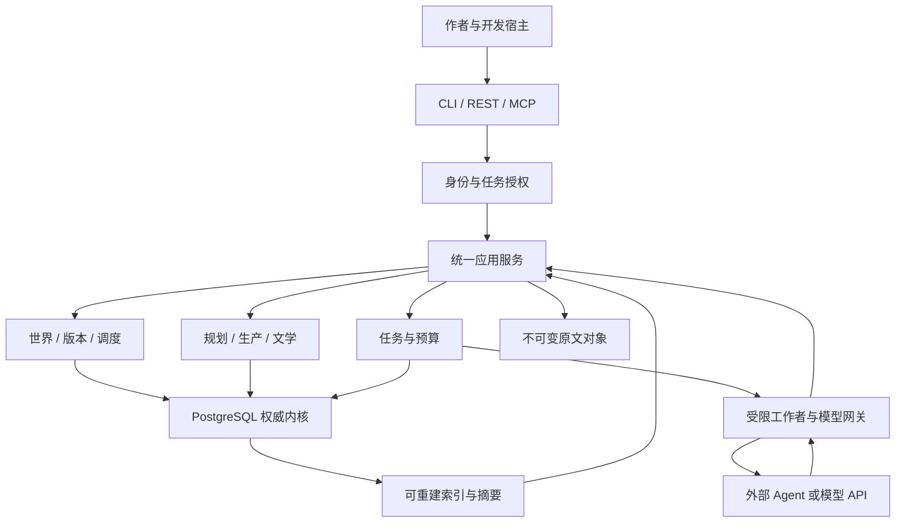

# 01｜详细技术架构

> v2.0-R1 · 2026-11-10（中国标准时间）· 设计基线，不等于生产实现。
> 上位依据：[v1.1 总体架构](../baseline/v1_1/01_总体架构设计.md)；接口依据：[契约说明](../contracts/README.md)。

## 1. 结论和适用范围

采用 **Python 模块化单体 + PostgreSQL 17 + 内容寻址文件存储 + 数据库任务状态机**。部署一套应用和少量 worker；角色、导演、写作、审稿是任务模式和权限配置，不是独立微服务。本地处理数据、规则、权限、时间、资源、调度与恢复，外部 Agent 提供创意、语义裁决候选、写作、摘要和文学判断。

本方案以单机模块化单体起步，数据契约面向大量外部 Agent：查询服务可无状态多进程扩展，模型工作者、上下文编译与接受协调分别设置并发预算。Agent 数、工具请求率、数据库查询率、正式提交率和外部模型在途数分别测量。每分支只在正式接受时短暂线性化；无关 HEAD 变化可经受控依赖重验证继续接受，不要求所有地区串行推理。实际容量与瓶颈由压测确定，暂不引入 Kafka、Redis、Neo4j、Temporal 或独立向量库。

v2.0 保留 v1.1 的世界自主、结构性冗余、角色提出意图、世界独立裁决、卷级滚动规划和整卷编辑。新增的是可实现的边界：不可变引用、任务代际、接受事务、故事推进覆盖、发布清单以及开发规范。已确定的是工程语义；尚待实测的是模拟深度、检索质量和文学收益。

## 2. 技术基线与锁定方式

| 层 | 推荐基线 | 为什么采用 | 限制和升级条件 |
|---|---|---|---|
| 语言 | Python 3.12 系列，P0 固定补丁版 | 成熟数据、检索、模型 SDK 生态，便于 Agent 开发 | 不宣称是最新版本；升级需契约和依赖回归 |
| 数据 | PostgreSQL 17，psycopg 3 | 统一事务、行锁、约束、JSONB 和关系查询 | 生产并发及迁移测试必须用真实 PostgreSQL |
| 数据访问 | SQLAlchemy 2.0 维护系列 + Alembic | 显式 Unit of Work、结构迁移 | 2.0 不是当前最新主线；P0 可验证 2.1 后另记选择，禁止混用 ORM 隐式事务 |
| 输入契约 | Pydantic 2 + JSON Schema 2020-12 | 边界校验、版本化 DTO、适配器复用 | Schema 不能证明因果、权限或文学正确 |
| 接入 | Python 应用服务为核心；CLI 首先；FastAPI 管理 API；MCP 按需 | 一套业务语义，多个入口 | FastAPI/MCP 不拥有独立事实写路径 |
| 原文 | 本地不可变对象，SHA-256；元数据在 PG | 精确版本、证据定位、成本低 | 文件持久化先于 DB 引用；未来可迁移对象存储 |
| 编排 | DB 状态机、租约、generation、outbox/inbox | 避免工作流与世界两个真源 | LangGraph 仅作为未来受限子流程候选 |
| 检索 | ID/别名 + SQL 类型关系 + 中文分词后的全文/BM25候选 | 先建立可解释基线 | 分词/召回必须实测；embedding/pgvector 为可选扩展 |
| 验证 | unittest（本包实验）；正式项目 pytest、Hypothesis、PG 集成测试 | 分离纯规则与真实事务故障 | 本包没有运行完整项目集成测试 |
| 运维 | JSON 日志 + 业务审计 + 调用账本；OTel 可后接 | 先能解释一次事件为何被接受 | 不把正文、秘密和凭据写入公共日志 |

版本范围是设计选择；正式开发第一张任务卡生成并提交依赖锁文件、镜像 digest 与许可证记录。当前包不伪造尚未安装验证的 lockfile。PostgreSQL 的隔离范围、版本维护和队列锁用途见[官方事务说明](https://www.postgresql.org/docs/17/transaction-iso.html)、[版本政策](https://www.postgresql.org/support/versioning/)、[SELECT](https://www.postgresql.org/docs/17/sql-select.html)；其余来源集中在[10](10_论文与技术资料库.md)。

## 3. 运行结构

工作者只接受任务授权，在事务外运行语义任务，结果回到统一服务。`domain` 不导入网络/ORM/MCP，`application` 通过端口调基础设施，所有适配器共用命令与错误模型。角色的长期状态由版本化记录保存，模型会话不是人物记忆的唯一持久位置。

### 3.1 同一数据库中的不同权威域

世界账本是“发生了什么”的权威；版本化正文是“写了什么”的权威；计划文档是“打算怎样写”的权威。三者有各自对象，不相互替代。所谓单一事实源，是世界事实只有世界接受协议可以确立，并非要求把所有文本存成事件。

世界事实、角色信念、读者已披露材料、未来计划、模拟分支、文学解释使用明确 `plane`。统一时间查询使用 ReadContract、KnowledgeCut 和 SubjectTime，先解析并固定 WorldRef、计划/叙事清单及当前授权，再执行批量子查询；`world_revision_id` 不是日期，`branch_seq` 不跨分支比较，章节号不决定角色知情。参见[03](03_数据模型与知识图谱.md)。

### 3.2 本地和外部的责任矩阵

| 能力 | 本地确定性部分 | 外部语义部分 | 最终接受者 |
|---|---|---|---|
| 世界建设 | 身份、关系类型、冲突、版本与证据 | 结构、制度、历史、力量体系的创造和合理性讨论 | 授权策略 + WorldCommitService |
| 角色行动 | 裁剪认知、可用资源、场景时点 | 动机、目标权衡、行动意图 | 角色只提案；不能自报成功 |
| 行动裁决 | 规则前提、资源、互斥、时间、随机结果存证 | 无法形式化的后果候选及依据 | 独立裁决提案通过硬校验后由提交服务接受 |
| 世界推进 | 依赖、推进覆盖、过程状态、冲突组 | 未定义环境变化与宏观过程的候选 | 调度器不决定胜负 |
| 卷规划 | 依赖闭包、不可达前提、受影响任务 | 路线、节奏、人物目标、局部重写 | 卷导演在授权范围选取计划版本 |
| 写作与摘要 | 固定输入、检索、预算、格式和来源核验 | 文学表达、语义抽取、摘要 | 草稿先保存；正式重要事实需对账 |
| 审核与整卷编辑 | 硬冲突和依赖新鲜度 | 人物、语言、情绪、结构建议 | 总编裁定审美，硬约束不能豁免 |

本地“记忆工具库”能够存取、筛选、聚合和核验已经产生的语义摘要，不能单靠数据库算法生成可靠的文学摘要。允许使用外部 embedding，但在语义召回证明有价值之前，不依赖它完成身份、历史或权限查询。

## 4. 六个必须清楚的提交边界

1. **候选保存**：保存不可变提案或草稿，只增加候选对象，不改变正式世界。
2. **世界接受**：短事务原子写 world revision、已批准事件选择、关键投影、过程推进、最小失效标记和 outbox。即使没有正文，也可接受幕后事件。
3. **叙事接受**：接受某版场景卡、编排、正文或文学档案，不自动执行事件效果。
4. **本地发布**：固定 release manifest、正文顺序、披露证据与 WorldRef；不得再次扣库存或重演认知变化。
5. **外部投递**：独立 outbox、渠道授权、目标代际和回执；本地 release 不等于网络已发表。
6. **历史修订**：在 repair 分支重建并重审，CAS 切换作品 canon 分支指针；保留旧历史与旧发布。

一个用例可以在同一 PG 事务中协调多个内部记录，但默认分离世界接受与正文发布，避免把所有创作环节放进一个巨事务。模型调用、写大文件、全文索引和文学判断绝不持有数据库事务等待。

## 5. 故障与恢复设计

| 失败位置 | 持久结果 | 恢复动作 |
|---|---|---|
| 对象写到一半 | 临时文件，未在 DB 引用 | 重写/清理临时文件，不能接受其哈希 |
| 对象已持久化，DB 未提交 | 孤立对象 | 相同命令重试；过保留期再回收 |
| DB 提交成功，客户端未收回执 | 命令已完成，outbox 已登记 | 同幂等键查回原结果，不重新裁决 |
| 外部调用已发出但结果未知 | attempt=UNKNOWN，预算预留未释放 | 先查供应商回执；必要时明确新尝试和可能重复费用 |
| worker 租约到期后迟到 | 旧 generation 结果留作审计 | 拒绝其接受资格，不覆盖当前产物 |
| 索引/摘要未更新 | 权威已更新、派生水位落后 | 回源或等待相关范围；不伪称事实未知 |
| 数据库恢复到较早版本 | 外部投递可能比本地新 | 暂停投递并对账；epoch/generation 重建后恢复 |

故障处理不靠“把 Agent 再跑一遍”。回放世界只读取已接受的标准化结果和规则版本，不重新调用模型。外部服务无法普遍提供端到端恰好一次；本设计保证受控数据库世界效果按业务身份去重，外部未知结果另行结算。

### 5.1 文件与备份

`ObjectStore.put(bytes)` 的后置条件是内容哈希已验证、文件和目录按部署文件系统要求完成持久化、可读且不可覆盖。数据库提交失败不立刻删除对象，以防重试和并发引用。GC 只删除无正式/候选保留引用、过宽限期且不在上传中的对象。

MVP 备份暂停新的接受、等待短事务排空，记录冻结 head 集、导出数据库并复制其全部被引用对象及清单，再解除暂停；读者查询可继续。数据库与对象恢复必须一起校验。数据量扩大后再做在线对象复制与 PG 基础备份/WAL，不能将 `pg_dump` 称为 PITR 基础备份。详见[官方 PITR](https://www.postgresql.org/docs/17/continuous-archiving.html)与[11](11_研发路线与测试计划.md)。

## 6. 最小运维面

先做 CLI/简单管理页：作品与 canon 指针、各域处理到哪里、候选与正式记录、任务/调用/预算、阻塞原因、待处理审稿和整卷版本。无需先做完整可视化小说 IDE。

每条审计关联 work、branch、world_revision、task、generation、proposal、approval、release；普通日志只保存获准的元数据和内容引用。模型调用账本记录输入/输出用量、价格来源版本、预留/结算、废稿、重试、人工时间标签。一次费用只能在总账出现一次，阶段标签不能被再次相加。

文学试产可从两个写作任务的小窗口开始；服务侧从P1就验证10/50逻辑Agent的并发正确性，再按负载模型探索50/200/500/1000档位。这些是试验档位，不能直接解释为已支持的吞吐。实际派发受费用预算、供应商限流、数据库池和队列背压共同约束。模型未知回执继续占预留；预算不足停止新派发，不删除现有结果。指标重点是被接受正文的成本、净产出和返工范围，而非原始 token 吞吐。

## 7. 未来扩展与明确停止点

保持服务端口和数据契约后，worker 可以多进程或多机扩展；API/查询副本与模型worker独立扩展；世界接受仍保持每分支短事务序列，允许已证明独立的候选在新parent上接受。对象可迁移兼容 ObjectStore 的服务；图/向量作为派生索引增加；LangGraph 可承载一次受限创作子流程，TaskService 仍负责最终生命周期。

以下情况才提出新 ADR：实际锁等待成为主要延迟；SQL 子图查询在索引优化后仍不满足已测目标；单机不可用风险超过作者容忍；持久工作流复杂度持续高于框架运维成本。任何扩展必须保留回源与回退路径。

本包不承诺通用社会模拟、无漏检抽取、百万字文学收益或供应商间完全可重现。优先在首个 5–10 场景短卷同时检验工程与文学闭环，详见[11](11_研发路线与测试计划.md)。

## 8. R1：统一时间与并发目标的实施落点

[13](13_统一时间线与动态知识演化.md)定义统一坐标下的异质时间条目与动态关系；[14](14_高并发服务与一致性协议.md)定义读取切面、scope守卫、提交证书和接入资源控制；[15](15_并发压测与端到端验收.md)定义行为负载与A–H验收。03–09及11–12已同步修订，三个专题是深入规范，不是另一套旁路系统。

旧core 2.0契约保留；新增2.1契约通过同一应用服务承载统一查询、批量读取、Context Compiler和受控接受。角色上下文、scope token及审批资格由服务端产生和核验，任何接入协议或缓存都不能另行授予权限。
