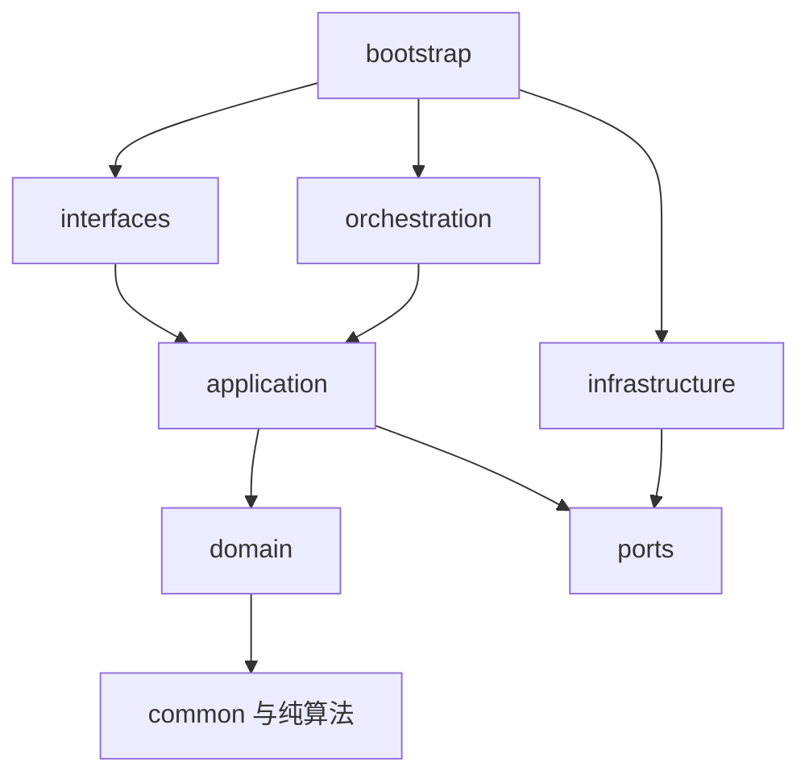

# 02｜代码架构与模块设计

> 本文给出正式项目的目标目录和模块接口；本交付仅创建文档、规范、Schema 与独立实验，没有生成空业务实现。

## 1. 目标仓库结构

```text
novel_factory/
├── AGENTS.md                         根开发规则
├── SKILLS.md                         开发/运行时技能索引
├── README.md
├── pyproject.toml / uv.lock           P0 实际安装验证后生成
├── .agents/skills/                   Codex 仓库开发技能
├── adapters/claude/                  Claude 适配说明与导入模板
├── docs/                            01–15 技术规范
├── contracts/                       公共 Schema、例子、工具目录
├── runtime/
│   ├── roles/                       权限和产物角色契约
│   ├── skills/                      运行时渐进加载的技能
│   ├── prompts/                     后续经样例验证的提示模板
│   └── policies/                    后续作品授权配置与版本
├── src/novel_factory/
│   ├── domain/
│   │   ├── common/                  身份、StoryPoint、引用、错误
│   │   ├── world/                   实体/规则/资源/已接受事件
│   │   ├── knowledge/               断言/证据/认知/信息域
│   │   ├── versioning/              分支/修订/效果选择/依赖
│   │   ├── simulation/              过程/交汇/动作/联合裁决
│   │   ├── narrative/               卷契约/计划/场景/编排
│   │   ├── production/              正文/对账/批准/发布
│   │   └── literary/                人物档案/声线/研究方法
│   ├── application/
│   │   ├── ports.py                 UoW/Repository/ObjectStore/Gateway
│   │   ├── authorization.py         Principal/TaskGrant/ViewPolicy
│   │   ├── knowledge_service.py      KnowledgeService
│   │   ├── representation_service.py RepresentationService
│   │   ├── world_queries.py         WorldQueryService
│   │   ├── timeline_service.py       TimelineQueryService，统一cut与批量查询
│   │   ├── acceptance_service.py     AcceptanceService，服务端证书与scope核验
│   │   ├── world_commits.py         WorldCommitService
│   │   ├── version_service.py        VersionService
│   │   ├── impact_service.py         ImpactService
│   │   ├── scheduler_service.py      WorldSchedulerService
│   │   ├── adjudication_service.py   AdjudicationService
│   │   ├── context_service.py        ContextService
│   │   ├── context_compiler.py       ContextCompiler，recipe/硬约束/证据打包
│   │   ├── planning_service.py       PlanningService
│   │   ├── narrative_service.py      NarrativeService
│   │   ├── review_service.py         ReviewService
│   │   ├── release_service.py        ReleaseService
│   │   └── memory_service.py         MemoryService
│   ├── orchestration/
│   │   ├── task_service.py          TaskService、状态迁移、租约/取消
│   │   ├── workflow.py              版本化流程定义和依赖图
│   │   ├── worker.py                有界并发执行循环
│   │   ├── gateway.py               模型/外部宿主调用与结果存证
│   │   ├── budgets.py               预留、未知费用、结算
│   │   └── outbox.py                消息投递及幂等消费
│   ├── algorithms/
│   │   ├── temporal.py              区间/偏序/可达下界
│   │   ├── graph.py                 局部路径/闭包/环检测
│   │   ├── constraints.py           守恒/互斥/前置规则
│   │   ├── impact.py                类型化失效闭包
│   │   ├── footprints.py            注册命令模板的读写/否定范围
│   │   ├── calendar.py              作品坐标、地区历法和相对约束转换
│   │   └── retrieval.py             候选排序、证据去重、预算分配
│   ├── infrastructure/
│   │   ├── postgres/               ORM映射、UoW、仓储、队列
│   │   ├── objects/                内容寻址文件实现
│   │   ├── search/                 SQL/全文/可选向量适配
│   │   ├── cache/                  有界本地缓存、失效订阅；共享缓存后选
│   │   ├── providers/              外部模型API和Host适配
│   │   └── telemetry/              日志、trace、审计导出
│   ├── interfaces/
│   │   ├── cli/                    本地开发/作者命令
│   │   ├── http/                   REST DTO和错误转换
│   │   └── mcp/                    白名单工具与协议profile
│   └── bootstrap.py                依赖注入，唯一组装处
├── migrations/                     Alembic 迁移、真实PG验证
├── tests/
│   ├── unit/                       纯领域规则和算法
│   ├── contract/                   Schema与跨适配器相同语义
│   ├── integration/                PG事务、文件持久化、权限
│   ├── fault/                      崩溃、迟到、重试、恢复
│   ├── scenarios/                  T/S/L/F 基线与新案例
│   └── literary/                   脱敏文本、人工标注、盲读方案
├── benchmarks/                     负载模型、数据规模、压测场景和结果口径
├── experiments/                    可复现候选机制，不能生产导入
├── research/                       论文、证据卡与官方文档
└── ops/                            后续部署、备份恢复、诊断脚本
```

`src` 中本包仅放必要的局部 AGENTS.md，真实类在对应阶段实现。不要为目录完整性创建空的业务类。`project_layout/README.md` 说明怎样把本设计包演化为仓库。

## 2. 依赖方向



领域类型无网络/文件/ORM；领域函数返回拟接受的变化，不自行提交。应用服务拥有事务边界和授权次序。基础设施实现端口，不导入其他模块的内部仓储；跨模块访问通过用例或显式只读投影。编排请求用例，但不能把工作流 checkpoint 当世界提交。

可用导入检查或静态测试约束 domain 不导入 infrastructure/interfaces，正式实现时在 CI 中加入。不同领域不复制 Entity、WorldRef、ArtifactRef；公共契约仅保留真正共享的值对象，不建立万能 `BaseManager` 或万能实体 JSON 服务。

## 3. 模块契约矩阵

| 模块/服务 | 核心输入 → 输出 | 关键类型与责任 | 依赖/事务 | 典型错误 | 必要测试 |
|---|---|---|---|---|---|
| WorldQueryService | WorldRef、StoryPoint、typed query → AnswerEnvelope | 固定版本、状态/历史/图路径、覆盖与证据 | 只读PG/可验证索引；同一读取快照 | UNKNOWN、NOT_EVALUATED、STALE_DERIVATION | T01/02/04/12；角色结果同构 |
| KnowledgeService | assertion candidates + evidence → proposal | 名称消歧、客观断言/信念/计划分类 | 不更新canon | UNRESOLVED_IDENTITY、INVALID_EVIDENCE | T06；否定/传言反例 |
| WorldCommitService | legacy strict request 或 R1 certificate-bound request → receipt | 唯一世界接受入口、effect去重、关键投影、outbox | 一次短UoW，分支HEAD锁；scope守卫复验；无外部调用 | HEAD_CONFLICT、STALE_CERTIFICATE、APPROVAL_STALE、RESOURCE_CONFLICT | T07/08/09、R1-F/H、真实PG并发 |
| VersionService | fork/diff/merge/retcon commands → candidate/report/promotion | 单父状态链、来源映射、canon指针 | 准备在事务外；promotion短CAS事务 | MERGE_CONFLICT、REPAIR_INCOMPLETE | T05/11；旧release仍可读 |
| ImpactService | typed changes + DependencyManifest → impact report | 正/负向依赖、版本戳、直接/传递失效 | 最小失效范围同步；细闭包异步 | COVERAGE_GAP、REVALIDATION_REQUIRED | 空查询新增实体、风格/顺序变更 |
| WorldSchedulerService | WorldRef + scope + target point → ready bundle/blocked frontier | 过程登记、入站影响、冲突组、推进证明 | 准备不写世界；进展随接受事务写 | ADVANCE_BLOCKED、TIME_AMBIGUOUS | S01–S08；打乱返回顺序 |
| AdjudicationService | ActionBundle + rules + pinned state → adjudication proposal | 程序硬规则与语义候选；共享起点联合裁决 | 硬规则纯函数；模型在事务外 | HARD_RULE_VIOLATION、SEMANTIC_UNRESOLVED | 合法失败/共同资源/反应阶段 |
| RepresentationService | effect_group + detail proposal → refinement report | 只叙述细化/等效替换/retcon分类 | 不能直接再次执行已接受效果 | NON_EQUIVALENT_REFINEMENT | S宏微重复与中间时点依赖 |
| ContextService / ContextCompiler | task + recipe + fixed read cut → CompiledContext/core bundle | 批量装配硬约束、角色视图、计划/披露、证据与依赖 | 固定同一输入；取材只读，编译回执短写 | TASK_REBIND_REQUIRED、CONTEXT_INCOMPLETE | R1-E/F，缓存/证据/错误不泄漏 |
| PlanningService | volume contract + accepted changes → plan revision | 目标、承诺、条件未来、局部重规划 | 保存计划产物，不写世界 | PLAN_INFEASIBLE、DEPENDENCY_STALE | T03/10；意外可改变路线 |
| NarrativeService | scene card + draft → artifact/narrative revision | 表达、事实对账、交接、编排版本 | 原文先持久化、元数据短事务 | FACT_DELTA_UNRESOLVED、TEXT_STALE | T08；删文不撤销事件 |
| ReviewService | exact artifact/arrangement versions → issue/disposition/approval | 硬问题、审美分歧、证据与处置 | 批准绑定内容及依赖 | APPROVAL_STALE、UNRESOLVED_BLOCKER | 审稿循环、误伤多声部 |
| ReleaseService | manifest proposal + authority → release | 固定文本/世界/披露/顺序；外部outbox另行 | 本地manifest原子提交，不应用世界effects | RELEASE_CONFLICT、MISSING_OBJECT | 连载冻结、重排批准失效 |
| MemoryService | permitted evidence + request → memory artifact/search | 摘要/文学解释/方法；出处、覆盖和过期 | 语义产物由外部生成，本地校验来源 | STALE_DERIVATION、EVIDENCE_GAP | 人物档案不能覆盖认知 |
| TaskService / Gateway | task spec → attempts/result acceptance | 租约代际、预算、取消、调用账 | 领取/回执短事务；网络在事务外 | STALE_GENERATION、CALL_UNKNOWN | F取消/重复/旧worker/断电 |

| TimelineQueryService | UnifiedQueryRequest/QueryBatchRequest → typed result | 统一时间视图、一次pin、分页和一致性选择 | 不自动触发模拟；批量无写命令 | CANON_MOVED、PROCESS_NOT_EVALUATED | R1-A/B/D/E、批量不混修订 |
| AcceptanceService | exact proposal + task dependencies → AcceptanceCertificate | 有限注册模板、scope闭包、审批适用性；不是第二接受器 | 事务外准备；WorldCommitService事务内复验 | UNPROVEN_FOOTPRINT、DEPENDENCY_CONFLICT | R1-F/H、负向范围、写偏差及ABA |

所有错误使用[统一 ErrorEnvelope](../contracts/core.schema.json)的代码、`retryable`、安全解释与可恢复动作；HTTP、MCP、CLI不各造业务错误语义。

## 4. 端口的最小定义

以下是设计签名，不是已实现 SDK。实现时可用 Protocol/dataclass/Pydantic，不要求照搬类层次。

```python
class UnitOfWork:
    def __enter__(self): ...
    def commit(self) -> None: ...
    def rollback(self) -> None: ...

class ObjectStore:
    def put_durable(self, content: bytes, media_type: str) -> ArtifactRef: ...
    def read_verified(self, ref: ArtifactRef, auth: ReadGrant) -> bytes: ...

class ModelGateway:
    async def execute(self, request: PreparedCall) -> CallOutcome: ...

class WorldCommitService:
    def accept_world(self, principal: Principal,
                     request: AcceptWorldRequest) -> CommitReceipt: ...
```

`principal` 来自已认证通道而不是用户 JSON；`PreparedCall` 来自 TaskService 固化的上下文和预算；Gateway 不自行提升角色权限。UoW 在服务端显式传递，一个世界接受用例只拥有一次提交。仓储返回领域类型或窄只读 DTO，避免 ORM 对象逃出事务后触发隐式读取。

## 5. 同步和异步边界

同步完成身份验证、语法校验、小规模精确查询、批准验证、短世界提交、草稿/manifest 元数据写入。可能调用模型、扫描长文、重建索引、retcon重建、整卷编辑或外部投递的操作返回 task_id，再由查询/回执取得结果。

以“准备”和“接受”分开长操作：`prepare_retcon` 输出影响和候选，`promote_candidate` 仅切换已核验的候选。索引重建不阻塞与其无关的精确查询；涉及完整性证明的操作若无法回源，则返回具体受阻范围。

事务内不得 await 外部模型、等人审核或运行大规模文档抽取。为多步骤任务留下确定的停点和输入版本，暂停后须重新核验批准资格；旧strict批准不能跨输入切面，明确DEPENDENCY_STABLE政策下的原内容批准也须证明所有依赖仍成立。MVP跨模块通知用outbox表；进程内通知只作加速，不能成为唯一恢复依据。

## 6. 演进与迁移

首先实现纯领域约束与单一世界接受入口，再接真实PG及对象存储，然后任务/上下文和真实短卷。新 event payload 采用 schema_version 和向后兼容读取；旧原始事件不可原地改 JSON。需要重建时写新 projection generation，并核对状态摘要后切换。新旧解释器不能对同一旧事件随意产生不同余额。

数据库迁移分 expand → backfill → verify → switch → 延后contract；不要一次 migration 同时删旧列、改事件含义和清空旧快照。实现候选迁移可自主进行；执行到用户真实作品上前必须满足已有授权及备份/恢复门禁。

## 7. 开发交接的完成定义

一项模块任务必须给出：采用的文档/ADR、修改的契约、可复现输入、实际结果、重要反例、未覆盖风险。正常重构、局部单元测试、增加兼容字段、修复边界实现可自主完成；涉及权威边界/历史含义的改变先提出ADR并让代码变更保持在候选开发分支。禁止为了让测试变绿而删去不变量、偷偷降低权限或改金标准。

每个阶段只执行与改动和剩余风险相关的测试。纯文档排版不需要跑整套模型评测；资源或版本事务改动则必须跑真实PG冲突/恢复测试。包内[验证脚本](../validation/validate_package.py)验证设计文件的一致性，不可替代正式实现验收。

## 8. R1新增端口及实现边界

TimelineQueryService复用WorldQueryService、PlanningService和认知/披露读取端口，只做类型化组合，不维护第二条可写时间线。ContextCompiler是ContextService内部能力，先完成当前授权和切面解析，再按recipe批量取材；不能把模型调用放在读取事务中。AcceptanceService只产服务器可验证的证书；实际状态效果仍由WorldCommitService接受。

ScopeRegistryPort提供已注册scope与单调版本，ScopeGuardPort读取/锁定并验证token；ProjectionReader按WorldRef和projector_generation重建或查询；ReadCutResolver一次解析canon与RYW回执；AdmissionController在获取数据库连接前限制请求成本。各端口的SQL实现都留在infrastructure，不让HTTP/MCP自行加锁、解析世界时间或直写scope。

2.1新DTO见[temporal_concurrency.schema.json](../contracts/temporal_concurrency.schema.json)；原core契约保持可读。业务Schema校验以外，必须实现分支血缘、同cut批量、时间范围、模板读写范围完整性和服务端证书来源校验。

对外工具门面沿用WorldQueryService与WorldCommitService：前者委托TimelineQueryService组合查询，后者委托AcceptanceService准备证书。两者为模块化单体内的组件，不是新增部署服务或另一写入器。ContextCompiler同样是ContextService内部组件。
