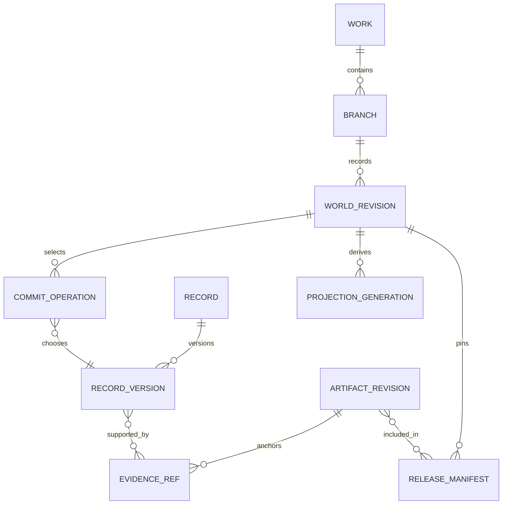

# 03｜数据模型与知识图谱

> v2.0-R1 详细设计｜2026-11-10｜状态：统一时间与动态知识契约已整合；尚未实现生产数据库。
> 本文定义领域数据及查询语义；[04](04_事件溯源与版本体系.md) 定义记录如何成为某版世界，[05](05_世界模拟与调度引擎.md) 定义过程如何推进。核心身份沿用 [core.schema.json](../contracts/core.schema.json)；统一查询及并发扩展见 [temporal_concurrency.schema.json](../contracts/temporal_concurrency.schema.json)，完整时间模型见 [13](13_统一时间线与动态知识演化.md)。

## 1. 模块责任与事实来源

`domain/world` 表达实体、规则、状态转移与资源；`domain/knowledge` 表达陈述、观察、信念、证据及查询视图；版本内核决定哪些不可变记录构成哪个世界版本。三者共用 PostgreSQL 和应用提交服务，不各自批准一套事实。

权威对象是**接受记录、其不可变内容版本和世界版本的选择清单**。实体状态表、时态边、全文/向量索引、摘要都由该清单导出。正文对象有独立的内容权威：它证明某版实际写了什么；其中每句话不会自动取得世界事实地位。世界查询不能读一份可任意修改的角色卡，正文查询也不能由最新摘要替代原稿。

本地负责结构校验、时间与资源约束、版本选择、权限、精确检索和依赖计算。外部 Agent 负责提出设定、解释暗示、实体消歧候选、信念变化、文学摘要和语义审查。任何语义输出先进入提案区。

### 1.1 不要求把每句话入图

普通即时细节可保存在正文中的 `SURFACE_DETAIL`：例如不会影响后续的停顿、比喻、杯沿反光。它们仍是文学连续性的原文证据，后文不能随意自相矛盾。若某个细节后来成为持久物品、角色知识、能力例外、通行条件或跨章因果前提，必须先提出结构化知识增量，回查现有正文并完成必要接受，之后才能作为硬前提使用。

因此，“单一事实源”要求统一采信和版本规则，不要求为每个名词建立实体。不能用 `SURFACE_DETAIL` 隐藏伤势、秘密告知、资源消耗等已知的重要影响。

## 2. 身份、版本和时间

| 类型 | 必需字段 | 语义及限制 |
|---|---|---|
| `WorldRef` | `work_id, branch_id, world_revision_id` | 三者绑定；revision 是不透明 UUID，不可用其字面排序 |
| 分支顺序 | `branch_seq` | 仅同一分支内递增；事务回滚不产生一个正式版本；不可比较不同分支的序号 |
| `StoryPoint` | `tick, phase` | tick 为作品日历中的整数尺度；phase 为已确认的同刻因果阶段，绝不从提交顺序产生 |
| 故事区间 | `start, end, bounds="[)"` | 公共StoryInterval表达持续或查询范围的精确半开区间；不能代替发生时刻的不确定性 |
| `OccurrenceTime` | `EXACT{at}` / `BOUNDED{earliest,latest,constraint_refs}` / `UNSPECIFIED{constraint_refs}` | AcceptedEvent.occurrence_time使用该类型；BOUNDED两端均为可能发生点，约束需领域核验；不擅选earliest为实际时刻 |
| `ArtifactRef` | `artifact_id, artifact_revision_id, sha256` | 稳定文档身份、不可变内容版本与字节哈希 |
| 叙述定位 | `narrative_revision_id, arrangement_version, scene_id, span` | 与故事时间独立；文本重排改变叙述位置而非事件日期 |
| 现实执行时间 | `created_at, lease_expires_at` 等 UTC 时间 | 只供任务、审计与运维；不参与故事推进 |

AcceptedEvent 的发生字段统一为 `occurrence_time`；task/query/adjudication 的 `story_time` 仍表示固定上下文点。已接受“发生在D22–D25之间”不等于它持续四天。`BOUNDED`需验证 earliest≤latest 和相关因果约束；`UNSPECIFIED`保存发生事实及已知约束，不填造日期。

同刻存在明确“发出信号→看见信号→作出反应”时，可使用 phase；未知的先后不能通过分配不同 phase 偷偷确定。互不作用的事件可在实现中稳定排序，这个排序不产生额外因果关系。作品若以日为单位，上午/下午的先后需要更细 tick、明确的阶段或时间约束；不能因为都标记 D30 就认定同时。

### 2.1 四种时间职责，共享故事坐标而不混合语义

| 维度 | 领域问题 | 存储与选择 |
|---|---|---|
| Story Time | 哪个发生在 D20，哪个发生在 D30 之前？ | occurrence_time、因果约束，使用作品统一的 StoryPoint |
| Valid Time | 持有、组织归属、控制权在什么期间成立？ | 有类型关系/状态段的有效区间，和发生时间共用故事坐标 |
| Transaction / Revision Time | 系统在哪个编辑修订中开始采用这项记录？ | 不可变接受记录、world_revision、分支父链和 recorded_at；UUID/现实时间不用于故事排序 |
| Narrative Order | 第 80 章之前正文披露了什么？ | 固定 narrative_revision_id、arrangement_version 和读者切点；不按故事日期排序 |

`world_revision_id` 选择一套编辑历史，StoryPoint 选择其中的世界状态；二者正交。新的记录可以补充旧故事时点，新的正文也可以讲述更早的事件。分支祖先关系回答某修订包含哪些变化，不能把不同分支的 branch_seq 或 recorded_at 直接比大小来做合并。

故事世界没有供所有模块读取的唯一 `world.now`。角色场景时点、读者叙事切点、地区过程前沿和规划窗口都要指明用途。主角线已求值到 D40、反派线 D35、宗门线 D20 可以共存于一个 WorldRef；它表达这组已被接受的覆盖，不声称三个地区都已经完整求值到 D40。

PostgreSQL 的日期类型采用公历，适合现实记录/租约时间；虚构历法由作品的版本化 CalendarDefinition 转成统一 tick，原文日期与转换依据保留，不把修真年号直接塞入 timestamptz。[日期类型](https://www.postgresql.org/docs/17/datatype-datetime.html)

### 2.2 时间归一化、关系有效期与未知边界

作品定义最小 tick 单位、纪元、日/月/年规则及区域历法映射。多个地区的纪年和报时可不同，必须转换到同一作品坐标后才比较；转换尚不确定时保存可能区间或约束。时间倒流、秘境时流差等属于明确世界规则及分支/事件关系，首期不假装能由公历时区库自动解释。协议保持安全整数 tick，不静默切换单位或用浮点近似。

精确关系段使用 `[start,end)`；“尚未知道终点”不等于“永远有效”。派生存储可以有开放尾段，但查询仍必须检查该谓词的过程覆盖，不能把最后已知状态外推到未求值未来。发生的 BOUNDED 区间表达某个瞬时事件的可能时点，不直接作为该关系的持续区间。

`branch_seq` 可用于同一分支内选择记录的编辑有效区间；权威原文不原地修改 valid_to。初始背景可以以断言接受；运行后的关系变化必须有事件/规则来源。同一事实的实际发生、系统后来确认、人物后来获知和读者后来得知分别记录，见 13 的迟录与修订判定。

PostgreSQL range 可加速全序区间，不替代因果偏序或模糊时间求解。[范围类型](https://www.postgresql.org/docs/17/rangetypes.html) 首期用 tick/phase 的精确比较；可选 int8range 只做保守候选筛选，须覆盖首尾 tick 并再次核验 phase。禁止用忽略 phase 的粗范围排他约束拒绝同一天互不重叠的关系段；可计算的精确区间编码和索引基准见第 6 节。

## 3. 最小关系模型

以下是逻辑表集合；对外示例中WorldEvent由AcceptedEvent承载（该名称仅指载荷形状；进入候选不等于已接受，commit membership才确立所选版本的地位），ProcessInstance由ProcessRecord承载，表名不要求与DTO名完全相同。可在迁移设计中合并不常用的子类型；不要把所有可选字段立即铺满。所有作品数据都有 `work_id`。跨表外键同时约束作品身份；仅凭一个全局 UUID 不足以阻止跨作品误引用。

### 3.1 身份、不可变记录和世界选择

| 表/记录 | 核心字段与键 | 责任与约束 |
|---|---|---|
| `work` | `work_id PK, calendar_definition, canon_branch_id, policy_version` | `canon_branch_id` 指向当前正式分支；“main”是角色名称/解析入口，不是永不变的实体 ID |
| `branch` | `branch_id PK, work_id, kind, fork_ref, head_revision_id, status` | kind=`CANON/CANDIDATE/SIMULATION/REPAIR`；fork 来源固定；归档不删除历史 |
| `world_revision` | `world_revision_id PK, branch_id, branch_seq, parent_revision_id, change_set_hash, manifest_hash` | `UNIQUE(branch_id,branch_seq)`；同分支单一状态父链；合并来源另存 provenance |
| `record` | `record_id PK, work_id, kind` | 稳定领域身份；事件型记录的稳定发生身份见 occurrence |
| `record_version` | `record_version_id PK, record_id, schema_version, payload_hash, payload, evidence_refs` | 不可变内容；`UNIQUE(record_id,payload_hash)` 可防重复内容存储；相同文字不是相同发生 |
| `commit_operation` | `revision_id, op_no PK, record_id, selected_record_version_id, operation, reason_ref` | 在本版选择、替代或停用某记录；只能由接受内核写入 |
| `branch_record_head` | `branch_id,record_id PK, selected_record_version_id, source_revision_id` | 可重建的当前选择加速表，不是第二个权威；历史查询按指定 revision 解析 |
| `entity` | `entity_id PK, work_id, entity_kind, identity_record_id` | 稳定身份；名称、别名、伪装对应和当前位置是版本化断言，不做唯一主键 |

公共 WorldChangeSet 分别用 `record_operations`（RecordSelectionProposal）及 `event_operations`（EventSelectionOperation）传递类型化选择。持久层可将二者规范化为同一 commit_operation 体系，但必须保留 occurrence/event_version 与通用 record/version 的身份映射；不得把同一事件同时作为两个独立权威记录接受。事件候选载荷单列于 event_candidates，接受状态由选择操作与提交成员关系共同确立。

MVP 的 fork 物化**基线记录选择清单**和必要投影，不复制每份不可变正文与事件内容。基线清单保留原 occurrence、record 与来源版本 ID。这样避免深层分支查询递归，也不会把继承事件误作新发生。小世界的额外元数据成本可接受；之后才评估持久化共享树。

### 3.2 世界语义对象

| 子类型 | 关键内容 | 必须保留的边界 |
|---|---|---|
| `WorldRule` | `rule_id, rule_version_id, scope, preconditions, effect_policy, exceptions, evaluator_version` | 自然语言规则可以需语义裁决；只有明确可计算部分进入确定性解释器；不能直接执行模型生成代码 |
| `Assertion` | `subject_id, predicate, object/value, valid_time, assertion_kind, evidence_refs` | 可批准初始背景/制度/关系；已开始运行后的状态改变不得伪装为无历史来源的当前值覆盖 |
| `WorldEvent` | `occurrence_id, event_version_id, occurrence_time, participants[], causal_parents[], effects[], ruleset_ref, adjudication_ref, effect_group_id, representation_id` | 发生与版本分开；一段对白、回忆及模拟可能引用同一 occurrence |
| `WorldProcess` | `process_id, process_version, type, participants, footprint, evaluated_frontier, next_condition` | 过程已启动不等于未来结果已发生；管理旅行、生产、传播等真正需要演化的范围 |
| `ScheduledTrigger` | `trigger_id, process_ref, due_bounds, condition_ref, evaluation_status, outcome_ref` | 到期只要求求值；`EVALUATED` 允许结果为“条件不成立” |
| `AdvanceCoverage` | `scope_id, world_ref, frontier, dependency_fingerprint, channel_bounds, unresolved_ranges`（内部证明内容） | 对外ProcessAdvance以expected_frontier/evaluated_frontier和proof_artifact_ref引用该证明；条件性覆盖，不是“世界绝无遗漏”证书；与事件及过程变更同一次接受 |
| `Claim` | `claim_id, proposition, speaker/source, claim_kind, evidence_ref` | 台词真实出现不证明其命题为真；传闻、预言、条件句及不可靠叙述分别标注 |
| `Observation` | `observer_id, source_event/claim, observed_at, channel, content_ref` | 暴露/送达、阅读与理解可分阶段；只能引用合法渠道 |
| `Belief` | `character_id, proposition_ref, stance, acquired_at, source_observation_refs, interpretation_ref` | 允许误信、怀疑、冲突信念；模型自报置信度不视为校准概率 |
| `PrivateDecision` | `character_id, decided_at, decision_content, evidence_ref` | 已接受私有决定是真正认知记录；与编辑对动机的解释分开 |

过程定义、触发及覆盖也使用相同的不可变记录与版本选择，不另建一套可绕过提交的调度数据库。任务队列表可以改变现实执行状态，但不能直接改变世界内过程阶段。

认知的两种输入也必须归一：初始认知可通过 record_operations 的 COGNITION 建立；运行期由 COGNITIVE_RECORD_ADD 产生的观察/信念/私有决定，按 occurrence_id、effect_key 和认知类型映射到稳定 record_id，事件版本映射到相应 record_version。若变更包同时携带对应 RecordSelectionProposal，必须是同一身份与同一内容，不能再接受第二份认知效果。该映射由服务保存并随分支继承，不由模型自选另一ID绕过去重。

### 3.3 证据、规划和文学对象

| 表/对象 | 关键字段 | 生命周期 |
|---|---|---|
| `artifact_revision` | `ArtifactRef, media_type, byte_length, object_key, created_by, source_refs` | 内容先可靠保存，再登记引用；之后不可原地覆盖 |
| `evidence_ref` | 公共 EvidenceRef 按 kind 区分 ARTIFACT/EVENT/RULE；ARTIFACT 的可选 `span={start,end,unit,quote_sha256}` | 正文按精确UTF-8内容解码后的Unicode code point半开区间 `[start,end)`；unit=UNICODE_CODEPOINT，不做换行或NFC规范化；quote_sha256对切片重新UTF-8编码取哈希，emoji按code point计，组合字不等于grapheme；原文变更后建立新引用 |
| `plan_node` | `plan_id, plan_revision, intent_type, expected_time, prerequisites, alternatives, status, realization_refs` | 规划被批准仍处于 PLAN 域；到期只触发资格检查；realized 必须引用有效接受记录。计划清单独立版本化，不随 WorldRef 暗取最新 |
| `dependency_edge` | `from_ref,to_ref,dependency_kind,selector,observed_fingerprint` | 类型为 `HARD_PRECONDITION/COMPUTED/SEMANTIC_REVIEW/REVEAL/STYLE` 等；语义边可有环，因果 before 子图不能有环 |
| `promise` | `promise_id, source_evidence, expected_payoff, narrative_status, world_refs` | 人物承诺发言、作者对读者的叙事承诺分型；未兑现可转化、失败或延期 |
| `reveal` | `narrative_revision_id, arrangement_version, scene_id, evidence_ref, proposition_ref, presentation_mode` | 记录文本披露，不声明真实读者一定理解；正文重排需要重新核验 |
| `literary_record` | `record_type, subject_refs, interpretation/intent, evidence_refs, artifact_revision, applicability` | 人物弧线、关系阶段、情绪余效、声音解释；引用事实，不覆盖事实 |
| `summary` | `summary_id, audience, source_manifest, coverage, generator_version, text_ref, validity` | 派生摘要；源版本变化可失效；角色遗忘不得由检索遗漏生成 |
| `research_item` | `source_id, canonical_url, bibliographic_fields, verification_level, method_notes` | 与作品域隔离；资料中的人物、法术不进入当前作品实体图 |

不要求为每个文学概念单独建专表。MVP 的 `literary_record`、卷契约、场景卡、风格说明可共用版本化文档和结构化头部；等检索与约束需求稳定后才拆表。

### 3.4 状态投影及缓存

`fact_segment` 保存 `branch_id, projection_generation, subject_id, predicate, object/value, story_interval, source_record_version_id`；`belief_segment` 按角色额外分区。投影元数据保存确切 `WorldRef`、源清单哈希、投影器版本、构建状态及覆盖。关键当前状态与接受事务一致，不能在事件提交成功后再异步扣减库存。

投影遇到BOUNDED/UNSPECIFIED发生时保留不确定性来源。若某查询点的结果随可行时刻/先后改变，返回UNDETERMINED/UNRESOLVED；若能证明所有可行安排都给相同答案，才返回确定值。不能核实高影响结果与硬约束相容时，保留提案待决而非借未知值放行。认知获得时间同样受约束：只有能证明某观察/信念已在查询时点形成，ContextService才把内容交给该角色；不能选择earliest提前泄露可能尚未得知的信息。

历史查询优先使用指定版本的相容投影/快照，重放仅限其后必要事件后缀或经验证的影响闭包；热点缓存精确 WorldRef 对应的时态投影。首期小世界允许整分支重建作为保守恢复路径，普通查询不能每次从创世重新计算。**不为了方便历史查询先建设任意双时态 SQL 优化器。** 大幅 retcon 的新投影在 REPAIR 分支隔离构建，只有完整验证的 generation 才能成为该分支可正式使用的投影。旧 generation 可回收的前提是其源记录、对象和重建路径仍在，且未破坏保留策略。

缓存键至少含 `work_id,branch_id,world_revision_id,story_selector,view/subject,policy_version,query_signature,projection_version`。命中后仍检查当前授权；角色撤权不会因命中旧缓存而恢复权限。

## 4. ER 关系与职责依赖

图只画统一记录及证据骨架；WorldEvent、Belief、Process 是 record 的类型化内容，不意味着新增一套同等权威的数据库。一个发布清单可以固定多个章节 ArtifactRef 和一个兼容的世界版本/场景依据集合，详细规则见 04。

## 5. 统一查询语义与正交状态

对外入口统一解析 `ReadContract` 与 `KnowledgeCut`，将动态分支选择在请求开始时解析为确切 WorldRef。STATE 问状态，TIMELINE 枚举不同类型的时态条目；它们都固定故事选择器、知识/读者/计划切面和当前授权。客户端 `plane=WORLD` 不授予全知权限；SIMULATION 只允许读授权模拟分支，不能混入 CANON。批量查询共享同一冻结切面，不能让每个子查询分别读取“最新”。

统一时间视图按源类型归一化事件、关系段、认知、意图、预测、承诺及规划，但不写回一个万能 event 表。计划或预测的目标时间、记录其意图/发言的发生时间分别保存；同一世界事件被披露多次不增加发生实例。具体字段和九类问题映射见 13。

| 字段 | 枚举 | 回答的问题 |
|---|---|---|
| `plane` | `WORLD/BELIEF/READER/PLAN/SIMULATION/LITERARY` | 查询的材料属于哪个语义域？研究资料另由研究接口返回 |
| `truth_status` | `DETERMINED/UNDETERMINED` | 在所选域和条件下结论是否已经确定？不表示陈述内容为真 |
| `knowledge_status` | `KNOWN/UNKNOWN` | 当前获准视角能否知道这个结论？ |
| `evaluation_status` | `EVALUATED/PENDING/BLOCKED/NOT_APPLICABLE` | 影响请求时点的登记过程是否求值？静态背景可为 NOT_APPLICABLE |
| `freshness` | `CURRENT/STALE/ABSENT/NOT_USED` | 使用的派生产物是否覆盖请求来源版本？回源时可为 NOT_USED |
| `coverage` | `COMPLETE/PARTIAL/UNDECLARED` | 对声明的作用域是否完整？COMPLETE 不代表开放世界整体完备 |

`truth_status=DETERMINED` 必须与明确的值/命题结论配合：`data=false` 且 `value_status=VALUE` 表示已证实不成立，空结果只有在封闭完备范围内才表示 `NONE`；毁坏物品的活跃使用可用 `value_status=NOT_APPLICABLE`。未知或未推进的目标值用 `value_status=UNRESOLVED`，不使用 VALUE+null；VALUE表示实际值，NONE/NOT_APPLICABLE表示确定的无值原因。存在多个争议候选时，目标答案保持 UNDETERMINED/UNRESOLVED，data为null；获准的不确定性证据可经evidence_refs提供。需要枚举候选时发起明确的“候选集合”查询，返回有标签的候选材料，不把它当成原目标的确定值。PLAN 中的“已确定计划内容”依然不是 WORLD 中的已发生事实。

对于角色接口，无法披露的世界确定性、隐藏过程和隐藏覆盖缺口不能回显。`UNKNOWN` 可表示该视角缺少知识；不返回 `WITHHELD`、隐藏实体计数或“因为秘密事件仍未推进”这样的侧信道。完整内部状态只供授权控制面审计。

### 5.1 五个必须区别的例子

| 场景 | 正确响应要点 | 下游处理 |
|---|---|---|
| 剑已被正式接受为毁坏 | 世界值 destroyed；DETERMINED；本范围覆盖满足 | 拒绝使用完好剑的动作，未来赠剑改线 |
| 地区仅求值至 D24，问 D30 政权 | 返回 D24 已知前缀；请求时点 evaluation=PENDING，coverage=PARTIAL | 先推进相关过程；不能把旧政权外推成 D30 已确认值 |
| 全知世界也未确定遗失物落点 | UNDETERMINED，knowledge=UNKNOWN；不是“无人持有” | 可以调查/保留开放背景；不凭空指定持有人 |
| 导演批准 D50 赠剑方案 | plane=PLAN；有正式计划内容，未来效果未执行 | 不增加持有与库存，不让角色提前记得未来 |
| 权威记录已有毁剑，搜索索引未更新 | freshness=STALE；回源后按已毁事实回答 | 关键决定回源，重建索引；不把检索落后当世界未知 |

内部查询规划结果可含 `required_action`（不是公共QueryAnswer已有字段，适配器不得直接添入严格Schema）可为 `NONE/ADVANCE_SCOPE/RESOLVE_KNOWLEDGE/REBUILD_VIEW/REVALIDATE` 等内部建议；角色可见版本须重新裁剪。该字段提示下一步，不自行执行世界改变。

## 6. 时态图谱及关系类型

首期用关系表、索引、有限深度递归 SQL 和局部内存图。只有基于真实规模的测量证明需要时才增加专用图库。图遍历返回同一个 WorldRef 的关系；不能把不同时间有效的边拼成从未真实存在的路径。

| 关系族 | 示例 | 核心约束 |
|---|---|---|
| 结构 | `member_of, contains, located_in` | 包含不得出现物理循环；组织从属可按领域允许多重归属 |
| 权属 | `legal_owner, possessed_by, custody, license` | 所有权和占有分别计算；独占性由已批准制度定义 |
| 事件参与 | `actor, recipient, witness, affected_item` | 多方关系统一指向 occurrence；不把赠剑拆成互不相关的边更新 |
| 信息 | `observed, said, believes, doubts` | 只在认知/陈述域推导；不从 believes 推出 world_true |
| 因果与时间 | `causes, before, depends_on` | 严格 before 无环且时间区间可满足；因果理由不等于主题关联 |
| 规划 | `requires, expected_to_enable, alternative_to` | 执行前提失败触发重规划；不自动兑现路线 |
| 来源 | `derived_from, supports, cites` | 指向不可变版本及原文；同名不能替代身份 |

别名、伪装身份和揭晓使用有适用视角与故事区间的断言。默认不物理合并“黑衣人”和“师父”两套旧引用；作者视图的身份对应可确定，角色视图仍保持匿名。图路径、别名提示和证据标题也执行权限裁剪。

### 6.1 可扩展关系记录与谓词注册表

R1 以 `TemporalRelationRecord` 表达**从已选择正式记录或效果派生**的关系/属性段：稳定 relation_id、主体、注册 predicate、有类型 object_value、有效起止、源事件版本和适用投影。ENTITY、STRING、DECIMAL、BOOLEAN 是封闭值类型，不接受模型随意塞入对象。起点来自已确定效力边界；开放终点只表示尚无已接受终止，不授予无限未来保证。

运行时变化使用 `RelationTransition`：OPEN 以新 relation_id 建立一段关系或属性，expected_relation_version_id=null；CLOSE 关闭精确匹配的既有关系版本。关闭后再开使用新 relation_id，保留旧段身份；同一次状态切换可在一个事件中关闭旧段并打开新段。它进入 `AcceptedEventR1` / `WorldChangeSetR1`，复用原提交、发生及效果去重规则。`at` 是首期**已解析的效力边界**，可以按合法规则晚于发生时间；不能从 BOUNDED/UNSPECIFIED 事件擅选端点。效力尚未确定时保留时间约束/证据，查询返回未定，相关高影响动作待解决。

`PredicateDefinition` 固定允许的主体/值类型、单值或多值、排他范围、允许变更的事件族、有效期与结束规则、单位及认知可见性。服务根据版本化注册表校验，不依据任意 predicate 字符串扩展权限。首期维护有限族：权属/占有、成员/控制、位置/包含、生命/能力状态、知识传播与因果依赖；不要实现一套通用本体推理语言。

多重组织成员各有独立 relation_id；单值阶位更新是旧段关闭＋新段打开；有争议的情感判断保留断言/文学解释，不机械压成数值亲密度。旧 `RELATION_SET` 经兼容适配归一到同一投影及谓词规则，不能又施加同义 RelationTransition。`record_operations.ASSERTION` 仍用于有来源的正式断言/背景；不得直接覆写权属、生命或资源以绕开运行期事件。

### 6.2 查询、索引和图路径的时间正确性

三类查询分开执行：POINT 路径中的所有边须在同一 StoryPoint 成立；INTERVAL 的“同一期间关系”须报告边有效期的共同交集；“先甲传给乙、后乙传给丙”的历史传播路径则按发生及因果次序遍历，不能冒充任一时点的同时路径。每一跳保持同一固定版本和授权视角，并检查环、深度与预算。PostgreSQL 递归查询可用于有限邻域，`CYCLE` 可帮助循环处理；外层 LIMIT 不保证复杂递归工作量受控。[递归查询](https://www.postgresql.org/docs/17/queries-with.html)

| 用例 | 首期索引/执行路径 | 额外正确性条件 |
|---|---|---|
| 某实体某时点的状态 | 投影代际＋subject＋predicate＋起点的 B-tree；按精确 tick/phase 验证终点 | 同代际必须确切覆盖请求 WorldRef；尾段仍受过程覆盖限制 |
| 某物的历史变化 | entity/event参与反向索引、发生范围、稳定版本引用 | 模糊时间单独标注；显示排序不宣称先后已确定 |
| 区间重叠检索 | 必要时以 int8range/GiST 粗筛，再精确比较 tick/phase | 粗区间须保守包含首尾 tick，不能漏掉同 tick 的不同阶段 |
| 多跳关系 | 从已授权邻接表逐跳扩展，限制关系族和工作量 | 每一步都裁剪权限和有效期，不能先经秘密节点找到捷径再删节点 |
| 计划依赖反查 | 对 entity/relation/event/effect_group 的类型化 dependency_edge 反向索引 | 保留目标时窗及条件量词；未来条件未证实不等于当前恒假 |
| 权威约束复核 | 受影响精确关系段及资源账户的确定性查询 | 不能用全文/向量 top-k 或检索空集证明不存在 |

PostgreSQL 范围的包含/重叠操作可由 GiST/SP-GiST 加速，范围排他约束须建在**精确且同一投影代际**的有效区间上。[范围索引与排他约束](https://www.postgresql.org/docs/17/rangetypes.html#RANGETYPES-INDEXING) 若后续采用 `key=tick×2147483648+phase` 的精确排序键，应使用足够精度的 numeric，不能溢出 bigint 或转浮点；映射版本固定，SQL/Python边界须有共同向量。是否引入这一编码及 numrange 排他约束由 P1 原型决定，P0/P1 默认的精确字段比较＋事务领域约束不依赖它。可组合 UUID 等标量与范围的 btree_gist 不能替代普通唯一约束。[btree_gist](https://www.postgresql.org/docs/17/btree-gist.html)

复合索引以实际等值过滤和扫描路径为依据，不给每个可选字段建一套巨大索引；索引选择、行数和 IO 需由目标数据上的 EXPLAIN/压测确认。[多列索引](https://www.postgresql.org/docs/17/indexes-multicolumn.html) 这些是实施候选，当前包未运行 PostgreSQL 性能实验。

## 7. 物品、资源与生命周期

### 7.1 首期可实现的分类

至少区分类型模板、唯一实例、可计量批次、容器、知识内容及知识载体。唯一实例保存生命周期，批次保存带单位的精确数量，容器保存有效包含关系。货币及物资用整数最小单位或 Decimal；禁止浮点余额参与守恒。

资源转移记录同一个发生下的完整增减项。公共 NormalizedEffect 的 RESOURCE_DELTA 使用 `account_id, resource_id, quantity, unit, effect_key`，其中quantity为带符号的Decimal字符串；配方与转化规则经事件的ruleset_ref/adjudication_ref及证据引用，不向严格效果Schema临时添加conversion_rule_ref。账户是计算归属，不表示现实银行账户。生产配方允许不同量纲输入输出，通过配方及损耗核验，不能直接比较“3份矿石=1把剑”。已批准的凭空造物或回收能力通过显式规则与代价解释，不硬编码现实物理法则。

### 7.2 必要不变量

- 同一 WorldRef、故事时点和领域排他定义下，唯一物品不能有两个互斥的独占者；共同持有必须显式建模。
- 盗窃改变实际占有，不按默认逻辑改变法定所有权；具体制度可另行规定。
- 数量不低于领域允许下界；欠债是显式负债对象，不通过偷偷允许物资负库存表达。
- 同一个材料批次不能在同一次世界构建中消费两次；拆分、合成与产物保留派生来源。
- destroyed 不删除身份和历史；活跃持有/使用可能不适用，最后确认所有者与赔偿权利另查。
- 未来计划预约、世界内契约权利、worker 租约互不转换。
- 宏观结算和微观描述遵守同一效果选择，见 05；正文提到一次不再转移一次。

数据库 `NOT NULL/UNIQUE/FOREIGN KEY` 负责局部结构底线，跨行资源与时间不变量由受控事务及领域校验共同维护。PostgreSQL 官方明确普通 CHECK 不保证涉及其他行的约束；不能把跨行守恒伪装成一个 CHECK 函数。[官方约束文档](https://www.postgresql.org/docs/17/ddl-constraints.html)

### 7.3 同一机制处理其他实体演化

| 演化 | 采用的记录/效果 | 必须保留的含义 |
|---|---|---|
| 赠送、借用、盗窃、继承 | 法定所有、实际占有、保管等关系段分别开闭；源为转交/制度裁决事件 | 继承触发条件、权利和实际交付可能不同日；盗窃不默认取得产权 |
| 抵押、租用、许可 | 独立的权利/负担关系及期间；必要时关系实体化 | 法定所有、收益权、处置限制不可合并成一个owner字段 |
| 制造、拆分、合成 | 新身份、材料消费、产物谱系、数量与单位；同一事件组核算 | 分裂产生几个实体须由领域规则确定；不能复制原实例身份 |
| 损坏、修复、毁坏 | 注册 durability/state 属性及生命周期规则；修复有来源和代价 | 部分损坏不等于毁灭；不可修复毁坏不能被计划中的修复自动撤销 |
| 人物死亡、复活 | 注册 vital_state 的关系/属性转移和对应事件 | 不把 DEAD 塞进旧 LIFECYCLE_SET 枚举；复活是否同一身份由明确规则及证据决定 |
| 改名、伪装、身份揭晓 | 名称/别名及身份对应断言、观察传播 | 改名不新建人物；揭晓不在现实编辑时刻给所有角色追溯获知 |
| 宗门成立、分裂、合并、覆灭 | 组织身份、成员/治理/控制关系、资产与继承规则 | 法人式延续与新组织身份分开；成员、疆域、资源不能只靠改宗门名整体复制 |
| 地区控制变化 | 统治/驻军/税权等注册关系及有效期 | 实际军事控制与名义宣称分开，消息传播不自动同步所有地区认知 |
| 功法传播、失传、改进 | 内容版本、载体、持有/可访问/已学会等不同关系 | 书被毁不等于已学习者失忆；修订内容新版本保留方法谱系，不能改写旧施法依据 |
| 人际关系、目标与认知 | 已接受承诺/私有决定/信念与有证据的文学解释分层 | 同一关系可以不对称；怀疑、误信、意图不自动变成客观事实 |

初始状态可以由被选中的正式 record 建立；TemporalRelationRecord.origin 用 EVENT 或 RECORD 类型化来源表示，不为满足接口虚构创世发生。闭合关系的完整 OPEN/CLOSE 来源以及前驱关系依赖保存在 evidence_refs 与依赖清单中，不能只保留最后一次关闭事件。运行期变化仍遵守事件/效果接受，RECORD 来源不是旁路修改权限。

首次实现只需选择上述几个事件族，但类型注册、关系身份、有效期、证据和效果选择协议从一开始共用。扩展一个领域须增加对应规则与反例，不新增另一套可直接写世界的知识表。完整青霜剑时间演化及修订例见 13，基线旧夹具仍保留自己的作品ID与原日期。

## 8. 查询与提交接口

| 服务方法 | 输入 | 输出 | 明确不做什么 |
|---|---|---|---|
| `WorldQueryService.query_state` | UnifiedQueryRequest 的 STATE 操作、ReadContract、KnowledgeCut | 固定切面的授权值、状态、证据和覆盖 | 不把 HEAD 随子查询变化；不自动推进世界 |
| `WorldQueryService.query_timeline` | UnifiedQueryRequest 的 TIMELINE 操作、类型/对象/时间选择 | TemporalEntry 列表、源版本、有效性、覆盖与安全游标 | 不把计划混入事实投影；不替代旧 world_history 适配 |
| `KnowledgeService.propose_assertions` | 版本化陈述/观察/信念、证据、任务资格 | 不可变提案及验证问题 | 不直接改正式事实 |
| `ImpactService.analyze_change` | 固定变更包、目标 WorldRef、依赖范围 | 硬前提/计算/语义影响及未覆盖风险 | 不把所有图可达边都当必然损坏 |

表中是应用服务端口语义；R1 的请求/响应形状以 temporal_concurrency.schema 与 tool_catalog 为准，旧 core.schema 的 world_query/world_history 保留固定版本兼容入口。不能向旧封闭 DTO 任意增加过滤器或字段。

查询依赖回执保存确切实体读集、作用域读集和负向谓词。例如“路线 R 在 [D29,D31) 无阻断过程”须包含路线、时间窗、过程注册表/通道版本及当时 fingerprint，不能仅保存空结果数组。R1 在 P1/P2 就登记版本化读集、写范围及负向谓词，为可证明独立的旧输入生成受控重验证资格；分支 HEAD 的变化本身不等于语义冲突。严格 CAS 仍用于不完备读集、修订/推广等路径；GuardedAcceptRequest 的资格、批准适用及短事务规则以 04/14 为准，Agent 不得自己把旧 WorldRef 改成新值。

错误至少分为 `INVALID_ARGUMENT, TIME_AMBIGUOUS, ADVANCE_BLOCKED, RESOURCE_CONFLICT, VIEW_DENIED, DEPENDENCY_STALE`。已证明时间矛盾属于 HARD_RULE_VIOLATION，未能确定次序才是 TIME_AMBIGUOUS；详细外部码以08工具接口为准。同一内部错误可能映射为统一的角色安全外部错误，避免以错误类型揭露隐藏信息。

## 9. 数据生命周期、迁移和验证

候选产物 → 结构校验 → 领域/语义审查 → 批准绑定 → 接受清单 → 关键投影/失效范围 → 异步索引。候选被拒绝仍可留作成本、研究和审计材料，不默认保留无限期；正式历史及发布证据按作品保留策略保护。

`schema_version` 管序列化格式，`evaluator_version` 管确定性解释程序，`rule_version_id` 管世界规则内容。旧格式可通过版本化 upcaster 读入统一内存模型，原始字节不变。解释器修复需要重建对照和差异报告；改变世界后果的差异须走修订，不能标成普通缓存刷新。

| 验证层 | 必测输入 | 可观察验收 |
|---|---|---|
| 数据契约单元 | 缺主键、跨作品外键、未知枚举、中文/emoji/CRLF片段偏移与哈希 | 明确拒绝，不自动修复为别的实体 |
| 领域单元 | T01/T03/T09/T11/T12 | 权属、计划、配方、谎言与时间含义正确 |
| 查询集成 | T02/T04/T06、F05/F06/F07/F13/F14 | 固定版本、角色隔离、空结果语义、索引回源正确 |
| 历史集成 | T05/T08、S04、F12/F17 | 旧版可读、效果不重复、规则与派生失效可解释 |
| 语义评测 | 同名消歧、隐含伤势、模糊心理、正文事实抽取 | 独立人工标注，报告漏检/误报与待定，不把模型无报错当完备 |

T/S/F 编号继承 v1.1 的 `09_压力测试与端到端案例.md`。本文是实现契约，不宣称上述业务测试已运行。尚需原型确定：中文受限检索召回、复杂模糊时间的可接受成本、后补 SURFACE_DETAIL 升级的漏检率，以及大幅 retcon 的投影构建开销。
