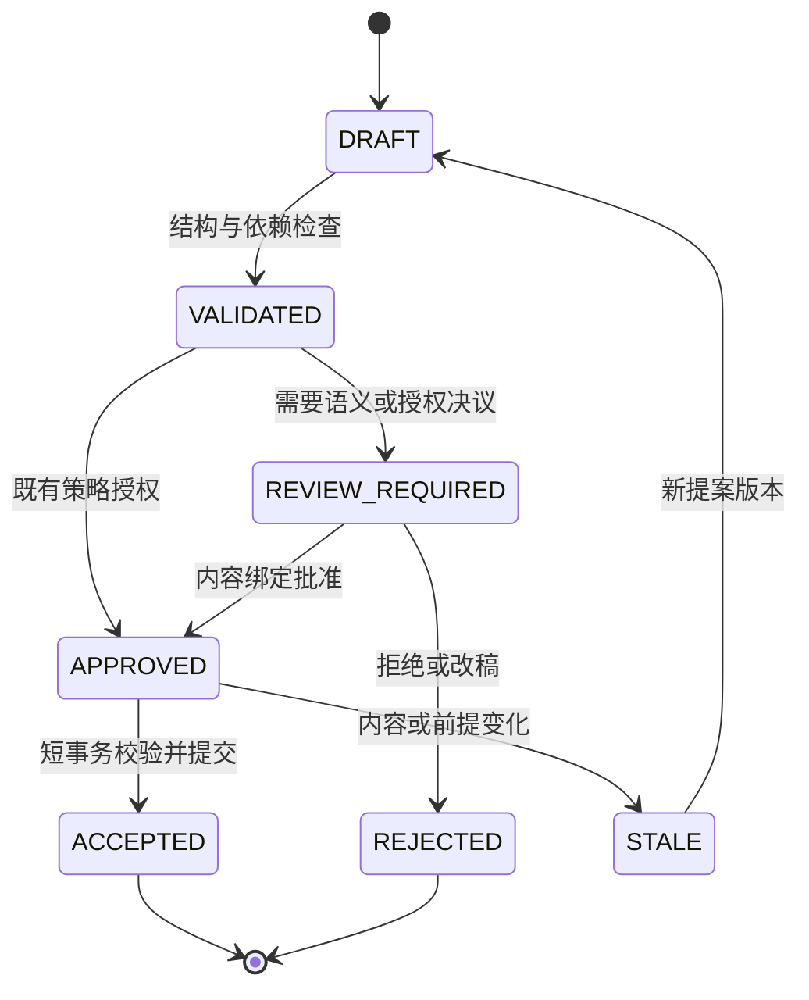

# 04｜事件溯源与版本体系

> v2.0-R1 详细设计｜2026-11-10｜状态：提交内核、统一时间与受守卫接受契约可直接开发；完整语义合并和复杂等价细化先做原型。
> 上游：[03 数据模型](03_数据模型与知识图谱.md)；下游：[05 世界调度](05_世界模拟与调度引擎.md)、[07 文学生产](07_剧情与文学生产系统.md)、[08 工具接口](08_MCP与工具接口.md)。

## 1. 三本账，同一个受控内核

| 历史 | 权威记录 | 改变什么 |
|---|---|---|
| 世界历史 | 不可变设定/事件/认知/过程记录及所选版本 | 世界内曾发生什么、何时成立、谁合法获知 |
| 编辑历史 | `world_revision`、`commit_operation`、正文版本、批准及发布清单 | 系统采用哪套历史和哪份正文 |
| 工作流历史 | task、attempt、generation、调用账与outbox | 现实中谁执行、是否重试、费用及恢复位置 |

本项目采用选择性的事件溯源：世界发生和接受决议不可变；当前投影、任务进度、索引水位可更新重建。日志不替代领域事件；不把每次心跳、排队和文件保存编造成世界事件。初始设定可由正式断言建立，无需为城市存在虚构一条建城动作。

世界重放使用保存的裁决结果和效果，不重新调用角色模型、重新抽签或改用新版世界规则计算过去。格式升级、投影器修复和世界规则修订分别管理。

## 2. 版本身份与分支模型

### 2.1 分支是身份，main 是当前正式入口

`branch_id` 永久标识一条分支；`work.canon_branch_id` 指向当前正式分支。用户界面的 `main` 在任务开始时解析为确切 branch_id 与 world_revision_id，随后任务只用固定 `WorldRef`。解析结果及历史指针变化有审计记录。切换正式入口不把旧分支删掉，旧发布仍引用旧 WorldRef。

一个分支的 world_revision 形成单一状态父链，`branch_seq` 仅在本分支排序。首个 revision 以 fork 的不可变基线清单为输入；继承事件保留 occurrence 与版本身份。合并建立目标分支的新 revision，并记录源 WorldRef 和采用决议；**不通过两个父指针自动求两套世界的并集**。

| 分支用途 | 允许的工作 | 正式地位 |
|---|---|---|
| CANON | 已授权的世界推进、正文生产依据 | 当前正式入口所选世界 |
| CANDIDATE | 卷路线、局部改写、待采纳变化 | 可有本分支已接受记录，未采纳到正式入口 |
| SIMULATION | 有界预演、反事实与机制试验 | 不向正式角色或main泄漏预测 |
| REPAIR | 历史修订的重建、重审和验证 | 在明确 promotion 前保持隔离 |

分支用途和是否当前 canon 是控制元数据；不能仅凭 `kind=CANON` 判断历史发布身份。版本引用必须验证 work、branch 和 revision 所属关系；不相容时拒绝，不能自动回退 HEAD。人类输入历史 `main@旧版本` 时由审计解析器返回当时精确 WorldRef；若存在歧义则明确列出，不静默串读。

### 2.2 正文版本独立但必须可对账

`artifact_revision_id` 标识一次不可变文本内容；`narrative_revision_id` 标识经过对账的正文版本集合；`arrangement_version` 固定章节/场景排列、POV与披露安排；`release_id` 固定一次可交付清单。

世界可以已经接受 D31 毁剑，而读者尚未读到。正文可三次回忆 D12 借剑，但 occurrence 仍只有一次。更改一句修辞只生成新的文本版本及必要审核，不生成世界状态转移。若改成永久受伤或新增告知，则先走事实提案，不能仅给正文一个新版本号就绕过接受。

## 3. 提案、批准、接受与发布状态



状态机描述世界变更提案，不用于表示世界中的人物已经成功。`APPROVED` 是“允许提交这个具体变更包”，`ACCEPTED` 是“某 WorldRef 已正式选择它”。ACCEPTED 后不能回到 DRAFT 冒充未发生；后续改变建立新提案、新版本和替代关系。

正文另有草稿、对账完成、审定、冻结等生产状态；外部送达另有 pending/sent/unknown/confirmed/withdrawn 等投递状态。`FROZEN` 或内部发布清单不证明外部网站已发表。实际枚举由生产与接口 Schema 管理，不复用世界提案状态。

### 3.1 ChangeSet 的最低内容

| 契约层 | 字段或引用 | 权威位置 |
|---|---|---|
| AcceptWorldRequest | schema_version、task_id、generation、context_bundle_id、expected_world_ref、proposal_ref、approval_refs、dependency_fingerprint、idempotency_key | 严格公共请求；expected_world_ref同时给目标分支和预期头 |
| WorldChangeSet | schema_version、proposal_id、input_world_ref、event_candidates、event_operations、adjudication_refs、process_advances、record_operations、trigger_evaluations、dependency_fingerprint | 由proposal_ref指向的不可变产物；接受服务读取并核验 |
| EventSelectionOperation | operation、occurrence_id、prior_event_version_id、selected_event_version_id | ADD/REPLACE/DEACTIVATE 明确事件选择；替代或停用历史必须进入修订策略 |
| RecordSelectionProposal | record_id、record_version_id、record_kind、operation、prior_record_version_id、payload_ref | 初始身份、规则、断言、过程、触发、认知的类型化选择；不是任意表CRUD |
| TriggerEvaluation | trigger_id、trigger_record_version_id、outcome、produced_event_refs、replacement_trigger_refs、evidence_refs | 触发的完成/替代与事件和推进同事务接受 |
| 受控附属记录 | 当前policy、attempt、规则/证据、效果表示和全部读依赖 | 服务由任务、授权、源记录和存档产物解析；不信模型自报 |

字段精确形状以 [核心 Schema](../contracts/core.schema.json) 为准。本文逻辑名 `proposal_revision_id` 对应 `proposal_ref.artifact_revision_id`，不另造一套未关联版本。世界变更中的 `event_candidates` 使用 AcceptedEvent 载荷形状，但候选中的出现不授予接受地位。其时间字段为 `occurrence_time`，可精确、有界或尚未指定；不得用任务的 `story_time` 填造发生日期。

事件载荷与选择操作分别验证：event_candidates 保存待核验的新内容；event_operations 明确本次选择。ADD 的 prior 为空且不能重加目标分支已继承的 occurrence；REPLACE 必须精确匹配旧选择并指向已核验新版本；DEACTIVATE 只停用选择，不删除旧发生。每个选择版本必须已存在为核验后的不可变载荷；同一包不允许对同一 occurrence 发出相互矛盾的操作。普通接受不得借 REPLACE/DEACTIVATE 绕过 Retcon，未被选择的候选载荷不产生效果。

最小失效范围由服务根据权威变更、登记过程和依赖计算，必要时保守扩大；不接受外部 Agent 一句“影响为空”作为屏障依据。模型可提议 effects，只有裁决与接受链允许其成为世界效果；角色行动提案本身没有权威 effects 写入权。

### 3.2 Approval 必须绑定内容

批准记录绑定变更包内容哈希、目标基线、规则与策略版本、依赖摘要、所需审核范围及批准者能力范围。只在同一个章节 ID 上挂永久 `approved=true` 不合格。

修改正文、替换事件、改变关键依赖或排列时，旧批准不会自动覆盖新内容。普通授权范围内可以由服务策略自动批准；重大设定变更、历史修订、外部发布等根据作品策略走相应决议。文学评阅者给出建议或接受意见，不因此取得数据库写入权。

批准内容不可变，但其当前适用资格可以被撤销。提交必须在锁内复核批准者/策略范围、有效期、撤销状态和所需批准集合，不能只读取旧记录中的ACCEPTED。首版为相关批准资格设置细粒度AUTHORIZATION守卫：正常接受持共享锁，撤销/替代事务持冲突排他锁并原子更新资格及token；均遵守14的全局锁序。

v2.0 旧 `AcceptWorldRequest/commit_request` 保持严格 HEAD CAS。R1 在 P1 增加受控 `STRICT_HEAD/DEPENDENCY_GUARDED` 两种接受模式；后者允许同一分支 HEAD 已前移而全部相关依赖仍成立的提案继续接受。它仍生成统一分支序列，不原地改旧提案的 input_world_ref，也不修改旧批准哈希。R1 的 ApprovalBinding 明确批准适用于精确 HEAD，还是允许已证明依赖不变的后代；旧批准默认严格。角色/正文仍保留原输入 provenance，是否用于新 narrative/release 按场景依赖复核。完整算法见 [14](14_高并发服务与一致性协议.md)。

### 3.3 R1 接受资格：原输入、证书、实际父版本

| 对象 | 作用 | 不代表什么 |
|---|---|---|
| 原 ContextBundle/WorldChangeSet | 固定 Agent 实际看到的 base WorldRef 与候选内容 | 不因为 HEAD 前移就把输入改标成新版本 |
| AcceptanceCertificate | 服务端对具体内容、依赖范围、规则、调度封闭、授权与批准适用性的不可变校验结果 | Agent 自报的“依赖完整/审核通过”没有效力 |
| 实际 parent WorldRef | 接受短事务内锁定的当前分支 HEAD | 数据库排序不赋予故事先后，也不决定冲突胜负 |
| GuardedCommitReceipt | 保存原 base、核验版本、实际 parent、新 WorldRef 与证书引用 | 不掩盖曾使用旧输入，也不更改已存原命令 |

DEPENDENCY_GUARDED 只适用于服务器已登记读/写/负向范围/约束及副作用的有限命令模板。每个合法 writer 都必须原子更新实际受影响 scope token；新域登记守卫父范围，删除重建保留单调版本和 tombstone。过程覆盖、渠道、同一冲突组 sealed intent set、规则与权限也是依赖。若不能证明范围完整、发生跨分支采纳、Retcon、效果替换或历史 REPLACE/DEACTIVATE，则保留严格模式或先重做语义核验。

资格准备在一个有界、一致的只读数据库快照内固定核验WorldRef、权威状态和全部守卫token，产出不可变核验输入后立即释放事务。长语义检查在事务外进行；证书保留原采样token，不能在核验结束后另取当前token填入旧证明。原DependencyManifest及其指纹始终对应原输入；证书中的核验token另行记录，不重算或改写旧上下文/批准的依赖指纹。完整过程见14第6节。

R1另以interpretation_ref固定已认可的reducer/projector/predicate/clock mapping版本，作为证书和ResolvedReadCut的必需来源。INTERPRETATION作用域守卫在语义解释变化时受控递增；单纯重建同义索引不递增。固定旧WorldRef按其认可解释恢复，不能因部署更新悄悄换规则；会改变历史结果的修复需可审查的解释兼容证明或修复版本流程。validator_version仅标识校验器，不替代这一绑定。

计划、叙事编排和文学档案的不可变manifest可长期固定读取；如果接受命令还依赖“它仍是当前采用版本”，必须登记ARTIFACT_SELECTION守卫。采用新计划/编排的事务同步更新其选择token与最小失效屏障；只读旧manifest不因此失去历史读取资格。提案所用base、上下文、任务、依赖和批准集合的逐字段绑定要求见 [contracts](../contracts/README.md)，不能只核验证书引用存在。

正文创意是否有文学价值不由模板决定。模板仅限制可自动证明“原候选仍能合法接受”的工程范围；自由语义候选仍可提交、审核并走严格接受。

### 3.4 R1类型化关系变化仍走同一事件链

core2.0文件保持原样。R1的 `AcceptedEventR1/WorldChangeSetR1` 使用schema_version=2.1，允许已注册的RelationTransition表达多值关系与类型化标量状态，仍由同一发生身份、选择清单、规则与投影器接受。旧NormalizedEffect和新RelationTransition必须规范化到同一权威效果槽位：同一变化不能同时通过两种表示重复作用。关系OPEN新建关系发生身份；CLOSE绑定当前选中的关系版本，关闭再开启使用新relation_id。谓词基数、物品/人物/组织的合法状态及因果时点均由领域规则核验。

提案Artifact的类型/版本由服务端已存元数据及实际载荷共同校验，不信调用者随意指定解析器。`record_operations`中的ASSERTION用于其原有受限设定语义，不是绕开行动事件直接改owner、life_status或组织成员的通用后门。旧 `commit_request` 只接受原core契约；新增控制入口同时验证core或R1包，再调用同一提交写入器。

## 4. 原子世界接受协议

### 4.1 事务外准备

1. 保存候选原始输出、裁决和正文对象；使用内容寻址或不可变文件名，完成持久化与可读性检查。
2. 校验 JSON Schema、身份引用、故事时间约束、资源变化、因果闭合、效果表示和认知来源。
3. 获取必要审核，生成不可变 ChangeSet 与内容绑定批准；计算最小保守失效范围。
4. 外部模型调用、长文本阅读、语义影响分析及大规模重建都在数据库事务外进行。

本地文件采用临时写入、flush/fsync、原子更名及所选文件系统要求的目录持久化确认；存储适配器对外提供同一个“已可靠保存并可核验”契约。对象存储则使用其完成回执并核对内容。上传成功但数据库未提交会形成可回收的孤立对象，这比发布悬空引用更可控。

### 4.2 短事务伪代码

以下保留 v2.0 strict 入口；R1 两模式共享相同事务写入器，guarded 的依赖检查分支见 [14 第6节](14_高并发服务与一致性协议.md)。两个入口不能维护两套投影或效果应用逻辑。

```python
def accept_world(command, authenticated_actor):
    # 外部调用与对象持久化已经结束；以下不包含 LLM 调用。
    authorize_envelope_and_reference_reads(authenticated_actor, command)
    prepared = load_and_verify_prepared_changeset(command.proposal_ref)
    with unit_of_work.transaction():
        share_lock_current_policy_and_required_canon_pointer()
        branch = lock_branch(command.expected_world_ref.branch_id)
        lock_task_and_proposal_in_stable_order()
        receipt = find_idempotency_receipt(derived_command_scope(command, authenticated_actor),
                                           command.idempotency_key)
        if receipt:
            require_same_payload_hash(receipt, command)
            return authorized_receipt_view(receipt)

        require_expected_head(branch, command.expected_world_ref.world_revision_id)
        require_current_task_generation(command.task_id, command.generation)
        require_not_cancelled_and_current_grant(command)
        require_proposal_content_and_approvals_match(command, prepared)
        require_dependency_receipts_valid(command, prepared)
        require_durable_objects(collect_artifact_refs(command, prepared))
        require_event_and_record_operations_match_target_manifest(prepared)
        require_causal_closure_time_resources_and_effect_selection(prepared)

        revision = append_world_revision_and_commit_operations(command, prepared)
        apply_critical_world_and_belief_projections(revision)
        update_processes_triggers_and_coverage(revision)
        bump_actual_conflict_scopes_and_invalidation(revision)
        append_outbox(revision, indexes=True, replanning=True)
        compare_and_swap_head(branch, revision)
        record_idempotency_receipt(command, revision)
    return receipt_for(revision)
```

同一事务要么同时记录事件、关键效果、过程进度、触发求值、推进覆盖、作用域 token、最小失效屏障和 HEAD，要么全部不生效。不会出现“已经推进到 D30”但决定 D30 库存的事件尚待异步保存的正式状态。

普通提交每分支只在短事务内持有 HEAD 的 `FOR UPDATE` 锁；正常 canon/授权 guard 使用共享锁，promotion、撤权和策略切换使用与其冲突的排他更新，不把全部普通接受变成作品级排他大锁。固定锁序为作品/canon/授权 guard（需要时）→按 ID 排序的分支 HEAD→任务及提案→按 key 排序的作用域/资源 guard。取消与接受遵循同一顺序；只领取/续租的任务事务不再向上申请分支锁。canon 接受验证目标仍是预期正式分支，撤权和提交在同一授权状态上线性化。

`READ COMMITTED + 分支短锁 + 当前依赖核验 + CAS + 唯一约束` 可作为单分支命令的首期实现；涉及工作级或跨域不变量的额外 guard 同样必须遵守，所有相应写服务必须参与协议。多分支推广命令遵循固定加锁顺序。是否引入 Serializable 由具体不变量决定，不能作为遗漏依赖记录的补丁。PostgreSQL 的事务隔离只管其覆盖的数据库事务；模型在数分钟前另一次事务读过的事实仍需业务复核。[官方隔离文档](https://www.postgresql.org/docs/17/transaction-iso.html)

### 4.3 幂等、过期与未知结果

幂等键的作用域统一为 `work_id + principal_id + command_type + idempotency_key`；目标分支、WorldRef及全部业务内容纳入请求内容哈希。同一键同内容返回既有回执，同一键不同内容报 `IDEMPOTENCY_MISMATCH`。另以 `UNIQUE(target_branch_id, proposal_revision_id, operation_type)` 保护同一已接受提案，换一个幂等键也不能在目标分支再次产生世界效果。

任务代际用于阻止租约已被替代的 worker 提交。若命令已成功提交而回执丢失，随后重试只取回其有权读取的既有回执，不因任务后来关闭而假称原提交失败，也不重新执行。若原提交从未成功，旧代际请求须被拒绝；候选文本可隔离保存供编辑参考。

guarded 请求的幂等 hash 仍绑定其原始内容及不可变证书；不因实际 parent 前移而修改 hash。证书改变或新提案需要新命令键；目标分支已接受提案的唯一约束防止换键重复。回执记录原 base、validation、实际 parent 和新 WorldRef；重复请求返回第一次成功的同一回执。

网络断开不证明数据库或外部供应商没有执行。世界命令通过回执表对账；模型调用通过可用供应商 ID 查账，否则保持 unknown 并保留预算占用。业务副作用可以在明确身份和事务范围内避免重复，不能宣称所有远端调用天然恰好一次。

## 5. 重放、快照与效果身份

### 5.1 恢复输入与顺序

先根据 WorldRef 解析有效记录选择清单，再在故事时间与因果约束下构建状态。编辑提交的顺序用于选择内容版本，**不是故事事件应用顺序**。不相互作用且效果可交换的事件可以稳定排序；相互作用但先后未确定的事件不能任意排序；能推进的范围须有已保存的联合裁决、显式时间依据或结果不受剩余顺序影响的证明。AcceptedEvent.occurrence_time中的BOUNDED/UNSPECIFIED事实可保留，查询跨其可能时点而结果未定时返回UNDETERMINED。快照保存未解析发生及其约束，不按earliest或数据库序号擅自执行；不能构造确定状态的相关范围保持未确定/受阻，无关范围仍可恢复。

快照包含 `WorldRef, manifest_hash, projector_version, rule_refs, scope_frontiers, applied_effect_coverage, state_hash`。它只是派生加速材料。快照缺失或哈希不符时回到更早相容快照/创世基线重建，不重问模型。

不能仅因快照的 `branch_seq` 小于目标就认定可用：retcon 替换了其覆盖事件、规则或效果表示时，快照已不相容。相容性取决于来源清单与选择关系。MVP 可先整分支重放，以小世界明确验证；有实测瓶颈后再引入增量受影响子图重放。

### 5.2 三种去重分别实现

| 层次 | 主键/机制 | 能保证什么 |
|---|---|---|
| 命令重试 | 命令作用域+幂等键+内容哈希 | 已知同一操作不会再次接受 |
| 发生身份 | `occurrence_id`、文本→发生对齐、版本替代映射 | 多次叙述引用同一发生；不同真实发生不会只因描述相似被合并 |
| 效果应用 | `effect_group_id` 的唯一活动表示；构建账 `(build_id,group,representation,effect_item)` | 一次状态构建不会重复应用同一个已选择效果 |

fork 的基线选择与快照携带已覆盖 occurrence/effect 身份。继承的祖先转移不会在新分支又执行一次；分叉后新增的假设动作则可在该隔离分支独立发生。禁止把效果做成跨所有分支的全局已执行布尔值，这会错误阻止合法反事实实验。

仅有唯一 ID 不能识别模型用不同 ID 描述同一次转移的语义重复；正文对账和高影响复核仍然必要。模糊相似度只能提出对齐候选。

## 6. 分支比较与合并

`VersionService.compare_branches` 固定共同基线、source、target 三个 WorldRef，输出：新增记录、同一记录的不同版本、资源与时间交叉、认知变化、计划依赖、正文/披露/风格影响、未确定的语义冲突。不得只显示 Markdown 行差异。

`prepare_merge` 形成目标 ChangeSet：

1. 已由共同祖先继承且版本相同的 occurrence 不重复导入。
2. source 新发生先验证 target 当前前提、故事时间、角色知识、资源和过程覆盖。
3. 同一 occurrence 不同版本，或 source 的影响早于 target 已接受覆盖边界，进入修订评估；不能伪装为普通新增。
4. target 与 source 各自耗用了同一批粮、分别救剑/毁剑等冲突，必须选择完整因果方案、局部重规划或保留分支。
5. 批准绑定合并包和目标 head；提交时再次 CAS。合并失败保留 source，重做比较，不最后写入覆盖。

MVP 支持 fork、选择性采纳候选及显式冲突报告；不承诺任意分支自动语义合并。正文独立段落无文本冲突，也可能在秘密披露、时间前提或物品身份上冲突。

## 7. Retcon：重建候选，明确推广

### 7.1 补充与修订的判定

新增背景若与所有已确认状态和已声明覆盖兼容，可作为历史补充。若会改变既有明确状态、前因、认知或已被下游依赖的中间结果，则属于 Retcon。正文尚未发布不免除这个判断。删掉描写不能冒充撤销世界事件。

### 7.2 执行路径

1. `prepare_retcon` 固定旧 canon WorldRef，登记理由、被替代记录、最早故事影响边界、保护的发布前缀及所需权限。
2. 建立 REPAIR 分支，保存旧世界完整选择清单作为来源；保留事件 occurrence_id，替代内容使用新 event_version_id。移除的发生用显式停用决议，不物理删除。若效果内容改变，还需新的不可变representation_id并替代同组旧表示；不能在原表示ID下重写效果。
3. 从早于最早影响边界且与新清单相容的快照重建；若无法证明快照相容，从初始基线重建。这里回到的是故事状态构建点，不是删除编辑审计记录。
4. 对保留的后续发生依次检查前提。数值可重算不等于语义仍成立：D12 借改赠之后，D30 师父再次许诺赠剑需检查其认知与台词；不能自动删除“曾说过”这一发生，也不能无审查保留不可能动作。
5. 重新核验相关人物观察/信念、触发与传播下界、推进覆盖、计划、正文证据和发布资格。不得在现实编辑时刻给全体角色生成一次获知事件。
6. 生成影响报告和新旧差异，在候选分支得到完整可解释状态。不能重建的依赖保持阻塞，不能以空值默认成功。
7. `promote_candidate` 在短事务中锁定作品 canon 指针及相关分支头，CAS 原 canon WorldRef，核验修订批准、候选 head 和投影完成状态，再切换 `canon_branch_id`，写推广审计、最小失效屏障与 outbox。
8. 旧 canon 分支和旧发布保留；新的正文版次经重审后才能绑定新世界。世界入口切换不会替换读者已经收到的旧文本。

若旧 canon 在重建期间又推进，promotion 拒绝，先比较新增前提并重建/重审必要部分。不把新输入无条件并到旧修订包。涉及大范围未来的文学改写由计划/编辑处理，不要求在 canon 切换事务内生成整本小说。

### 7.3 为什么不用反向 delta 撤销

撤销曾赠出的剑不能只对当前账户做一次反向转移：剑可能已被盗、消耗或毁坏；人物可能基于赠与作出决定。正确恢复依赖一套新的有效历史。普通候选计算失败可以丢弃其尚未接受的结果；已经接受的世界不能使用运行时“回滚一下”隐去后果。

## 8. 失效屏障与跨模块一致性

权威接受时同步登记保守的 `invalidation_barrier(work,branch,revision,scope,dependency_kind)`。逐个找出摘要、场景和旧批准的作业可异步执行，但相关新接受/发布必须检测屏障与依赖版本。不能在后台尚未改完 `approved` 标志的空窗中沿用旧资格。

| 影响 | 同步必须做 | 异步可做 |
|---|---|---|
| 世界资源/认知变化 | 原子更新关键投影、范围版本和覆盖 | 图索引、全文、普通摘要重建 |
| 历史修订 | 固定新世界、屏障及需要重验证的范围 | 扩展语义影响搜索和文学复审任务 |
| 正文修改 | 新内容版本、旧审批适用性检查 | 摘要和引用召回更新 |
| 场景重排 | 新 arrangement_version、披露/衔接范围失效 | 整卷节奏与人物理解复审 |
| 权限撤回 | 立即限制后续读写，更新策略版本 | 缓存清理、会话归档 |

失效仅针对向新版本继续使用的资格；明确读旧 WorldRef 的审计查询仍可返回当时的历史，受调用时权限限制。无关作用域可继续工作；HEAD 前移不等于所有任务失效。guarded 接受以注册依赖与同步 token 为依据，未证明完整的命令保守使用严格模式。某个向量索引落后不应冻结全厂；关键信息可以权威回源则继续。

## 9. 正文冻结与外部发表协议

生产服务在独立事务中建立 `release_manifest`，固定正文 ArtifactRef 列表、narrative_revision_id、arrangement_version、采用的 WorldRef、对账映射、审核与风格版本、阅读覆盖记录和内容哈希。发布检查确认正文所述重要发生已接受，或明确属于合法的传言、假设、未来计划等呈现类型。整卷各批次最初可能固定不同历史WorldRef；冻结前必须证明各场景的重要发生/规则在最终manifest的WorldRef中仍选择同一有效版本，或已有明确的重验证/修订映射，不能仅拼接各批曾经approved的稿件。

冻结**不会调用 apply_world_effects**。世界发生早已接受时，只建立正文证据映射；若正文含新影响，冻结前先走世界增量/修订并重新对账。删除借剑对白保留借剑发生；删除告知描写保留角色已知，除非另行修订该告知。

外部渠道投递通过 outbox。为每个渠道目标保存 `desired_release_id, operation_generation, unresolved_delivery`。发送前重验授权和目标期望版本；远端支持条件写入则采用其条件版本，不支持时同一目标只允许一个未结算操作。unknown 回执先核对，不让旧 v1 晚到覆盖 v2，也不让旧撤回删除新版本。MVP 可以只形成内部交付文件；外部发布未接入时明确停在内部冻结。

## 10. 失败与恢复矩阵

| 故障点 | 持久结果 | 恢复动作 |
|---|---|---|
| 对象已存，事务未开始/失败 | 孤立候选对象，无正式世界变化 | 复用相同哈希或按保留期清理 |
| 事务内进程退出 | 数据库回滚或已提交回执 | 查询命令回执，禁止靠猜测重新施加 |
| 世界已提交，索引任务未执行 | 权威/关键投影一致，outbox待处理 | 幂等补建；关键读回源 |
| 旧worker迟到 | 可能有输出和费用，无提交资格 | 隔离产物；按generation拒绝新接受 |
| 重建修订中断 | REPAIR分支未推广 | 从存档产物恢复；canon继续保持旧版 |
| promotion CAS失败 | canon未切换 | 比较新增head，定向重建与重新审批 |
| 关键对象损坏 | 哈希/可读性失败 | 阻断相关发布、恢复副本，禁止生成替代文本冒充原稿 |
| 远端发布回执未知 | 内部release已固定、外部状态未知 | 按目标序列对账，再允许后续操作 |

备份恢复先隔离写入，恢复数据库及引用对象，校验清单、规则和快照，再重建索引，最后处理任务租约、未知调用和outbox。恢复的旧generation不自动获得新的提交资格。

## 11. 实现与验收顺序

**P0 冻结契约与环境；P1 必做：** 不可变记录/正文、稳定发生身份、分支与fork、严格CAS及有限模板的DEPENDENCY_GUARDED、批准绑定、作用域/否定范围守卫、三层幂等、关键投影与覆盖原子接受、同步失效屏障、最小REPAIR重建推广、内部release及基础恢复。语义合并允许人工/授权Agent逐项决议；不必先写自动图合并器。

**P2：** 将上述内核用于5–10场景的完整短卷并完成整卷编辑，形成MVP；宏观结果的微观细写仅纯呈现。

**P3 后续原型：** 在P1已有保守作用域守卫上优化精细读集/负向谓词范围，减少可度量的误冲突；补充受影响子图重放、宏微等价表示替换和更复杂多分支合并。P4扩大跨卷/连载与恢复；外部渠道投递按是否实际接入决定。若首期实际启用其中任一能力，其对应正确性门禁必须同时到位。

验收继承 T05/T08、S04/S06/S08 和 F01–F05/F07–F12/F17/F18，并增加：fork继承效果不重施；相同幂等键不同payload拒绝；请求提交成功但回执丢失仍返回同一revision；修订快照相容性失效；promotion期间canon推进导致CAS失败；正文重排不改变世界hash却使披露批准失效；部分修订重建失败不能推广。R1 另验证同旧base的无关提案可依次接受、交叉读写偏斜被约束集合捕获、否定查询新增行触发失效、scope删除重建防ABA、证书签发后撤权、共享锁不成为全作品大锁。所有工程验收用真实 PostgreSQL 事务与故障注入；内存实验只能验证算法思想，不能证明数据库锁和恢复已经正确。

## 交接补充：修订报告与组合演练

[四类报告契约](../contracts/report_templates.md) 固定 RetconPlan、ImpactReport、RevalidationReport 和 AlignmentReport 的内部字段、版本绑定及服务端核验责任；ArtifactRef 存在不等于检查结论可信。[交接演练](../validation/HANDOFF_EXERCISE.md) 逐步验证借剑改赠、旧稿并发、取消迟到与推广 CAS 的服务衔接。后续报告机器 DTO 与真实门禁分别在 P1/P2 实现，不把纸面演练当作并发验收。
