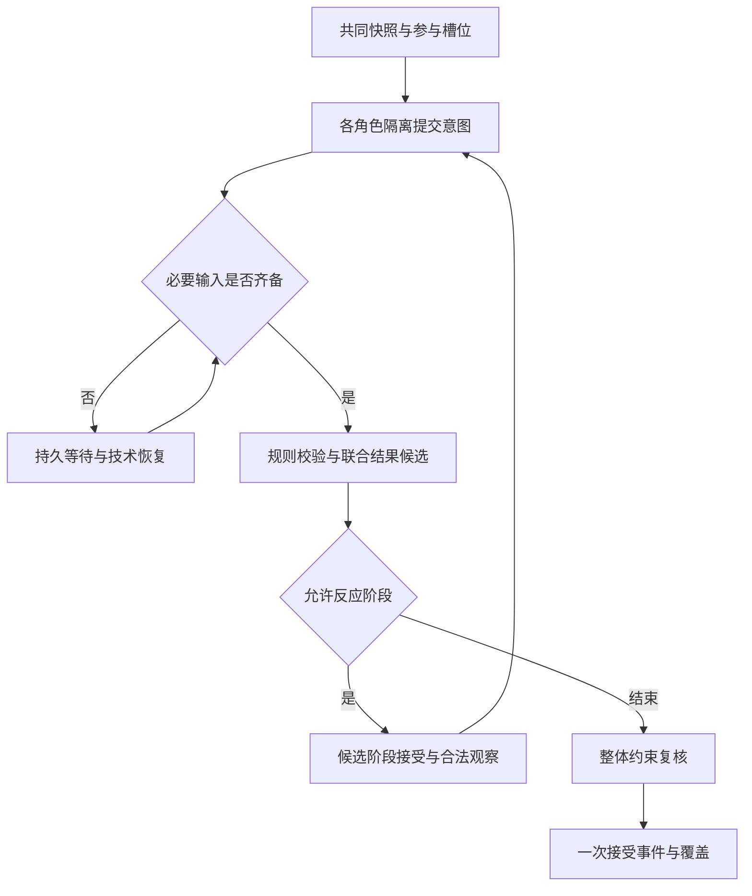

# 05｜世界模拟与调度引擎

> v2.0-R1 详细设计｜2026-11-10｜状态：局部推进、跨域同步与并发候选协议已整合；开放语义影响识别与等效细化需原型。
> 本文落实 v1.1 ADR-19/20，不引入新的世界数据库或通用现实仿真平台。数据见 [03](03_数据模型与知识图谱.md)，接受见 [04](04_事件溯源与版本体系.md)，阶段见 [11](11_研发路线与测试计划.md)。

## 1. 三个明确的责任

| 模块 | 输入与输出 | 有权决定 | 无权决定 |
|---|---|---|---|
| `WorldSchedulerService` | 固定世界、过程登记、目标范围 → 就绪交互、共同快照、覆盖候选 | 哪些过程需检查，哪些输入必须联合，推进能到哪里 | 人物想做什么、谁获胜、什么最精彩 |
| `AdjudicationService` | 意图集合、共同前态、规则、环境与证据 → 结果候选 | 确定规则校验与授权语义结果建议 | 直接提交canon，因导演偏好推翻已接受失败 |
| `WorldCommitService` | 已审核结果、依赖和批准 → 新WorldRef | 在当前资格和不变量下接受哪个具体结果 | 重新创造人物意图或文学评价 |

工作流调度另管现实的worker、超时、租约与费用。世界调度请求语义任务时持久化未决范围，关闭数据库事务，等待有效任务结果。角色模型慢十分钟不会让军队在故事里迟到十分钟。

## 2. 有限的过程类型与数据结构

MVP 首先支持旅行/运输、消息传播、有限库存生产或消耗、按条件触发的势力行动和单场交互。后台过程一旦被接受，立即登记范围、触发和可能出站渠道；不是等某个 Agent 开始执行后才让调度器知道它存在。下表是内部领域对象，不应照搬为额外公共字段：公共请求/响应以core.schema、temporal_concurrency.schema与tool_catalog为准；ProcessInstance的公共摘要是ProcessRecord，内部AdvanceProposal由advance_prepare返回其ArtifactRef，语义裁决使用AdjudicationProposal载荷，内部AdjudicationResult只是核验后的包装。它们共享接口，不要求建完整经济、天气或军事系统。静态背景只保存已接受设定；声明会变化的过程才需要推进。

### 2.1 ProcessDefinition 与 ProcessInstance

| 对象 | 核心字段 | 用法 |
|---|---|---|
| `ProcessDefinition` | `type, schema_version, evaluator_kind, rule_refs, effect_slots, interruption_policy` | 确定性解释器或语义任务模式；版本固定 |
| `ProcessInstance` | `process_id, world_ref, definition_ref, participants, world_stage, parameters, evaluated_frontier` | 已接受过程的身份与阶段；参数中的未来目标不自动成为实际结果 |
| `ProcessFootprint` | `read/write entity scopes, resource scopes, region/routes, possible_channels, time_bounds, unresolved_semantics` | 声明可能影响范围，包括尚未生成事件的过程；过宽会保守阻塞，过窄有漏检风险 |
| `ScheduledTrigger` | `trigger_id, trigger_version, process_ref, due_bounds, condition_ref, outcome_ref` | 到期求值；改期/替代保留历史，不直接产生返航等世界动作 |
| `InteractionBundle` | `interaction_id, base_world_ref, active_phase_world_ref, StoryPoint/window, phase_policy, participant_slots, sealed_intent_refs, dependency_fingerprint` | 同一共同前态的交互输入；包括必要环境过程，不只角色列表 |
| `AdjudicationResult` | `bundle_hash, chosen_outcome, occurrence_versions, effects, observations, outgoing_processes, rules, reasoning_evidence` | 不可变候选；先过硬校验，再按策略审核/接受 |
| `AdvanceCoverage` | `scope_id, WorldRef, frontier, closed_interactions, channel_bounds, registered_process_fingerprint, unresolved_ranges`（内部证明） | 公共ProcessAdvance用expected_frontier/evaluated_frontier和proof_artifact_ref引用；不等于最大事件日期 |

`world_stage` 可表达 NOT_STARTED、ACTIVE、SUSPENDED、COMPLETED、TERMINATED；SUSPENDED 只表示世界内实际暂停，必须有发生依据。系统等待模型时仅改变工作流/evaluation状态，不能把 ACTIVE 商队改成世界内停步。

触发的“技术计算中”也属于任务状态。只有结果与过程推进被接受后，该世界版本中的触发才被记为已求值。条件不成立可以是一次成功完成的求值，不能把“未抵达”同时当成尚未计算和技术失败。

### 2.2 持续过程的区间核算

确定性生产或旅行分段按 `[last_evaluated_frontier, new_frontier)` 计算实际变化。每个区间效果有稳定身份，例如 `process_id + process_version + interval + effect_slot`。推进区间、资源效果和下一触发在同一接受事务里保存，重试不能重复累计产量或消耗。

存在更早中断/入站影响时先截断区间，不能先算至 D30 再补一个 D29 封路。未确定途中过程不能将终点库存平铺到整段时间。“七日末交付一百袋”不证明第三日已到一百袋。

## 3. 影响范围与条件性推进边界

### 3.1 Scope 与耦合图

推进域不是固定地理分区。首期可手工登记两个或三个 scope，通过以下可计算关系建立耦合：

- 两个过程在重叠故事窗口读写同一唯一物品、库存账户、桥梁控制或角色状态。
- 一个过程的出站消息、移动或远程能力最早可能在待接受边界之前/边界处影响另一过程。
- 一个过程的结果是另一过程的明确前提；或存在已登记但未解析的高影响条件。
- 已接受规则允许跨区即时影响，且暂不能证明与当前交互无关。

图节点为当前窗口的过程/交互，边有 `resource_conflict/inbound_channel/precondition/possible_influence` 类型。地理距离只能参与传播下界计算，不能独自证明无关。范围可使用路线、资源类和地域选择器；尚不知具体拦截者 ID 时不能因此漏掉“这条路线可能受拦截”的依赖。

相关连通分量形成候选冲突簇；有明确先后的仍按偏序处理，连通不意味着所有动作同时发生。零时延相互作用和未知但相关的下界通常促使合并域，逐阶段共同处理。已结算且出站影响登记完毕后，未来窗口可以重新分域。

### 3.2 Frontier 的端点语义

统一把内部 `AdvanceCoverage.frontier`、公共 `ProcessRecord.evaluated_frontier` 及 `ProcessAdvance.evaluated_frontier` 解释为**排他的已检查边界**：该作用域中严格早于该 StoryPoint 的已登记相关过程已完成必要求值。等于边界的输入仍要检查。若一个外部影响最早在 `{tick:30,phase:0}` 到达，只能据此保证此前的范围；不能声称 D30 交汇已完整处理。

`ProcessAdvance` 的 frontier 针对其 process；聚合作用域的可用边界由相互作用过程、入站通道与证明范围共同限制，不能取最大日期。coverage=PARTIAL 不允许跳过已知且相关的未求值过程；它必须明确未覆盖范围，不能据此向查询方承诺整体已完成。`ProcessRecord.next_due` 的 StoryInterval 表示待求值窗口，不是已发生事件的时间证明。

同刻交互的 phase 只能来自明确的因果阶段协议。phase0 发信、phase1 观察、phase2 反应可作为已批准结构；队列插入 ID、数据库序号和模型返回顺序不得生成 phase。`closed_interactions` 可说明某组边界交互已经结算，但不证明同一天其他未知过程也已完成。

### 3.3 可推进的判定

对候选边界 H，取相关过程的注册版本、当前在途影响、已登记但待求值的潜在发送方、共享资源前提和传播下界。满足以下条件才能声明相应范围已覆盖：

1. 早于 H 的必要触发及持续过程片段已经求值，或其结果被包含在同一接受包。
2. 所有**已知且相关**的入站影响在 H 前不可能到达，或已经纳入输入。到达下界等于 H 时可以停在排他边界 H，但不能声称 H 的交互已处理，也不能在未纳入该影响时越过 H。
3. 共享资源和认知前提不存在未处理的冲突；已明确存在的高影响过程不能用“本次范围不含它”排除。
4. 新产生的出站过程/消息已登记，不留下只有内存知道的影响。
5. 上述结论绑定规则、通道、过程注册表与负向谓词 fingerprint，提交前复核。

某项最短传播时间未知时，不伪造正的 lookahead。可以缩小窗口、合并相关域、补足过程或暂停该局部。真正无依赖的地区可继续推进。

这是声明模型范围内的条件性保证。开放世界中的语义漏报、新设定、隐含能力和未知人物无法仅靠调度算法证明不存在；高影响新证据若指向已接受过去，应进入历史补充/Retcon，不自动回滚正式历史。


### 3.4 统一时钟下的局部进度向量

每个 WorldRef 固定一组 process/scope 前沿与证明；逻辑上可记为 `F(W)={A:40,B:35,C:20}`，这不是额外的世界版本向量，也不是所有地区共有的当前日期。每个数值仍需完整 StoryPoint 和排他边界。界面“推进到 D40”应说明是 D40 开始前、某阶段后还是整日完成，不能省略后又拿它作严谨接受条件。

例如 A 的前沿为 `(40,0)`、B 为 `(35,0)`，有覆盖完整的 B→A 通道证明：从 B 尚未求值的前缀之后出发，最早可能在 `(40,0)` 影响 A。A 可以证明严格早于这一点的范围，不能先接受 D40 争剑的结果。C 仍在 D20，但其已登记通道证明 D50 前不可能影响 A/B，则 C 不必先追到 D40。

推进分三种情况：

- **独立窗口：** 读写集与入站影响在目标窗内均不耦合，分别计算候选并发派发；接受时按范围依赖重验证。
- **单向消息：** 发送发生、在途过程和最早到达在源域接受中一并登记；目标只在合法到达/观察后获得信息。原子登记后，源不必等待目标完成整段后续故事。
- **交汇窗口：** 共享人物/物品/通路使两个候选相关，先把两侧必要前缀推进到共同交互入口，再封闭一次交互集合并联合裁决；不先在某一侧写“抢夺成功”再让另一侧适应数据库结果。

跨域通信的接收身份由 `source_occurrence_id + channel + delivery_slot` 等服务端稳定键确定；投递重试不会新造一条消息。最早到达只是下界；“已经送达”“收件者看见”“相信内容”分别是需要接受的后果。未知传播下界必须显示未定，不用零/无限大默认值假装证明安全。

### 3.5 注册表与遗漏防护

过程/通道目录按有限作用域版本化。新增过程、改变可达路线、开启瞬移能力或扩大影响范围，同次接受必须推进相应注册范围戳与最小失效屏障；只改变其他无关地区的目录，不能通过一个全局 registry 计数使所有任务虚假过期。共享规则、跨域能力等真正全局依赖仍可使用全局规则版本。

作用域重划分需保留旧 scope 到新 scope 的覆盖关系和注册代际；旧 ScopeToken 不能因为新域计数恰好相同而继续有效。客户端不得自行选择一个不含竞争者的 scope 声明“完整”。任务创建时，调度器以权威过程目录和注册规则推导必要参与槽位，语义 Agent 只提补充范围。

恢复扫描比较：已接受未终止过程、到期窗口、未求值触发、已登记未结算出站影响、待关闭交互。若发现工作流队列漏项，补派同一业务身份的任务；不能把“队列为空”当作“世界全部演化完成”。扫描可按 scope/到期范围分页及分批运行，避免一次锁住所有世界。

开放小说世界仍存在尚未声明的远程能力、人物或隐含关系。P2 用手工可审计的过程/通道集合证明范围内正确性；新证据指向已接受过去时转历史补充/修订流程。它不能被忽略，也不能以一次技术队列回退悄悄覆盖旧正式历史。[时间与迟录模型](13_统一时间线与动态知识演化.md)

## 4. 核心算法与持久化边界

### 4.1 prepare_advance 的可实现流程

```python
def prepare_advance(request, actor):
    ref = pin_and_authorize(request.world_ref, actor)
    registered = load_relevant_processes_and_channels(ref, request.scope_keys)
    receipts = capture_scope_and_negative_query_dependencies(registered)
    boundary = earliest_relevant_boundary(
        triggers=registered.triggers,
        interruptions=registered.interruptions,
        possible_inbound=registered.possible_inbound,
        requested_limit=request.target_frontier,
    )
    if boundary.has_unresolved_high_impact_precondition:
        return blocked_or_refinement_request(boundary, receipts)

    coupling = build_time_and_resource_coupling(registered, boundary)
    groups = split_ordered_and_simultaneous_interactions(coupling)
    outputs = []
    for group in ready_groups(groups):
        if group.has_prior_cause:
            require_cause_in_pinned_prefix_or_same_ordered_bundle(group)
        if group.needs_actor_or_semantic_output:
            outputs.append(persist_task_bundle_and_pending_footprint(group, ref))
        else:
            outputs.append(run_versioned_deterministic_evaluator(group, ref))
    return AdvanceProposal(ref, boundary, receipts, outputs)
```

此处输入字段按AdvancePrepareRequest使用world_ref、scope_keys、target_frontier；任务身份和幂等由应用入口核验。这里只准备内部候选，外部工具取得其ArtifactRef，不修改正式库存或覆盖。`ready_groups` 不按章节号排序，也不把队列先返回的候选写入世界。语义任务就绪后进入 `AdjudicationService.evaluate_bundle`，其通过的结果经受控服务按格式版本装配为 WorldChangeSet / WorldChangeSetR1；event_candidates 保存载荷、event_operations 选择版本，process_advances 与 trigger_evaluations 同包，再调用受控世界接受服务。旧 AcceptWorldRequest 保留严格预期头模式；可证明依赖独立的 R1 候选采用 GuardedAcceptRequest 与受控重验证，详见 04/14；两条入口最终执行同一接受内核。

### 4.2 计算就绪不等于故事就绪

工作者用数据库任务租约领取任务；内存堆可按候选时间用于加速查找。重启后从触发、过程和任务记录重建堆，堆不是权威。调度频率和计算优先级只影响何时算出候选，不改变故事先后。

同一个任务可以多次技术尝试，但 `interaction_id`、输入快照和已选裁决不因重试而改变。已经保存可用输出时优先恢复该输出；若确需重新生成语义结果，记录新的候选/尝试和费用，不冒充确定性重放。

### 4.3 时间约束的最小求解器

P1 采用公共 `OccurrenceTime`：EXACT通过at给定精确点；BOUNDED通过earliest/latest给包含两端的可能发生点及constraint_refs；UNSPECIFIED仅保存已知约束。AcceptedEvent使用`occurrence_time`，不是`story_time`；task/query/adjudication的story_time仍是固定上下文。StoryInterval的半开[start,end)表示持续或查询范围，不能用来代替模糊的瞬时发生。

最小求解器支持固定 tick、可能发生区间 `[earliest,latest]`、明确 before、最短持续时间及显式 phase。对已知严格先后子图检查环；对仅含最小距离约束的 DAG，可按拓扑顺序传播最早可行时间，并与各节点最晚边界比较。A 必须在 D22–D25、B 在 D20、A before B 会被拒绝，即使图无环。

在同一 tick 内使用因果 phase 的先后，不凭空增加一天。若未知时间次序会改变竞争结果，返回待细化或候选分支；不能选任意拓扑排序后称唯一历史。MVP允许接受已经核实的有界发生证据，但不伪造具体日期。对跨其可能发生区间的状态查询，若无法证明所有可行安排给同一结果，返回UNDETERMINED/UNRESOLVED。只有已确定先后或可证明本次结果、观察及被依赖切面不受剩余顺序影响时，才推进相关frontier；事件存在不等于其全部区间内状态均已确定。快照与恢复须保留未解析约束，不按earliest排成真实发生顺序。首期不枚举整个世界所有时间排列，复杂且无法核验的高影响结果保持阻塞/候选。任意上/下界差分约束、复杂日历及大规模区间推理留作独立求解器原型后再扩展。

## 5. 共同快照、密封意图和联合裁决

### 5.1 InteractionBundle 的阶段



角色只获得对应 `context_bundle_id` 的合法认知、目标与环境观察，不能查询其他角色的密封意图。每一阶段的 participant_slots 和输入版本明确，缺少必要角色不能因远程模型超时而默认为“他沉默/放弃”。如设计允许角色在世界内不参与，必须有明确场景条件或已接受选择。

P2 默认单阶段联合裁决。确需多轮反应时，控制面建立一个隔离 CANDIDATE 交互分支，保存原始 canon `base_world_ref`；每个阶段经同一提交内核把结果、观察及认知接受到该分支的精确 `active_phase_world_ref`。下一阶段的所有角色任务以这个共同阶段起点构建新的 ContextBundle，其 `world_ref` 就指向该候选阶段版本。角色只收到本分支当前时点已合法观察的结果，不使用未入库的临时全知覆盖层，也不能读取尚未发生的后续阶段。

这些阶段接受只约束候选分支。完整交互闭合后，将全部阶段的因果片段和有效发生身份一起与原 canon 前提比较，按原 `base_world_ref` 复核后一次接受到canon；不能只采纳对己有利的阶段。R1/P1 的跨分支采纳仍以目标 canon 的精确基线复核并 CAS。canon 已变化时可保留候选字节与已选语义结果，服务检查完整交互的读/写范围、密封输入、规则、入站通道、覆盖与批准；即使变化被证明无关，也必须形成适用于新目标基线的变化包和批准资格，不能直接凭 scope 匹配沿用旧的跨分支接受资格。实际交互前提变化时重新构造相关候选。同分支独立追加的 guarded 优化不自动扩展为通用合并；跨分支优化需单独模板与原型门槛。被弃候选的认知、观察和会话不带入新的候选或正式角色上下文。

phase 扩展有预算与终止条件。若不愿承担候选分支的阶段接受成本，保持单阶段裁决，不另建无法审计的内存认知；更复杂的交互overlay不是MVP前提。

### 5.2 裁决算法分层

1. **硬前提过滤**：动作是否具备已定义能力、可达时间、资源和合法认知依据。角色可以尝试错误或被骗后的行动，前提不足决定实际可能性，不等于禁止描写意图。
2. **联合资源解析**：收集所有读写同一资源的效果候选，检查排他性、守恒、权属规则和行动持续范围；未成功动作也可能有实际成本，按规则共同核算。
3. **结果形成**：明确可计算的部分用规则执行器；人物动机、谈判及非形式化结果由独立语义裁决 Agent 提案，保存使用的依据与未定项。
4. **整体复核**：验证结果集在同一前态上整体一致、必要因果和观察来源闭合、资源没有多重分配、已登记出站影响齐全。
5. **选择并存档**：在授权范围内接受一个具体候选；不因文学目标未达成就无记录重抽。实际随机抽样保存结果与算法版本，重放用已存结果。

为使模型输入不受返回速度影响，收齐输入后按稳定角色/行动 ID 规范化序列，再计算 bundle_hash。排序仅用于稳定输入，不能成为故事胜负优先级。交换 worker 返回顺序的工程测试使用相同输入与已选裁决夹具；它证明调度不会篡改输入和重复效果，不证明随机外部模型每次都生成相同文学结果。

### 5.3 先后已知与同时的区别

守军上午已封桥、商队下午才到，后者读取封桥后的状态。若三方确属同一交互边界，则共同前态联合裁决。相同日期、区间重叠、数据库同时提交均不能单独证明世界同时性。优先级若是某世界批准的规则，例如“决斗依已公开先攻规则”，可以使用；任务优先级不能冒充该规则。

## 6. 宏观、局部、微观的切换

### 6.1 切换契约

| 切换 | 必须携带 | 失败处理 |
|---|---|---|
| 宏观过程→关键微观场景 | WorldRef、入场状态、资源、有效时窗、角色知识、已承诺边界、effect_group | 若入场条件不足，先推进/细化；不临时补资源 |
| 微观结果→宏观继续 | 实际效果、伤势/债务、未完行动、消息、角色认知和下一触发 | 硬约束不满足则不接受；语义不清则保留未决 |
| 已接受宏观结果→文学细写 | 已选结果、同一occurrence/effect_group、允许的呈现自由 | 新增持久影响回提案，不能重复施加 |
| 已接受宏观结果→新微观效果表示 | 等价证明候选、替代映射、全部已依赖切面 | 未证明等价走Retcon或保留旧表示 |

### 6.2 MVP：只做纯呈现细化

P2 短卷先支持：宏观结果接受后，微观对白、动作描写和回忆引用已有 occurrence；不再计算和应用同一结果的资源 delta。对白若新增告知、承诺、伤势等重要效果，必须明确提案；若其时间落在已关闭范围内并改变原历史，走修订。

这样可以验证“世界先发生→文学表达→对账”而不等待复杂等价求解器。P2 不声称任意微观展开都能无损替换聚合历史。

### 6.3 P3 候选：effect_group 与 representation

一个发生范围使用稳定 `effect_group_id`；聚合表示 A 与微观子事件集合表示 B 使用不同 `representation_id`。一个 WorldRef 对该组只选择一套有效表示；其余保留证据，不能叠加进入 reducer。每套表示包含固定的 effect_item 列表、覆盖区间、输入/输出契约和引用的 occurrence。

替换不能只检查总粮食数量。等价门槛至少比较：

- 区间入口和出口的资源、权利、生命周期及位置；
- 所有已被下游查询/行动依赖的中间故事切面；
- 出入消息的身份、最早到达、送达与认知后果；
- 已经接受的私有决定、对外承诺及触发状态；
- 已发布文本的事实依据及必须复审的文学差异。

例如宏观仅声明 D30 交付一百袋，细化为 D25 已交付五十袋，若 D26 某行动依赖“仍无粮”，即使终点总量一样也不等价。无法覆盖全部已知依赖时返回需审查，不宣布证明通过。涉及开放语义的等价性不能由有限字段比较完全保证。

替换在隔离候选/REPAIR中构建新有效选择；已包含旧表示的快照失效，从相容切面重建。绝不先反向扣回宏观 delta、再正向加上微观 delta 并假定后续状态仍合法。一个构建账中的 `(group,representation,effect_item)` 去重结合“每组唯一有效表示”阻止已知重复；语义漏对齐仍由对账和独立复核处理。

## 7. 白桥粮运：贯穿示例与可验证结果

本例继承 v1.1 S01–S08 的独立作品夹具，不能与青霜剑作品因同名城市合并。

| 已接受前缀 | 未兑现安排 |
|---|---|
| D20 商队携一百袋粮出发；商会所有、商队保管 | D30抵达北岸民仓只是预计触发 |
| D27 守军下达征用令；该制度规定命令不转移本批货物权属 | D30实际接管须另行裁决 |
| D28 对手队伍出发 | D30夺桥仍为行动目标 |
| D29 信使出发，所走通道最短两日 | D31是最早可能送达，不是必然送达 |

D30 调度读注册过程及桥梁/货物耦合，不先弹出商队触发就入库。三个意图在共同前态联合裁决。用于工程回归的**固定选定结果**是：对手在北桥头，商队停南岸，守军未取得货物；交汇没有粮食损耗，一百袋仍为商会所有且由商队保管，民仓和军仓本批库存均为零。该军事结果是夹具，不是本地算法自行证明的最优结局。

一份接受包包含控制权/位置变化、抵达触发已求值且成功条件不成立、各方实际观察、出站过程及D30相应覆盖。任务结果顺序的全部置换应产生同一已选效果集合；不能让首个提交者先占粮。正文细写若写成“烧毁两袋粮”，对账应发现新的历史效果，不静默把100改98。

商队可以看见桥头冲突，但不能因全知数据库有 D27 命令就自动理解其动机。信使通道不足以支持 D30 收信；若另有已接受的D30现场宣告，可通过该渠道得知。送达仍与相信分开。

准时交付路线失败后，导演对未执行计划提出谈判、等待、既有可行绕路或承担失败等候选。不可凭空加桥、复位已接受结果或强迫对手让路。南海支线若在已声明通道与范围内证明 D35 前无必要交互，仍可继续推进。

## 8. 故障、无进展和恢复

| 情况 | 正确动作 | 禁止动作 |
|---|---|---|
| 必要角色任务超时 | 保留bundle、查账、受限重试或替换执行者 | 写成角色迟疑、错过或战败 |
| 任务旧generation返回 | 保存隔离候选/费用，拒绝正式接受 | 覆盖已接管任务的结果 |
| process或规则在计算期间变化 | 相关依赖变化则拒绝并重建/复核；只有无关HEAD变化且受控证明成立时复用候选 | 改旧WorldRef或沿用失效触发产生效果 |
| 互相等待 | 查看耦合图，合并域或缩小最早窗口 | 随机推进一边的正式历史 |
| 零时延反应无穷循环 | 达到阶段/预算边界后暂停，要求改粒度或规则决议 | 悄悄增加故事时间让循环消失 |
| 崩溃发生在结果存档之后 | 复用存档裁决，按回执检查是否已接受 | 再次询问模型决定过去 |
| 新信息声称早于覆盖边界发生 | 历史补充/Retcon评估 | 直接塞入队列并应用到已接受前缀 |
| 预算不足 | 保存候选、暂停有关语义派发，允许独立任务继续 | 默认成功/失败来腾出队列 |

无进展以依赖 fingerprint、阻塞集合和世界覆盖没有变化判定，并记录可解释原因。有限重复阈值是作品/运行配置，经原型调整，不是人物必须执行固定次数动作的文学公式。工作流可设置计算防饥饿，但后台分配晚不意味着势力在故事中晚行动。

## 9. 模块接口、依赖与错误

| 接口 | 输入 | 输出/错误 | 测试边界 |
|---|---|---|---|
| `WorldSchedulerService.prepare_advance` | AdvancePrepareRequest；预算从任务读取 | AdvanceProposal的ArtifactRef 或 ADVANCE_BLOCKED/TIME_AMBIGUOUS | 过程注册扫描、负向依赖、边界端点 |
| `WorldSchedulerService.prepare_interaction` | 共同前态、交互范围、参与槽位 | InteractionBundle | 共同输入、私有意图隔离、阶段结构 |
| `AdjudicationService.evaluate_bundle` | 完整bundle、规则与候选结果 | AdjudicationResult 或 HARD_RULE_VIOLATION/TIME_AMBIGUOUS/RESOURCE_CONFLICT | 整体结果约束、已存裁决重用 |
| `RepresentationService.prepare_refinement` | 既有effect_group、细化候选、依赖切面 | 纯呈现对齐或P3等价/修订报告 | 父子效果不叠加、消息与认知保留 |
| `WorldCommitService.accept_world` / 受控重验证入口 | AcceptWorldRequest或GuardedAcceptRequest；固定候选及已审查变化包 | 对应提交回执或依赖/代际/审批错误 | 与04一致的事务原子性，HEAD变化不代替实际范围检查 |

调度依赖查询服务、时间/资源规则、过程仓储和任务分派端口；不直接依赖某个模型SDK。裁决依赖同一规则服务及外部语义端口；内核提交只接收存档结果。MCP调用这些应用服务，不复制另一份调度器。

对受限角色，内部阻塞原因须裁剪。不能通过“你不能行动，因为敌方秘密过程X未完成”泄漏该过程。完整原因留在授权审计。

## 10. 分阶段实现与验证

### P0–P2：尽早形成可读短卷

P0 冻结上述最小契约与夹具；P1 实现单/少域过程登记、精确tick及简单区间、固定裁决输入、范围读写回执、原子推进、回执与任务fencing，并验证无关变更的受控重验证；P2 采用多worker并发准备独立候选，在5–10场景真实短卷中接入角色/环境/裁决语义任务、两线交汇、一次联合结果、合理失败后的重规划和宏观结果的纯呈现细化。P2 完成MVP，不能只把数据库测试通过当小说产线完成。

### P3–P4：有证据地扩大

P3 根据压测完善范围粒度、动态合并/拆分、受控等价表示替换和方法对照；P4 做跨卷/连载规模与恢复。首期同一分支的接受记录仍有短暂线性化点，多分支独立接受；它不覆盖候选推理、查询或整个世界推进过程。先并行耗时语义与写作，再根据分支提交等待数据决定是否扩展，不引入分布式仿真来替代范围定义。

| 验收组 | 输入扰动 | 必须观察到的结果 |
|---|---|---|
| S01/S03 | 到期但受阻、消息有最短时延、另加合法通道 | 求值不等成功；下界不当必达；认知来源独立 |
| S02/T07 | 三方返回顺序全置换、同日有明确上午/下午反例 | 同一裁决效果一次生效；已知先后不误作同时 |
| S04/T08/T09 | 宏观后细写、重复提取、命令重试 | 效果不双算；新增损耗不能伪装为细节 |
| S05 | 未排队但已登记的高影响过程、零时延能力 | 相关域阻塞/合并；无关域继续；新规则使旧边界失效 |
| S06/S07 | 偏好更好结局、失败路线受阻 | 已接受后果保留，候选可丢弃，未执行规划调整 |
| S08/F01/F08 | 超时、取消、旧worker晚到 | 故事时间不动，旧generation无提交权 |
| 新增边界案例 | 入站下界恰等H、期望H前和H后查询 | 半开边界一致，不遗漏同边界影响 |
| 模糊发生案例 | AcceptedEvent为BOUNDED(D22,D25)，查询D23；另加A before D20反例 | 前者保留不确定值，后者拒绝矛盾约束；快照不能择earliest伪造确定历史 |
| 新增恢复案例 | 接受事务各步骤注入崩溃 | 事件、过程、资源、触发、coverage全有或全无 |
| P3细化案例 | 终点相同、中途先送粮或提前告知 | 不通过伪等价；检查已依赖切面并必要修订 |

用内存小实验可以验证队列排列不影响固定联合结果和选中表示去重；生产验收还必须使用真实数据库、任务恢复与语义样本。开放语义跨域依赖的召回、过程登记粒度、动态分域成本、有限角色模拟的文学收益、等价细化语义误判，都不能仅靠纸面算法宣布解决。

## 11. 技术来源与采用边界

SimPy 官方说明同时间事件按排入顺序依次处理；本项目借鉴简单事件队列，不把FIFO当作世界竞争规则，也不要求引入SimPy作为生产依赖。[Time and Scheduling](https://simpy.readthedocs.io/en/stable/topical_guides/time_and_scheduling.html)

v1.1 收录的 Lamport 因果偏序及 Fujimoto 保守并行离散事件仿真研究，为“实现全序不等于因果”和“推进需要影响下界”提供概念参考。本文的过程登记、局部frontier、共同快照、效果选择和小说交接是项目设计；没有声称论文已验证中文小说的开放语义调度。论文阅读范围和工程映射统一见 [10 论文库](10_论文与技术资料库.md)。
