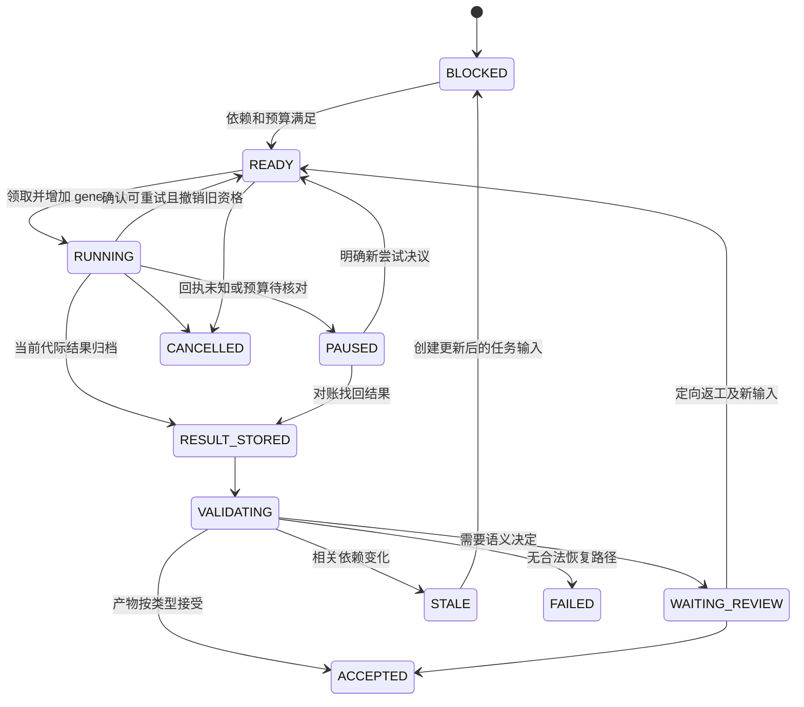

# 06｜Agent 编排与管理

> 版本：v2.0-R1 详细工程设计｜2026-11-10  
> 状态：接口与可靠性边界确定；角色质量、并发配置和模型路由待原型验证。没有运行完整小说产线。  
> 上游：[详细架构](01_详细技术架构.md)、[数据模型](03_数据模型与知识图谱.md)、[事件与版本](04_事件溯源与版本体系.md)。下游：[创作产线](07_剧情与文学生产系统.md)、[工具接入](08_MCP与工具接口.md)、[记忆](09_长期记忆与检索.md)。

## 1. 设计结论与责任边界

采用 **数据库持久化任务状态机、通用 worker、隔离的外部 Agent 调用**。运行时角色是任务配置，不是一个个常驻服务。长期人物状态、任务结果、预算、审核与批准保存在统一存储中；模型会话可以随时销毁并重建。

TaskService 管执行资格和现实运行时间；WorldSchedulerService 管故事时间与相互作用；AdjudicationService 管行动后果；WorldCommitService 管正式世界接受；NarrativeService、ReviewService、ReleaseService 管正文和发行。任何外部 Agent 都不能直接写权威世界表，协调者也不能通过自然语言命令提升权限。

| 对象 | 持久化内容 | 不承载的内容 |
|---|---|---|
| role definition | 责任、任务模式、产物种类、需要的能力与技能版本 | 某个具体人物的全部记忆 |
| role instance | work、branch、人物/势力或编辑范围、可用授权 | 自动继承其他会话的权限 |
| task | 不可变输入引用、依赖、目标、预算、当前 generation | 世界事件发生时间的替代值 |
| attempt | 某次外部调用、provider receipt、用量、返回状态 | 直接被接受的世界事实 |
| model session | 一次受限上下文，必要的短期交互 | 权威长期记忆、跨角色秘密缓存 |
| worker | 领取任务、调用适配器、保存结果、续租 | 判断故事胜负或批准自身越权结果 |

“角色分工”能改善检查结构，不意味着统计独立性。同一模型换角色后仍可能共享偏差。高影响事件或持续误报再引入另一模型/人工复核，费用记入任务预算。

## 2. 十个角色族，按任务模式复用

完整契约在 [runtime/roles](../runtime/roles/README.md)；catalog 记录加载元数据。下面的能力是服务端授权需求，不是 Markdown 自动授予的权限。

| 角色族 | 常用模式与输入 | 输出 | 是否长期保存状态 | 批准边界 |
|---|---|---|---|---|
| chief_editor 总编 | 全书约定、跨卷决策、争议裁量 | DecisionRecord、批准建议、受权批准请求 | 保存作品政策与决议；会话按任务重建 | 只能在已有 grant 内审批；不能绕过硬规则 |
| world_designer 世界设计者 | 结构底稿、规则补充、冗余背景维护 | WorldChangeProposal、开放问题与过程建议 | 作品设定持久；顾问按需调用 | 不自行接受其重大设定变更 |
| volume_director 卷导演 | 卷契约、窗口规划、场景组织、重规划 | PlanRevision、SceneContract、候选取舍说明 | 卷目标/路线版本持久 | 可选择开放候选；不能修改已接受后果 |
| character_actor 角色行动者 | 某人物或明确组织决策者的受限认知 | ActionProposal、对白、理由与信息来源 | 人物/组织状态在内核；临时角色池调用 | 无世界批准权；可拒绝导演偏好 |
| environment_director 环境导演 | 指定域、已登记过程与规则 | EnvironmentProposal、观察/传播候选 | 过程在内核；推理按需 | 不得为迫使角色服从反复补造灾祸 |
| adjudication_advisor 语义裁决者 | 共同快照、全部相关意图、规则缺口 | AdjudicationProposal、前提、后果与未决项 | 裁决结果及证据持久 | 程序验证后才形成可接受效果；不替角色选目标 |
| writer 写作修订者 | 场景卡、允许披露内容、声音与原文锚点 | TextArtifact、event links、重大增量说明 | 正文不可变版本持久 | 可自由表达；持续事实变化需对账 |
| evidence_maintainer 证据维护者 | 明确版本正文、事件与认知范围 | AssertionCandidate、SummaryCandidate、档案增量 | 来源和依赖持久 | 抽取、摘要不直接升级为事实 |
| reviewer 专项审核者 | fact / epistemic / continuity / literary 模式 | ReviewReport、证据、严重性、反解释 | 审核记录持久 | 硬约束由服务校验；模型意见不成为真值 |
| literary_editor 文学编辑 | research / structure / seam / cross_volume 模式 | MethodNote、EditPlan、文学结算 | 方法、作品采纳和编辑决议分开保存 | 可受权调整呈现；改世界返回正式提案 |

角色或势力只在有决策、观察、关系或资源变化需求时唤醒。组织行动需要指明代表者、制度约束与内部异议，不将“组织目标”当作所有成员共享的心智。小角色可以从模板临时实例化，但一旦形成持续后果，应保存实体身份和认知来源。

初始 worker 池只需 research、planning/simulation、writing、review 四种能力标签；同一通用 worker 可顺序承担全部类型。角色数量不决定进程数量，生产并发由提供方限流、预算、审核积压和过期候选比例共同控制。R1明确区分Agent数、工具RPS、数据库读吞吐、正式接受吞吐与外部模型在途数；按 [14](14_高并发服务与一致性协议.md) 管理这些独立容量。

## 3. 编排选型与扩展条件

| 方案 | 有用之处 | 本项目必须额外实现 | v2.0 决定 |
|---|---|---|---|
| DB 显式状态机 | 事务清楚、与任务/世界提交同库、容易故障注入 | 租约、代际、依赖、预算、outbox | MVP 主方案 |
| LangGraph | 复杂语义子图、节点检查点、人机中断 | 领域版本、权限、效果去重、发布状态 | 可在单个 task 内试用，不接管世界真源 |
| Temporal | 长流程定时、工作者故障恢复、成熟编排 | 工作流确定性适配、部署运维、领域事务衔接 | 首期不引入；实际跨进程运维复杂度证明需要后复审 |
| 纯 asyncio/内存队列 | 本地 IO 并行简单 | 进程重启后全部持久恢复能力 | 仅 worker 内执行，不作任务真源 |

LangGraph 的线程检查点与跨线程 store 有不同职责；外部副作用仍需幂等键，丢失回执可能意味着结果未知。这支持保留独立的领域提交机制，不支持“采用框架就获得全系统 exactly-once”的结论。[E07：Persistence](https://docs.langchain.com/oss/python/langgraph/persistence) [E08：Fault tolerance](https://docs.langchain.com/oss/python/langgraph/fault-tolerance)

决定是否引入框架的原型问题是：它减少了多少恢复/编排代码，增加了哪些调试与一致性风险；不是比较示例代码中 Agent 的数量。所有候选仍通过同一 TaskService 端口和合约测试。

## 4. 统一任务与产物协议

通用字段以 [core.schema.json](../contracts/core.schema.json) 为准。本节定义领域约束，JSON Schema 不能替代数据库检查与授权。

### 4.1 不可变任务输入

| 字段组 | 关键字段 | 校验规则 |
|---|---|---|
| 身份与范围 | task_id、work_id、branch_id、role_id、task_mode | 作品、分支和角色由任务创建授权决定 |
| 固定事实基线 | world_revision_id、story_time={tick,phase}、context_bundle_id | revision 必须属于该分支合法视图；故事时点不能用墙钟生成 |
| 内容依赖 | ArtifactRef={artifact_id,artifact_revision_id,sha256}；narrative_revision_id、arrangement_version | 计划、风格、原文、文学档案按所需版本引用；不传可变文件路径当版本 |
| 执行围栏 | generation、attempt_id、policy_version、dependency_fingerprint | worker 不能自增 generation 或改 task principal |
| 方法与模型 | role contract revision、skill revisions、model config revision | 已开始尝试固定；切换方法创建新尝试并记录原因 |
| 资源与交付 | budget reservation、deadline、output kind、idempotency key | deadline 是系统时限；不自动映射为故事内迟到 |

`dependency_fingerprint` 是服务端生成的依赖清单摘要，不是 Agent 自报一个“未变化”字符串。依赖包含行引用，也包含负向查询的范围戳、规则版本、过程覆盖、披露和编排版本。Agent 可补充发现的依赖；不能删除控制面登记的依赖。R1的注册命令模板另外保存ScopeToken与范围完整性证明：HEAD变化本身不自动取消所有旧输入任务，只有相关依赖改变、授权撤回或任务换代才撤销对应资格；是否可跨HEAD接受由控制面的证书与批准适用性决定。

`TaskSpec.context_bundle_id` 在尚未准备输入的 BLOCKED/READY 任务以及 RUNNING 的准备子阶段可为 null；外部调用前必须保存并绑定当代 ContextBundle。RESULT_STORED、VALIDATING、WAITING_REVIEW、ACCEPTED 均必须非 null。TaskResult 始终携带非空引用，按 `(task_id,generation,attempt_id,context_bundle_id)` 验证；旧代际输入不能直接改标成新上下文。

机器字段以 core.schema.json 为准：作品/分支位于 `TaskSpec.world_ref` 内；`task_kind` 使用角色 catalog 的 task_modes 值；`attempt_id` 属于持久执行尝试及 TaskResult，不是 TaskSpec 的额外字段。输入清单、模型配置、技能版本与实际授予范围通过固定引用解析，不由调用者向封闭 Schema 随意加键。`task_get/task_cancel` 不依赖尚未建立的 ContextBundle，仍须受信任务身份和当前授权。

R1新增 `context_compile`：按任务模式组织固定世界、知识/读者切面、硬约束、近期经历和证据，再持久化ContextBundle及编译清单。TaskService先解析期望ReadContract，为新的任务输入/代际确定WorldRef，再以FIXED编译。context_bundle_id为null只代表尚未编译，不能解释为TaskSpec.world_ref可变。dynamic selector或WAIT所得版本若与当代TaskSpec.world_ref不同，编译返回BLOCKED/TASK_REBIND_REQUIRED，控制面显式创建新输入代际后重编；同代不改WorldRef，旧输入保留。普通动态查询返回的read_cut不自动修改生产任务。写作/审核/角色分别使用不同编译模板，具体见 [09](09_长期记忆与检索.md)。

编译回执固定interpretation_ref，保存实际采用的投影/规则解释版本。语义解释器更新会失效对应接受资格，但不会把旧输入原地重解释。源plan/reader/literary清单保持精确引用；任务若要求这些资料仍为当前采用版本，另外注册ARTIFACT_SELECTION依赖。所有新选择及语义升级先写同步守卫，再异步展开任务失效，避免后台扫描之前旧任务漏过门禁。

角色专用 `actor_id` 绑定到服务端任务主体。请求另一个 actor、扩大故事时间、切换 WORLD 视图，必须验证新 grant；不因工具入参中写了某个名字而获得权限。

### 4.2 输出信封

结果携带 task_id、generation、attempt_id、context_bundle_id、输入依赖摘要、产物引用、产物种类、未决项和使用证据。业务产物可以包含创作性自由文本，但关键交接有固定类型：ActionProposal、AdjudicationProposal、PlanRevision、SceneContract、TextArtifact、ReviewReport、MemoryCandidate、DecisionRecord。

不要求模型给出完整思维链。需要的是可审核的依据：引用哪些事实、目标、文本片段，关键选择是什么，还有什么不能确定。自然语言“全部检查已通过”不具有提交效力。

| 检查层 | 内容 | 失败处理 |
|---|---|---|
| 信封 | 任务身份、代际、hash、产物类型 | 保留原始返回；拒绝成为当前有效结果 |
| 结构 | JSON Schema、引用存在、时间格式、必需交接字段 | 限次格式修复；不允许修复器改语义后果 |
| 依赖与权限 | 当前 grant、取消状态、范围/版本戳 | 相关依赖变更才STALE；无关HEAD前移可走受守卫接受。撤权/取消则停止，不盲重试原产物 |
| 领域 | 资源、因果、认知、正文对账 | 定向修订、再裁决或历史修订 |
| 语义与文学 | 角色动机、表达、结构与阅读效果 | 有证据的问题单；按作品目标裁量 |

## 5. 三层状态机：任务、调用、领域产物

任务完成不等于世界接受，更不等于对外发表。以下状态名是推荐领域枚举；最终数据库枚举与契约共同维护，不允许适配器暗自增加“success 即已发布”的映射。

取消、失效及终止状态均保留所有历史尝试。任务复用时不覆盖旧输入：新的输入版本和 generation 一起持久化。对同一场景有意产生两个候选，应创建两个 task_id，并保留共同 candidate group，而不是让两个 worker 争夺同一 task。

外部调用另有 `PREPARED → SENT → SUCCEEDED / FAILED / UNKNOWN`。SENT 后服务崩溃或网络超时不能证明 provider 没有执行；先查询支持的 provider receipt。UNKNOWN 调用的预算仍保守占用；若决定重新调用，要登记新 attempt、潜在重复费用与预算许可。不能声称模型响应完全可复现。

领域产物的状态另由其服务管理：提案可以是 draft/reviewed/approved/rejected；世界事件一经接受成为该分支历史；正文可以保存、审核、冻结、发布。这些状态与任务 ACCEPTED 不一一对应。

### 5.1 领取与回收协议

1. 短事务锁定 READY 任务（PostgreSQL 行锁；并行领取可用 `FOR UPDATE SKIP LOCKED`），核验依赖与预算，增加 generation，写 lease_owner 与 lease_expiry，再提交。
2. 事务外构建 ContextBundle 并调用模型。续租必须同时匹配 task_id、generation、lease_owner；网络延迟不能用旧身份续租新代际。
3. 返回值先以不可变对象保存，再进行结果信封校验。只有仍有效的 generation 能更新当前任务槽位；旧结果保留为 superseded candidate。
4. 领取者崩溃后，由恢复器核对外部调用，决定等待、接纳已保存回执或建立新 generation。回收不是立即重抽故事结果。
5. 提交时再次核验当前授权、取消、代际和依赖。启动时验证一次不够；数据库事务隔离也不能保护数分钟前已离开事务的模型上下文。

任务执行可 at-least-once；领域效果通过事务唯一约束与提交幂等达到指定分支/效果范围内的一次生效。对外模型计费和外部发布的副作用保证取决于供应商能力，必须保留 UNKNOWN。

### 5.2 有界派发和工作者池

入站API、Context Compiler、模型调用、正式接受和维护分别有队列上限与并发预算。任务在等待外部模型、推进或审核时不占数据库连接；多worker用短事务领取，调用中仅按task/generation续租。SKIP LOCKED只用于竞争领取可独立任务，不用于跳过世界因果前置或冲突角色；官方也将它定位于队列式访问，而非一致世界查询。[PG SELECT](https://www.postgresql.org/docs/17/sql-select.html)

调度至少按作品和任务类别保持公平份额，给恢复/收件预留容量；大影响分析和重建不能挤满短查询。provider并发及费用预留需要跨进程的持久lease/reservation，单进程semaphore不保证多实例总量。UNKNOWN调用保留占用，按实际供应商回执对账；排队、拒绝和空闲时间单独计量。

### 5.3 子任务部分完成与重试

世界准备、模拟、写作、审稿组成依赖DAG，每个子任务独立task_id与输入版本。fan-out后只有全部必需前置有效才开启下一接受；可选文学建议失败不伪装成硬条件已通过。父任务失败可保存已经产出的候选，重启时复用依赖仍有效的结果；不因父工作流失败反向撤销已接受世界。

跨子任务的语义原子性由同一有界ChangeSet提供。若各步骤本已独立接受，其后返工属于新事件/新修订决议；不把工作流补偿等同删除历史。技术重试可重取回执或重跑确定性校验；涉及角色胜负、情节取舍或超出预算时走新候选和具体决议。

## 6. 权限、上下文与审批

### 6.1 信息视图服务端裁剪

WORLD、BELIEF、READER、PLAN、SIMULATION、LITERARY 是不同语义平面。ContextService 根据任务身份与用途选择授权材料，并对正文、引用、路径、计数、检索结果和错误信息统一过滤。

- 角色行动：只含该人物在 story_time 的合法观察、记忆、信念与其可用资源；不含作者未来弧线、他人私有意图或尚未发生的候选未来。
- 写作：默认只含场景所需事实与允许披露材料；确需隐藏真相布置伏笔时，使用另有授权的作者写作上下文，仍受披露契约约束。
- 裁决：可读取同一冲突组的私有意图和世界真相，输出给各角色的反馈必须重新裁剪；不把整个裁决输入发回角色。
- 研究：默认独立 research namespace；不把其他作品人物和秘密作为当前作品的事实或通用检索命中。

P2 默认单阶段联合裁决。需要多阶段反应时，在隔离 CANDIDATE 交互分支逐阶段正常接受，再以 `InteractionBundle.active_phase_world_ref` 构建下一阶段的 ContextBundle.world_ref；该阶段所有参与者共享同一阶段起点并分别裁剪。最后将完整因果片段对初始 canon 基线重新核验后一次接受。未采用候选的认知与会话不得带入其他候选，不另建可绕过版本的内存事实 overlay。

禁止把看过全知上下文的会话“改个提示词”复用为受限角色。切换角色、分支、时间视图或授权范围，创建独立会话；缓存按授权范围与 policy_version 分区。撤权立即阻断后续调用和提交，但不能承诺从外部提供方已有上下文中追回信息。

### 6.2 批准针对内容与授权范围

批准记录至少绑定提案/正文 hash、WorldRef、依赖指纹、规则/策略版本、审批主体、适用范围和批准类型。编辑一字若不影响语义，可使用作品预先允许的轻量审核流程；原批准的 hash 本身不可自动更新。

| 操作 | 默认方式 | 何时升级 |
|---|---|---|
| 普通描述、对白、有效候选保存 | 写作任务授权内完成 | 出现持续资源/能力/认知后果 |
| 普通局部事件接受 | 规则验证＋授权自动审批 | 受保护规则、历史变化、超预算 |
| 章节审定和内部冻结 | 配置化审阅门禁 | 未解硬冲突或保护性表达变更 |
| 文学偏好争议 | 负责编辑作出有限决议 | 超出作品方向授权或持续无进展 |
| Retcon、保护设定修改、外部发布 | 核验具体 grant | 无预授权时交作者批准具体方案 |

高风险分权由策略执行：提出者不能独立批准其高风险变更。不是每个角色行动、角色死亡或每一句措辞都一律人工审批；看作品的既有授权和保护范围。模型凭角色名称“总编”无法创造 grant。

## 7. 审核、返工与冲突终止

ReviewReport 的必要字段是被审 ArtifactRef/WorldRef、实际阅读范围、issue_id、证据锚点、可能反解释、建议修改范围、是否涉及世界/认知/披露，以及 no_change 的理由（如适用）。每个 ReviewIssue 使用三个正交维度：`category` 标识主题（HARD_CONSISTENCY/CONTINUITY/LITERARY/STYLE/READER_DISCLOSURE），`issue_kind` 标识下表的处置类别，`severity` 为 BLOCKER/SUGGESTION/QUESTION。文学偏好不能自称客观硬冲突；作品质量未达目标时，负责编辑仍可拒选候选并说明文学理由。

| 类别 | 例子 | 门禁 |
|---|---|---|
| HARD_CONFLICT | 同一时刻唯一剑有两个独占持有人，或角色引用未到达的确切消息 | 相关接受/发布阻塞；先确认非谎言、倒叙或权属概念混淆 |
| SEMANTIC_CONCERN | 动机不充分、信息可能由合理推断获得 | 独立复核或补充证据；不能直接当确定性错 |
| LITERARY_CHOICE | 节奏、留白、句法、情绪表达偏好 | 编辑裁量，可保留异议，不作多数票硬门禁 |
| CHANGE_REQUEST | 好的新交易改变未来剧情 | 进入领域提案与影响分析，不包装为润色 |

ConStory-Bench 的证据定位与分类可作为问题单候选方法；其二元诊断可能误判延迟揭示，不能直接输出最终真值。[P-C](https://aclanthology.org/2026.findings-acl.410.pdf)

返工循环采用“问题状态＋责任人＋本轮目标＋预算”，而不是每次把全文丢给所有审稿员。新的稿件针对原问题检查并进行受影响回归；无新增证据的审美争论不无限重开。作品策略可从 `max_revision_rounds=2` 起做原型，但这是可调整预算示例，不是经实验确定的最佳次数。

触达上限后汇总：最佳候选、未解问题、双方证据、保留/修改/延期的影响与成本。负责编辑在授权内作决定；硬约束未解决就保留未发布状态，不能靠文学高分放行。

## 8. 成本、可观测性和恢复

BudgetService 按作品/卷/任务分层预留额度，记录实际 token、提供方计价版本、废弃候选、审核和人工时间。并发限流在 provider、作品、任务类别和接入服务层分别实施；先消化审核积压，再扩大写作 worker。暂停新任务不阻止读取、下载、备份及已完成结果对账。

日志记录 trace_id、task_id、generation、WorldRef、ArtifactRef、调用状态和错误代码；默认不在普通日志复制全文、角色秘密和凭据。受限任务只能查看授权范围的诊断；完整堆栈和事实冲突证据保留给受权运维。

恢复顺序：扫描未结算调用 → 核对回执与预算 → 识别过期租约 → 重建 READY/PAUSED 任务 → 校验已存对象引用 → 重发 outbox。世界恢复重放存档裁决和规则版本，不重新问模型决定过去。首个异步闭环就具备这些能力。

## 9. 实现与验收

| 边界 | 核心端口/持久对象 | 单元检查 | 集成/故障检查 |
|---|---|---|---|
| TaskService | create、claim、renew、store_result、cancel；task/attempt/lease | 状态转移、generation 比较、预算边界 | F01、F02、F08：旧租约、未知回执、撤权晚提交 |
| ContextService | build_actor/build_writer/build_reviewer；ContextBundle | 视图/时间/角色裁剪、hash固定 | T02/T04/T11、F06/F13/F19：错误/缓存/引用泄密与注入 |
| RoleRegistry/SkillLoader | 版本化catalog、按任务加载 | 未注册角色/技能拒绝，版本固定 | 更新技能不改变已运行尝试或作品规则（L04） |
| ReviewService | review、resolve_issue、approve | 批准内容绑定、职责约束 | F03/F15/F16：改稿后批准失效、漏抽、返工停止 |
| ProviderAdapter | invoke、lookup_receipt、cancel_if_supported | 错误分类、结构修复边界 | 超时、限流、模型不可用、响应归档后崩溃 |

角色能力评测与工程门禁分开：改变 worker 返回顺序不得改变采用夹具的世界结果（S02/S08）；角色是否有令人信服的动机、整卷是否更好读，应通过实际文本和独立评阅验证。尚未验证的假设包括分工收益、上下文预算、跨模型复核价值及自动审批范围；按 [11](11_研发路线与测试计划.md) 的短卷原型收集证据。
