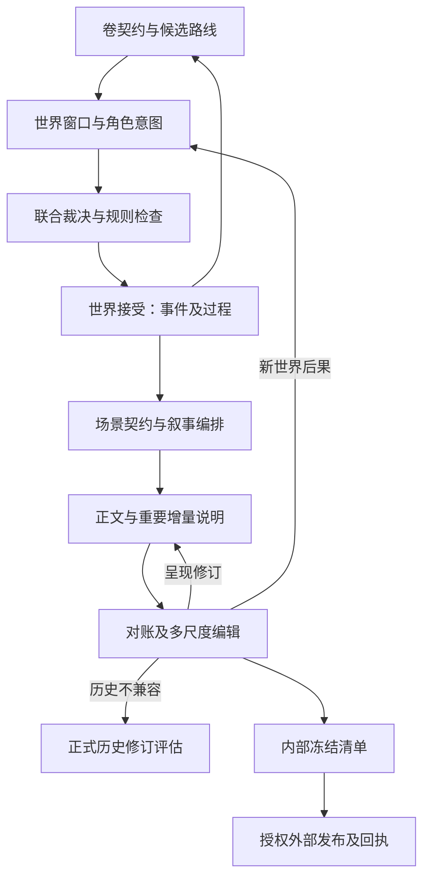

# 07｜剧情与文学生产系统

> 版本：v2.0-R1 详细工程设计｜2026-11-10  
> 状态：交接协议与边界已设计；剧情和文学方法为待实测候选。世界测试夹具不是已生成小说。  
> 关联：[世界调度](05_世界模拟与调度引擎.md)、[Agent](06_Agent编排与管理.md)、[长期记忆](09_长期记忆与检索.md)、[验收路线](11_研发路线与测试计划.md)。

## 1. 两条相连的生产线

世界线接受“发生了什么”，文学线确定“向读者怎样呈现”。它们共享 WorldRef、事件身份和证据引用，却具有不同事务边界。章节只是叙事编排单位，不是世界交易或故事时钟的单位。



最后一条回边表示因后果更新未来路线，不是回滚已经接受的历史。幕后事件可以先被接受且始终不写进正文；正文可以倒叙、多次讲述或概述同一事件。讲述不再次施加资源、位置、伤势或认知效果。

## 2. 从世界准备到短卷交付的阶段契约

| 阶段 | 输入与版本要求 | 交接产物 | 完成条件与失败出口 |
|---|---|---|---|
| 世界准备 | 作者约定、已有 WorldRef、题材规则包版本 | WorldChangeProposal、规则/实体/关系、初始过程、开放范围 | 结构相容、当前关键前提充分；不以词条数量验收；缺口返回设计 |
| 世界设定接受 | 指定提案hash、审核与授权 | 新 WorldRef、规则版本、受保护设定记录 | 受控提交成功；冗余背景一经接受也受版本保护 |
| 全书及卷契约 | 当前接受历史、人物目标、前卷结算 | PlanRevision、卷目标、保护承诺、可变路线、预算和停止条件 | 目标与事实/计划区分；不保证目标成功 |
| 卷可行性与有限预演 | 卷契约、独立过程、资源和时间约束 | 风险说明、少量 simulation 分支、候选差异 | 核查真实前提；无收益可不预演；不自动导入未来历史 |
| 宏观窗口 | WorldRef、登记过程、入站影响、传播下界 | AdvanceProposal、冲突组与待细化范围（对外以 ArtifactRef 交接） | 相关覆盖充分；未知高影响前提仅阻塞相应作用域 |
| 微观互动 | 共同快照、每角色合法认知、反应阶段 | ActionProposal 集、观察反馈、AdjudicationProposal | 人物意图与世界后果分开；技术超时不改变故事结果 |
| 世界接受 | 已选裁决、效果集、依赖、推进覆盖、批准 | 世界事件、过程进展、出站影响、新 WorldRef | 原子提交；过期则重验证，已接受内容需修订而非删除 |
| 未来重规划 | 已接受差异、计划依赖、文学承诺 | 新 PlanRevision、失效节点及受影响任务 | 保留后果和真实代价；无可信路线可接受阶段失败 |
| 场景及章节细纲 | WorldRef、计划版本、叙事编排、声音约定 | SceneContract、ChapterOutline | 必要结果引用已接受事件；候选目标不得伪装为事实 |
| 并行写作 | 固定上下文包、场景卡、前后接口 | TextArtifact、事件呈现关联、重大增量说明 | 表达可自由；依赖未决的稿件仅作候选 |
| 对账与章节审核 | 正文hash、世界事件、认知/披露契约 | AssertionCandidates、ReconciliationReport、ReviewReport | 重要终态、信息、资源核对；硬问题修复后再接受 |
| 卷中及整卷编辑 | 精确正文清单、全文阅读覆盖、文学记忆 | EditPlan、修订正文、接缝检查、卷结算 | 先结构后语言；读了摘要不能声明通读原文 |
| 内部冻结及发布 | 当前依赖和批准、完整 release manifest | 不可变内部发布清单；可选外部回执 | 内部冻结与外部成功分开；未知回执保留 UNKNOWN |
| 跨卷维护 | 世界与文学结算、未完成过程及承诺 | 下一卷入口、文学档案增量、风格变更提案 | 不按卷号重置人物、不强迫全部支线推进到同日 |

阶段之间使用服务层持久任务和产物引用，不传一条自然语言“做完了”作为完成条件。模型输出结构通过后，仍需相应领域验证；协议正确不等于文学成功。

## 3. 规划数据与局部重规划算法

### 3.1 少量稳定对象

PlanningService 管理 `BookIntent`、`VolumeContract`、`WindowPlan`、`PlanNode`、`PlanDependency`、`NarrativeArrangement` 和 `SceneContract`。这些对象保存计划与编排，不复制人物状态或物品库存。可机校验的最小 VolumeContract/WindowPlan 见[literary.schema.json](../contracts/literary.schema.json)，正例见[卷契约](../contracts/examples/literary_volume_contract.json)和[窗口计划](../contracts/examples/literary_window_plan.json)。预算数值只是合成夹具，不是推荐的统一文学配方；protected_commitments 只能引用已有政策授权，不能由计划文本创造权限。

| 对象 | 最小语义 | 约束 |
|---|---|---|
| VolumeContract | 叙事问题、主题张力、焦点、阶段回应、预算、保护承诺 | 保护承诺与普通偏好分开；未来意图不进入角色记忆 |
| PlanNode | 目标、条件、候选行动、风险、失败/替代出口 | status 区分 proposed/viable/blocked/abandoned/realized；realized 必须引用事件证据 |
| PlanDependency | hard prerequisite / alternative / causal risk / literary promise | 图可达不等于必然因果；风险边只触发复核 |
| NarrativeArrangement | scene/chapter 的呈现顺序、视角、披露安排 | 独立于世界时间排序；改顺序产生新版本 |
| SceneContract | 事实边界、文学作用、人物信息与自由范围 | 不把文学目标当裁决结果；见第5节 |

伏笔对象记录已铺设的正文锚点、期望回应及当前决议；不是所有背景细节都自动成为待回收债务。未出场的正式背景继续约束世界，是否进入卷纲是另一个决定。

DOME 可借鉴粗纲—局部细纲—正文交替和记忆检索；其章节号索引不替代故事时间，多线依赖与提交协议属于本项目新增设计。[P-M，§4.1–4.2](https://aclanthology.org/2025.naacl-long.63.pdf)

### 3.2 已接受意外之后怎样改线

```text
replan(accepted_change, plan_revision):
    affected = traverse_typed_dependencies(accepted_change)
    invalidate_definitely_broken_hard_preconditions(affected)
    mark_semantic_risks_and_literary_promises_for_review(affected)
    preserve(unaffected_plan_nodes, accepted_history, published_prefix)
    request_few_structurally_distinct_options(affected, current_world)
    check_time_resources_knowledge_and_protected_commitments(options)
    record_editor_choice_or_explicit_failure()
    save_new_plan_revision_and_fence_affected_tasks()
```

本地算法负责依赖传播、失效和可验证条件；外部导演提出不同后续方向，编辑评价人物、代价和阅读意义。没有可行方案时允许结束当前弧、改叙事问题或提交明确的承诺冲突决议。

例如“唯一古钥毁坏”确定阻断“凭完整古钥入门”，不自动阻断“查明旧案”的所有路线。既有账册可以成为候选，但主角不知道账册时仍需合法获知；账册存在也不保证能取得。可接受的改线保留机会损失、交易或时间代价，不用新道具无损补回同一奖励。

重规划范围由真实依赖决定。政变可能要求全卷复看；一次普通措辞调整不应重跑所有模拟。导演不能因结果不满意把重生成包装为技术重试；候选筛选保留弃用理由和成本。

## 4. 两种合法生产顺序

### 4.1 世界先行

关键政变、运输结果、资源转移等先由 WorldCommitService.accept_world 接受，再由文学任务组织呈现。后续写作可以改切点、对白、节奏和细节，但不可把固定后果悄悄改掉。世界接受不等待全文完成，也不意味着所有角色或读者已知。

### 4.2 候选试写

在 candidate/simulation 分支中形成被该分支接受的试写基线，尝试文学表现；尚未选中的分支可放弃。要成为 canonical 世界，调用 VersionService 的受控比较/采用流程，复核分叉以来的前提、入站影响和保护约束。

P2 默认单阶段共同裁决；确需反应阶段时，在隔离 CANDIDATE 交互分支正常接受每阶段结果，以 `active_phase_world_ref` 取得下一阶段受限认知，最后完整片段回 canon 一次接受。不能向仅绑定旧 WorldRef 的角色偷偷注入未版本化观察；被弃分支的认知和会话不得带入新候选。

采用返回新的 WorldRef 及必要的引用映射；候选正文重新绑定适用世界、重新进行受影响对账与批准，才能加入 canonical release。不能只把 branch_id 从 candidate 改成 main，也不能从互斥分支各挑好结果拼接。

在任意分支，已接受历史都具有不可变记录。主分支别名 `main` 解析到 `work.canon_branch_id`；branch_id 本身不改名。正式 Retcon 在 repair 分支构造替代历史，验证后以 CAS 切换 canonical 指针，旧 release 继续引用原 WorldRef；正文尚未发表不是免去历史修订协议的理由。

BOOKWORLD 的角色与环境结合以及模拟后改写可提供任务分工参考；它的简化场景时间不能直接承担本项目的历史、资源和跨线同步。[P-B，§3](https://aclanthology.org/2025.acl-long.773.pdf)

## 5. 场景契约与写作输入

SceneContract 必须足以约束关键交接，不预先锁定每句对白。

| 字段组 | 内容 | 写作者的自由 |
|---|---|---|
| 基线 | WorldRef、story interval、计划 ArtifactRef、narrative_revision_id、arrangement_version | 可用倒叙/概述等形式，但按正确故事时点取人物信息 |
| 发生依据 | event_refs、已接受后果、仍未接受的候选目标 | 已接受事件的描写方式可变；结果变化另提案 |
| 入/出状态 | 关键位置、资源、伤势、消息与承诺的证据引用 | 不逐项列普通表情；持续影响要显式对账 |
| 人物与视角 | actor/POV、narrator、叙述者时间位置、合法认知 | 可以犹豫、拒绝、沉默；不提前知道未来 |
| 文学作用 | 本场问题、关系/情感承接、阶段回应、可省略材料 | 可提出更好的场景组织或有理由的留白 |
| 披露 | 已提供给读者的材料、允许新增披露、仍需隐藏的内容 | 可设计暗示；不必逐句信息公式化 |
| 声音 | StyleGuide 与少量原文锚点、适用语域/允许变化 | 保留多POV与人物成长的差异 |
| 变更入口 | allowed_invention、must_reconcile 的类别、预算 | 普通表达自主；重要增量说明有固定出口 |

第一人称回忆中的“那时我还不知道”可以由后来讲述者表达，不代表年轻的角色当时知情。叙述者、聚焦者、对话角色和作者分别处理；全知叙述也不把所有秘密自动送给所有人物。

### 5.1 普通即兴细节怎样处理

允许将不承担持续因果的颜色、物件摆设、临时动作和修辞保存为 `SURFACE_DETAIL`：它们属于已存正文及文学连续性证据，不逐名词建立世界实体，也不直接成为 WorldQuery 的权威断言。

当某细节后来成为资源、能力、时间、认知、路径或跨章因果前提，先提交设定/事件提案，核对既有文本和规则，再升格为可用于裁决的世界事实。已有正文中的细节不能因尚未结构化就任意改写；编辑仍需检查连续性。明显持续伤势、新交易、秘密传播、唯一道具与能力例外不能藏在这个类别里绕过对账。

这个边界让写作者有创作空间，同时避免“正文中写过，所以无需审核就拥有一件神器”的事实污染。划分有语义残余风险，需要场景终态核验和抽样复查，不宣称抽取器零漏报。

## 6. 从正文到事件的对账协议

NarrativeService 保存不可变 TextArtifact；Evidence Maintainer 提取候选断言并提供精确证据跨度；ReconciliationService（可作为 NarrativeService 的内部组件）对齐发生实例并生成差异；重要后果交领域服务验证。抽取器没有 WorldCommitService 的直接提交资格。

| 对账类别 | 例子 | 系统动作 |
|---|---|---|
| EXISTING_EVENT_PRESENTATION | 再次回忆已经交剑 | 关联同一 occurrence_id＋event_version_id；零新世界效果 |
| SURFACE_DETAIL | 无持续约束的室内摆设或动作语气 | 保存叙事细节/必要连续性锚点；不强制结构化 |
| SPEECH_OR_BELIEF | 反派说“剑已归还”，实际未归还 | 若发言是新发生则提发言/传播增量；命题本身不自动为真 |
| NEW_WORLD_EFFECT | 新增交易、承诺、受伤、消息到达 | 进入当前/未来合法窗口的行动或事件提案；通过后才用于后文 |
| HISTORICAL_CONFLICT | 在已接受无损交汇中写烧掉两袋粮 | 修稿或正式历史修订；不无痕补扣库存 |
| READER_DISCLOSURE_CHANGE | 移动揭示凶手的段落 | 新编排与披露版本，失效相关文学批准；世界历史不变 |
| UNCERTAIN | 话语真假、时间或同一事件身份不明 | 保存待定，补上下文或语义复核；不默认通过或强行合并 |

三层去重相互补充：请求幂等防止同一次提交重发；发生身份避免正文重复描写被当新事件；效果应用账防止同一版本构建中重复施加。不同日期确实再次发生的交剑不能仅凭相同动词而合并。

### 6.1 接受正文时必须核验什么

1. 内容对象已持久化、可读且 sha256 与 ArtifactRef 一致。
2. 场景的关键终态、资源和信息边界与采用的事件相容；高影响约束做直接核验，不能只看“抽取无报错”。
3. 本稿的新重要世界增量已被接受，或正文已移除/明确改为假设、传言等合法表达。仅 pending 的增量不能用来支持 canonical 发布。
4. generation、授权、依赖范围、计划/风格/编排和批准绑定仍有效。未变化的旧世界依赖可通过明确验证继续用，不要求一律追逐最新 revision。
5. 叙事产物接受事务写正文版本、event links、披露候选/接受记录、适用批准与失效范围；**它不重放世界效果**。

需要同时确保“新世界增量”和“正文使用资格”的场景，先接受世界再核验正文即可；中间状态是合法的幕后已发生、正文未接受。不要为了追求跨对象一键完成而把模型审核放进数据库长事务。正文对象与数据库引用的恢复见[04](04_事件溯源与版本体系.md)。

## 7. 并行章节与状态交接

MVP 为一个写作 batch 固定同一 WorldRef、已接受事件切片、计划/风格/编排版本，各场景再按自己的 story_time 查询。不同 scene 的故事时间可以不同，不能把同一 revision 中更晚的事件泄露给早期角色。R1保持批内统一切面；背景世界无关提交不会自动使已固定写作输入无效。采用到更新的整卷切面前仍须有正文对账与依赖重验证，不能只修改world_ref或直接套用世界接受证书。

| 依赖 | 可并行条件 | 不满足时 |
|---|---|---|
| 世界终态 | 两场关键事件已被接受或属于同一隔离候选基线 | 等裁决，或明确作为 speculative draft 保存 |
| 角色认知 | 后场所需消息和私有决定已可用 | 不用前场“预计会说”的话构造确定记忆 |
| 资源与位置 | 同一物品、人物或地点没有未决排他结果 | 先联合裁决/同步相关作用域 |
| 叙事披露 | 呈现顺序、前缀披露与允许新增信息固定 | 先定编排，或接受后续重新审核成本 |
| 文学衔接 | 上下场应延续的疑问、关系与声音有明确交接 | 先形成最低可用场景卡和原文锚点 |

后章不直接读取前一 writer 的私有聊天记录。交接由不可变场景产物、event links、认知记录和接缝摘要承担。前章稿件有新交易时，冻结相关后章接受资格；其无关部分可保留，不必全量废弃。

合并后至少检查状态、披露、重复解释、视角切换、称谓关系、情绪余效及章末期待。相邻不只按章号：跨卷伏笔和倒叙沿依赖图回读相关原文。接缝审核通过也不替代整卷结构编辑。

## 8. 文学研究、风格与五尺度审核

通用文学研究放 research namespace，作品采用的方法形成版本化 StyleGuide/EditorialPolicy。MethodNote 至少保存问题、来源、证据类型、适用条件、可能伤害、正反例与比较方案。研究方法不会随技能升级自动改写旧卷。

| 尺度 | 主要任务 | 材料与输出 |
|---|---|---|
| 场景 | 选择、感知、信息与表达是否有作用 | SceneContract＋本场全文；具体意见或 no_change |
| 章节 | 阅读单元的重心、节奏与场景配置 | 本章全文＋前后接口；局部编辑方案 |
| 相邻/相关章节 | 承接、重复、信息差与关系余效 | 接缝原文及跨章依赖；有范围修订 |
| 整卷 | 人物选择如何积累、支线如何改变整体、阶段回应是否成立 | 全文覆盖＋场景功能图＋关键原文；结构决议 |
| 跨卷 | 旧后果是否仍有作用、承诺如何回应、声音如何有意演化 | 相关旧卷原文＋文学结算；新卷接续说明 |

`ReviewReport` 允许记录反解释与保留意见；ReviewIssue 的 `category` 是主题、`issue_kind` 是处置类别、`severity` 是严重性，见[06](06_Agent编排与管理.md)。硬冲突、语义疑点和审美偏好分开；总编不平均模型评分，不把多数票当客观真值。不得设“每章必须冲突/成长/反转”“悲伤不能笑”“相同句式一律禁用”等普遍硬规则。

本地 n-gram 重复、句长分布、对白词频、结构模式重复只生成阅读线索。它们无法独立判断有意复沓、仪式语言、人物声线或安静段落的价值。模板化写作的识别最终需要跨场景原文和功能证据，不能靠固定禁词表。

DiriGent 的原文包含要求动作注入和持续提高张力的 Story Enforcement；本项目只采用可审核的导演/角色分工，不把这套强制循环作为默认自治机制。[P-D](https://cgl.ethz.ch/Downloads/Publications/Papers/2025/Che25b/Che25b.pdf)

## 9. 整卷编辑的可执行工作流

### 9.1 阅读覆盖不等于理解保证

ReadingCoverage 记录 reader task、ArtifactRef、core TextSpan 的 Unicode code point 半开 `[start,end)` 区间、read_mode（FULL_TEXT/EXCERPT/SUMMARY）、即时观察及完成时间；不做 NFC 或换行规范化，段落号仅作辅助。程序对每个精确正文版本合并区间、检查缺口；hash 改变后重新评估受影响范围。只有 FULL_TEXT 覆盖才能支持“已通读这一版本”的流程声明。

ReadingCoverage 的可执行结构和正反例在[literary.schema.json](../contracts/literary.schema.json)与[literary_index.json](../contracts/examples/literary_index.json)。覆盖由服务根据实际交付/读取回执记录；SUMMARY 使用独立 summary_ref 且原文 spans 为空，不接受模型自报“我通读了”替代回执。FULL_TEXT 可是一轮完整阅读计划中的原文块，最终对同一 ArtifactRef 合并这些块的跨度计算覆盖。

覆盖记录是防漏段证据，不证明模型拥有完整的人类阅读体验。长卷可分段阅读，保存问题如何随后文改变，再回读关键原文；重要样卷还应有真实读者/编辑的整体评价，成本计入实验。

### 9.2 七步编辑

1. 固定有序正文清单、WorldRef、披露与风格版本，标出已发布前缀及允许修改范围。
2. 通读并归纳主要成就与阻碍，建立场景功能图及人物选择链。不要先全量润色再发现大段应删。
3. 对最重要问题提出少量保留、删并、重排、改聚焦或调整篇幅的方案，说明收益、损失和世界/披露影响。
4. 授权编辑选择一个结构方案，保存未采用方案理由；遇保护承诺或已发布文本修订形成明确决议。
5. 将互不冲突的改写派发给 writer 池，更新场景契约，冻结相关旧批准。
6. 结构稳定后进行接缝与语言编辑，保护合法多声部；不要求整卷无差别换成一种语气。
7. 回读受改范围与关键跨章依赖，重新核验覆盖和重要问题，形成文学结算与 release 候选。

文学问题单关闭必须引用本次修改或明确的保留决议，不能只换 issue_id 把同一偏好争论重新打开。到达作品预算上限后，保留最佳候选和未解分歧，结束自动循环；硬问题未解仍不得发布。

## 10. 内部冻结、外部发布与双结算

ReleaseService 内部冻结的 manifest 至少包括：release_id、prior_release_id、WorldRef、narrative_revision_id、arrangement_version、有序 ArtifactRefs、disclosure_revision_id、approval_refs，以及计划/风格/文学档案的精确依赖。manifest 是不可变集合，不用“最新章节”动态展开。

最终 manifest 固定一个统一 WorldRef。来自不同写作批次、较早 pinned WorldRef 的场景，必须在该统一 cut 上证明所引用的重要 occurrence/event version、规则和认知仍为同一有效选择，或存在明确重验证/修订映射；不能只拼接各批旧批准。对没有变化的场景保留原文，不必为了统一引用而重写。

冻结短事务校验内容可读、依赖适用、与本 release 依赖相交的同步失效屏障已处理或已完成有效的权威回源重验证、批准匹配，以及已发布前缀不被静默更改。无关作用域的失效或普通索引重建不阻塞本 release；关键权威证据无法取得时才暂停相关发布。新的阅读顺序即使世界不变，也产生新的叙事与披露版本，并重审受影响批准。

外部发布通过持久 outbox 连接独立 delivery 状态机：内部冻结成功不等于读者已收到；外部超时保留 UNKNOWN。同一目标按操作 generation 有序投递，未知回执未核清时不让迟到旧版覆盖新版或旧撤回删除新版。MVP 默认只生成内部 release 与可阅读导出，不自动增加外部发布平台。

世界结算引用已接受事件、局部推进覆盖、资源、认知、消息与未完成过程。文学结算引用人物实际选择及其文本表达、关系/情感未竟后果、读者已见材料、未回应承诺、风格决议和未决解释。两者相互引用，不复制新的事实真源。

删去告知描写不撤销已接受告知；压缩八次追逐不减少世界中的追逐次数；换到下一卷不自动结束悲伤、清偿债务、完成运输或让所有支线同日同步。这些分别由世界事件、认知接受和文学编辑决定。

## 11. 白桥粮运最小端到端原型

复用 v1.1 S 系列，独立于青霜剑 T 系列：商会拥有一百袋粮，商队保管；守军征用命令不自动转移权属；信使 D29 出发、该通道最早 D31 可能送达；D30 三方交汇使用共同快照。

先采用**明确写入测试输入的裁决夹具**：对手控制北桥头、商队停南岸、守军没有粮、没有粮食损耗。它用于验证提交、对账与改线，不能当作语义裁决模型已自行正确推理出军事结果。

首轮控制为约 5–10 个场景：世界底稿 → 卷契约 → 三方意图 → 联合裁决 → 接受交汇 → 原准时交付路线失败 → 有代价的改线 → 两场可并行写作 → 对账 → 一次卷中回看 → 全文整卷编辑 → 内部 release → 双结算。加入一个原文可见的人物选择变化及一个需要延续的关系/情感后果。

至少注入以下扰动：交换模型返回顺序；重提同一交汇；微观稿凭空烧两袋粮；删除已接受告知的描写；某角色漏见作者未来计划；审核后改正文；调整披露顺序；旧租约晚回。工程预期来自 S02/S04/S07/S08、T02/T08/T11、F01/F03/F15/F17，文学讨论来自 L01–L05。

## 12. 待验证机制及验收证据

| 机制 | 工程可验收部分 | 必须通过原型决定的部分 |
|---|---|---|
| 动态卷纲 | 类型依赖传播、旧任务隔离、事件与计划分离 | 候选数量、窗口尺度、改线是否保留人物与代价 |
| 选择性微观模拟 | 认知隔离、共同快照、一次效果 | 哪些场景值得模拟、是否改善对白与选择 |
| 文学档案 | 原文/事件锚点、版本失效、范围隔离 | 长程收益、摘要遗漏和早期解释锚定 |
| 并行写作 | 同一基线、显式交接、接缝重审 | 净交付吞吐、声线差异、返工成本 |
| 整卷结构编辑 | 原文覆盖、编辑边界、批准绑定 | 相对语言润色的阅读收益与边际成本 |
| 自动审核 | 证据定位、分类、有限返工 | 误报/漏报、对有意留白和不可靠叙述的容忍 |

比较配置时保持世界、模型、篇幅和总预算尽量一致，记录全部预演、废稿、返工、人工阅读和失败输出。按作品/卷报告结果，不把同一卷几十段当独立作品样本。论文支持局部机制；本方案未证明组合后可稳定生产百万字中文小说。

## 13. R1：未来计划、上下文和并行产线的交接

卷纲、角色预测和承诺使用统一故事坐标，但分别来自固定计划清单、认知记录和发言事件。计划到达目标时间仅使调度器检查条件，不能自行兑现。宝剑已毁造成计划前提失效时，先保留原计划版本、标记受影响依赖和相关任务，再由卷导演提出替代路线；不因作者仍想进入秘境而复活物品。

每个写作/审稿任务通过ContextCompiler取得固定WorldRef、SceneContract、叙事编排/读者cut、计划/风格清单与证据。TaskSpec同一代输入不可改；编译过程中发现所需cut不同，控制面建立新输入代际。多角色、写手和审核者可并行推理，供应商等待不占数据库连接。批量查询一次pin；多个已绑定任务不会因同一HTTP/MCP连接而共享角色认知。

世界接受的DEPENDENCY_GUARDED只解决可证明独立的正式世界写入。正文采用使用独立AlignmentReport和内容批准：重要事实、认知、披露、计划或风格依赖发生变化才定向返工；依赖识别不完整时扩大回读与重审，不能以“非同一实体”断言文学内容无关。整卷release仍固定统一世界切面，跨切面采用有可追踪验证记录。

对子任务部分完成的卷生产，已接受世界事件保持历史，尚未采用的草稿和模拟分支可取消；工作流失败不自动反向执行事件。重试沿用准确幂等键，取消后的旧代结果只作审计。端到端实例及退出门槛见[15](15_并发压测与端到端验收.md)。
