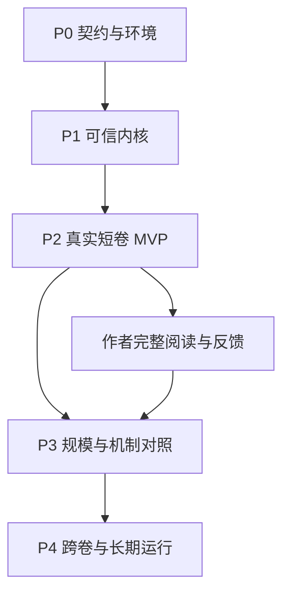

# 11｜研发路线、任务依赖与测试计划

> 修订：v2.0-R1。统一时间与并发基础已前移到 P0/P1；本章的“通过”是未来开发验收要求。本轮实际运行的文件/Schema校验与小实验结果见[验证报告](../validation/REPORT.md)，不得把其等同正式系统已通过。

## 1. 实施主线与MVP边界

MVP在P2结束：单作者权限域、单机多进程与有界工作者池、一个实际外部模型/Agent接入路线、一部5–10场景短卷、两个有因果交汇的地区/势力、少量角色、一次合法意外、一次局部重规划、一次整卷结构编辑。题材和具体篇幅由样卷决定，以上数量是夹具预算，不是小说规则。

MVP包含真实数据库、固定世界快照、候选分支、基础历史修订、角色视图、过程推进、联合裁决、世界/正文分离、摘要证据、真实调用账、取消和迟到阻断、恢复演练；还包含统一历史/计划查询、最小完整scope注册、封闭命令的无关变化重验证，以及有界连接池、限流和背压。文学档案和整卷编辑不能推迟到“大工程做完以后”。

暂缓专用图库、向量库、微服务、复杂工作流框架、实时多人协作UI、任意分支自动语义合并、通用物理/社会模拟、全量细模拟和网站自动发表。外部发表非端到端创作闭环的必要条件，本地release已可提供明确可读版本。

不指定未经测量的交付周数。P0/P1可以并行做纯领域规则、对象存储和任务模块，但跨模块接口变更集中审核；P2出口以前不进入没有瓶颈证据的基础设施扩容项目。并发契约、独立写入重验证、资源隔离和小规模多进程正确性属于早期内核工作，不能推迟到P3。

## 2. 开发任务卡和依赖

每张任务交给开发Agent时附：目标、前置任务、输入契约、实现范围、必过反例、产物、退出条件。下面是可以直接拆工的任务目录。

| ID | 任务/输出 | 前置 | 验收要点 |
|---|---|---|---|
| P0-01 | 初始化Python项目/依赖锁、PG17开发实例、CI入口 | 无 | 固定运行版本和安装命令；DB迁移可在空库执行 |
| P0-02 | 载入本包Schema/角色/技能/ADR，确定契约生成方向 | 无 | 服务DTO与Schema只有一处生成源；无字段名称分叉 |
| P0-03 | 青霜剑、白桥粮运两个隔离夹具；固定不变量 | P0-02 | 原v1.1故事/测试ID完整映射，未知与否定可区分 |
| P0-04 | 冻结统一时间/ReadContract、scope注册和行为负载输入；记录硬件与目标Host | P0-01/02 | 区分Agent数、工具RPS、SQL量、正式接受与模型在途；所有容量数字标注假设 |
| P1-01 | 身份、WorldRef、StoryPoint、事件/关系/资源纯类型 | P0-02/03 | 单位、生命周期、所有权/占有/认知分开 |
| P1-02 | 真实PG仓储/UoW/分支head/事件账本/关键投影 | P0-01、P1-01 | 原子接受、回执丢失重试、CAS冲突，不用SQLite替代 |
| P1-03 | 不可变对象/ArtifactRef/引用校验/基础GC | P0-01/02 | 文件写中断与DB失败，不接受缺失对象 |
| P1-04 | 固定版本查询、基础图路径、权限ContextBundle | P1-02/03 | 角色不可读秘密/未来/错误旁路，旧版本可还原 |
| P1-05 | 任务状态机、租约/generation、调用账/预算、outbox | P1-02/03 | 取消与领取竞态，旧worker不能提交，未知费用保留 |
| P1-06 | 最小fork、diff、人工指定repair与canon指针CAS | P1-02/04 | 旧发布和旧世界仍可查，修订非第二次效果 |
| P1-07 | 冻结写入备份与隔离恢复脚本/演练 | P1-02/03/05 | DB+正文+规则+任务恢复一致，投递暂停 |
| P1-08 | scope/负向谓词/规则/覆盖token；STRICT与DEPENDENCY_GUARDED接受；可信证书 | P1-02/04/06、P0-04 | R1-F独立写可重验证；write-skew/phantom/撤权/过期证书必须阻断；全部写路径更新scope |
| P1-09 | 无状态接入、进程总连接预算、类别限流、队列背压与公平调度 | P1-05、P0-04 | 10/50逻辑Agent夹具；等待模型不持DB连接；过载显式拒绝/排队且不绕过门禁 |
| P1-10 | UnifiedQuery与批量固定切面、KnowledgeCut、Context Compiler策略及缓存键 | P1-04/08/09 | 同批一致WorldRef；未知/未推进/索引滞后分开；缓存命中仍检查授权 |
| P2-01 | 世界底稿审核、卷创作契约和滚动计划产物 | P1-04 | 冗余背景可正式存在；移除主角后势力仍有行动理由 |
| P2-02 | 过程登记、推进覆盖、入站消息/冲突组、联合裁决 | P1-02/04/05 | S01/02/03/05/08；模型快慢不改故事结果 |
| P2-03 | 一个真实Host/API接入，角色任务与语义裁决 | P1-05、P2-02 | 真实身份隔离、输入输出、费用和失败都存证 |
| P2-04 | 场景卡/写作/事实抽取对账/局部重规划 | P2-01/03 | 世界先行与文本先行均闭合，重要新增后果必须提案 |
| P2-05 | 文学档案/声线/分层审核/整卷编辑 | P2-04 | 原文覆盖、结构先于润色、误伤/分歧处置有证据 |
| P2-06 | release manifest与两个固定快照写作任务 | P2-04/05 | 叙述不重施世界效果，章间衔接及批准正确 |
| P2-07 | 完整短卷、一次合法意外、恢复+作者完整阅读报告 | P2-06、P1-07 | 保留前后稿、真实调用账、未决问题与失败候选 |
| P2-08 | A–H组合验收、50/200行为负载、冷暖缓存、早期Retcon影响和公平性 | P2-07、P1-08/09/10 | 真正测量有效吞吐/尾延迟/成本；模型调用可先stub、真实短卷另验，不预宣称达到档位 |
| P3-01 | 已验证scope体系的粒度优化、增量重建/缓存及扩展guarded命令集合 | P2-08 | 降低无关阻断而不放过phantom；未知语义依赖保持保守，证书事务内再验 |
| P3-02 | 宏微等效替换、复杂共享资源、三方冲突 | P2-07 | 中间认知/消息/权属边界等效，不能只比终态 |
| P3-03 | 中文检索、摘要/文学记忆/编辑的配对消融 | P2-07 | 相同预算和独立金标准，保留全部尝试 |
| P3-04 | 500/1000逻辑Agent探索档位、open-loop过载、soak/故障与Host矩阵 | P3-01、P2-08 | 报告未达档位和瓶颈；吞吐扣除拒绝/返工/重复，必要时才引入共享缓存或队列 |
| P4-01 | 跨卷人物/关系/伏笔和连载前缀保护 | P3-03 | 旧发布不静默改写，多声部允许合法演化 |
| P4-02 | 在线备份/PITR、规模恢复和模型/规则换版 | P3-04 | 实测RPO/RTO与恢复完整性，冻结未知投递 |
| P4-03 | 依据瓶颈评估图/向量/编排基础设施 | P4-01/02 | 有比较、成本和回退方案才新增组件 |

旧v2.0 AcceptWorldRequest保持严格head语义。R1在P1实现有限封闭命令的依赖守卫接受：无关HEAD变化可以服务器重新验证后接受，原提案不能自己换版本；不完整语义足迹、Retcon、跨分支采纳仍按严格检查。P3再优化已证实安全的粒度，不把所有独立写入重试推迟到P3。MVP宏观事件细写仅纯呈现，有新效果改提案/修订，不能用未验证“等效替换”偷偷绕过审查。

## 3. 测试分层

### 3.1 确定性工程层

纯规则测试针对事件折叠、时间约束、容器环、单位转换、资源守恒、冲突组和依赖闭包；属性测试检查置换不变性、重放等价、重复输入不新增效果、分支隔离。时间或随机数通过显式依赖注入，已接受裁决保存实际结果，测试不靠调用模型。

PG集成测试使用两个独立连接制造真实事务竞争，覆盖同key重试、head CAS、取消与提交竞争、唯一性、行锁顺序、死锁/序列化失败重试。`SKIP LOCKED`只用于领取任务，不能用于声称完整的世界查询。持锁调用外部模型的实现视为失败。

文件测试在写临时文件、rename前后、DB commit前后、回执前后注入失败，验证引用永远指向已确认持久对象。进程崩溃用外部测试进程终止，不只在代码里抛一个可捕获异常。恢复测试在隔离目录和数据库运行，不能覆盖真实作品。

### 3.2 语义工具层

准备人工标注的实体/事件/传言/否定/时间/知识传播片段，分别测精确率、召回率、未知拒答和证据定位。训练/调参世界与测试世界分开，不能用系统自己的摘要作为事实金标准。区分模型先验猜测和服务泄露：模型猜中真相未必证明权限错，但若声称“已知”需有获准认知证据。

### 3.3 文学层

以完整短卷或跨章序列为样本单位，进行顺序随机的盲读，保留作者目标、读者解释、分歧和修改前后文本。评价阅读意愿、人物可信度、情绪回报、叙述节奏和语言，不强迫压成一个总分。模型审稿用于定位问题，不能作为所有文学目标的客观裁判。

“没有重大工程违规”是发布必要条件，不意味着小说好看；“编辑觉得好看”不能豁免世界资源、权限或版本违规。情绪反复、角色说谎、故意误导、不可靠叙述和多种声线必须有不应被误删的反例。

## 4. 完整继承 v1.1 案例

完整原文保留在[基线测试文件](../baseline/v1_1/09_压力测试与端到端案例.md)，机器可读映射见[case_matrix.json](../validation/case_matrix.json)。下列编号不改写其原意。

| 案例 | v2.0落实位置 | 首次门槛 |
|---|---|---|
| T01 历史权属；T02 倒叙三种信息；T03 承诺与计划 | 03数据/09上下文/07生产 | P1查询，P2文本 |
| T04 容器与隐藏路径；T05 Retcon及认知 | 03图路径/04分支修订 | P1 |
| T06 同名传言；T07 三方争夺；T08 多次叙述一次效果 | 03身份/05冲突/07对账 | P1基础，P2联合 |
| T09 配方单位血缘；T10 替代路径；T11 发言与真假；T12 模糊时间 | 03资源/05调度/07规划 | P1规则，P2语义 |
| S01 预计不兑现；S02 同刻交汇；S03 单通道下界 | 05过程与推进 | P2 |
| S04 宏微；S05 局部受阻；S06 预演与接受；S07 失败改线；S08 现实超时 | 04/05/07 | P2纯呈现，P3等效替换 |
| L01 人物成长证据；L02 整卷空转；L03 悲伤后发笑 | 07/09/运行时编辑契约 | P2 |
| L04 方法升级和多声部；L05 不对称认知/长期余效 | 07/09 | P2基础，P4跨卷 |
| F01–F04 租约/未知回执/批准内容/负向依赖 | 04/06/08/14 | P1基本scope与guarded反例，P3粒度细化 |
| F05–F08 索引/泄密/分支不相容/撤权取消 | 03/04/06/09 | P1 |
| F09–F12 模型换版/对象故障/outbox/规则版本 | 01/04/06 | P1；外部投递启用前完成F11 |
| F13–F16 缓存/未知与none/语义漏抽/预算循环 | 06/07/09 | P1缓存预算，P2语义 |
| F17–F19 失效窗口/发布乱序/材料越权指令 | 04/08/09 | P1失效；投递启用前F18；P2全文流程 |

总计44个继承案例（12+8+5+19）。某案例需要多个测试，不以“44个函数”机械替代语义覆盖。

## 5. v2.0新增验收

| ID | 输入/故障 | 必须观察的结果 | 类型 |
|---|---|---|---|
| V2-01 | 同一query分别处于未知、未推进、计划、索引滞后 | AnswerEnvelope正交字段不同，绝不统一返回false | 契约/查询 |
| V2-02 | 相同幂等key、不同payload | 拒绝而非返回旧结果假装新操作成功 | 事务 |
| V2-03 | fork继承了已施加effect，再引用同occurrence | 新分支当前投影不二次施加；独立反事实分支仍能合法试不同结果 | 版本 |
| V2-04 | repair准备后main继续变化 | promotion CAS失败；不丢失期间新接受历史 | 事务 |
| V2-05 | 两组细化终态相同，中间消息/持有/认知不同 | 不认定等效，转revision或retcon审查 | 调度 |
| V2-06 | 授权查询空结果后新增匹配范围事实 | 旧ContextBundle的负向依赖失效 | 并发 |
| V2-07 | 接受world成功，release重试、倒叙重用 | 世界余额、认知和effect数不变 | 集成 |
| V2-08 | 不改世界，仅调换章节、POV或style | 相关披露/接缝/整卷批准失效，事实批准可按依赖复用 | 生产 |
| V2-09 | 人物普通猜测恰好命中秘密 | 不无条件判泄密；标为推测且不得伪造知情证据 | 语义/权限 |
| V2-10 | 读者已披露信息来自不可靠旁白 | 保存“文本给出某说法”，不升级为世界真相或真实读者已相信 | 生产 |
| V2-11 | Host有额外全知文件工具 | 标记角色隔离未通过；改用受控工具网关验证 | 接入 |
| V2-12 | 备份DB完整但缺一正文对象/旧规则解释器 | 恢复验收失败并给确切缺口，不假报可用 | 恢复 |
| V2-13 | 研究方法更新，而旧任务仍跑 | 旧任务绑定旧method/style版本；新策略经选择后生效 | 文学/版本 |
| V2-14 | 公开发布v1回执未知时已请求v2 | 不盲发v2或旧撤回；每目标一个未结算操作并对账 | 投递 |
| V2-15 | 两个任务同时预留最后一笔预算 | 事务内最多一个成功，未知调用继续占用额度 | 账本 |
| V2-16 | 引入无关普通描写，然后后来用其支持因果 | 首次允许SURFACE_DETAIL；成为前提时必须升格并审查历史兼容 | 创作/对账 |

## 6. 第一部样卷的执行脚本

1. 用“白桥粮运”独立work_id初始化两地区、两势力、运输/消息规则、一批粮食、3–4个关键角色和少量未出场背景。审核跨域约束，保存已接受世界基线。
2. 创建卷契约：粮运困局、各角色独立目标、少量保护承诺、开放结局、费用上限；产生候选粗计划。
3. 登记粮运、天气和消息过程，准备交汇窗口，角色只读取本人的认知上下文并提出行动。
4. 以共同起点联合裁决争用，接受世界事件及推进范围。人为夹具确保一次规则允许的失败；真实模型可提出具体文学后果。
5. 卷导演检查受影响依赖，保留合理失败并局部改线，不重抽到原结局。
6. 固定世界cut及场景卡，两个相互独立场景可并行写；同线后继等待上游叙事交接。
7. 抽取重要增量、对齐已接受事件，常规表层描写留在正文；新持久事实回提案流程。
8. 做章节/邻章/整卷审核，结构删并或重排后重建披露和批准；记录原文阅读覆盖。
9. 生成本地release；比对接受前后world效果计数，证明文学呈现没有重复施加。
10. 中断一个worker并恢复；在隔离环境恢复DB与对象；作者完整阅读最终短卷与编辑前版本，填写证据型反馈。

夹具中的强制失败用于测试重规划，不可据此宣称外部模型自然涌现了该失败；记录哪些步骤是脚本预置、人工决议或模型生成。

## 7. 原型实验和性能门槛

本包 `experiments/` 只验证精简机制，使用内存模型；它不运行PG、MCP Host或真实小说产线。实验结果只能证明测试模型的断言，不证明部署可靠性。P1必须补真实PG故障测试，P2必须补真实调用与完整阅读。

性能执行方案以[15 并发压测与端到端验收](15_并发压测与端到端验收.md)和[workload_model.json](../benchmarks/workload_model.json)为准：10/50/200/500/1000逻辑Agent、1万/10万/100万事件、时态关系历史和热资源偏斜分别变化。行为闭环与独立到达负载都要测，报告p50/p95/p99、有效吞吐、拒绝/排队、重验证、锁/连接占用、索引水位、内存/磁盘、费用及恢复。毫秒SLO在冻结环境后的基线实验中审批，不预设已经实现。合成5000章元数据不表示生成过5000章合格正文。

本轮另实跑[独立负载算术模型](../benchmarks/README.md)：将声明的角色周期换算成流量需求，输出CSV/JSON；它没有调用服务或数据库，没有测得吞吐和延迟。

机制验证优先比较：无粗预演/粗预演；普通摘要/证据型人物档案；只有章节审稿/增加整卷编辑；串行/少量依赖并行。控制相同模型、世界、目标字数、预算和信息权限，按小说单位配对，保留全部废稿及人工介入。没有文学收益的机制可以关闭；工程权威边界不能为提高好评分而关闭。

## 8. 阶段出口与停止规则

P1只有内核及小规模并发正确性验收，不宣称MVP完成，也不宣称达到1000 Agent容量。P2必须有真实完整短卷、两线交汇、意外后改线、人物变化证据、整卷前后稿、成本账和基础恢复。P3用对照决定扩展优先级。P4必须实测跨卷阅读和恢复，不以文件数量作为长篇质量证明。

遇到硬不变量失败停止相关接受并保留候选；遇到语义未决缩小范围或提交明确选择；遇到审美分歧由作品约定下的总编决议；遇到预算耗尽暂停新派发。修复可以自主实施，不能删除失败证据、放宽金标准或把未知标成通过。

## 9. R1补充验收与扩展门槛

[A–H机器案例](../validation/r1_case_matrix.json)与[15章](15_并发压测与端到端验收.md)为新增、独立命名的验收；原44个v1.1案例和16个v2案例继续有效，不改写其故事日期。新剑例是D10赠送、D20借用、D30盗窃、D40毁坏，不能覆盖原D12测试世界。

| 案例 | 主要能力 | 首次真实执行 |
|---|---|---|
| R1-A 历史与未来计划 | 统一时间查询、关系演化、存续前提失效 | P1查询，P2重规划 |
| R1-B 改过去 | 两个修订D25还原、依赖重建及推广 | P1/P2 |
| R1-C 两线交汇 | 局部推进、入站下界、联合裁决 | P2 |
| R1-D 候选D100与main D60 | 分支/缓存/认知隔离和受控采纳 | P1/P2 |
| R1-E 误信与客观事实 | 视图裁剪、知识获得与读者披露 | P1/P2 |
| R1-F 并发与过期输入 | 独立写重验证、真实语义冲突、scope完整性 | P1反例，P2/P3规模 |
| R1-G 宏微展开 | 纯表现零新效果；复杂等价替换门槛 | P2/P3 |
| R1-H 丢回执和恢复 | 幂等回执、异步索引、任务部分成功 | P1/P2 |

扩展决策按实测瓶颈选择：连接爆增先处理进程池总预算；SQL/时态历史慢先优化索引、投影和增量重放；同键缓存重建慢先做合并请求及有界重建；任务队列表的清理/调度已成瓶颈才比较独立消息队列；跨区域读扩展才评估副本及明确读契约。不按“Agent数量看起来多”直接拆微服务。
