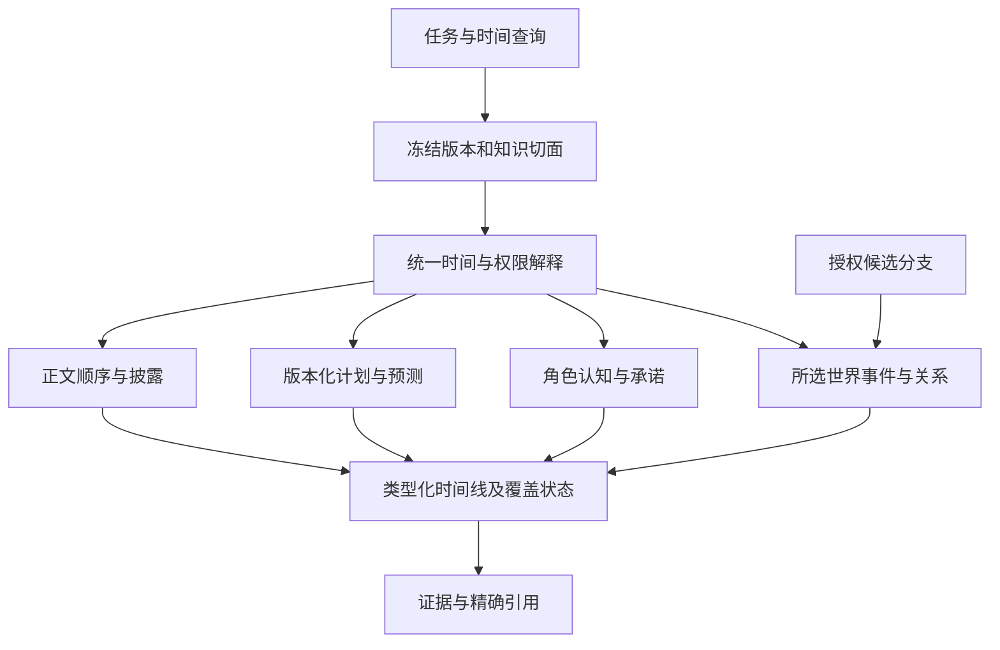

# 13｜统一时间线与动态知识演化

> v2.0-R1 整合设计｜2026-11-10。本文是 [03 数据模型](03_数据模型与知识图谱.md)、[04 版本](04_事件溯源与版本体系.md)、[05 调度](05_世界模拟与调度引擎.md) 的统一查询与时间专题；原正文已同步修订。机器形状见 [temporal_concurrency.schema.json](../contracts/temporal_concurrency.schema.json)。本轮没有运行真实数据库或宣称所有语义推理已解决。

## 1. 结论：一个故事时间坐标，多种有类型的记录

历史、已确认但未披露的发生、未来计划、角色预测和模拟未来使用同一个作品故事坐标。统一的是定位、约束、检索和调度语义；权威类别、版本、知识范围及接受过程仍明确分开。逻辑时间线是一个只读的类型化查询视图，不是一张可由所有 Agent 任意改写的 event 表。

查询不能自行把计划转成事件，调度器也不能因预定日期到来就声明执行成功。正式状态只由被选中的接受记录与效果构建。候选分支的 D100 可以是该分支已接受的事实，但它不因日期较远、被导演喜欢或被查询过而进入主分支。

## 2. 四种时间职责及三个“现在”

| 维度 | 例子 | 负责的对象 |
|---|---|---|
| Story Time | 盗剑发生于 D30，送信发生于 D35 | occurrence_time、因果次序、过程边界 |
| Valid Time | 朋友持剑在 D20 交接后至 D30 被盗前成立 | 关系/属性有效段、资源状态 |
| Transaction / Revision Time | 系统在修订 R18 接受了发生于 D30 的盗剑记录 | revision、commit_operation、recorded_at、来源链 |
| Narrative Order | 第 80 章才揭示 D30 的盗剑 | narrative_revision、arrangement、读者切点与文本锚点 |

Story Time 与 Valid Time 使用同一数轴，前者定位发生，后者定位状态的成立范围。后两者并不在该故事数轴上排序。现实时间 recorded_at 记录接收/接受时间，不能替代 revision 的身份和祖先关系；事务开始时间、系统时钟精度或 UUID 大小都不是故事顺序。

必须说明所谓“现在”是哪一个：角色正在行动的场景点、某作用域已求值前沿，还是读者已经阅读的叙事切点。三者可以不同。系统不提供一个可让各模块随意外推事实的全局 `world.now`。

一个 WorldRef 可以同时保存主角域 D40、反派域 D35、宗门域 D20 的覆盖。最大事件日期不是整世界进度，最小地区日期也不要求所有其他地区停在那里。正式状态查询只检查与本问题相关的过程及依赖范围。

## 3. 日历、模糊时间与相对时间

### 3.1 CalendarDefinition

作品保存版本化日历定义：纪元、最小 tick 单位、日/月/年换算、可接受的地域历法映射及原始日期表达。内部比较使用 StoryPoint；人物说的“永宁三年冬月”仍作为原文与证据保留。地域日历换算有版本，不能后来修改换算规则而无痕改变既有事件坐标。

普通地方报时差异可转换为同一坐标；秘境内外时间流速差、循环或时间旅行则必须成为明确世界规则和事件关系。首期只支持已定义、可验证的映射。映射不确定时保留约束或候选，不能把公历时区库当作任意虚构时间系统。PostgreSQL 日期采用公历，这也是故事 tick 与现实 UTC 时间分开的依据。[官方日期类型](https://www.postgresql.org/docs/17/datatype-datetime.html)

### 3.2 时间表达的求值边界

| 表达 | 保存方式 | 可以据此做什么 |
|---|---|---|
| “D20 午后已交剑”且日历可解析 | 精确 StoryPoint 或已知包含范围 | 在粒度足够时构建精确有效段 |
| “D22 至 D25 之间遭盗” | OccurrenceTime.BOUNDED，端点是可能发生点 | 查询 D23 时不能任择一天；可以返回约束及未定状态 |
| “失踪之后，决战之前” | 指向稳定事件版本的 before/after 约束 | 检查矛盾与必要先后，不伪造日期 |
| “闭关结束后三日” | 相对锚点＋经过版本化日历解释的偏移 | 锚点未发生则仍是条件时间，不能当实际日期 |
| “大约十年后” | 原始表达、粒度与不确定约束 | 用于计划/搜索；不能默认为精确 3650 天 |
| “同时抢剑” | 同一已定义交互窗口与阶段协议 | 进入联合裁决；同日标签本身不足以证明同时 |

P1 支持固定点、有界发生、明确先后、简单最短距离和已定义 phase；检查严格先后环及边界不相容。任意复杂差分约束、开放语言日期解析和时间旅行推理需独立原型。解析失败不意味着事件不存在，也不自动变成系统当前时间。

时间线可以列出尚未解析时点的条目，放入明确的未定位分组。按 earliest 排序只是显示索引，不宣称这是实际发生顺序。状态查询的 POINT/INTERVAL 选择器必须已解析；不能把文本时间表达悄悄降格成另一个精确点。

### 3.3 时间边界的解释

精确状态段采用半开 `[start,end)`；相邻交接段在边界无重叠。OccurrenceTime.BOUNDED 的两端则是可能发生时点，不能被同一半开规则截去最后可能点。STATE 在某点读取该点已经形成的有效状态，证明其完整通常需要相关排他前沿严格超过该点；交互的共同前态由阶段协议单独固定，不能借此提前看到自己的结果。

R1 的 RelationTransition.at 是**已解析的效力边界**。它不一定等于事件发生时刻，例如制度明确规定次日生效，但必须有规则与证据支持。无法解析的边界保留为未定证据/约束，不借 OPEN/CLOSE 造出确定关系段。通用模糊有效期与关键资源联合求解属于后续候选机制。

## 4. 冻结一个查询切面

查询首先解析 ReadContract，并形成确切 WorldRef。KnowledgeCut 再固定所需的知识平面；其字段只是请求意图，不能扩大服务端任务授权。

| 切面部分 | 必须固定什么 | 典型错误 |
|---|---|---|
| 世界 | work、branch、revision | 每个子查询重新解析 main，混用不同修订 |
| 故事目标 | POINT 或 INTERVAL | 用第几章代替故事时间 |
| 角色认知 | actor_id、known_at、允许读取的命题范围 | 查询 D20 的状态时加载角色 D50 才知道的真相 |
| 计划 | plan_manifest_ref，引用精确计划版本集合 | WorldRef 不变却悄悄换成新的“最新卷纲” |
| 读者 | narrative_revision_id、arrangement_version、reader_cut_ordinal | 文本重排后仍沿用旧第80章的知识集合 |
| 授权 | 当前 task/generation、grant、policy 与用途 | 客户端自填 WORLD/actor_id 就获得相应权限 |

历史目标时间与获知时间可以不同。例如“D50 的主角认为 D20 剑属于谁”查询目标 D20、known_at D50；“在 D20 行动的主角认为剑属于谁”则二者均为 D20。普通角色任务默认二者相同，只有被授权的回顾/编辑任务才能扩大知识切面。晚年叙述者知道后来结局，也不意味着年轻角色当时知道。

批量查询必须一次冻结整个版本与知识切面，并返回可复用的固定引用；分页游标绑定该切面、查询、授权与排序规则。跨分支比较使用明确的两个 WorldRef，不能返回一个失去来源标签的混合状态。普通 timeline_query/query_batch 每次只使用一个 KnowledgeCut，不能用批量容器混入其他平面。跨平面的组合仅由受信 ContextCompiler 按已授权 recipe 的主切面和 auxiliary_cuts 构建 CompiledContext，各段分别核验授权及来源；ACTOR 上下文不得含 WORLD/PLAN/READER 辅助段。

## 5. TemporalEntry：统一外观、分开的含义

TemporalEntry 是查询投影，不授予新的写路径。其 entry_kind、source、source_story_time、target_time、valid_time 及适用版本以机器 Schema 为准；下表定义解释责任。`source_story_time` 是条目在故事中发生或形成的时间；真实系统记录时间从源接受审计的 recorded_at 读取，二者不得因“记录时间”一词而混用。

| 条目类型 | 真正已经确定的内容 | 不能据此推导 |
|---|---|---|
| FACT | 所选分支/修订中接受的发生及后果 | 所有角色或读者已经知道 |
| STATE_ASSERTION | 被接受的设定/状态断言及适用范围 | 无来源地覆盖运行期事件所确定的状态 |
| OBSERVATION | 某人通过合法渠道看见/听到某内容 | 该人相信它，或内容必真 |
| INTENT | 某角色已经形成的目标/私有决定，或待确认意图候选 | 目标动作已执行、已成功 |
| PREDICTION | 某主体的预测、模型与依据 | 预测的未来是确定世界事实 |
| PROMISE | 某主体作出承诺及其内容/目标时窗 | 承诺已兑现；承诺内容具有世界真值 |
| PLAN | 某版本的作者/导演计划、条件与替代出口 | 到期自动兑现；角色自动知道作者计划 |
| READER_DISCLOSURE | 精确叙事切点前已提供的文本材料 | 真实读者一定理解，也不等于文本命题为真 |
| LITERARY_NOTE | 有证据的文学解释、意图或编辑决议 | 可直接改变心理事实、权属或角色记忆 |

若 D30 反派实际决定 D40 抢剑：决定成立在 D30，目标在 D40；查询前者是合法私有认知，查询后者仍是意图。若人物 D30 说“D50 还剑”，发言发生与承诺内容关联同一来源，不生成第二次还剑效果。PROMISE/INTENT 的源记录是否已被接受必须显示，不能因为类型名存在就当成已确认认知。

SIMULATION 是分支/视图边界，不把所有模拟结果都扁平标为假。一个模拟分支中已接受的 FACT 可用于该分支的状态查询；尚未选定的候选产物依然不能进入该分支的 reducer。采纳到主分支必须重新验证目标前提、作用域覆盖及发生身份。

## 6. 生命周期与到期行为

不同对象保持自己的状态机，不维护一个可写的“通用事件状态”来代替领域逻辑。

| 对象 | 主要生命周期 | 生效边界 |
|---|---|---|
| 世界变更提案 | 候选→校验→批准→接受；不合格转返工/拒绝/过期 | 接受事务选择不可变事件版本与效果；已接受不回退成草稿 |
| 世界事件 | 某修订中被选择；后来可被新修订替代或停用 | 原记录和旧修订仍可查询；不是直接编辑事件行 |
| 关系/属性段 | OPEN 后在有效期成立；CLOSE 终止；新值另开新段 | 同一事件/变化包内核验基数、资源、时间及前版本 |
| 计划 | 草案→可行/批准→待执行；条件变化→待重规划；后续实现/取消/替代 | realized 必须引用有效事件并通过对应关系核验 |
| 意图与预测 | 形成/记录→执行或被修正/放弃/证伪 | 实际行动和观察另有接受记录；预测错误不删掉“曾预测过” |
| 触发 | 待求值→条件成立、不成立、替代或取消 | 到期只使检查就绪；触发完成与结果/过程前沿原子保存 |
| 文学披露 | 文本候选→对账/审核→采用→新版本重排或修订 | 只影响读者材料和叙事资格，不施加世界效果 |

以上是逻辑状态，不可直接把中文阶段或临时枚举塞入封闭 DTO。R1 对外 PLAN 来源的 plan_status 固定为 DRAFT/APPROVED/READY/BLOCKED/INVALIDATED/CANCELLED/SUPERSEDED/FULFILLED；FULFILLED 必须有非空 fulfillment_event_refs，并经服务核验实现内容。旧领域计划的 realized 等名称只由适配器明确映射，不形成另一套事实状态。计划源记录的生命周期与其对当前世界是否仍适用分开：旧版计划可仍记载“已批准”，但依赖检查已经显示它不可用于当前任务。后台尚未来得及生成新计划版时，同步失效屏障已阻止继续接受基于破坏前提的结果。

到期算法只执行：读取固定计划/触发 → 检查当前授权与依赖 → 准备行动或求值任务 → 必要的角色选择和裁决 → 接受真实结果 → 据证据标记实现或触发重规划。它没有“计划日期≤当前日期，所以写入事实”的分支。

## 7. 读取一致性、求值与索引是三件事

ReadContract 将版本选择、过程要求和派生数据要求分开，具体枚举见接口 Schema 与 [08](08_MCP与工具接口.md)。

| 场景 | 合法策略 | 结果必须说明 |
|---|---|---|
| 固定旧修订 | FIXED | 所有页/子查询都使用该 WorldRef；新提交不改变旧版本 |
| 请求开始时的主分支最新状态 | LATEST_AT_START | 入口一次解析并固定；响应返回解析出的确切引用 |
| 读到自身刚提交的结果 | READ_YOUR_WRITES | 使用回执要求的版本/祖先资格；分支切换不能静默跨过去 |
| 普通搜索允许索引落后 | 显式可降级派生读取 | 标明索引来源/缺口；不能把旧搜索结果当新权威状态 |
| 必须已求值 | REQUIRE_EVALUATED | 相关过程不足时返回待推进/受阻，关键决策不消费未定值 |
| 允许部分状态 | ALLOW_PARTIAL | 标明已确定值与未求值范围；权限视图内裁剪原因 |
| 等待已有推进完成 | WAIT_EXISTING_ADVANCE＋动态版本选择 | 只等待已授权且存在的推进任务；超时返回状态/句柄，不自动发起模拟 |

**固定版本陷阱：** FIXED(W60) 若只包含某域 D35 的已求值覆盖，等待 W61 推进到 D40 不会让 W60 的世界知识变成 D40。固定版本可以等待的是“W60 的物理投影恢复/构建完成”，不是修改它的世界历史。需要等待世界推进的请求必须明确允许解析之后的新修订，并返回确切采用的 WorldRef。

查询仍保留 core 的 truth_status、knowledge_status、evaluation_status、freshness、coverage、value_status。统一响应 status=PENDING 专指等待已有推进作业；ALLOW_PARTIAL 可以成功返回 READY 的查询容器，但其中目标状态的 evaluation_status=PENDING，二者不能混同。计划内容可确定、角色误信可确定，而命题世界真值可能相反；未推进不等于未知，索引落后也不等于世界尚未发生。

## 8. 新增青霜剑夹具：九类查询

本节是补充任务的新独立作品夹具，不能和 v1.1 的 D12 借剑、D31 毁剑实例混用 ID。日期用 Dn 表示测试日历 tick；状态查询“D20 交接后”固定到已证明交接结束的阶段，不能省略边界又声称精确。

### 8.1 已接受历史与计划

| 故事时间 | 被采用的发生 | 所有/权利 | 实际持有/位置 |
|---|---|---|---|
| D1 | 工匠制造唯一剑 S | 工匠 | 工匠作坊 |
| D10 | 工匠赠给主角 P | P | P |
| D20 | P 借给朋友 F | P | F 的行囊 |
| D30 | 反派 V 成功盗走 | P | V；北岸营地 |
| D40 | S 被不可恢复地销毁 | 保留最后确认所有者P及历史；持续权利按明确制度单独判断 | 无活跃持有人；残骸另按身份规则登记 |

本夹具在毁坏后明确 active_holder=NONE、active_use=NOT_APPLICABLE，last_confirmed_owner 保留；不通过物理毁坏自动宣布所有权或赔偿权消灭。

固定旧计划清单含：D50 由 F 归还同一完整 S；D60 由 P 使用同一 S 进入秘境。两计划都依赖原实例继续存在，规则不允许无代价复原或拿另一把剑视作同一实例。D30 盗窃会触发路线/取得条件的风险复核，但不必然证明 F 在 D50 绝无可能重新取得；D40 的不可恢复毁坏则使“交付/使用完整 S”的硬前提失效。

角色 P 在 D20 观察了借出，直到 D35 仍未收到盗窃消息，仍相信 F 持有。第 80 章之前只披露制造、赠与和借出；第 90 章才揭露盗窃。世界在此叙事阶段已经接受毁坏也不矛盾。

### 8.2 查询、切面和预期

| 问题 | 关键选择 | 正确结果 |
|---|---|---|
| 第20天谁持有青霜剑？ | WORLD、W包含借出、D20交接后 | F；所有者仍是P；给出借出发生和有效段证据 |
| 第35天剑在哪里？ | WORLD、该范围已求值至D35之后 | 北岸营地的V处；从持有与容器/位置关系解析，而非只返回owner |
| 第50天之前经历哪些转移？ | TIMELINE、已接受FACT、[D1,D50) | 制造、赠与、借用、盗窃及终止生命周期；毁坏明确为终止，不能伪装成又一次转交 |
| 未来有哪些已计划转交？ | PLAN＋固定plan_manifest_ref＋D40后的目标窗 | D50归还计划及其源生命周期；同时说明依赖失效/待改线，不能返回为确定未来交付 |
| 哪些计划依赖它继续存在？ | 类型化反向依赖＋相同计划清单 | D50归还和D60秘境使用；定位具体时间条件及替代出口，不只给模糊相似文本 |
| 某角色在D30相信它属于谁？ | BELIEF、actor=P、known_at=D30 | P相信自己是所有者，F仍实际保管；即使客观盗窃已接受，也不注入V的信息 |
| 第80章读者知道什么？ | READER＋固定叙事/排列/切点 | 可知已赠P、借F；不包含第90章披露，且不宣称每位真实读者都理解一致 |
| 旧版剧情D40发生了什么？ | FIXED旧WorldRef＋D40窗口 | 只返回旧修订所选发生；新修订的改赠或取消毁坏不得混入 |
| 候选分支是否提前销毁？ | 明确候选WorldRef＋相同S身份 | 返回该候选中的已接受毁坏时点和证据；主分支状态保持原选择 |

若第二行所需范围只求值到 D29，应返回目标状态未求值及可见前缀，不能把“最后见于 F”当 D35 客观位置。若盗窃仅知在 D28–D32，D30 持有答案保持 UNDETERMINED；P 的既有误信可以仍有确定证据。若权威已毁而全文索引尚未更新，关键查询回权威源，不能让旧摘要把剑复活。

## 9. D20 借改赠：版本与故事时间的正交关系

在旧修订 W_old，D25 的 S 为 P 所有、F 持有。作者将 D20 借用改为赠与，建立 REPAIR 分支并选择同一发生的新 event_version。新修订 W_new 的 D25 为 F 所有、F 持有。两次查询的 StoryPoint 相同，WorldRef 不同；旧版仍可恢复。

重建并非给当前状态做一次反向转移。先比较选择清单与最早影响点，选相容快照或从基线恢复，再按故事/因果顺序解释新选择。D30 盗窃、D40 毁坏若仍成立可保留发生身份，但其权利后果和基于旧所有权的行动、信念及台词须复核。

影响按类型处理：资源/权属投影重建；依赖旧owner的硬前提重新核验；人物在D20如何理解赠与按实际观察重建；承诺、伏笔和正文提出语义/文学复审；相关旧摘要、计划、上下文和批准对新世界失去未经验证的适用资格。没有接触 D20 的人物不会因为编辑操作自动收到“历史已改”的通知。

版本链提供确定的一套有效历史；fork/采纳/修订的来源边形成整体溯源 DAG。它不是将两个分支记录简单相加的多父状态运算。待采用候选、输入基线、目标前沿和最终推广资格均由 04 的提交规则控制。

## 10. 迟发现、迟披露与 Retcon 的判定

| 情况 | 正确处理 | 为何不同 |
|---|---|---|
| 世界早已接受D30盗剑，人物D50才得知 | 新增D50合法观察/信念；世界D30记录不变 | 知识传播，不是历史发生变更 |
| 世界早已接受，正文第90章才展示 | 新正文/披露记录指向原occurrence | 文学呈现，不产生盗窃效果 |
| 系统D50才取得可信的D30发生证据，旧历史相应范围一直未确定 | 提出历史补充，检查范围/证据/依赖后接受，并重建必要投影 | 新修订能回答更多历史，但旧修订仍保留当时未知 |
| 新证据否定旧明确状态或已认证推进前提 | REPAIR/Retcon，复核下游并明确推广 | “后来发现”不能绕过历史修订门禁 |
| 作者把D20借用改为赠与 | 以新的事件版本选择替代，保留W_old | 这是主动改变既有事实及其后果 |

历史补充不是免审通道。它仍需证明与已确认状态、范围覆盖和下游前提相容；不能证明时进入修订评估。对尚未求值区间的补充也必须登记相应过程影响和时间约束，不能直接跳过调度把前沿提高。

认知回看使用两把时间尺：命题讨论的故事时间与主体已获得材料的 known_at。后者必须来自合法观察/记忆记录；不能因为客观事实的 Valid Time 早于场景，就认为当时角色必然知道。权限撤回仍以当前调用授权执行，历史版本不提供绕过现行权限的通道。

## 11. 多线交汇与候选未来

主角 A 已推进至 D40 开始，反派 B 至 D35，宗门 C 至 D20；若 B 尚未处理的移动最早能在 D40 到达争夺点，A 可以关闭 D40 之前的前缀，却不能先接受 D40 自己拿走剑。调度器推进 B 的必要前缀，登记移动/消息，再将同一资源和窗口合成联合交互。C 的渠道已证明 D50 前不影响争夺时，可保持 D20。

数据库只保证这个已选联合结果原子、不会重复或覆盖。若两个动作真属同一争夺，不能让第一个事务取得锁就成为胜者；若动作属于无关作用域，HEAD 的前进也不应迫使后一个 Agent 重新推理。后者通过范围依赖与受控重验证处理，具体见 04 与 14。

主分支接受至相关 D60 范围、模拟分支接受至 D100 时，两者仍用同一日历。main 的 D80 STATE 请求如相关过程未推进就返回 PENDING；模拟分支可在其自身切面返回确定状态。比较/采纳必须固定双方版本、共同来源和目标依赖，并检查是否把候选的独有知识提前带回正式人物。

已接受宏观运输的消耗、位置和伤势仍由同一 occurrence/effect_group 选择。微观展开只补表现时不再次 OPEN/CLOSE 或扣资源；新增后果须提案，改变已关闭历史则走修订。不能用更细时间粒度把同一资源损耗拆成第二套效果。

## 12. 实现与验证边界

P0 固定作品时钟、四时间维度、知识切面、Schema 与新/旧独立夹具；P1 完成精确关系段、R1效果、固定历史查询、范围依赖和必要重建；P2 在真实短卷中验证迟披露、角色误信、独立推进与交汇、未来计划失效及借改赠的返工路径。

必须验证的反例包括：同一日期不同phase被粗索引误判；FIXED查询等到新修订后返回新事实；父级计划换版但WorldRef未变导致缓存串读；图路径拼接不同时间边；迟发现自动让早期角色知道；未处理后台过程从队列消失；同一盗剑被事实条目和承诺/披露条目重复执行；候选D100污染主分支D60。

本轮设计采用 PostgreSQL 的范围、递归及常规索引能力作为实现工具；条件性安全前沿、知识切面和计划失效语义是项目设计，需用实际数据和对照实验验证。通用模糊有效期、开放语义依赖、复杂历法及时流变化、精细增量重建的性能，不因本文件写出接口就成为已证实能力。
