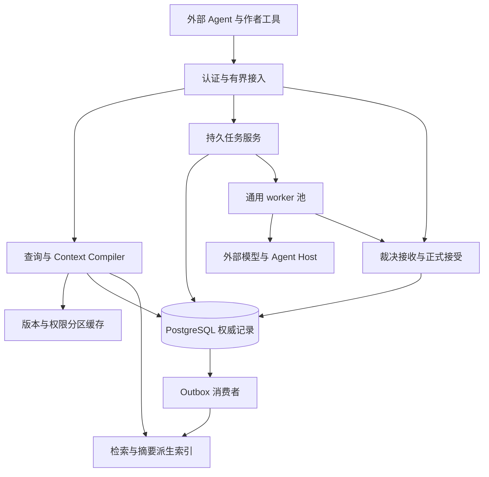

# 14｜高并发服务与一致性协议

> v2.0-R1｜2026-11-10｜设计状态：接口和并发边界已确定，真实数据库吞吐与 Host 容量待压测。
> 本文细化 [04 版本](04_事件溯源与版本体系.md)、[06 编排](06_Agent编排与管理.md)、[08 接口](08_MCP与工具接口.md)；时间含义见 [13](13_统一时间线与动态知识演化.md)，负载与门槛见 [15](15_并发压测与端到端验收.md)。

## 1. 先分清五种规模

| 指标 | 精确定义 | 主要瓶颈 |
|---|---|---|
| 并发 Agent 数 | 同一窗口内持有有效任务或正在思考、查询、写作的外部执行者 | 任务数量与上下文生命周期；不等于连接数 |
| 工具请求吞吐 | 每秒进入接入层的业务请求，另统计拒绝、排队和重试 | 认证、编译、序列化及排队 |
| 数据库读取吞吐 | 每秒数据库语句/事务及读字节，区分缓存命中后的实际请求 | 索引、缓存、存储和连接池 |
| 世界接受吞吐 | 每秒成功形成的新 revision，并另报每秒事件数和效果数 | 单分支短提交、约束和同步投影 |
| 模型调用并发 | 同时在途的外部调用，包括 UNKNOWN 未结算调用 | 供应商配额、成本和返回时间 |

1000 个 Agent 可以大多处于思考或等待，10 个 Agent 也可能制造高频小查询。任何容量结论同时报告行为分布、数据规模、缓存状态、热点比例、模型思考时间和硬件。设计支持多 worker 与有界扩展，不声称已经达到某个 Agent 数量或延迟。

## 2. 一个业务内核、多进程服务



MCP、HTTP、CLI 与 Python SDK 都调用同一应用服务。查询、编译、任务领取和世界接受可在一个代码包内启动为多个进程；服务进程不依靠本机内存判断任务是否合法。上下文、预算、调用回执和提交资格持久化；进程内缓存只作可丢失加速。

首版可部署一个 API 进程、少量 worker 与一个 PostgreSQL；从第一版就配置连接池、入站队列、任务租约、幂等、超时和负载隔离。增加无状态进程无需改业务契约，但要同时重算数据库连接、外部调用及缓存预算。跨机器运行时文本对象需要共享的持久访问方式，不能继续把单机临时路径当对象身份。

### 2.1 请求、会话与连接

模型会话需要角色/分支隔离；传输连接不是角色。MCP 2026-07-28 要求每请求携带上下文元数据，并允许同一连接处理不同任务；持续业务状态通过显式句柄引用。旧 profile 单独适配，不能把其初始化假设移植到新 profile。[MCP 基础规范](https://modelcontextprotocol.io/specification/2026-07-28/basic)

本项目每次工具调用都验证 Principal、task、generation、grant 和上下文归属。可以安全复用一个无状态传输，但不能把已看过全知秘密的模型会话改名为角色会话。HTTP 适配独立处理 Origin、认证与协议头；流中断只是传输层信号，业务任务取消还要执行持久代际规则。[MCP HTTP](https://modelcontextprotocol.io/specification/2026-07-28/basic/transports/streamable-http)

## 3. 三个正交的读契约

### 3.1 版本选择

| 模式 | 返回哪个世界 | 缓存与副本条件 |
|---|---|---|
| FIXED | 调用者已获准的确切 WorldRef | 内容不可变，可长缓存；每次仍检查当前权限 |
| LATEST_AT_START | 在请求开始时解析指定分支或 canon，固定一次 WorldRef | 不保证响应时仍是最新；整个批次使用同一解析结果 |
| READ_YOUR_WRITES | 已提交回执所指 revision，或显式同分支、且包含该 revision 的后代 | 未追上回执的副本不可回答；优先主库或有界等待 |

READ_YOUR_WRITES 不是“branch_seq 大就行”：先验证作品、分支与祖先关系。canon 已切换到不包含原提交的修复分支时，返回明确分支变化，允许调用者指定旧分支审计或显式选择新世界，不能伪称新 canon 自然包含旧操作。旧回执也不是读取其当前无权内容的通行证。

### 3.2 求值覆盖与检索新鲜度

世界是否已推进、投影是否已追上版本、检索是否允许近似，是不同问题：

| 策略 | 行为 |
|---|---|
| REQUIRE_EVALUATED | 指定故事范围必须有足够求值证明；不满足则返回未求值/阻塞及安全原因，不编造不存在 |
| ALLOW_PARTIAL | 返回已确认部分和明确的未求值范围；部分结果不能证明整个范围没有事实 |
| WAIT_EXISTING_ADVANCE | 仅动态版本选择可有界等待一个已经授权、已经存在的推进任务；不启动模拟，不自动支出模型费用；就绪后重新固定返回 WorldRef |
| 权威读 | 使用符合该 WorldRef 的关键投影/重放；索引缺失就回源或明确不可完成 |
| 允许滞后的搜索 | 仅普通发现/候选召回；返回已索引版本、滞后与覆盖，不能作裁决或正式接受的硬依据 |

**FIXED 的未推进范围不会因等待而在同一 revision 中变成已推进。** 可以等待这个固定 revision 的派生投影构建完成；不能等待未来接受后悄悄换成新 revision。长等待用持久 task handle 或重试令牌结束当前数据库事务，不占住一个连接直到模型返回。

普通查询可按grant动态选择版本；生产TaskSpec的world_ref按输入代际固定。TaskService应先完成期望版本解析，再创建新输入代际并以FIXED编译。context_compile若解析到不同版本，返回TASK_REBIND_REQUIRED，由控制面显式换代；即使context_bundle_id仍为空也不能同代改world_ref。动态查询的新read_cut只是一份查询结果，不自动更新任务或已存ContextBundle。

### 3.3 知识与叙事切面

KnowledgeCut 另外固定人物、当时获知边界、允许的平面，以及需要时的 narrative_revision、arrangement_version 和读者位置。它不从传输连接或文本“我是总编”推断。角色信念可以确定地是错误信念；这种“已知的 BELIEF”不升级为 WORLD。

一次批量查询只使用一个 Principal、一个固定世界切面和一个知识切面。按 item_id 返回成功项或安全错误，明确整体是否完整；不允许把失败项当 NONE。跨分支比较有单独授权用例，不能藏在普通 batch 内。每页游标固定这些切面；取下一页不重新解析 main。

## 4. 不同操作的并发策略

| 操作 | 并发方式 | 必须守住的边界 |
|---|---|---|
| 固定历史状态/关系 | MVCC 读、有界批量、版本缓存 | 不读到别的 revision；权限实时核验 |
| Context Compiler | 独立有界任务，批量 SQL/预取依赖，必要时异步 | 一个 bundle 固定同一输入；禁止半旧半新拼装 |
| 并行写作与审核 | 事务外模型调用，独立 task/attempt | 同一稳定 WorldRef 与各自场景/披露契约 |
| 不相交世界域模拟 | 各自候选和局部前沿并行 | 通道、资源与因果相交前必须同步 |
| 同一资源/同一故事窗口 | 调度器构造完整冲突组后联合裁决 | 数据库锁顺序不能选胜者 |
| 正式世界接受 | 每分支短线性化＋依赖守卫＋约束 | 一份候选一次生效；不最后写入覆盖 |
| 候选分支/实验 | 分支隔离，各自接受序列 | 不阻塞无依赖 canon 推理；共享基础记录只读 |
| 修订与推广 | 分支外重建、双端严格 CAS 的短推广 | 不跨越新的正式历史，旧版本保留 |
| 索引/摘要维护 | outbox、有代际的幂等重建 | 更新资格检查不能完全依靠异步消费者 |

当前投影通常可变。多条 SQL 构造一个一致视图时，要么使用完整 WorldRef 对不可变来源/版本投影查询，要么使用有界只读快照事务；不能在 READ COMMITTED 下每条语句各读一次“最新”再合成上下文。PostgreSQL 的 READ COMMITTED 每语句采用新快照，Repeatable Read 才让同一事务维持一致读取基线；它们都不会保护数分钟前已经结束的模型输入事务。[PG 隔离](https://www.postgresql.org/docs/17/transaction-iso.html)

## 5. 单分支 HEAD 与细粒度依赖共同存在

### 5.1 三种方案的取舍

| 方案 | 优点 | 主要缺陷 | 选择 |
|---|---|---|---|
| 只比较分支 HEAD | 最容易证明输入未变 | 无关地区接受也使所有旧提案失败 | 保留为 legacy/高风险/依赖不完整的安全模式 |
| 只比较写实体版本 | 无关实体可通过 | 漏读写偏斜、否定查询、全局规则、共享约束 | 不单独采用 |
| HEAD 序列＋服务端依赖作用域 | 历史仍有统一切面，无关变化可继续接受 | 需要可靠登记和原子 bump 规则 | R1 的受限模板默认增强路径 |

R1 不把每个区域变成独立权威数据库。每个 branch 仍生成线性 revision 序列；正式接受只在短事务内持有该 branch 的 HEAD 行锁。长推理、查询、审核及不同分支不持有这个锁。无关任务即使基于同一旧 HEAD，也可依次通过守卫，无需为仅有 HEAD 前移重新调用模型。

这是“逻辑冲突更细、物理提交仍短暂排序”的选择，不能无限提高单热点分支写吞吐。若压测证明短提交成为瓶颈，先减少事务工作和有界批处理；只有仍不足时再评估分区提交向量/多域原子协调，并新增 ADR。首版不提前引入跨域分布式事务。

### 5.2 ScopeToken 登记规则

ScopeToken 由服务器签发/保存。token 覆盖实体状态、否定谓词范围、资源约束集合、过程覆盖、冲突组封闭、规则/通道注册、解释版本、活动产物选择、权限和 canon/history epoch。受限角色只看到不透明依赖句柄与摘要，不能通过 scope 名称发现秘密。

ScopeToken的owner_kind区分WORK与BRANCH，branch_id在WORK范围为空；AUTHORIZATION尽量绑定具体grant，创建另一任务不递增全作品权限epoch。真正的全局规则/策略切换才产生相应广泛失效。

INTERPRETATION守卫绑定不可变interpretation_ref，清单固定reducer/projector、谓词解释和日历映射等会改变查询或效果意义的版本。语义部署/修复受控递增守卫并重新核验旧资格；普通重建同一内容索引不递增。旧WorldRef恢复使用原认可解释或明确兼容证明，不能静默按新版语义重算并继续复用旧证书。

ARTIFACT_SELECTION守卫用于“仍为当前采用”的计划、编排或其他产物选择。只读取固定旧manifest并不依赖活动指针；使用当前计划授权的接受模板则必须登记该指针的token，新采用事务同时更新token/屏障。这样WorldRef未变而计划/编排变更，也能阻断受影响接受，而不禁止合法历史查询。

同一业务写入计算其实际改变的全部冲突范围，并在正式接受事务内原子递增对应 token。token 不随删除重建归零：保留 tombstone，防止值从 A 变 B 再回 A 后旧任务误以为没有发生改变。新作用域/新实体插入要递增可覆盖它的父注册范围；不能让“原先没有这一行”成为漏检理由。

| 例子 | 单实体版本为何不足 | 额外守卫 |
|---|---|---|
| 两个角色各领一份粮，却共同超过总库存 | 写入的领用记录不同 | 同一库存账户/资源约束集合 |
| 两个护法分别离开，但至少一人必须留守 | 各改自身位置 | 留守人员集合及人数谓词范围 |
| 查询桥上无守卫，随后新增一个守卫 | 原读集没有命中行 | 地区＋关系类型＋保守时间范围的否定谓词 token |
| 所有权未改，但当地制度改变了借用权 | 物品 token 未变 | 实际采用的 ruleset 与适用范围 |
| 另一地区出现更早可到达的消息 | 当地角色行未改 | 通道注册、传播下界和相交过程覆盖 |
| 两份抢剑提案都声称没有对手 | 各自读相同持有者 | 同一 conflict group 的 sealed intent set 与规则/覆盖证明 |

首版使用有限、注册的 command template 与保守范围；负向查询范围可以先粗一些。模板注册者必须定义读集、写集、否定范围、约束集合和副作用；验证器从工具 receipts、实际载荷及规则推导依赖，不信模型自报“完整”。自由语义、全局叙事判断或无法证明范围完整的命令退回 strict，或先交语义重验证。日后细化范围减少误冲突，但不能降低覆盖正确性。

## 6. AcceptanceCertificate 与受守卫接受

### 6.1 资格准备

新 `acceptance_prepare` 由控制面调用，读取固定原提案和依赖；接收core或R1类型化变化包，并按concurrency_mode选择STRICT_HEAD或DEPENDENCY_GUARDED。guarded核验已登记命令模板，strict仍绑定精确头。满足相应资格时保存不可变 AcceptanceCertificate；其内容包括原 base、核验时的 head、提案 hash、依赖及作用域、调度封闭证明、规则/策略、任务代际、校验器版本、历史 epoch、interpretation_ref、过期边界与审批适用性。字段以 [R1 Schema](../contracts/temporal_concurrency.schema.json) 为准。guarded证书必须是coverage_status=COMPLETE_FOR_TEMPLATE、非空command_template_id/version和作用域集合，approval_bindings均为DEPENDENCY_STABLE；strict证书为STRICT_BASE_ONLY。结构字段齐全仍必须匹配可信校验执行记录，不能上传一个同形JSON充当已签发证书。

原 `WorldChangeSet.input_world_ref`、ContextBundle、DependencyManifest 和批准不改写。certificate 证明原内容可在相容后代上采用，并不伪装 Agent 曾看过新 HEAD。若批准原本只允许精确 HEAD，不能跨 HEAD 自动复用；需新的授权批准，或原批准采用的受控政策已明确允许“原内容及全部相关依赖不变时沿用”。政策不能由调用者临时设置。

**原指纹与当前守卫分开：** core DependencyManifest 的规范指纹包含原WorldRef、原scope_versions及原查询结果。certificate.dependency_manifest_ref/dependency_fingerprint继续绑定这份原输入清单；read_scope_tokens/write_scope_tokens才记录本次核验切面采得的守卫。重新验证只生成新证书和不可变验证记录，不把原清单换成当前值。若保守范围变化但注册验证器证明实际依赖结果不变，可以按原审批适用政策重签；若实际前提改变则建立新输入、提案及所需审批。

**证书采样必须一致：** 服务先识别模板和授权，在有界只读一致快照内解析validated_world_ref，读取对应权威状态、规则/解释/活动选择、调度封闭及全部作用域token，并保存可复现的核验输入。可使用有界REPEATABLE READ事务完成该采样，随后释放连接，再执行较长验证。证书只能携带这次采样的token；验证期间发生的变化由最终提交复验检测。禁止“按旧WorldRef验证，结束后采当前token”拼接两次观察，也不能在READ COMMITTED下逐条读取当前状态组装证明。若材料太大而无法在预算内一致冻结，返回待处理任务或严格失败，不能省略采样完整性。

Retcon、分支合并/推广、未声明语义依赖、效果表示替换、对既有历史的 REPLACE/DEACTIVATE，仍走严格路径。首期 guarded 只开放经验证的追加/局部状态转移模板。调度器未封闭相交行动集合时不能签发可接受证明，即使资源当前足够。

### 6.2 提交时复验

新 `commit_guarded_request` 是R1接受入口名称，载荷支持两种模式；下面展开DEPENDENCY_GUARDED分支。STRICT_HEAD走同一写入器但要求当前头精确匹配base，不能因改了模式名绕过依赖或批准。

```python
def accept_guarded(command, principal):
    # 对象和语义准备在事务外；command/certificate 均不原地改写。
    authorize_envelope_and_reference_reads(principal, command)
    prepared, cert = load_immutable_inputs(command)
    with transaction():
        share_lock_current_auth_and_canon_guards_if_needed()
        branch = lock_target_branch_head()
        lock_task_and_proposal_in_stable_order()
        receipt = lookup_command_receipt()
        if receipt:
            require_same_original_command_hash()
            return authorized_receipt_view(receipt)

        require_live_grant_generation_and_task()
        require_certificate_provenance_content_and_policy()
        require_request_task_context_proposal_and_certificate_bindings()
        require_same_branch_and_history_epoch()
        require_preserved_ancestor(cert.base_world_ref, cert.validated_world_ref)
        require_preserved_ancestor(cert.validated_world_ref, branch.head)
        lock_required_scope_guards_in_stable_order()
        require_all_tokens_equal_certificate()
        require_interpretation_and_active_selection_guards()
        require_complete_registered_template_and_sealed_conflicts()
        require_current_approval_eligibility_and_domain_constraints()

        parent = branch.head
        revision = append_from_parent(parent, prepared, cert)
        apply_critical_projections_and_process_coverage(revision)
        bump_actual_conflict_scopes_and_invalidation(revision)
        append_outbox_and_original_command_receipt(revision, parent, cert)
        advance_head_to(revision)
    return original_receipt()
```

certificate 签发后 HEAD 再前移并不必然失败：同分支同历史 epoch、祖先关系成立、全部守卫仍相等，便可在实际 parent 上接受。任一相关 token 改变则停止；在事务外重新核验，能够确定性重算的才重做局部准备。若只是保守范围引起的误冲突，注册验证器可证明实际依赖结果未变并按已有批准适用政策重新签证；若真实前提或语义后果改变，需要新输入/提案及相应审核或重裁决/重规划。不能仅把证书里的token改成当前值。不得在持锁时请求 LLM。

回执分别用original_base_world_ref、validation_world_ref、parent_world_ref和world_ref记录原输入、证书核验版本、实际父版本与新世界，并保存证书与提案引用。原命令哈希包含不可变证书引用；只发生无关 HEAD 变化时命令无需修改。同键改提案或改证书仍报幂等冲突，新证书是新的接受尝试键；已成功提案的目标分支唯一约束继续防止换键重复生效。

### 6.3 锁序、撤权与数据库故障

固定锁序：所需作品/canon/授权 guard → 按 ID 排序的分支 HEAD → 任务/提案 → 按 key 排序的作用域/资源 guard。正常命令对 canon/授权 guard 使用共享锁；promotion、撤权和策略切换使用与其冲突的排他更新，避免把所有普通命令串成作品级大锁。共享读锁必须确实阻止对应更新，不能误用允许该更新穿过的锁模式。

事务进入前合并所需guard集合，并按每项实际读/写需求确定最强锁模式；同一guard只按规范位置获取一次。已持有的授权/选择guard不能在后面的scope步骤重复升级，避免多个共享持有者同时等待升级。发现未预先登记的新写范围时回滚并重新准备，不能持锁临时扩展到顺序更早的guard。

批准记录的内容绑定不替代当前资格核验。相关批准的可撤销资格使用细粒度AUTHORIZATION守卫，在最前面的授权guard阶段取得共享锁；批准撤销/替代按同序取得排他锁，原子更新资格与token。提交在锁内核对批准集合、内容哈希、政策、有效期及未撤销状态；不可只沿用不可变旧disposition=ACCEPTED。已经成功的命令仍先按原键返回有权查看的历史回执，资格撤销不倒写其历史结果。

取消目标任务也遵循相同的 guard/branch/task 顺序，先撤销代际资格，再尝试终止外部执行。单纯领取/续租事务只锁任务且不再向上取 branch 锁；任何需要同时操作领域与任务的服务从规范顺序开始。INTERPRETATION和ARTIFACT_SELECTION的写服务也遵守同一锁序，不能先持scope锁后再倒序取branch锁。表约束、唯一效果身份和版本检查仍然存在，不能只靠应用约定。[PG 锁与死锁](https://www.postgresql.org/docs/17/explicit-locking.html)

死锁/序列化失败可以有限重试整个短事务，仍要重新检查当前守卫；这不是重新抽模型结果。锁超时进入有界排队/退避。未知提交结果先按原业务幂等键对账；取消后查询既有成功回执仍是读取历史结果，不是恢复写权限。

## 7. 背压、连接与资源预算

每个进程设有界入站并发和数据库池，服务类别至少区分：短查询、Context Compiler、大图/影响分析、正式接受、维护作业。为控制面与恢复保留容量，避免大型检索占满全部连接。上游过载时在拿数据库连接前拒绝/排队，返回可安全重试信息；不通过无限排队制造表面低错误率。

数据库总连接预算应按所有进程汇总：`API进程数×每进程池上限 + worker池上限 + 维护/运维保留 ≤ 部署连接预算`。Agent 思考、外部调用、等待推进和排队期间都释放数据库连接。每个并发线程/协程独立 Session；子进程新建自己的 Engine/池，不继承可用连接。[SQLAlchemy 会话](https://docs.sqlalchemy.org/en/20/orm/session_basics.html) [连接池与多进程](https://docs.sqlalchemy.org/en/20/core/pooling.html)

跨进程的强预算与调用并发用数据库持久 reservation/lease 管理，进程内 semaphore 只是本机保护。一个 provider 的 UNKNOWN 调用占用预算直到对账；不能因为 worker 重启就释放并重复调用。速率令牌按 provider/作品/任务类别配置，给退避加入抖动，记录拒绝、队列等待和实际服务时间。

首期用应用池。连接增长成为实测瓶颈后可加入 PgBouncer transaction pooling；这要求审查 session 变量、LISTEN、临时表、advisory lock 和 prepared statement 配置。核心接受使用多语句事务，不采用 statement pooling。[PgBouncer 功能与限制](https://www.pgbouncer.org/features.html)

## 8. 缓存、副本与异步索引

固定 WorldRef 的事实结果可长缓存；缓存 key 同时包含interpretation_ref、查询、知识/叙事切面、精确源manifest、权限版本和方法版本。最新别名只短缓存或在主库解析；新权限撤回后缓存命中也不能跳过授权。防击穿的 single-flight 同样按完整权限 key 分组，不能让两个角色共享未经裁剪的中间结果。

关键世界与认知投影同事务更新；全文、向量、摘要与普通统计可异步。索引记录已覆盖的 revision/manifest 和 generation，旧消费者不能晚到覆盖新构建。部分索引未覆盖时，普通搜索显式标注；动作裁决、硬规则及正式接受回权威源。outbox 成功出队也不代表所有索引已经追平，要各自保留完成水位。

读副本是后续性能选项。固定历史读须证明该 revision 的记录和投影已到达；最新/RYW/正式接受优先主库。异步副本上不能仅凭当前墙钟或较大的 branch_seq 推断已包含某个跨分支 revision。权限撤回优先查询当前权威授权，不能依赖滞后副本中的旧 grant。

## 9. 故障、批量与重试决策

| 情况 | 可自动完成的部分 | 必须升级的部分 |
|---|---|---|
| HEAD 前移、守卫未变 | guarded 在新 parent 接受 | 原批准不允许跨 HEAD 则重新批准 |
| token 改变但模板可确定性重算 | 新证据/证书和新的命令尝试 | 资源胜负、人物意图或文学因果改变需重裁决 |
| 同一资源的同时行为 | 归入同一 conflict group | 缺行为/规则/时间依据则保持阻塞 |
| 提交成功但响应丢失 | 原键读取原回执 | 不重施世界效果 |
| DB 已提交、索引失败 | outbox 幂等补建，关键读回源 | 关键对象损坏则阻断相关用例 |
| 任务已取消、结果迟到 | 可归档输出与费用 | 旧代不能成为当前有效结果或新接受 |
| 多子任务部分完成 | 复用有效不可变产物、重试失败节点 | 不因工作流整体失败撤销已接受世界 |
| 计划条件被历史修订破坏 | 失效标记、影响范围和重规划任务 | 作者保护承诺或语义路线取舍走具体决议 |

一个 ChangeSet 是一个语义原子包：事件、认知、资源、覆盖和触发一并成功/失败。多个独立变化的吞吐批处理是提交优化，不自动赋予跨包全有或全无语义。首版只支持有界、显式同一原子包；跨包协调使用工作流状态和已接受结果，不用数据库回滚概念抹掉真实故事后果。

## 10. 选型与扩展触发条件

| 选择 | MVP/R1 | 何时考虑替代 |
|---|---|---|
| SQLite / PostgreSQL | PostgreSQL 为真实并发内核；SQLite 可做离线工具/纯夹具 | SQLite WAL 仍只有一个 writer，不能替代 PG 锁/隔离验收；不把文件共享当横向扩展。[SQLite WAL](https://www.sqlite.org/wal.html) |
| SQL 时态图 / 独立图数据库 | 关系表、范围索引、有界递归和权威视图 | 实测特定深遍历无法满足目标时，引入可重建图索引；权威仍在同一接受链 |
| 单/多进程 | 相同代码包可多无状态进程＋worker | CPU/连接/队列饱和后扩实例；每次重算连接与预算 |
| 单体 / 微服务 | 模块化单体 | 独立团队/隔离和部署瓶颈有证据后拆适配或计算服务 |
| PG 队列 / 消息队列 | task＋租约＋outbox | 消费量/延迟确证瓶颈后引入队列；消息仍仅唤醒，数据库保留资格 |
| 进程缓存 / 共享缓存 | 有界进程缓存及固定对象缓存 | 多进程重复构建成本过高时共享缓存，不迁移权威 |
| 同步 / 异步投影 | 关键状态同步，检索异步 | 根据查询用途细分，不能把不可靠索引当硬约束真相 |
| HEAD / 细粒度版本 | 一个 HEAD 序列＋注册依赖守卫 | 更细范围、增量重验证由误冲突实测推动 |
| MCP / HTTP / Python | 同一应用服务、多种薄适配 | 远端大量 Host 优先 HTTP；MCP按真实Host profile测试，SDK面向受信脚本 |

P1 实现有限模板的守卫与否定范围，真实多连接验证无关提案可连续接受、相关提案被阻止；P2 接入完整短卷并测10/50档负载；200/500/1000档按压测环境和退出门槛逐步开展。数字只定义实验档位，不构成已实现容量。语义依赖无法自动完备、单热点分支吞吐和复杂权限缓存都是明确的后续风险。
