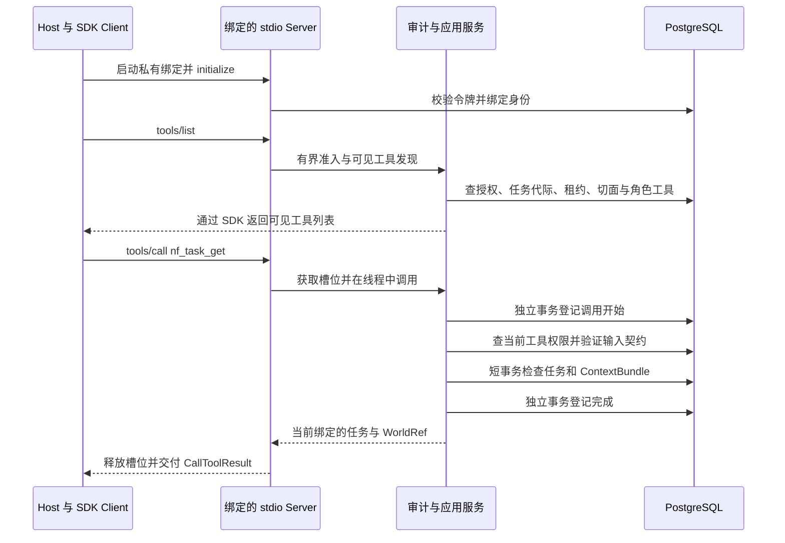
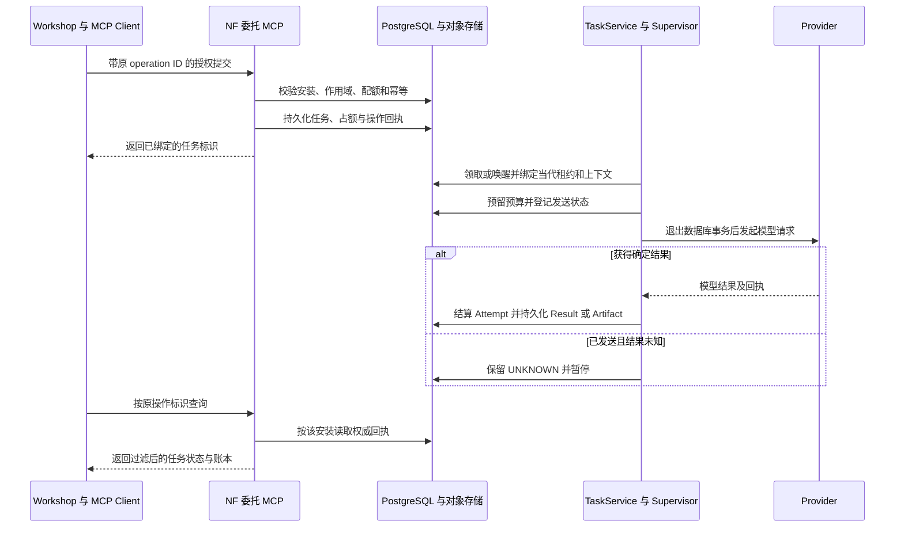

# NovelFactory 的 MCP 并发、调度与连接管理

本设计冻结在数据库实验 `9364b154941bfbbe95a57fee5ceb600f5219fa5b`。该分支与 Runtime #33 的共同祖先是 `3e6b59268f1e89520230c8b70e9a26b9950a2f79`，#33 核查头为 `877be80d7c1dfa8b6fb9c9c5a2a570c7b14d3ca0`。共同祖先至该 Runtime 头的变动落在测试、文档和证据；接管后另一个平台依次合并 #33 和 #34。交付前复核的 main 为 `bcb03637`，本实验只写独立分支。所有开关均按可信 Host 的启动配置设置。容量、失败与预登记见[实验交付](../../reports/performance/p59_mcp/README.md)。

## 一次真实的任务读取

下面是两部作品双绑定基线的第一笔已预热请求。角色 0、JSON-RPC 请求 4 的工具是 `nf_task_get`。从计划到 SDK 交给 stdio 写入端为 0.242 ms，服务端 SDK 分派为 6.438 ms，业务线程执行区间为 7.121–142.300 ms，服务器准备回包为 142.871 ms，客户端在 144.047 ms 验证回包。该笔调用 checkout 五次、执行 35 条应用 SQL，累计 cursor 时间 24.317 ms。一次观测用于定位事件，整组分布见[原始逐请求数据](../../reports/performance/p59_mcp/stdio/reads-2-ABBA.json.gz)。

`runtime_from_config` 只接受私有配置中的可信绑定。SDK 可能在定义缓存缺失时额外请求工具发现；缓存命中仍须经 `invoke_bound_tool`。它先登记审计，再查 Host ceiling、业务工具可见性和参数，业务返回后登记完成。发现背压和没有可见工具都可能得到空列表，压测要求严格命中预期集合。角色读取同时检查作品和授权共享锁、任务代际、当前 worker、租约、策略版本、输入指纹、Runtime 快照、故事时间和认知平面。固定版本素材查询另外核查 input manifest，经过 WorldQueryService 后再查交付资格。强写使用幂等回执。入口、应用和事务范围分别见[stdio](../../src/novel_factory/interfaces/mcp_stdio.py)、[绑定调用](../../src/novel_factory/application/bound_tools.py)、[任务运行时](../../src/novel_factory/application/mcp_runtime.py)、[数据库工作单元](../../src/novel_factory/infrastructure/database.py)。

## 委托和长任务的另一条路径

一次角色只读调用产生零次 Provider Attempt。下面的时序适用于实际提交任务并由 Supervisor 执行的场景。项目控制端的 `nf_resume_project` 根据持久条件唤醒任务；真正模型执行由独立受权的 Supervisor 驱动。已实测的异步提交是 Workshop 的委托域接口，普通角色没有通用创建/领取/完成任意任务的入口。

`RuntimeSupervisor.admit_model` 依据作品/分支选择已有任务，在数据库协调配额与租约。等待依赖时使用 WorkflowService 的持久 wait、outbox/inbox 和恢复流程。未发送与已发送效果未知有不同的重试和结算规则。写请求丢失响应时先查原回执；读取、审核和未知 Attempt 均不得借重连再次扣费。模型运行可以占用 Provider 并发额度，等待审核的任务可以保留持久状态；这两者不要求长期占用数据库连接。详见[任务和预算](../../src/novel_factory/orchestration/tasks.py)、[调度与派发](../../src/novel_factory/orchestration/dispatch.py)、[Supervisor](../../src/novel_factory/application/supervisor.py)、[委托](../../src/novel_factory/application/delegation.py)、[跨服务回执](../../workshop/src/agent_workshop/reconcile.py)。

## 准入、共享与资源预算

| 执行边界 | 使用的约束与证据 |
|---|---|
| stdio 进程 | 每份可信绑定独立运行一个 SDK 子进程和 SQLAlchemy 引擎。默认两槽、两条连接、零 overflow；启动时可能已打开一条。单进程启动多个逻辑角色会改变身份边界。一个绑定空闲约 30 秒后且无已借出的连接才回收池，下次调用重新建连并检查授权。|
| 线程和取消 | AnyIO limiter 在分派同步业务前立即准入，超额工具调用返回 BACKPRESSURE。取消已开始的业务等待时，shield 保护槽至同步线程真正退出；进程死亡后以数据库回执和租约恢复。取消、强事务提交后断线、撤权等反例均有原始记录。|
| 多进程预算 | 默认 N 份同时热绑定的潜在应用连接上限为 2N，再加 Host、Supervisor、观察及维护连接；进程空闲回收使实际值可远低于上界。可由可信 Host 限制同时热绑定数、批次或选择每绑定一槽。单进程开关仅约束本地，实验没有部署跨主机的全局连接配额服务。缩池的拒绝和吞吐成本见 stdio 对照。|
| 任务公平性 | 保留已有基于 PostgreSQL 的作品派发、事务领取和配额。主机级有界 FIFO、分级、WFQ、DRR、老化和弹性槽在独立回放里比较；回放显示保护续租可能增加尾时延。实验输出不携带取代业务状态机的权限。|
| 跨入口共享 | HTTP timeline 容量损耗同时含客户端发头、凭证鉴权和 ASGI 准入。stdio 省去这些入口步骤，但仍执行角色授权、上下文/版本读取、同步 SQL、审计和任务服务。多进程峰值、连接数或 lock 采样为零均不能独立认定根因。|
| 远程副本 | 原型仅在回环端口支持 SDK 1.29 的 Streamable HTTP；每份 Bearer 在可信进程查 PG 后映射到固定绑定。独立角色不共享运行时，副本内复用有界引擎。原型要求每个 principal 只配置一份任务绑定。RR、最少在途和二选一均在相同总业务槽上 A/B/B/A；尚无发布远程生产入口的依据。|

## 允许集合化的范围

| 可尝试 | 约束 |
|---|---|
| 同一角色的一次任务/上下文读取 | `--compact-role-reads` 将静态 assignment 判定和实际读取放在同一受信任短事务。保留独立审计、工具可见性和任务动态授权，不保留跨请求的角色数据。检测到动态 Workshop assignment 时，在事务外刷新 witness，再以当前 PG 状态复检。|
| 同一绑定中的并发发现 | `--batch-discovery` 最多收集四个等待者、窗口 1 ms，发起授权前先关闭该组。静态组共享此次发现的授权点，动态及控制器逐项判断，结果分别交付给原 Future。低载窗口与尾时延会抵消收益，保留为研究开关。|
| 多个已准入的状态或 ContextBundle 读 | 新增同绑定 H 微批原型，仅在已校验权限、参数、独立审计的同一 runtime 上聚合。实际两绑定闭环每臂只减少 18 条 SQL，尾时延超标。数据库微批的吞吐无法直接传递到这条 MCP 路径。|
| 旧数据库 TaskStatus 协调器 | 只接受类型化操作，在可信事务内按作品及授权次序锁行，按请求身份映射结果；900 状态读和 100 笔独立续租在积压时可显著减少 SQL。普通 GET 返回结构、固定时间线和角色任务工具各有自己的契约。|
| 禁止作为同一读结果复用 | 不同 principal/任务代际、动态 witness、作品/授权、故事时间和知识切面。只凭同一个 WorldRef、相同工具名或完全相同参数均不足以共享原始 ContextBundle。写效果、租约变更、预算、Attempt 发送/结算以及正式世界修改保持各自事务。|

## 配置、回退与部署

Workshop 的 `aw-reconcile --reuse-session` 在一次 CLI 批次、一个可信安装、同一 asyncio 所有者内按需建立并复用 NF 子进程。每次仍重新发现可用工具。调用失败时关闭传输，只有后续操作可以重建连接；失败的写按原业务操作查询回执。去掉开关即使用既有每次新建会话的路径。

角色工具的 `--compact-role-reads` 适用于反复读取本人状态及上下文的已测负载。删除该选项恢复原三阶段读取。单槽、发现聚合、跨请求微批、远程路由、动态槽和混合候选均有独立实验边界。无新常驻中间件、公开监听端口或新的权威任务表。需要移植的两个可采纳改动各自提供补丁；完整实验分支不进入主线。[移植说明](../../reports/performance/p59_mcp/INTEGRATION.md)

本仓库锁定 MCP Python SDK 1.29.0，握手实测 2025-11-25。该版的旧实验性 Tasks API 需要服务端显式启用，本应用未启用。2026-07-28 的传输及新版 Tasks 扩展采用不同协商约定，当前实验没有测试新版客户端。协议、Psycopg、Ray、Temporal、vLLM、排队及尾延迟研究的原始来源和适用前提见[候选资料表](../../reports/performance/p59_mcp/scheduling/SOURCES.md)。
