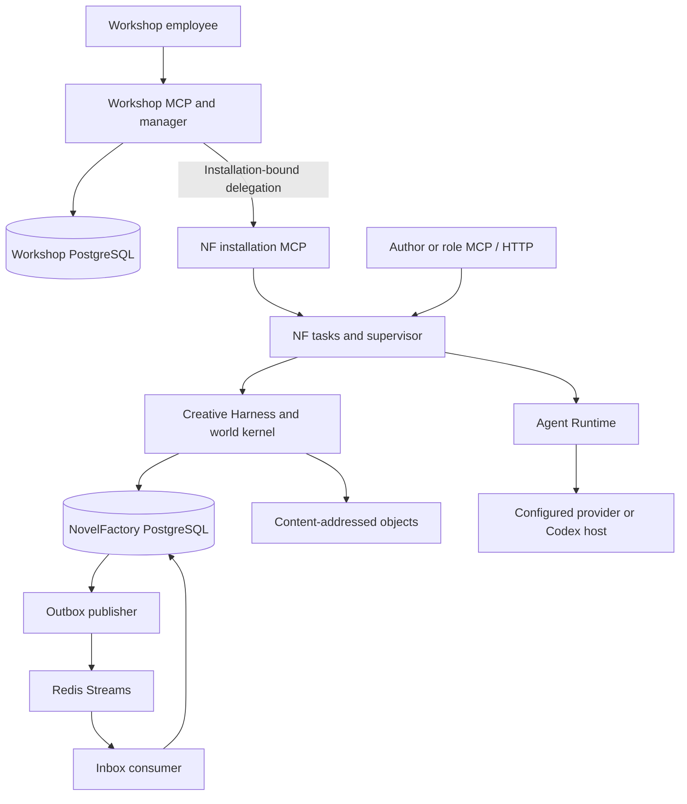
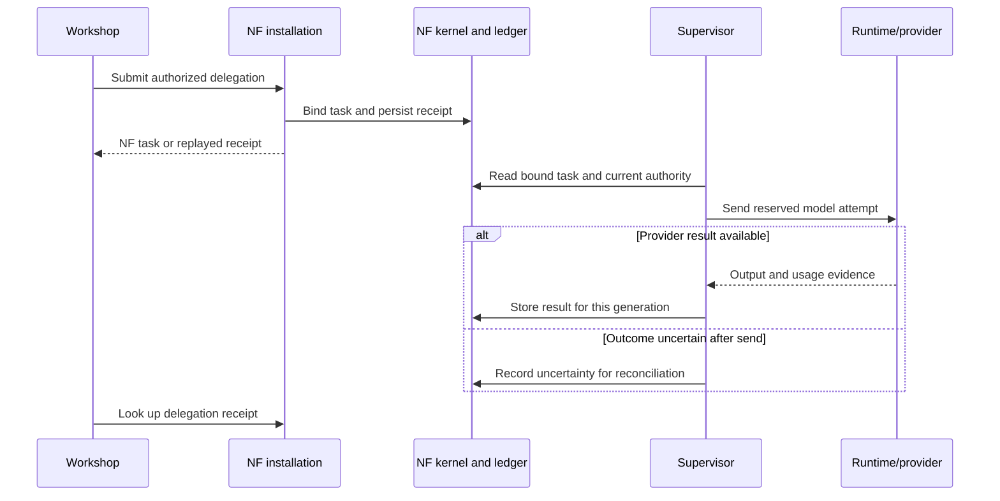
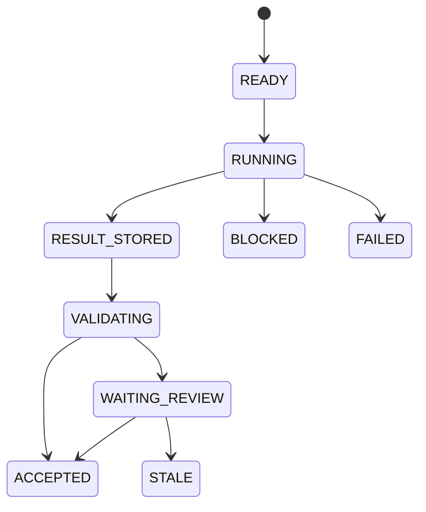

# System architecture

[中文](../zh-CN/03-系统架构.md) · [Agent platform](04-agent-platform.md) · [Runtime](05-agent-runtime.md)

## Where state lives

NovelFactory and Agent Workshop run as separate services. An installation-bound MCP call crosses their trust boundary. Workshop owns organization membership, routing and skill grants. NovelFactory owns story revisions, task generations, artifacts, reservations and model-call receipts. A provider can return text after a supervisor disconnects. A persisted Attempt lets the operator reconcile that call with the provider without issuing another request.

| Boundary | Stored records and checks |
| --- | --- |
| World kernel | A `WorldRef` identifies the work, branch and revision. Accepted changesets append events and advance the branch head in a database transaction. Fork and promotion name their source and expected revision. |
| Query and context service | Resolves the version and knowledge cut, reads the permitted plane, records dependencies, and rechecks authority at delivery. The context fixes inputs and references for a task generation. |
| Creative Harness | Stores plans, simulations, draft versions, review passages, evaluations and instruction selections as scoped artifacts. Publication and promotion require the corresponding decision paths. |
| Agent Workshop | Binds employees to an organization and employment revision. Delegation has an expiring installation route and a frozen task-owner binding. Revocation is checked when a capability is used. |
| Supervisor and Agent Runtime | Enroll eligible tasks, resolve operator routing rules, reserve budget and slots, invoke the adapter, and record the outcome. Different works can compete for shared account, organization or provider limits. |
| Storage and delivery | PostgreSQL stores authoritative receipts, identities and outbox/inbox records. The object store holds hash-addressed payloads. Optional Redis delivery accelerates waking workers; recovery reconciles durable records. |

[Kernel](../../src/novel_factory/application/kernel.py) · [Database definitions](../../src/novel_factory/infrastructure/database.py) · [Tasks, budgets and outbox tables](../../src/novel_factory/infrastructure/reliability_tables.py) · [Workshop implementation](../../workshop/src/agent_workshop)

## World time, character knowledge and versions

The same event can have a story time, a period over which its effect is valid, and a later time when an actor learns about it. A query binds a revision and a `knowledge_cut`. WORLD exposes authorized facts; BELIEF uses the actor and acquisition cutoff; PLAN binds a plan manifest and target time. SIMULATION uses hypothetical material with its own provenance. Timelines distinguish source time, target time and validity. A planned reveal can appear on the target axis while the character's observation appears on the source axis.

A guarded world write refers to an expected revision, a task context, a prepared certificate and approvals. The kernel checks scope tokens and dependencies again before appending. A strict write uses the expected head. Historical queries can select a fixed revision while a different branch advances. A repaired or refined interpretation preserves references to the historical input. [Temporal contract](../../contracts/temporal_concurrency.schema.json) · [World queries](../../src/novel_factory/application/queries.py) · [Semantic dependencies](../../src/novel_factory/application/semantic_dependencies.py)

## A task crosses two services

A worker claims a lease for a particular task generation. The following subset shows successful computation, review and two failure outcomes. Expiry, cancellation and explicit recovery also check the generation. Receipts make state changes traceable when a response is lost. [Task transitions](../../src/novel_factory/orchestration/tasks.py) · [Delegation](../../src/novel_factory/application/delegation.py)

## Creative context and instruction revisions

An operator supplies schema-validated JSON in `NF_CREATIVE_HARNESS_CONFIG`. Creative Harness defaults to disabled. Dynamic agents and adaptive instructions have separate switches. The context compiler selects authorized material for the task, role and world revision within a token budget, and records the selection and omissions. A writer, a character and a reader can receive different material for the same scene.

An instruction change starts as a candidate for evaluation. Selecting a version records a new selection epoch. Later tasks freeze their inputs against that selection. Rolling back changes the selection for future work. Earlier tasks retain the instruction digest they used, and accepted world events keep their recorded history. [Configuration](../../src/novel_factory/infrastructure/creative_config.py) · [Context compiler](../../src/novel_factory/application/creative_context.py) · [Instruction selection and rollback](../../src/novel_factory/application/adaptive_promotion.py)

## Parallel work and model accounting

Future-volume planning freezes its assumptions, budget and versions. A scene can be drafted in advance. When its dependencies change, the pipeline marks affected work for replanning or adoption. The final handoff uses a reviewed continuity snapshot. A draft, an advisory review and a published world event have distinct identities. [Production pipeline](06-production-pipeline.md)

A runtime route selects a provider profile using task, role, branch, work and installation policy. The generation adapter sends a text request derived from frozen input. The role MCP host enforces tool permissions separately. The scheduler considers work-level fairness, capacity and provider quotas before dispatch. A stored result can coexist with an unknown amount in the ledger. Inspect the work, task, generation, Attempt, provider and usage fields together when attributing a cost. [Routing](../../agent_runtime/routing.py) · [Budget and admission](../../src/novel_factory/orchestration/runtime_admission.py) · [Statistics](../../src/novel_factory/application/statistics.py)

## Operating and extending the system

Run the services with distinct database identities. Use one project binding per book and keep installation secrets on the operator side. Extend adapters at the runtime protocol and register model capabilities in the operator profile. Extend role tools through their registered schemas, live grants and frozen task-tool ceiling. New world effects belong in the kernel's template, approval and acceptance flow. For physical recovery, restore both service databases and matching objects to isolated targets, check their receipts, then rebuild delivery state. [ModelAdapter protocol](../../src/novel_factory/infrastructure/model_gateway.py) · [Portable request and response types](../../agent_runtime/protocol.py) · [Interface reference](07-api-reference.md) · [Deployment](08-configuration-and-deployment.md) · [Recovery](09-operations-and-recovery.md)
