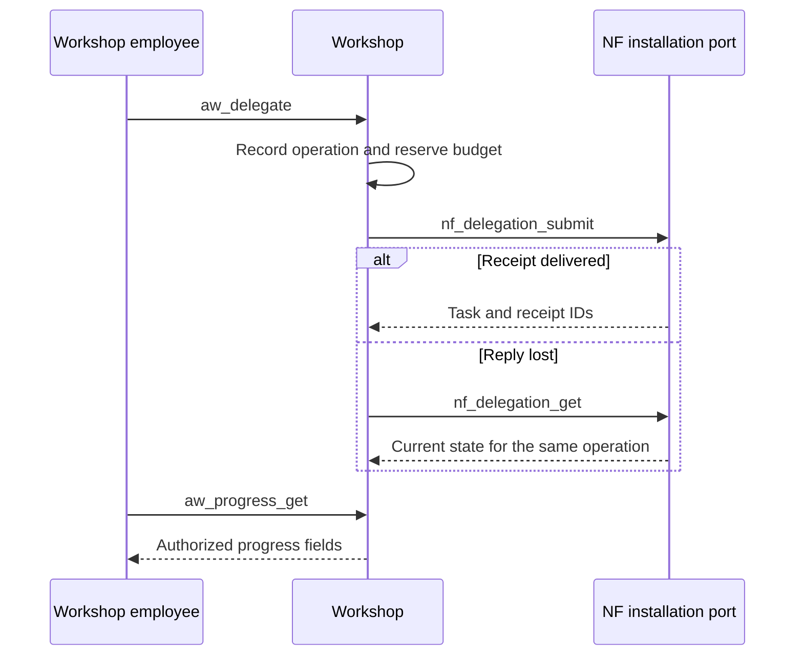

# Agent platform

[简体中文](../zh-CN/04-Agent系统.md) · [API reference](07-api-reference.md)

Agent Workshop assigns work to people or agents in an organization. NovelFactory (NF) decides what the recipient can do within a particular novel. One employee can hold several successive assignments. Each writing or review task has its own generation, materials and budget. The Supervisor assigns an execution process when work becomes ready.

## Identity and lifetime

| Object | Binding | What changes |
| --- | --- | --- |
| Workshop employee | Organization, installation, employee ID and employment revision | Hiring, transfer, suspension and departure update the roster. A stale employment binding can return `STALE_EMPLOYMENT`. |
| NF task | Work, branch, role, grant, world revision and knowledge cut | The role host checks the current generation, lease owner and frozen tool list. The task can use only its authorized material. |
| Dynamic agent | Instance, revision, selected version and epoch | A controller registers a candidate, selects a version, or exits or archives the instance. Future tasks use the new selection. Existing tasks retain their revision and must still pass live authorization. |
| Execution process | The Supervisor assigns work and the host sends the task’s model request | Task records, delegation receipts and spending reservations survive process exit. |

NF checks `READ` before exposing task tools. Storing a candidate also requires `ARTIFACT_WRITE` and the corresponding tool in the frozen input. A `character_actor` has a knowledge cut pinned to its own identity and time of learning. Workshop organization privileges and NF branch grants are configured separately.

## Create an organization and connect

Set `AW_DATABASE_URL` to a migrated Workshop database. Use the installation ID and NF instance ID provisioned for the two services as `INSTALL` and `NF_INSTANCE`. Set `ORG` to a new organization name and `PRIVATE_DIR` to an operator-owned private directory.

```bash
workshop/.venv/bin/aw-admin install "$INSTALL" "$NF_INSTANCE"
workshop/.venv/bin/aw-admin bootstrap "$ORG" --installation "$INSTALL" --preset Minimal
workshop/.venv/bin/aw-admin enroll "$INSTALL" "$ORG" manager "$PRIVATE_DIR/manager.json" --revision 1
workshop/.venv/bin/aw-mcp --binding "$PRIVATE_DIR/manager.json"
```

The last command starts the stdio service for an MCP client. Enrollment creates a mode-0600 file containing the token and Workshop database configuration. Call `aw_capabilities` with `{"protocol_version":"aw-nf.v1"}`, then call `aw_roster_get` to inspect the directory. Use the current employment revision when enrolling another member.

## Mail and delegation

The organization graph and temporary route grants govern mail delivery. A sender can register text with `aw_message_body_put` and reference it in `aw_message_send`. The recipient pages through `aw_mailbox_get`, retrieves the body and acknowledges delivery. If the route has been revoked, the mailbox can show only a sequence number and `UNAVAILABLE`.

A delegation also needs an organization budget and a slot provisioned through `aw-provision`. Map the slot to a task definition provisioned in NF. The NF administrator needs branch `ADMIN`, and the slot owner needs `TASK_CREATE`. The sender’s permission to send mail is a separate grant.



`aw-reconcile` compares the two services’ records. Within an installation the same operation ID binds once. Reusing it with changed arguments conflicts. Managers and authors see the spending hold and remote task identity. A current sender or owner receives a narrower progress view.

## Skills and independent review

A manager uses `aw_skill_share` to share a source revision for a defined audience and lifetime. An employee resolves the live version with `aw_skill_resolve` and binds it to an assigned task with `aw_skill_freeze`. After withdrawal, `aw_skill_history` still exposes the historical digest to the authorized employee. New resolutions, dynamic execution and delivery each check current authority.

A formal literary review binds the manuscript digest, its producers, the review task and its reviewer. Delegated reviews also check the originating delegation, employee tenures and substantive subject groups. A work administrator obtains a proof with `nf_harness_review_independence`. The assigned reviewer receives original text and a coverage record from `nf_harness_review_read` before submitting a report. Each manuscript has its own independence check. The final editor needs `APPROVE` and must be independent of both the producers and reviewer.

Workshop can close a deterministic check as `RULE_PASSED` or `RULE_BLOCKED`. Cases requiring judgment go to a human or a funded NF assignment. Expiry or a second round of requested changes escalates the case. For early chapter opinions and formal manuscript review, see the [production pipeline](06-production-pipeline.md).

[Workshop tool routing](../../workshop/src/agent_workshop/server.py) · [Skills and reviews](../../workshop/src/agent_workshop/reviews_skills.py) · [NF task tool authorization](../../src/novel_factory/application/mcp_runtime.py)
