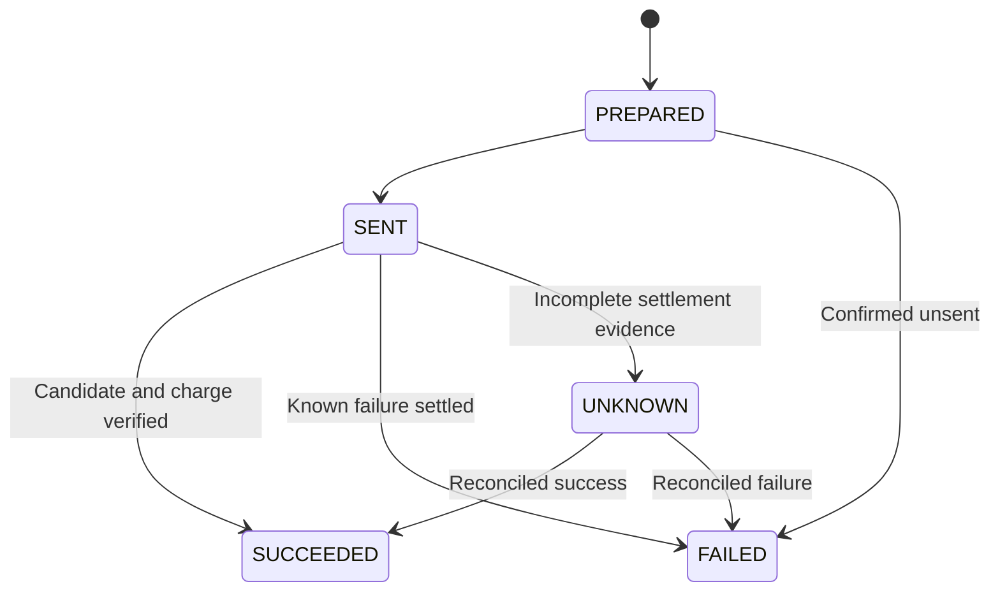

# Agent Runtime and model routing

[简体中文](../zh-CN/05-Agent-Runtime.md) · [Configuration and deployment](08-configuration-and-deployment.md)

A novel can use one model to draft a scene and another to review it. Operators install named profiles, a Workshop manager publishes matching rules, and an NF work administrator activates the policy. The task input records the selected configuration, rule and policy digest so that a particular call can be traced to its model.

## Install a profile

`NF_RUNTIME_PROFILES` names a JSON file with a `profiles` object. The following profile can be validated offline. Before making a live call, substitute a model authorized for the account and supply the credential in the named host environment variable.

```json
{
  "profiles": {
    "draft-model": {
      "kind": "deepseek",
      "model": "example-chat-model",
      "secret_ref": "NF_DEEPSEEK_API_KEY",
      "max_output_tokens": 2048,
      "timeout_seconds": 90
    }
  }
}
```

Save the example as `providers.json`. From the repository root, validate the catalog and list its profiles. This command reads the configuration without inspecting the provider credential or sending a request.

```bash
export NF_RUNTIME_PROFILES="$PWD/providers.json"
.venv/bin/python -c 'import os; from agent_runtime.providers import read_profiles; print(sorted(read_profiles(os.environ["NF_RUNTIME_PROFILES"])))'
```

| `kind` | Execution | Requirements |
| --- | --- | --- |
| `deepseek` | Chat Completions with `max_tokens` | Defaults to `https://api.deepseek.com/chat/completions`. Set the credential named by `secret_ref`. |
| `openai-compatible` | Chat Completions with `max_completion_tokens` | Supply an explicit HTTPS `endpoint` that handles the requested JSON output and usage format. |
| `codex-cli` | An isolated text turn on the local Codex CLI app-server | Install `codex`. The host accepts `api-key` and `chatgpt-plan` authentication. Plan mode requires `oauth_client_id` and a `model_output_ceiling` equal to `max_output_tokens`. |

The accepted range for `max_output_tokens` is 1–1,000,000. `timeout_seconds` defaults to 60 and accepts 1–600. The provider and account determine the model’s actual limit. Model IDs and text-only execution capabilities come from the local catalog. The loader validates the whole catalog, so one malformed profile stops startup. After loading, a provider request failure is recorded against its own Attempt. Before sending, the host checks credentials, execution capabilities and authorization. Live calls also require `NF_RUNTIME_LIVE_APPROVED=1`. Enable it only for a run with spending approval.

## Publish, preview and change a route

Each rule has an `id`, a `when` selector and a `profile`. A policy has 1–256 rules, including a default with `when: {}`. Rule IDs and selector combinations must be unique. Save this example as `rules.json`.

```json
[
  {"id": "writer", "when": {"role_id": "writer"}, "profile": "draft-model"},
  {"id": "default", "when": {}, "profile": "draft-model"}
]
```

On an initialized two-service installation, set `AW_BINDING` to the Workshop manager binding and `NF_ACCESS` to the NF administrator access file. Use their `WORK_ID` and `BRANCH_ID`. These commands publish and activate the first policy, then inspect the selected route. When updating an existing policy, provide each service’s current expected revision.

```bash
workshop/.venv/bin/python -m agent_workshop.policy_cli --binding "$AW_BINDING" publish --work "$WORK_ID" --branch "$BRANCH_ID" --expected-revision 0 --rules rules.json > policy.json
.venv/bin/python scripts/runtime_policy.py --access-file "$NF_ACCESS" activate --expected-revision 0 --policy policy.json
.venv/bin/python scripts/runtime_policy.py --access-file "$NF_ACCESS" preview --role writer --kind scene_draft
```

An authorized explicit override takes precedence. The remaining selectors rank from most to least specific, starting with task ID, instance and task kind, instance, role and task kind, role, task kind, branch, work, organization, installation, then default. Every referenced profile must be installed before activation. Existing tasks keep their frozen inputs.

To change an enrolled task’s route, an administrator can run `.venv/bin/python scripts/runtime_policy.py --access-file "$NF_ACCESS" rebind --task "$TASK_ID" --generation "$GENERATION" --key "$OPERATION_KEY"`. Rebind checks the generation, deadline, dependencies and task state. It releases confirmed unsent reservations, advances the generation and rebuilds context at the next claim. Sent, terminal and unresolved attempts require handling against the original Attempt. Delegated tasks and tasks bound to a plan, dynamic agent or adaptive instruction need fresh generation-specific authorization.

## Concurrency and accounting

Supervisor worker counts bound local parallelism. PostgreSQL coordinates provider, account, organization, work and role limits on concurrent calls, requests per minute and reserved tokens per minute across workers. Scheduling can assign different weights to works. Works that share a provider or account share its permit pool. A different provider has its own pool. When investigating latency, distinguish local `RUNTIME_CAPACITY_LIMIT` responses, upstream HTTP errors and database waits.

Every external request has an Attempt linked to its task, generation, WorldRef, model configuration, request digest and budget. The ledger writes `PREPARED` when reserving funds and `SENT` at the send boundary.



Token usage, provider receipts and the actual charge are recorded separately. A response with tokens but no price, a currency or amount outside the reservation, or a lost response after send can leave an Attempt `UNKNOWN`. Its reservation stays on the ledger. The task cannot automatically resend that call. Other tasks can run under their own authorization and available quota. Operators can inspect `.venv/bin/python scripts/p6_reconcile_invoice.py --help` to post a reviewed invoice line against that request. Synthetic adapter results, actual network calls and supplier charges have distinct evidence in tests, call audits and the spending ledger.

[Profiles and host protocol](../../agent_runtime/providers.py) · [Selector precedence](../../agent_runtime/routing.py) · [Rebinding](../../src/novel_factory/application/model_routing.py) · [Call accounting](../../src/novel_factory/application/agent_gateway.py)
