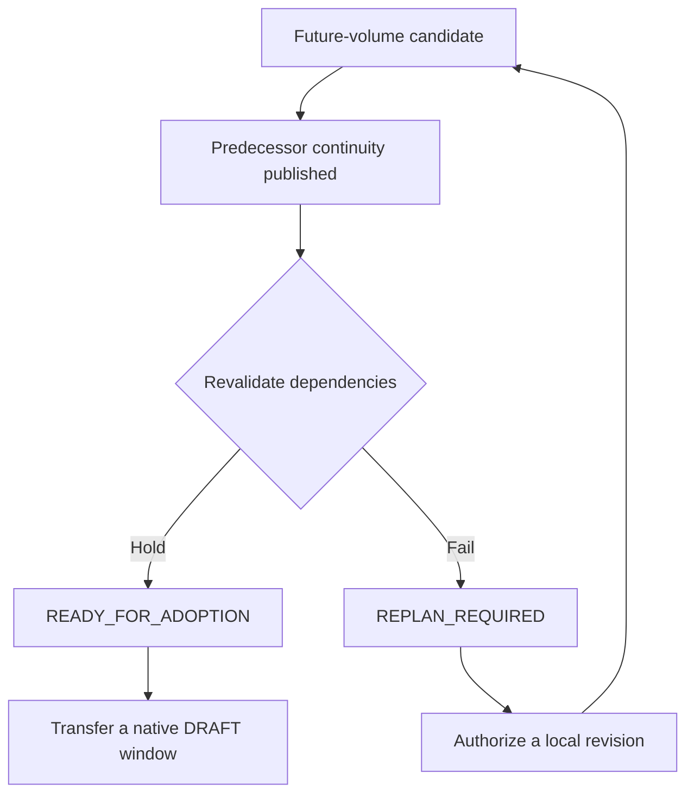

# Novel production pipeline

[简体中文](../zh-CN/06-小说生产流水线.md) · [Agent Runtime](05-agent-runtime.md)

A novel can draft the current volume, send completed chapters to a reader, and commission plans for later volumes at the same time. Each assignment has a task identity, input materials, budget and delivery requirements. Scene drafts, reading advice, future plans and authoritative world events are stored separately.

## Register a book

Complete the database migrations in the [quick start](02-quick-start.md) and configure the NF database and object directory. Save the following as `book.json` in the repository root. It supplies the intent for two volumes, two scene goals for the current volume, and book-wide and per-call limits. Monetary amounts are strings. The sample amounts illustrate budget configuration. Actual prices come from the provider.

```json
{
  "title": "The Last Ferry",
  "protagonist": "Lin",
  "place": "North Wharf",
  "volume_one": "Lin reconstructs the ferry timetable.",
  "chapters": ["The missing crossing", "A second passenger"],
  "volume_two": "Trace the passenger beyond the river.",
  "routes": {"draft": "draft-model", "review": "draft-model", "plan": "draft-model"},
  "budget": {"currency": "USD", "total_amount": "1.00", "reserve_amount": "0.10", "total_tokens": 30000, "token_reservation": 4000}
}
```

```bash
.venv/bin/python scripts/p58_bootstrap_book.py --book book.json --private-dir private-book
```

The script initializes the character, location, world revision, adopted plan and scene cards. It writes private `supervisor.json`, `control.json` and `pipeline.json` files. The first run creates a mode-0700 directory and returns `CREATED` and `model_requests: 0`. Rerunning with the same configuration verifies the book and returns `EXISTS`.

Install the sample `draft-model` profile and set `NF_RUNTIME_PROFILES` as described in [Agent Runtime](05-agent-runtime.md). These commands register the pipeline and inspect its state before any model runs. A Supervisor already running for that branch can pick up the registered work.

```bash
.venv/bin/python scripts/run_supervisor.py --access-file private-book/supervisor.json --register-pipeline private-book/pipeline.json
.venv/bin/python scripts/run_supervisor.py --access-file private-book/supervisor.json --pipeline-status
```

Once a live creative run and its budget have been authorized, start the Supervisor with the same access file to process work continuously. Supply `--once` for a single pass. Give each additional novel its own private directory and access file. Each Supervisor operates within its authorized work and branch. Supervisors sharing the NF database coordinate shared provider quotas.

## How chapters move through the pipeline

| Stage | Assignment and inputs | Delivery |
| --- | --- | --- |
| Draft a scene | `writer / scene_draft` receives the scene card, plan revision, batch and predecessor handoffs. | `DRAFT_STORED` records the draft and its text. A chapter becomes readable when all its scenes have drafts. |
| Read a chapter | `reviewer / literary` reads the chapter’s drafts in order under an identity distinct from the writers. | `ADVISORY_REVIEW` stores the reader’s observations. Formal editorial decisions use the review and release services. |
| Plan a later volume | `volume_director / window_plan` uses a frozen PLAN cut and upstream dependencies. | `PROVISIONAL_WITH_ASSUMPTIONS` records the candidate and its assumptions until predecessor continuity is published. |

Ready chapter reviews take priority. When pending ready reviews plus active reviews reach `review_backlog`, the scheduler pauses new draft and lookahead assignments. In-flight work continues. Direct registration accepts up to 32 chapters, 32 scenes per chapter, eight future candidates and 128 nodes in total, looking ahead at most two volumes. Each stage can have 1–16 active assignments. The review backlog limit is 1–32. The book initialization script accepts 1–16 chapter goals and creates one scene card per goal.

## After the preceding volume is published



Dependencies can express commitments from predecessor plan nodes or conditions on authoritative world state. Use `--transfer-window` to submit a revalidated candidate to native planning as a draft. Adoption is a separate decision. For an invalidated window, `--revise-window` requires the exact candidate reference, the published predecessor’s WorldRef and revised assumptions. A candidate allows at most two explicit local revisions. The status view retains Attempt IDs for the current task and its prior revisions, so completed chapters outside the affected window can stand.

## Close reading, targeted revision and publication

For passage-level review, Creative Harness binds the manuscript reference, text-delivery records and a proof of reviewer independence. Findings can identify an exact span. An editor may return the work, retain it or defer a decision. On a `targeted_revision` task the writer calls `nf_harness_revision_brief` to read the authorized excerpts, then `nf_harness_revise` to submit replacements. Accepting a revised draft requires a new independent review. Autonomous character actions, simulated branches and unadopted plans produce candidates. Authoritative world history advances through events accepted by Core.

On an authorized branch, `.venv/bin/python scripts/run_supervisor.py --access-file private-book/supervisor.json --pipeline-results` exports scene text, chapter advice and future-plan candidates. The export contains unpublished manuscript text. Its `literary_quality` field currently returns `NOT_EVALUATED`. Human reading scores are recorded separately.

[Book initialization](../../scripts/p58_bootstrap_book.py) · [Pipeline registration and scheduling](../../src/novel_factory/application/production_pipeline.py) · [Targeted revision authorization](../../src/novel_factory/application/creative_revision_brief.py)
