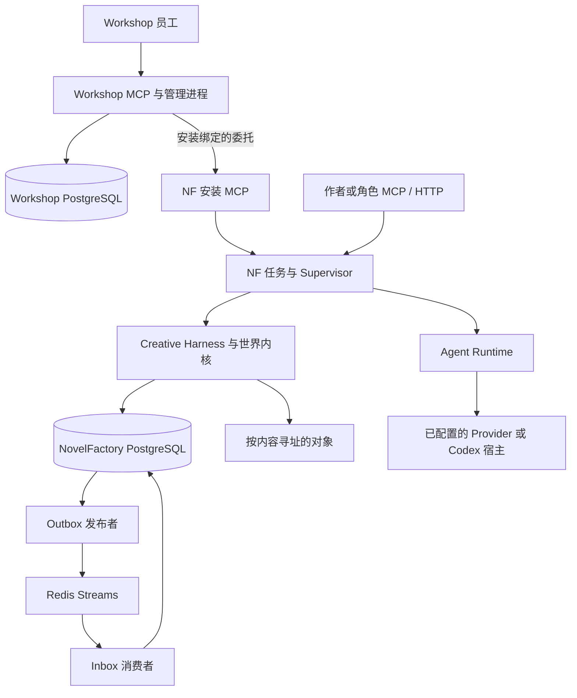
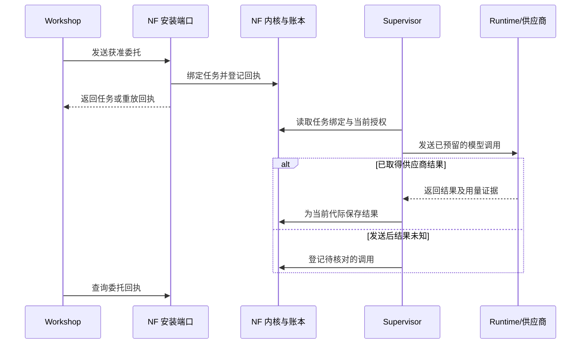
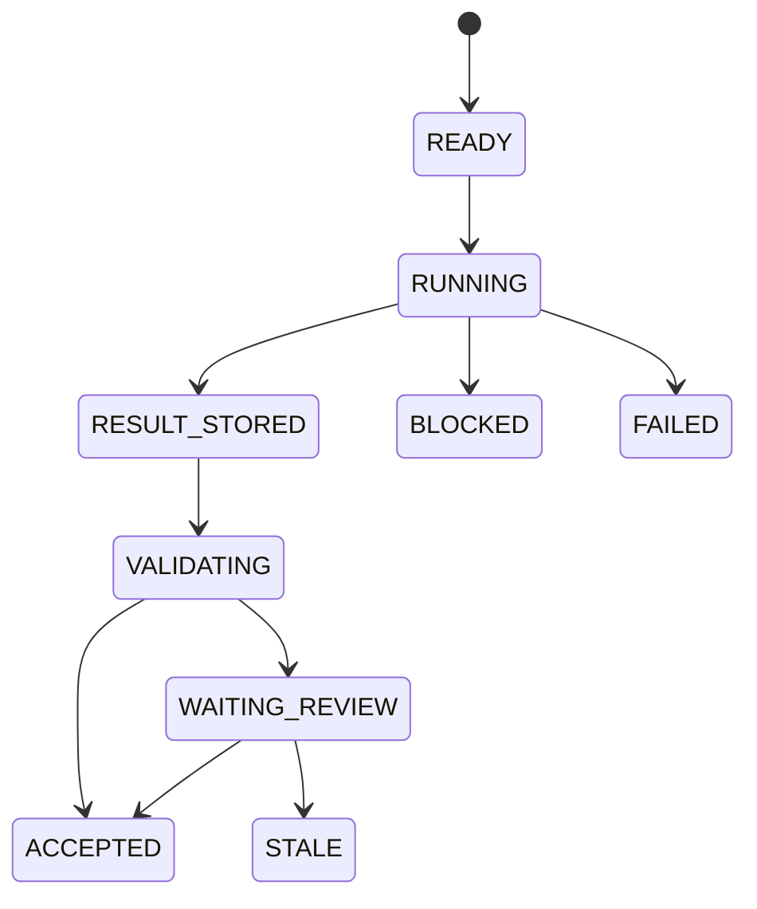

# 系统架构

[English](../en/03-system-architecture.md) · [Agent 系统](04-Agent系统.md) · [模型运行时](05-Agent-Runtime.md)

## 每种状态由谁保存

NovelFactory 与 Agent Workshop 各自运行，通过安装绑定的 MCP 端口传递委托。Workshop 管组织、消息路由和 Skills 授权。NovelFactory 管世界版本、任务代际、工件、预算预留和模型调用回执。Supervisor 断开后，供应商仍有可能完成请求。系统保留原始 Attempt，操作人员可凭它核对结果和账单。

| 组件 | 保存的记录与执行时检查 |
| --- | --- |
| 世界内核 | `WorldRef` 由作品、分支和版本标识组成。接受变更集时，在数据库事务内追加事件并移动分支 HEAD。分叉与提升都指定来源和预期版本。 |
| 查询与上下文 | 解析世界版本和知识切面，读取获准的数据平面，登记依赖，交付时复核权限。上下文为一个任务代际冻结输入和引用。 |
| Creative Harness | 按作用域保存计划、推演、草稿版本、审读段落、评估及指令选择。发布和晋升各有决策流程。 |
| Agent Workshop | 员工绑定组织及任职版本。委托经过有期限的安装路由，并绑定冻结的任务所有者。使用能力时检查撤权。 |
| Supervisor 与 Agent Runtime | 登记合格任务，解析操作人员配置的路由，预留预算及槽位，调用适配器并记账。多部作品可以竞争同一账号、组织或供应商的容量。 |
| 存储与投递 | PostgreSQL 保存权威回执、身份及 Outbox/Inbox 记录。对象库按哈希保存正文等内容。启用 Redis 后可用流消息唤醒工作进程，恢复时按持久记录核对。 |

[世界内核](../../src/novel_factory/application/kernel.py) · [数据库定义](../../src/novel_factory/infrastructure/database.py) · [任务、预算及消息表](../../src/novel_factory/infrastructure/reliability_tables.py) · [Workshop 实现](../../workshop/src/agent_workshop)

## 故事时间、角色认知与世界版本

一件事何时发生、它的效果在哪段时间有效、一个角色何时得知它，是三个不同的问题。查询同时绑定版本和 `knowledge_cut`。WORLD 读取获准的事实，BELIEF 按角色和获知时点裁剪，PLAN 绑定计划清单与目标时间，SIMULATION 使用带来源记录的假设材料。时间线可按来源、目标或有效时间筛选。将来揭晓的计划出现在目标轴上，角色读到消息的记录出现在来源轴上。

受守卫的世界写入引用预期版本、任务上下文、准备好的证书和批准记录。内核在追加事件前复核范围版本和依赖。严格写入按预期 HEAD 检查。分支继续推进后，仍可选定旧版本查询。修复或细化解释时保留原始输入的历史引用。[时态契约](../../contracts/temporal_concurrency.schema.json) · [世界查询](../../src/novel_factory/application/queries.py) · [语义依赖](../../src/novel_factory/application/semantic_dependencies.py)

## 一项委托怎样跨过两个服务

Worker 为指定任务代际领取租约。下图列出计算、审核和两种失败分支。租约过期、取消和显式恢复也要核对代际。响应丢失时，可以从持久回执查明执行进度。[任务转换](../../src/novel_factory/orchestration/tasks.py) · [安装委托](../../src/novel_factory/application/delegation.py)

## 创作上下文与指令修订

操作人员通过 `NF_CREATIVE_HARNESS_CONFIG` 提供符合契约的 JSON。默认关闭 Creative Harness；启用后可分别开启动态 Agent 与自适应指令。上下文编译器依据任务、角色、世界版本和 Token 上限选择材料，并记录入选依据与遗漏。写作者、角色和读者各自取得获准的材料。

指令改动先作为候选进入评估。选择新版本时会登记新的选择代次，后续任务据此冻结输入。回滚改变后续选择，历史任务仍引用原有指令摘要，正式世界事件继续按原记录追溯。[配置定义](../../src/novel_factory/infrastructure/creative_config.py) · [上下文编译](../../src/novel_factory/application/creative_context.py) · [指令选择与回滚](../../src/novel_factory/application/adaptive_promotion.py)

## 并行写作与调用账本

提前规划下一卷时冻结假设、预算和版本。场景可以提前起草。前提变化后，流水线标出需要重规划或等待采用的工作。最终交接使用审过的跨卷快照。草稿、咨询性审读与已发布的世界事件分别保存。[小说生产流水线](06-小说生产流水线.md)

运行时按任务、角色、分支、作品及安装策略选择 Provider 配置。生成适配器按冻结输入构造文本请求。角色 MCP 宿主单独检查工具权限。调度时同时核对作品公平性、可用槽位和供应商配额。任务已有结果时，账本金额仍可能未知。费用归因应同时核对作品、任务、代际、Attempt、Provider 及用量记录。[路由解析](../../agent_runtime/routing.py) · [预算与准入](../../src/novel_factory/orchestration/runtime_admission.py) · [统计](../../src/novel_factory/application/statistics.py)

## 部署和扩展入口

两个服务使用独立数据库身份。每部作品使用自己的项目绑定。安装密钥由操作人员保管。扩展模型适配器时实现运行时协议，并在服务端配置中登记能力。增加角色工具时同步注册 Schema、现行授权和任务冻结的工具上限。新的世界效果进入内核的模板、批准和接受流程。物理恢复时，先把两套数据库和配套对象还原到隔离目标，核对回执，再重建投递状态。[ModelAdapter 协议](../../src/novel_factory/infrastructure/model_gateway.py) · [可移植请求与响应类型](../../agent_runtime/protocol.py) · [接口参考](07-接口参考.md) · [配置与部署](08-配置与部署.md) · [运维与恢复](09-运维与恢复.md)
