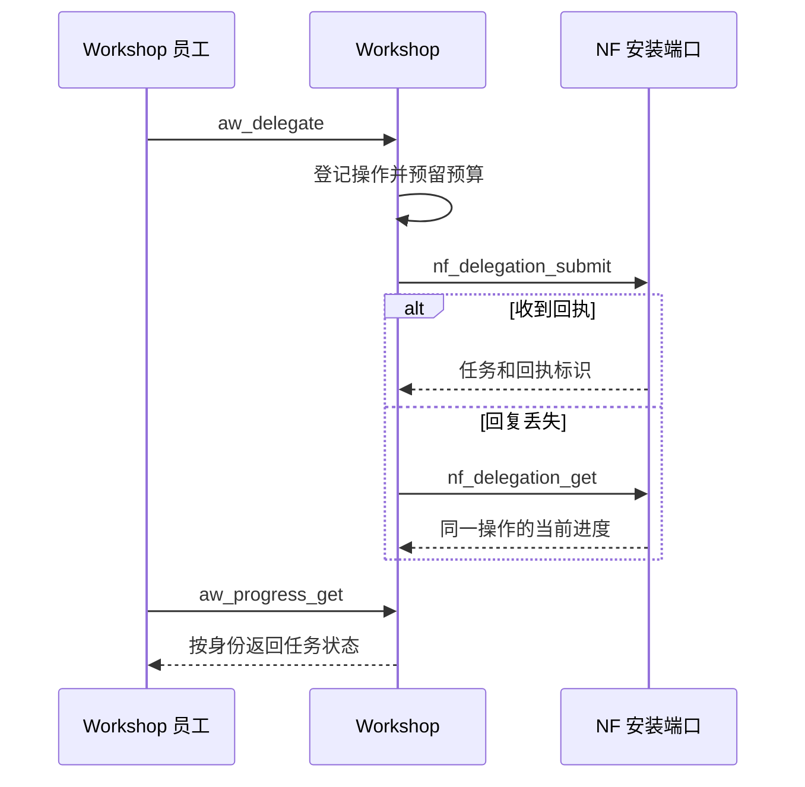

# Agent 平台

[English](../en/04-agent-platform.md) · [接口参考](07-接口参考.md)

要把一章交给另一位作者或审核人，先在 Agent Workshop 确定谁能接手，再由 NovelFactory（NF）为具体任务签发执行权限。员工的任职可以跨越多个任务。每次写作或审核都有自己的任务、执行代际（`generation`）、材料和预算，Supervisor 在任务就绪时分配执行进程。

## 员工、任务与宿主

| 对象 | 身份如何绑定 | 变更的影响 |
| --- | --- | --- |
| Workshop 员工 | 组织、安装、员工 ID 和任职版本 | 聘用、调岗、停职和离职都会更新组织名册。旧任职凭据可能返回 `STALE_EMPLOYMENT`。 |
| NF 任务 | 作品、分支、角色、授权、世界版本和知识切面 | 任务宿主还要核对当前 generation、租约所有者和冻结的工具清单。角色在任务内只能使用获准材料。 |
| 动态 Agent | 实例、修订、选用版本及 epoch | 控制者登记候选修订、选择版本、退出或归档。后续任务读取新的选择。已有任务使用冻结修订，仍要通过实时授权校验。 |
| 执行进程 | Supervisor 分配工作，Host 按任务发送模型请求 | 进程退出后，任务记录、委托回执和费用保留在数据库中。 |

NF 在角色工具调用前检查 `READ`。写入候选需要 `ARTIFACT_WRITE` 和任务冻结的相应工具权限。角色为 `character_actor` 时，知识切面绑定自己的角色标识和获知时点。Workshop 的组织管理权限与 NF 的分支授权分别配置。

## 建立组织和连接

在已迁移的 Workshop 数据库上设置 `AW_DATABASE_URL`。以下命令创建一个组织并为管理者签发首次绑定。将 `INSTALL`、`NF_INSTANCE` 设为两端预配的安装和 NF 实例标识，将 `ORG` 设为新的组织名。`PRIVATE_DIR` 应指向由操作员持有的私有目录。

```bash
workshop/.venv/bin/aw-admin install "$INSTALL" "$NF_INSTANCE"
workshop/.venv/bin/aw-admin bootstrap "$ORG" --installation "$INSTALL" --preset Minimal
workshop/.venv/bin/aw-admin enroll "$INSTALL" "$ORG" manager "$PRIVATE_DIR/manager.json" --revision 1
workshop/.venv/bin/aw-mcp --binding "$PRIVATE_DIR/manager.json"
```

最后一条命令启动 stdio 服务，供 MCP 客户端通过标准输入输出连接。绑定文件由 `aw-admin enroll` 以 0600 权限创建，内含令牌和 Workshop 数据库连接配置。客户端调用 `aw_capabilities` 时传入 `{"protocol_version":"aw-nf.v1"}`，随后读取 `aw_roster_get`。注册新的成员应使用其当前任职版本。

## 消息和跨服务委托

一般组织消息经组织图或有效的临时路由投递。正文先由 `aw_message_body_put` 登记，随 `aw_message_send` 引用。接收方在 `aw_mailbox_get` 中按序号读取消息，再取正文并确认。若路由撤销，信箱可能只显示该序号和 `UNAVAILABLE`。

委托采用另一条执行路径。先用 `aw-provision` 配置组织预算和槽位，并将槽位对应到 NF 预配的任务定义。NF 管理者需要分支 `ADMIN`，槽位所属主体需要 `TASK_CREATE`。普通角色的组织消息权限无法代替此授权。



`aw-reconcile` 核对两端记录。重试 `aw_delegate` 时，在同一安装、组织、发送人及任职版本下沿用调用者提供的操作键。改变参数会触发冲突。查看进度或 NF 回执时，使用返回的服务端操作 UUID。管理者和作者能看到委托的预算保留状态及远端任务标识，当前发送者和持有人只能看到其获准的进度字段。

## 技能与审核

管理者用 `aw_skill_share` 共享指定来源修订，设置适用角色、团队或个人等范围及期限。员工先用 `aw_skill_resolve` 查验可用版本，再用 `aw_skill_freeze` 将它绑定到本人任务。撤权后，可通过 `aw_skill_history` 核对历史摘要。新解析、动态任务执行和结果交付各自按当前权限复核。

正式文学审核将稿件哈希、生产者、审核任务和审核人绑定为独立性凭据。跨服务审核还会核对委托、员工任职和实质主体分组。作品管理员用 `nf_harness_review_independence` 取得凭据，审核人用 `nf_harness_review_read` 领取原文及覆盖记录，随后提交报告。能够访问审核工具仍须满足该稿件的独立性条件。终审编辑还需要 `APPROVE`，并独立于作者和审核人。

Workshop 本地可将明确规则判定标为 `RULE_PASSED` 或 `RULE_BLOCKED`。需要判断的案件进入人工或已获预算的 NF 审核。到期或第二轮仍要求修改时，案件升级处理。早期章节阅读意见和正式稿件审核的权限与产物各见[小说生产流水线](06-小说生产流水线.md)。

[Workshop 工具路由](../../workshop/src/agent_workshop/server.py) · [技能与审核实现](../../workshop/src/agent_workshop/reviews_skills.py) · [NF 任务工具权限](../../src/novel_factory/application/mcp_runtime.py)
