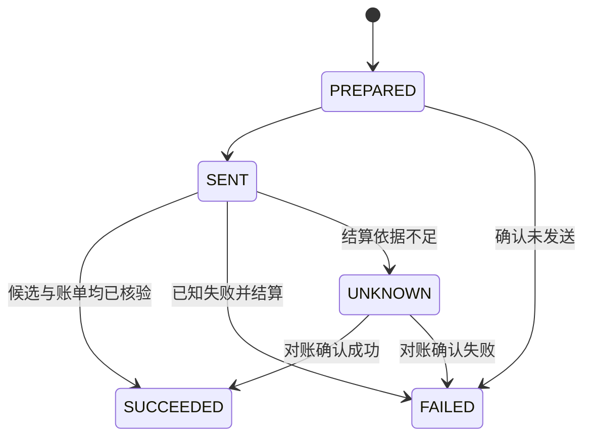

# Agent Runtime 与模型路由

[English](../en/05-agent-runtime.md) · [配置与部署](08-配置与部署.md)

同一部小说可以让一个模型写场景，另一个模型读稿。操作员给每条执行路径命名，Workshop 管理者发布匹配规则，NF 作品管理员采用策略。任务输入会记录选中的配置、匹配规则和策略摘要，事后可以查清某次调用用了哪个模型。

## 配置模型

`NF_RUNTIME_PROFILES` 指向含 `profiles` 对象的 JSON 文件。下面是可以离线校验的单配置示例。实际开通调用前，将模型名改为账号获准使用的模型，并登记相应凭据。

## 管理 API Key

在运行 Supervisor 的同一操作系统用户下执行：

```bash
python scripts/nf.py credentials set NF_DEEPSEEK_API_KEY
python scripts/nf.py credentials status NF_DEEPSEEK_API_KEY
python scripts/nf.py credentials remove NF_DEEPSEEK_API_KEY
```

`set` 使用不回显的输入框；自动部署可用 `--stdin` 从标准输入读取。命令行参数不接收 Key 原文。`status` 只报告引用、是否配置和来源，`remove` 删除本机保存项。已有同名环境变量优先，删除本机项不会删除环境变量。

Windows 使用当前用户的 Credential Manager；Linux/macOS 保存到 `$XDG_DATA_HOME/novel-factory/credentials`，未设置时使用 `~/.local/share/novel-factory/credentials`。POSIX 目录为 0700、文件为 0600，读取拒绝符号链接和其他用户可访问的文件。不同用户、Windows 与 WSL 各有自己的凭据存储。Supervisor 每次发送前解析引用，轮换 Key 后无需把密钥写入任务或重新发布模型目录。真实调用仍需要独立的任务授权、预算和 `NF_RUNTIME_LIVE_APPROVED=1`。

Workshop 的模型路由继续引用 Provider 配置名，配置中的 `secret_ref` 指向本机项。数据库、Git、模型目录和对外报告均不保存 Key 原文。岗位默认由 Codex 负责大纲、规划、审核，DeepSeek 负责正文和角色扮演；通过下文的角色路由规则实现，已开始的任务保留原绑定。

```json
{
  "profiles": {
    "draft-model": {
      "kind": "deepseek",
      "model": "example-chat-model",
      "secret_ref": "NF_DEEPSEEK_API_KEY",
      "max_output_tokens": 2048,
      "timeout_seconds": 90
    }
  }
}
```

将上例保存为 `providers.json`。在仓库根目录执行下列命令可验证配置并列出名称。校验过程不读取供应商凭据，也不发送模型请求。

```bash
export NF_RUNTIME_PROFILES="$PWD/providers.json"
.venv/bin/python -c 'import os; from agent_runtime.providers import read_profiles; print(sorted(read_profiles(os.environ["NF_RUNTIME_PROFILES"])))'
```

| `kind` | 模型宿主 | 运行条件 |
| --- | --- | --- |
| `deepseek` | 使用 Chat Completions，输出上限传入 `max_tokens` | 默认请求 `https://api.deepseek.com/chat/completions`，凭据由 `secret_ref` 指定。 |
| `openai-compatible` | 使用 Chat Completions，输出上限传入 `max_completion_tokens` | 显式设置 HTTPS `endpoint`。端点须支持模型请求的 JSON 输出及用量格式。 |
| `codex-cli` | 本机 Codex CLI 的 app-server 运行隔离文本回合 | 宿主须安装 `codex`。可选 `api-key` 或 `chatgpt-plan` 鉴权。后者需 `oauth_client_id`，且 `model_output_ceiling` 与 `max_output_tokens` 一致。 |

`max_output_tokens` 范围为 1–1,000,000，`timeout_seconds` 默认为 60，范围为 1–600。实际模型还受供应商和账户限制。模型标识和纯文本执行能力来自本地配置。加载器会验证整份目录，一项配置格式有误即可阻止启动。加载后，供应商请求失败记入该次 Attempt。宿主在发送前校验凭据、执行能力与授权。真实调用另需 `NF_RUNTIME_LIVE_APPROVED=1`。仅在已获费用授权的运行环境启用。

## 发布、预览和切换

路由规则包含 `id`、选择条件 `when` 和 `profile`。一个策略包含 1–256 条规则，必须有一条 `when: {}` 默认规则。规则 ID 和相同条件的组合均须唯一。以下内容可保存为 `rules.json`。

```json
[
  {"id": "writer", "when": {"role_id": "writer"}, "profile": "draft-model"},
  {"id": "default", "when": {}, "profile": "draft-model"}
]
```

在已初始化的双服务环境中，设定 Workshop 管理者的 `AW_BINDING`、NF 管理者的 `NF_ACCESS` 及其 `WORK_ID`、`BRANCH_ID`。以下命令发布并采用第一个策略，最后一步只查询匹配结果。更新现有策略时使用两端各自的当前预期版本。

```bash
workshop/.venv/bin/python -m agent_workshop.policy_cli --binding "$AW_BINDING" publish --work "$WORK_ID" --branch "$BRANCH_ID" --expected-revision 0 --rules rules.json > policy.json
.venv/bin/python scripts/runtime_policy.py --access-file "$NF_ACCESS" activate --expected-revision 0 --policy policy.json
.venv/bin/python scripts/runtime_policy.py --access-file "$NF_ACCESS" preview --role writer --kind scene_draft
```

获准的显式覆盖优先于规则。其余条件的优先级从高到低依次为任务 ID、实例加任务类型、实例、角色加任务类型、角色、任务类型、分支、作品、组织、安装、默认。策略采用时要求所有引用的配置均已安装。已有任务继续使用冻结的输入。

如需为已登记任务切换模型，管理员可执行 `.venv/bin/python scripts/runtime_policy.py --access-file "$NF_ACCESS" rebind --task "$TASK_ID" --generation "$GENERATION" --key "$OPERATION_KEY"`。操作核验 generation、截止时间、依赖和可重绑状态。它释放已确认未发送的预留，递增 generation，并在下次领取时重建上下文。已发送、终态或结果未知的调用需要先处理原 Attempt。委托、计划以及动态 Agent 或自适应指令绑定需要按新的代际重新授权。

## 并发、费用与未知结果

Supervisor 的进程数控制本机并行度。运行时配额在 PostgreSQL 中跨 Worker 生效，可按供应商、账户、组织、作品或角色限制并发数、每分钟请求数和每分钟预留 Token 数。作品之间的调度还使用项目权重。共享供应商或账户的作品会共用相应配额，另一个供应商走自己的配额。排查延迟时，区分本地 `RUNTIME_CAPACITY_LIMIT`、供应商返回的 HTTP 状态和数据库等待。

每次外部请求记录 Attempt，关联任务、generation、WorldRef、模型配置、请求摘要和预算。下图展示账本状态。预算预留时写入 `PREPARED`，跨越发送边界时写入 `SENT`。



Token 用量、供应商回执和实付金额分别记录。Token 已知但金额缺失、币种或金额越界，以及发送后失去可核对的结果，都可能留下 `UNKNOWN`。原预留继续占用相应预算，同一任务不会自动重发这次调用。其他任务有独立授权且有可用额度时可以继续。运维人员以账单标识和该次请求的证据对账，可用 `.venv/bin/python scripts/p6_reconcile_invoice.py --help` 查看入口。合成适配器验收记录、真实网络调用记录和供应商账单可分别通过测试结果、调用审计和账本核查。

[配置与宿主协议](../../agent_runtime/providers.py) · [路由优先级](../../agent_runtime/routing.py) · [模型切换](../../src/novel_factory/application/model_routing.py) · [费用登记](../../src/novel_factory/application/agent_gateway.py)
