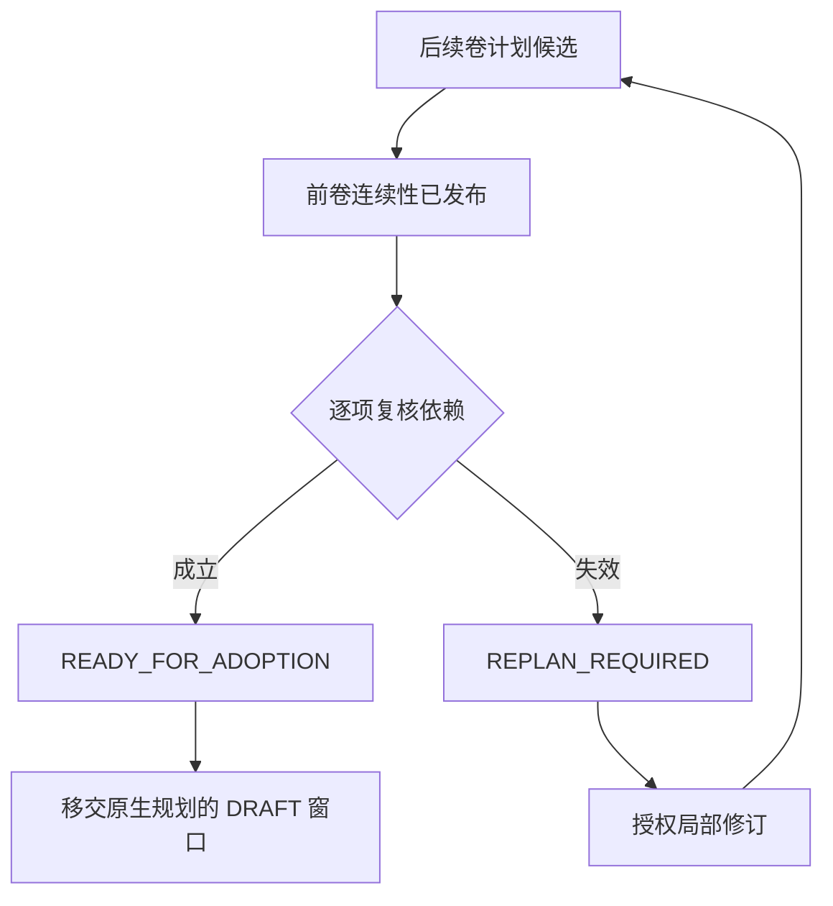

# 小说生产流水线

[English](../en/06-production-pipeline.md) · [Agent Runtime](05-Agent-Runtime.md)

一部小说可以一边写当前卷，一边让读者审核已完成草稿的章节，让策划者为后续卷提出方案。每项工作都有任务标识、输入材料、预算和交付条件。章节草稿、阅读意见、未来计划与正式世界事件分别存储。

## 登记一本书

按[配置与部署](08-配置与部署.md)迁移持久化 NF 数据库，设置 `NF_DATABASE_URL` 和 `NF_OBJECT_ROOT`。在仓库根目录将下例保存为 `book.json`。它提供两卷的创作意图、当前卷两章的场景目标，以及每次调用和整部作品的预算上限。金额以字符串传入。示例金额用于演示预算配置，实际费用按供应商账单核对。

```json
{
  "title": "The Last Ferry",
  "protagonist": "Lin",
  "place": "North Wharf",
  "volume_one": "Lin reconstructs the ferry timetable.",
  "chapters": ["The missing crossing", "A second passenger"],
  "volume_two": "Trace the passenger beyond the river.",
  "routes": {"draft": "draft-model", "review": "draft-model", "plan": "draft-model"},
  "budget": {"currency": "USD", "total_amount": "1.00", "reserve_amount": "0.10", "total_tokens": 30000, "token_reservation": 4000}
}
```

```bash
.venv/bin/python scripts/p58_bootstrap_book.py --book book.json --private-dir private-book
```

脚本初始化角色、地点、世界版本、已采用的当前卷计划和场景卡，生成私有的 `supervisor.json`、`control.json` 和 `pipeline.json`。首次运行会创建 0700 私有目录，输出 `CREATED` 和 `model_requests: 0`。相同配置再次运行会验证原作品并返回 `EXISTS`。

按[模型运行时](05-Agent-Runtime.md)配置 `NF_RUNTIME_PROFILES`，安装示例中的 `draft-model`。以下两步分别登记这份流水线和读取状态，可在运行任何模型之前完成。若已有运行中的 Supervisor，它可以领取已登记的工作。

```bash
.venv/bin/python scripts/run_supervisor.py --access-file private-book/supervisor.json --register-pipeline private-book/pipeline.json
.venv/bin/python scripts/run_supervisor.py --access-file private-book/supervisor.json --pipeline-status
```

取得真实模型创作与费用授权后，操作员使用同一访问文件启动 Supervisor，持续推进任务。`--once` 只执行一轮。为其他小说使用各自的私有目录和访问文件。每个 Supervisor 限定在它获准的作品与分支，多个作品通过同一 NF 数据库协调共享供应商的配额。

## 当前卷如何推进

| 阶段 | 执行角色与输入 | 产物和下一步 |
| --- | --- | --- |
| 写场景 | `writer / scene_draft` 接收场景卡、计划修订、批次和前序交接材料 | `DRAFT_STORED` 记录稿件与原文。章内所有场景完成后，该章可以交给读者。 |
| 读章节 | `reviewer / literary` 按章内顺序阅读草稿，身份须与作者分开 | `ADVISORY_REVIEW` 保留阅读建议。正式文学处置由相应的审核和发布服务执行。 |
| 规划后续卷 | `volume_director / window_plan` 使用冻结的 PLAN 切面及上游依赖 | `PROVISIONAL_WITH_ASSUMPTIONS` 保留候选及其前提，等待前卷连续性发布。 |

就绪的章节审核优先领取。如果等待和执行中的审核数达到 `review_backlog`，系统暂停新增写作及前瞻任务，已有任务继续运行。直接登记的流水线支持最多 32 章、每章 32 个场景、8 个前瞻候选，以及总计 128 个节点。前瞻最多覆盖之后两卷。各阶段的同时执行数可设为 1–16，审核积压上限为 1–32。上述建书脚本接收 1–16 个章节目标，每个目标生成一张场景卡。

## 前卷出版之后



依赖可以是前卷计划节点的承诺，也可以是正式世界条件。满足前提的窗口经 `--transfer-window` 移交后，仍需经过原生规划流程才能采用。若条件失效，`--revise-window` 要求提供失效候选的准确引用、已发布前卷的 WorldRef 和更新的前提。每个候选最多接受两次显式局部修订。状态查询同时保留当前任务和历史修订的 Attempt ID，已经写好的其他章节无需重跑。

## 细读、定向修订与发布

需要逐段审核时，Creative Harness 使用稿件引用、原文交付记录和独立性凭据。审核人提交的发现可以定位到文字区间。编辑可退修、保留或延期决定。收到退修后，作者在 `targeted_revision` 任务中用 `nf_harness_revision_brief` 读取获准的片段，再用 `nf_harness_revise` 提交替换。接受修订稿前，系统要求对新稿重新独立审核。作者的自主行动、模拟分支和未采用计划各自生成候选，权威世界只随着 Core 接受的事件推进。

在已获授权的分支上执行 `.venv/bin/python scripts/run_supervisor.py --access-file private-book/supervisor.json --pipeline-results` 可获取正文、章节意见和计划候选。输出包含未公开稿件，`literary_quality` 当前返回 `NOT_EVALUATED`。人工阅读评分另行记录。

[建书脚本](../../scripts/p58_bootstrap_book.py) · [流水线登记和调度](../../src/novel_factory/application/production_pipeline.py) · [定向修订授权](../../src/novel_factory/application/creative_revision_brief.py)

## 重复返工与方法更新

质量模式按场景累计修订，不因换了一组审稿问题而清零。相同问题先尝试两种修订方法；再失败时，调度器登记独立的 Codex 总编诊断任务，冻结当前原稿、审核或字数实测报告、失败记录及历史方法。总编只提出根因与新方法，不能通过原稿或降低验收条件。Flash 采用新方法修订后，原有认知、事实与文学审核仍须重新完成。

每场最多 12 次修订、2 次诊断；每个节点另有 6 次技术格式修复额度，改变错误诊断也不会重置。缺少材料、重复提出旧方法或耗尽额度时保留证据并停止付费派发。旧实验的累计次数与 Attempt 不改写；管理员只能在固定版本和关联节点上执行一次有回执的有限额度迁移，不能由模型自行续期。

诊断结果是当前作品内的不可变方法版本。跨任务发布动态 Agent 或 Skill 仍使用已有提案、回放评测、独立审核和晋升流程。Flash 修订与 Codex 独审可形成已验证经验，前提是完整传输或 Host 回执、独立身份和所审正文版本完全对应；UNKNOWN 金额继续保留。

长期返工历史不会整段复制到任务指令：诊断提供有界摘要和完整请求哈希，当前问题与全部历史方法通过受权限约束的材料通道交付。完整写作返工意见另存不可变修订简报，模型实际收到的材料及摘要均保存快照。历史保留、任务指令长度和总上下文预算分别核验，不能靠丢弃硬性问题绕过限制。

## 系统内疑问与审核取证

新登记的原生 Codex 审核必须实际调用任务绑定的 MCP。回执同时绑定原稿、WorldRef、任务代际、Attempt、权限 epoch 及 Host thread/turn；只在回答里声称“已查询”不能通过验收。强制修改还须引用当前 text_ref 的准确 Unicode 原文区间，并给出明确修正方法。UNKNOWN 和未登记信息保留为待核，不能直接升级为已证实矛盾。

总编诊断缺少系统内资料时，程序登记独立 `reviewer / verification`。事实疑问每八题一窗，读取准确的报告及原文，逐题关联实际查询的实体、谓词、故事时点和人物认知切面。确认无矛盾或旧报告版本不符后，同一稿件重新抽取；确认矛盾后才交写作角色修改。每个疑问窗口只消费一次，原诊断次数、已用额度和旧调用账务保留。审核缺少实际取证时只重做审核，最多两轮；耗尽后停止新收费派发。

人物台词、猜测及设备显示可抽取为 `ATTRIBUTED_STATEMENT`，表示原稿中确有这种说法。它需要同稿的独立认知审核与真实 MCP 证据，不能建立正式事实、人物 BELIEF，不能代替必须呈现的已接受事件或重要变化。SAYS 和未经核查的未知状态仍保持严格约束。

长度返工只携带当前实测字数与目标区间。历史事实意见留在原不可变报告与归档引用中，不能因为新稿超出字数就再次当作当前稿的矛盾。

## 编辑退回与完本

整卷退回后，Flash 生成有明确父稿的修订候选，Codex 分别重新执行认知、事实和文学审核。正式接受仍执行正文对账；全部候选就绪后，在一个事务中接受新稿、生成新冻结检查点并重开独立编辑。父检查点和旧稿保留，正文接受不再次应用世界效果。

最终编辑批准后，P6 Worker 自动启动两条独立的 Codex 盲读轨道。每条轨道从固定正文片段形成自己的笔记与评分，不能读取另一轨道的意见或隐含世界状态。只有正式评审门槛通过才能冻结整书；不合格则交真实总编明确退修，再经新稿接受、编辑和新一轮双路盲评。相同正文不能重复投票，整书退修及版本修订均有持久次数上限。文学质量仍由内部独立角色实际判断，工程测试中的合成评分只验证程序通路。
