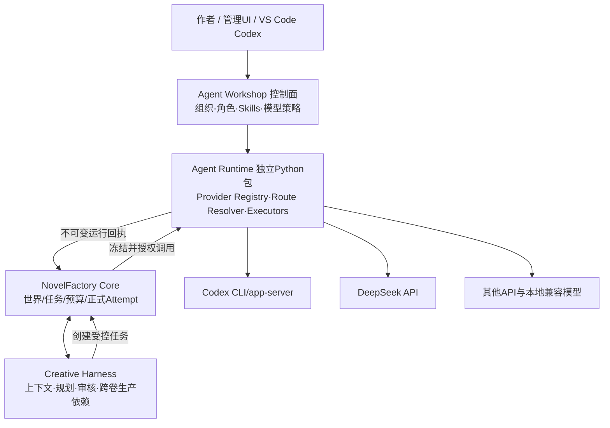

# NovelFactory P5.8：Agent Runtime、多模型调度、多作品流水线与 GitHub 分支治理

> **状态：设计草案 v0.1（尚未开发）**  
> **拟定时间：2026-11-12；时区：Asia/Shanghai**  
> **已核对基线：** `SKYdayDUCK/NovelFactory main@d6ff88223d6ae655a45d713687e5e8119e157737`，P5.7 S1–S6 已合并，P5.7 独立审查 `dev/p57-creative-harness-s1-s6@ece71f73292780211705114453ebfde1728195c5`。  
> **目的：** 本文是需求、边界、架构和分阶段验收方案，不是已实现的部署说明或已授权的开发指令。  
> **正式阶段：** P5.8-A 功能开发；P5.8-B GitHub 分支清理与实验基线同步。

## 0. 决策摘要

P5.8 的核心新建能力为**独立、可复用的 Agent Runtime**：多 Provider 运行适配、标准化模型调用、可解释的策略路由、冻结执行、供应商配额和监测。Agent Workshop 管理人员/组织/模型目录与配置策略；NovelFactory Core 保留作品世界、时间线、任务资格、唯一正式模型 Attempt 与费用账本；Creative Harness 保留文学规划、上下文、审核及优化，扩展可流水线化的跨卷交接。第三方 LangChain / LangGraph 的设计经验可选择性借鉴，但不作为必需依赖或第二套执行状态机。

遵循：**模型对 Agent 透明、配置只对授权管理者可见；新任务可热切换，已发送模型请求不盲目迁移；各小说在预算/权限/上下文上隔离、在执行容量上公平共享；未来候选不自动变为正式世界事实；不得以清理 Git 分支掩盖未合并实验或原始证据。**

## 1. 当前事实和缺口

### 1.1 已有工程能力

- NovelFactory：`RuntimeTaskService`、`AgentGateway`、`ModelAdapter`、`OpenAICompatibleAdapter`、`CodexAppServerAdapter`、`RuntimeSupervisor`、PostgreSQL 任务/Attempt、Redis EventHub、WorldRef、BELIEF/PLAN、费用预留、幂等、UNKNOWN、跨卷接续和 RollingPlanning。
- Agent Workshop：独立 PostgreSQL、组织/员工/任期、岗位 Skills 授权、委派、独立审核、计费委派回执、MCP。
- P5.7：S1 Context、S2 Planning/Simulation、S3 Fine-grained Review、S4 Dynamic Agents/Skills、S5 Adaptive Instructions、S6 Observability 已合入主线，初步工程/双服务资格通过。

### 1.2 缺口（已从实际代码识别）

1. `scripts/run_supervisor.py` 用单组 `NF_MODEL_*` 配置生成 `external` 和 `codex-text`；`codex-text` 当前使用相同 HTTP backend 的 Codex 隔离文本宿主，**不等于读取登录版 Codex 模型**。
2. `src/novel_factory/application/scene_runtime.py` 和 `scene_continuation.py` 固定一个 `adapter_id` 到整个场景和后继 allowance，没有按角色或任务类型的实时策略解析。
3. `volume_successor.py` 的正式下卷启动依赖前卷正式连续性发布。未来卷可以设计候选，但缺乏独立的 PROVISIONAL 前瞻规划和阶段式可执行门禁。
4. Supervisor 按作品、处理器起进程，缺少对多小说、多账号、多种 Provider 的统一公平准入；已有固定 worker 上限，不应直接改写为独立新调度器。
5. P5.7 审查未关闭的 P2：`PERF-02` 首阶段角色调用 Token 漏计；`PERF-01` 历史查询分页不足；`P57-CR-02` 空白文学阅读意见语义不清；`DB-01` 尚未做真正两独立 PostgreSQL 归档错位恢复。历史 Issue #13 AT-30 `NOT_MET`，真实文学质量 `NOT_EVALUATED`。

## 2. 系统职责和部署边界



### 2.1 物理实现

推荐仓库增加顶层 `agent_runtime/` 作为**可独立安装的 Python package**，不是立即新增服务、数据库或 Kafka；对外提供接口/服务端注入，直到出现独立扩容的实测需要才改为执行服务。与现有 `runtime/roles` 和 `workshop/` 分开命名；复用既有源码协议与数据库权威，不复制任务/角色表。

**权限/配置归属：** Workshop 的受信管理层保存路由配置及版本、安装/组织/Agent 关联，凭据仅存于本机安全存储或外部 Secrets Manager 中，表内只保留 `secret_ref`。NF 保存任务 `work_id/branch_id/task_id/generation`、冻结路线版本、Attempt 及费用；Runtime 仅对一次经过 NF 准入的调用负责，不得代替 NF 做世界接受、改账或发授权。

**多系统一致性：** 对于 Workshop 的组织限额和 Runtime 并发槽，使用有过期时间的执行租约/凭证和幂等操作 ID；不跨两数据库开长事务。NF 先做授权/费用/Token 预留，取得 Runtime 准入，再在发送边界重验授权和配额；撤权与超时保留原 Attempt。跨库中断走原有 reconciliation 和审计。不要新建另一份权威账本。

## 3. Agent Runtime 的内部模块

| 模块（拟议） | 核心接口与功能 | 边界 |
|---|---|---|
| `provider_registry` | Register/List/Health/Capabilities；Vendor、endpoint、credential_ref、模型特性、价格计划版本 | 仅管理员可写；机密不进消息 |
| `provider_adapters` | 标准 Invoke/Cancel/Inspect；Codex app-server/exec、DeepSeek Chat Completions、其他 OpenAI-compatible | 分协议编码；禁未经授权的自动重试 |
| `routing_policy` | 配置继承、精确覆盖、约束检查、确定性选择、解释和快照 | Agent 本身不能改路由/猜供应商身份 |
| `context_bridge` | 把 NF ContextPacket 转为服务商合法输入；结构化输出校验、元信息剥离 | 不把角色不该知道的 WORLD/PLAN/其他角色 BELIEF 注入 |
| `execution_host` | 短会话隔离、进程生命周期、预算围栏、并行模型调用 | 模型不能获得服务账户/其他任务的密钥或 OS 权限 |
| `capacity_admission` | Provider/account/work/role 令牌桶与并发槽，超时/429 退避 | NF/Workshop 既有预算是真值源 |
| `receipts` | Attempt 绑定的执行回执，使用量、供应商状态、错误类别、可选 Codex thread/turn 引用 | NF Attempt 是唯一权威外部调用账；敏感响应隔离 |
| `telemetry` | 路由命中率、延迟、已知/UNKNOWN、拒绝/限流、健康与可用率 | 审计可见，角色端不泄露供应商身份 |

建议首次支持 `DeepSeek Chat Completions API`、`Codex CLI/app-server`、一类 `OpenAI-compatible API` 三条路线，均需要独立协商可用性、实际使用量、调用协议及安装/授权条件。不要以 Codex 子进程能启动证明已使用 ChatGPT 订阅模型；需要原生模型实际调用、错误及账户合规证据。

### 3.1 统一模型调用契约（逻辑数据形状，尚非正式 Schema）

```yaml
InvocationEnvelope:
  scope: [installation_id, work_id, branch_id, task_id, generation]
  actor: [agent_instance_id, role_id, task_kind, skill_revision]
  context: [context_packet_ref, world_ref, read_cut, context_sha256]
  routing: [policy_revision, profile_id, route_hash, provider_capability_hash]
  budget: [nf_attempt_id, budget_id, max_tokens, max_amount, currency]
  controls: [deadline, idempotency_key, execution_isolation, optional_tools]
InvocationReceipt:
  scope: [task_id, generation, attempt_id]
  result: [normalized_content_ref, output_contract, actual_route_hash]
  usage: [input_tokens, output_tokens, cached_tokens, known_cost, unknown_reason]
  execution: [provider_receipt_ref, host_session_ref, sent_state, final_state]
  integrity: [request_sha256, response_sha256, signature_or_fence]
```

`provider_capability_hash` 指向起始模型的上下文、JSON、工具、超时等能力声明。模型名与 Provider 仅可见于授权控制与审计，不能让另一个业务 Agent 读取。为避免跨供应商隐藏状态依赖，规范上下文持久化为 NF 工件而不是私有会话；Codex threadId 可用于回执或安全恢复，但不得作为唯一记忆。

## 4. 配置策略与热切换

### 4.1 解析顺序

1. 单次任务覆盖（已授权，不允许模型自行决定）。
2. 具体 Agent instance 的任务类型覆盖。
3. 具体 Agent instance 默认。
4. 角色 × 任务类型。
5. 角色默认。
6. 任务类型默认。
7. 作品/分支默认。
8. 组织/安装默认。
9. 系统默认。

同优先级多条规则命中时，应规定可审计的确定性 tie-break 或**拒绝歧义**，不靠随机/数据库返回顺序。解析器输出 `RoutingDecision`：匹配规则、候选顺序、能力满足/拒绝原因、策略版本、使用的凭据引用、可用并发/预算及冻结摘要。用户需要在任务创建前有 `preview_route` 接口，不产生模型费用。

### 4.2 切换行为

| 状态 | 行为 |
|---|---|
| 新建任务 | 从当前策略解析并冻结版本，可立即用新 Provider |
| 已登记但尚未调用 | 在授权的控制事务里撤销旧的执行资格并形成新 task generation / 新引用；不直接覆盖已冻结 AgentInput |
| 费用已预留但未发送 | 证明 NOT_SENT 后可释放/迁移原预留，登记新调用 |
| 已发送且结果未确认 | 保留 `UNKNOWN`，禁止自动改派并重复计费；待对账或授权的取消决议 |
| 已返回候选或已经接受 | 只可建立明确的新修订任务，旧制品原样可追溯，正式世界影响必须通过原审批/Retcon |

可设置 `manual`、`pre-send-failover` 两类策略：在发送前依据已验真的网络/额度/能力切换可优先尝试备用路由；一旦已发送，不进行静默 fallback。热切换只改变新任务选择指针，不改变世界 HEAD、既有任务快照或故事历史。

### 4.3 供应商能力隔离

- 特征能力：模型上下文窗口、最大输出、JSON mode/strict structured output、tool-calling、流式响应、推理模式/effort、响应编码、取消、计费维度。
- 限额：每 Provider 每账号 RPM/TPM/并发、组织/项目并发、全局 Codex 子进程和文件系统隔离成本。
- 成本：按服务商提供的签名/可核对 usage 和价卡版本核算。Codex 登录态/订阅额与 DeepSeek API 计费性质可能不同，未确认时为 UNKNOWN，不得编造单价/实际费用。
- 官方 API 各有差异：DeepSeek Chat Completions 支持 `max_tokens`、`response_format={"type":"json_object"}`，实际使用需处理空白 JSON 内容及 finish_reason；当前 NF 通用 HTTP 适配使用 `max_completion_tokens`，必须分 Vendor 进行序列化。

## 5. 多小说共享运行时（多 work）

### 5.1 资源与租户边界

作品保留现有的 `work_id/branch_id` 权限、WorldRef、BELIEF、Task、审计与账本。安装/组织可关联多个作品、多个工作组、多个模型账号，但**模型缓存、上下文、摘要、源材料索引都必须至少按作品/分支/授权知识切面隔离**。不同作品同名角色绝对不能因为名称一致而共享记忆。

新增一个仅负责**全局准入**的 `MultiWorkAdmissionController`，并非第二个全功能任务调度器：NF 原有 Supervisor 依然负责领取、租约、任务代际、控制流程、持久恢复。共享执行器只获取已经批准的 `DispatchPermit`。使用分层加权公平队列 + 最老等待时间的饥饿保护：组织→作品→Provider/account→任务类型；允许用户对作品设置权重/保证份额/总并发，但高优先级不得无限饿死其他作品。

### 5.2 测试用量建议

先从 2 作品、3 角色类型、2 Provider、每作品最多 1–2 活跃模型调用、低额度确定性夹具测试；确认公平/隔离/幂等与查询开销后再增长规模。历史 #13 50/200/1000 压测不达标，应保留原失败并与 P5.8 额外压测分开展示，不能宣布大规模生产级容量通过。

## 6. 跨卷/跨章流水线引擎（属于 Creative Harness 业务扩展）

不把“全书细纲完成”作为第一卷写作的全局 barrier。新增**层次化计划与生产 DAG**，节点标识 `(work, branch, volume, chapter, scene, stage, revision)`，每节点绑定产物、故事时间、输入 WorldRef、必要前置 ArtifactRef、预算、版本与停止条件。节点的状态依赖确定性事实/证据，不依赖自然语言声称“阶段完成”。

### 6.1 建议阶段

- `BOOK_INTENT / WORLD_BASELINE`（整本最低稳定背景，正式版本）。
- `VOLUME_CONTRACT / COARSE_OUTLINE`（卷方向与跨卷承诺）。
- `VOLUME_FINE_OUTLINE / SCENE_CONTRACT`（该卷/已满足依赖章节的细纲）。
- `WORLD_ACTION / DRAFT / CONTINUITY_CHECK`（场景世界后果、正文、对账）。
- `REVIEW / REVISION / VOLUME_EDIT`（片段审核、定向修改、卷末连续性）。
- `FREEZE / PUBLISH / NEXT_VOLUME_ACCEPT`（内部冻结、正式世界前提、跨卷结算）。

当 V1 已有合格细纲时，V1 的已满足前置场景可以开始正文；V2 的粗纲与细纲并行进行，V3 可以只生成有限宏观候选。已完成的 V1 章节可提前审核，不等待 V1 全卷稿件。将并发前瞻限制为配置中的 1～2 卷、最多 N 个候选，防止未来细纲浪费。

### 6.2 PROVISIONAL 前瞻规划和正式接收

区分 `FROZEN_CANONICAL_INPUT`（正式已接受）、`PROVISIONAL_WITH_ASSUMPTIONS`（依据尚未确定前卷结局的候选）、`READY_FOR_ADOPTION`（依赖已满足）与 `INVALIDATED/REPLAN_REQUIRED`。未来卷绝不通过候选结果修改 canonical WORLD、BELIEF 或现有正式事件。V2 在 V1 结算前可以预测两种结局并准备条件化细纲；V1 真实结局接受后只重验匹配部分，前瞻不等于正式世界已发生。

### 6.3 动态依赖失效

设计带类型的边：`HARD_CAUSAL`、`WORLD_FACT`、`CHARACTER_BELIEF`、`STYLE_OR_VOICE`、`LITERARY_COMMITMENT`、`SOFT_PREFERENCE`、`READER_DISCLOSURE`。重规划由 P5.5 typed dependencies 和 P5.7 Context/Simulation 扩展，按受影响节点传播，不能把全书每卷全部标记过期。局部更改只重新编译受影响场景/章节，保留不相关卷计划与稿件哈希；已发布后果不得因重规划被静默覆盖。

### 6.4 流水线背压与度量

实现每卷/每阶段最大 WIP、待审核队列限额、允许并行的计划/写作任务数、资源预算。若审核长期积压，停止过度扩展后续细纲；防止下游因为前卷未完成而全部占据 Provider 容量。指标：每卷阶段耗时、有效吞吐、并行跨度、因前提变化的废稿比例、局部重规划成本、发布前连续性缺陷、下游等待时间、平均 Token/有效稿件、用户可感知的质量对照。

## 7. 可借鉴 LangChain/LangGraph 的思想，不纳入核心运行时依赖

- **LangChain：** 统一 `ModelAdapter` 与消息结构；通过 `configurable_fields` 思想做运行时可切换但可冻结的 Provider/Model Config；模型特征元数据；结构化输出与工具描述一致性。不要交付 LangChain 对象作为跨数据库权威 DTO，也不要容许隐式 SDK 级重试破坏 Attempt 账。
- **LangGraph：** 借鉴 typed state graph、checkpoint、interrupt/resume、条件边、fan-out/fan-in、长短记忆分离。现有 NF PostgreSQL task/WorldRef/outbox/预算/审核是唯一权威状态机；新增图投影为**可重建依赖索引**，不能再建立一个会改写任务状态的 LangGraph checkpointer。
- **Codex app-server：** 借鉴 thread/turn 生命周期、可观察的事件流、明确的执行取消与宿主回收；可选将 threadId 作为非权威回执，始终绑定 NF attempt_id 与任务代际。只能在供应商许可、账户限额和隔离验收允许时启用本地登录模型路线。

## 8. P5.8-A：功能开发里程碑与门禁

| 里程碑 | 工程交付 | 阶段验收（必要条件） |
|---|---|---|
| A0 需求/契约与 P5.7 影响清理 | ADR、正式 Schema、路由优先级/主体授权、A/B 基线，修复 PERF-02 权威观测归集前置问题 | 旧静态模型派工不变；已知四项 P2 和 #13 边界逐项登记；单位/反例 |
| A1 独立 Runtime 包 | Provider Registry + 三类适配（Codex、DeepSeek、通用 HTTP）+ 能力/凭据/错误协议 | 每条路由独立正负合同；真实可控模型请求前经过授权；环境缺失 fail-closed |
| A2 配置策略和热切换 | 工作/角色/任务/Agent 覆盖、预览与冻结、版本化、撤权/重绑定、改派门禁 | 新任务规则生效、旧任务不变、发送后 UNKNOWN 不重复计费，日志无密钥 |
| A3 多作品调度 | MultiWorkAdmissionController、Provider/账号槽位、组织公平权重、隔离管理 UI/MCP | 2 作品/2 Provider/不同预算并行，限流、撤权、预算耗尽与无饥饿反例 |
| A4 跨卷流水线 | 有界前瞻细纲、卷/章/场景 DAG、正式接受 barrier、局部重规划、背压 | V1 写作时 V2 细纲、V1 已完成章节审核并行；V1 结局改变仅使 V2 依赖节点失效 |
| A5 集成与正式发布 | WSL2/Linux 本地安装、CLI/MCP、PG17/Redis、双服务、旧库迁移、PITR、矩阵测试、正式 main 合并 | 至少 2 Provider（离线真实协议或授权 live）/2 work/3 role/2 volume 的完整成功/拒绝/恢复证据；静态回归与主线重跑。未经付费授权时 live 证据保持 NOT_EVALUATED |

功能阶段各里程碑独立提交并保留准确 Git SHA；不为未结束阶段创建多条竞争中的长分支。若直接合并 `main` 受保护规则禁止，停止并请求正常授权，不绕过规则。P5.8-A 的正式 Code Review 必须覆盖多租户/跨角色泄漏、费用双计、供应商切换、DAG 死锁与审查权限。

## 9. P5.8-B：分支治理和 Scion 同步

基线经实测有 89 条远端分支，开放 PR 仅 Scion #4；旧 `experiment/scion-incremental-20261111` 相较 P5.7 初次 main 已落后 247 个提交、仍有 13 个独有实验提交（此数应在 B 阶段重新测算）。

### 9.1 分支清单审计

建立 `reports/branch_archive/p58/` 并提交：远端全量清单、分支 SHA、merge-base、ahead/behind、开放 PR base/head、工作流与证据依赖、是否存在唯一文件/实验、最终处理决策、归档回执。不能只凭 `git branch --merged` 和名称猜测。按 3 类处理：

- **A类：** 完全被 main 祖先包含且无仍在使用的 PR/外部依赖；清理远端分支引用（完整 commit 仍可由 main 回溯）。
- **B类：** 独有测试/历史/证据；先以校验和验证的 Git bundle 或可信受保护归档标签保留 tips 和原始工件，验证恢复/可重建，才删冗余分支。不能无审计地把实验性代码合入正式 main。
- **C类：** 正在维护的功能实验；先同步最新正式基线并进行兼容性验证，明确保留与去向。

### 9.2 Scion 迁移策略

1. 冻结 #4 当前 PR base/head、`dev/p3-p4-continuity` 与 `experiment/scion-incremental-20261111` 的确切 Git 对象及原始性能、等价性证据；不得删除 #4 当前 base/head。
2. 在最新 P5.8-A `main` 上创建临时 Scion 兼容验证工作树，提取旧实验中的有效独有 patch（不混入旧运行时整树），逐条验证事件语义、对象/迁移、版本 CAS、保密性、性能与等价性。
3. 验证通过之后，再选择非强制的合并保留原 Scion 头，或迁移到新受审实验分支；若希望更新 PR #4 的 base 为 main，先检查分支保护、pr diff 与评论引用，不得强推覆盖历史。
4. 原实验结果永久标注基线版本，不允许把旧模型性能数字宣称为新运行时的最新实测。Scion 失败或方案不兼容时保留原实验独立性，不为减少分支数强制合并。
5. 完成 B 阶段后，PR 数量必须仍与真实研发需求对应；原 Scion PR #4 不因清理而被擅自关闭或合并。记录剩余分支清单与未能删除的明确理由。

## 10. 验收矩阵（最低必要场景）

| ID | 用例 | 预期 |
|---|---|---|
| AR-01 | 一场景同一时刻 2 个角色使用不同 Provider | 两个授权模型真实并行；结果同一世界规则裁决，角色互不见供应商与对方 BELIEF |
| AR-02 | role、task、agent、project 规则相互覆盖 | 命中严格顺序，按策略版本冻结，可预览，冲突可审计 |
| AR-03 | 模型调用前更改策略 | 下一任务新路由；旧冻结已发送请求不改变 |
| AR-04 | 模型发送后超时再切换 Provider | 保留原 UNKNOWN 和预算；不得暗自重新付费发送 |
| AR-05 | DeepSeek max_tokens/JSON/429、Codex app-server 进程退出 | 各自标准化回执；无供应商报文泄密；Host 进程/子进程正确清理 |
| AR-06 | 同一 Provider 为两部小说并行执行 | 世界、对象、Agent Context、预算和权限完全隔离 |
| AR-07 | 小说 A 持续积压、小说 B 新任务加入 | 公平调度避免 B 长期饥饿，优先级和供应商配额有效 |
| AR-08 | V1 细纲完成、V2 细纲编写、V1 正文写作 | 合法并行；V2 未来条件不会污染已接受 WORLD/BELIEF |
| AR-09 | V1 后果推翻 V2 先决条件 | 只失效受影响的 V2 节点；已发布正文不会被悄悄改写 |
| AR-10 | 同卷完成章节提前审核 | 审核无需等待全部章节完成；版本、独立评阅、限次返工正确 |
| AR-11 | Worker 崩溃、Redis 重启、PG 恢复、Workshop 撤权 | 任务/Attempt 幂等，原双服务边界与真实回执一致 |
| AR-12 | 关闭新 Runtime 配置 | 静态 P5.7 路径完全兼容；新增模型请求数为 0 |
| BR-01 | 全部旧分支完成分类和审计 | 每条包含 SHA、依据、处理结果、可恢复来源 |
| BR-02 | 清除已合并分支 | 不改写 main、Scion 原头或已开放 PR；可重查提交与原件 |
| BR-03 | Scion 兼容试验 | 旧基线可复原，新基线功能存在，等价性/性能与权限单独实测 |

### 10.1 终态判断

- `P58_A_ENGINEERING`: 仅在真实服务/权限/路由/恢复用例通过且 main 实际签收后标记 `MERGED_AND_VERIFIED`。
- `P58_LIVE_MULTI_PROVIDER`: 未经用户授权实际供应商调用则为 `NOT_EXECUTED`，不得以模拟协议代替。
- `P58_LITERARY_QUALITY`: 没有真正独立读者与真实作品评价则为 `NOT_EVALUATED`。
- `P58_B_BRANCH_CLEANUP`: 含可重建证据的全量清单、实际远端分支数量变化、所有保留理由与 Scion 独立状态。
- 历史 `AT-30`/Issue #13 继续报告原口径 `NOT_MET`，不能下调门槛以假装完成。

## 11. 风险与架构取舍

**最大风险 1：新 Runtime 与 NF/Workshop 的双重状态。** 解法：Provider Executor 无权确认任务结束/发布作品，只返回与 NF Attempt 紧密绑定的证据；控制面变更持久化与 Runtime 中断恢复仍由原 Task/Attempt 权威执行。

**最大风险 2：模型切换导致上下文不一致或暴露角色秘密。** 解法：始终从结构化 NF ContextPacket 按合法 KnowledgeCut 重建；Prompt/Skill/版本哈希冻结；多模型各自 session 仅为可丢弃缓存，不作为权威记忆。

**最大风险 3：跨卷高并行浪费。** 解法：有限未来卷规划、采用条件化候选、预算/并发 WIP 限制、按依赖图局部失效，独立发布与世界接受门槛。

**最大风险 4：原历史压测和真实文学验收未完成。** 解法：原问题不修改，P5.8 基础能力以真实低并发跨模型多作品可复现结果验收；扩大规模和文学品质为独立实测门禁。

**最大风险 5：清分支时丢失未合并历史或破坏 PR #4。** 解法：可验证归档、先重建/测试再更新，保留原 PR/旧基线，避免 `git push --force`、无验证 `delete-ref` 与把所有实验盲合主线。

## 12. 引用和核对入口

- 仓库：<https://github.com/SKYdayDUCK/NovelFactory>
- P5.7 正式主线：<https://github.com/SKYdayDUCK/NovelFactory/commit/d6ff88223d6ae655a45d713687e5e8119e157737>
- P5.7 Code Review：<https://github.com/SKYdayDUCK/NovelFactory/tree/dev/p57-creative-harness-s1-s6/reports/code_review/p57_creative_harness>
- 已知问题：<https://github.com/SKYdayDUCK/NovelFactory/blob/dev/p57-creative-harness-s1-s6/reports/code_review/p57_creative_harness/FINDINGS.md>
- LangChain configurable model factory：<https://reference.langchain.com/python/langchain/chat_models/base/init_chat_model>
- LangGraph persistence：<https://github.com/langchain-ai/docs/blob/main/src/oss/langgraph/persistence.mdx>
- LangGraph interrupts：<https://github.com/langchain-ai/docs/blob/main/src/oss/langgraph/interrupts.mdx>
- Codex app-server：<https://learn.chatgpt.com/docs/app-server>
- DeepSeek Chat Completions：<https://api-docs.deepseek.com/api/create-chat-completion/>

**本规划未运行代码、没有更新仓库、没有创建或删除任何 GitHub 分支；所有新模块名和 API 均为建议设计而非现存产品接口。**
